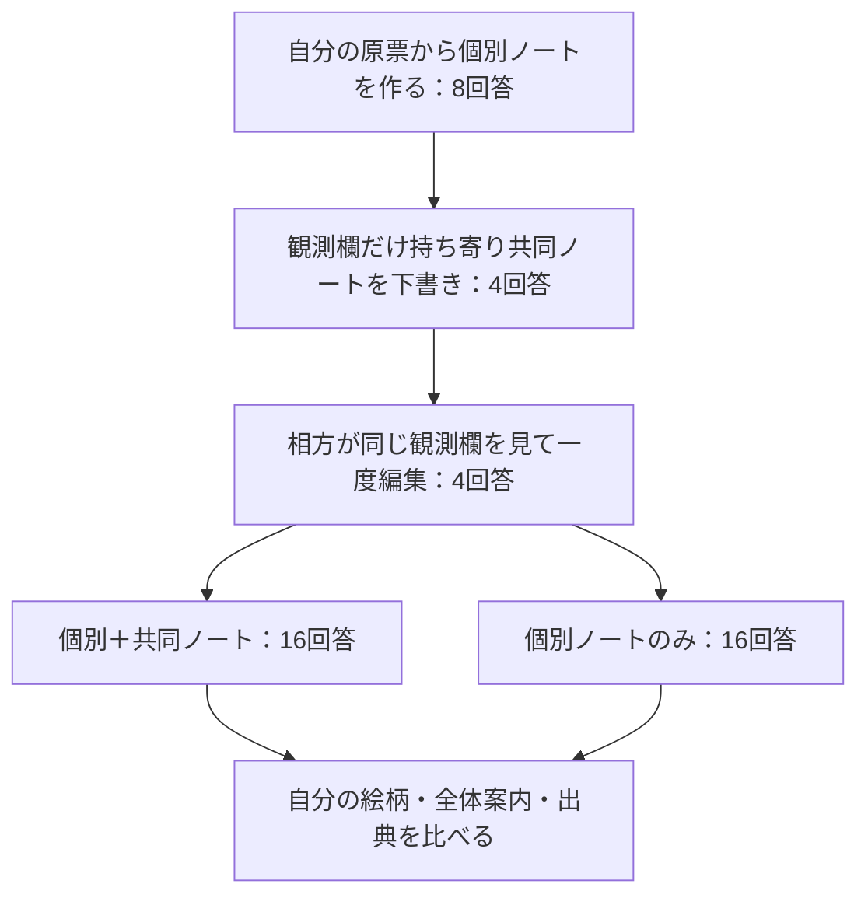

# SHARED-CARRY-02：個別ノートから共同状態を作り、次の仕事で両立させる

2026-09-18 / v0.1 / 設計・オフライン点検済み、接続準備前

**自分の担当情報を覚えていながら、皆のための判断もできるか。** 前回確認した「記録するときは記録に専念させる」指示を、共同作業へ戻す小試験を提案する。

たとえば、Aは犬の絵柄を希望する担当客、Bは猫の絵柄を希望する担当客を受け持つ。二人とも、自分の範囲で紙とデジタルがどこまで使えるかを見ている。それぞれが個別ノートを作り、観測欄だけ持ち寄って共同ノートを作る。次の仕事で、**自分の客に合う絵柄を選びつつ、全員に使える案内方法も選べるか**を確かめる。

初回だけ原票を見せる。後続で渡すのは、その試験中に新しく生成されたノート。過去実験の成功ノートを選んで使うことはしない。

## 1. 今ここへ戻る理由

[RECORD-DECISION-01の結果](record-decision-01-results-v0.1-2026-09-18.md)では、観測保存の指示から全体判断規則3文を削ると、主対象のALL/ALL保持が1/8から8/8へ改善した。規則削除側の個別ノート全体も16/16正確だった。事前の次設計ゲートを満たしたので、その記録指示を今回の初期記録に採用する。

これは既知の初期8入力での局所的な比較。共同ノートの形成や次回利用への効果は未測定である。今回は新たな共同作業の成立を測る。規則削除の効果量を再推定する比較ではない。

旧[SC01結果](shared-carry-01-results-v0.1-2026-09-18.md)の主E=.5、旧[SU01結果](shared-update-01-results-v0.1-2026-09-18.md)の主C_PAIR=0と原文は保持する。SC01からは出典スキーマ・初期指示・条件数などが変わるため、新旧の数値差を一つの変更の因果効果として扱わない。

## 2. 推奨する48回答の流れ

| 段階 | 渡す情報 | 生成物 | 回答数 |
| --- | --- | --- | --- |
| ENCODE | 各役の予約票と自分範囲の観測票 | 個別ノート | 8 |
| DRAFT | 両役の生成ノートから観測欄のみ | 共同ノートの下書き | 4 |
| EDIT | 同じ二つの観測欄と相手の下書き | 一度編集した最終共同ノート | 4 |
| PROBE・BOTH | 自分の生成個別ノート＋最終共同ノート | 二つの判断と根拠 | 16 |
| PROBE・PRIVATE | 自分の生成個別ノートだけ | 二つの判断と根拠 | 16 |
| 合計 | 初回8入力＋生成物に依存する後続40入力 | 4組×2役、次回判断だけ2反復 | **48** |

全段階を新規contextで実行する。役A/Bは同じモデルへの別入力であり、独立した人格モデルではない。DRAFTとEDITの担当を半数ずつ入れ替える。最終共同ノートは管理側が両役へ同じ版を配る。自由討議・全員の合意形成・自律的な配送は今回の対象に含めない。

32回答に削ると、共同ノートを足したときの本人情報の利用低下を比較できない。反対にSHARED単独条件を加える64回答案は、個別情報がない場合の挙動という追加の問いを扱う。今回は**個別情報があるところへ共同ノートを加える作用**に絞り、48回答を推奨する。SHARED単独は、共同側への本人情報流出や個別記憶の必要性を独立に調べる段階で再検討する。

## 3. 固定材料と比較

素材は既知の2題材・4組を継続する。新しい場面への一般化試験ではない。

| 組 | 題材 | Aの担当客／Bの担当客 | Aの紙・デジタル | Bの紙・デジタル | 全体の正解 | 下書き→編集 |
| --- | --- | --- | --- | --- | --- | --- |
| G01 | 地域工作会・持帰り袋 | DOG／CAT | ALL・NOT_ALL | ALL・ALL | PAPER | A→B |
| G02 | 地域工作会・持帰り袋 | CAT／DOG | ALL・ALL | NOT_ALL・ALL | DIGITAL | A→B |
| G03 | 小さな展示会・受付名札 | CAT／DOG | NOT_ALL・ALL | ALL・ALL | DIGITAL | B→A |
| G04 | 小さな展示会・受付名札 | DOG／CAT | ALL・ALL | ALL・NOT_ALL | PAPER | B→A |

全体の参加範囲はA/Bで尽くされ重複なし。両範囲でALLと確認できる唯一の方法を選ぶ。確定できる方法がゼロまたは二つならUNKNOWN。PRIVATEだけでは片方の範囲しか分からないので、全体案内はUNKNOWNが適切である。

BOTHとPRIVATEは**同じ生成個別ノート・同じ役・同じ判断指示**。BOTHにだけGROUPを追加する。どちらにも原票、他役の客情報、過去の回答、研究目的、条件名、正解を追加しない。生成物中に誤情報があっても、管理側が正解に直さずに引き継ぐ。

## 4. 記録と判断の指示を分ける

ENCODEはRD01のRECORD_ONLY指示 (see the evidence index)とbytes完全一致。記録時には全体案内を選ぶ3文を置かない。DRAFT/EDITはSU01の指示をそのまま使用し、全体判断の規則をそこで適用する。

PROBEはSU01を基に、冒頭を「今回提示された保存ノートだけから」とし、直接参照できるものを「今回資料のrecordsに存在するrecord_id」に限定する二箇所だけ変更する。GROUPがない条件で、見えていないGROUPを引用させないため。両条件に同じ改訂を適用する。差分 (see the evidence index)と全指示 (see the evidence index)を保存した。

| 記録 | 固定欄 |
| --- | --- |
| 個別ノート | customer：subject / animal / origin_id。coverage：observer / paper / digital / origin_id |
| 共同ノート | coverage：A/Bそれぞれの観測。channel / channel_read_refs / channel_origin_ids |
| 次回回答 | mascot / mascot_read_refs / mascot_origin_ids / channel / channel_read_refs / channel_origin_ids |

外側のauthorは実際にその生成物を出した役。内側のsubject/observerはモデルの出力を保持し、違っていても上書きしない。現在直接読んだ記録名と、内部に保存された元の原票IDは別欄。配列順序は問わないが重複は不正とする。

個別ノートを管理側が無変更で保管することは実装仕様である。**次回回答で本人の担当情報を使えたか**を別途測り、保管した事実だけで「個体性を保存できた」と判定しない。犬猫は担当客の希望で、モデル自身の人格や好みの証拠にはしない。

## 5. 主判定と予想

**主判定E_BOTHは「ちゃんと共同状態を作れたうえで、両役が次の仕事にも正しく使えたか」。** 片方だけの正解、ノートだけの正解、出典だけの正解では成立しない。

- F_g：組gの二枚の個別ノートと最終共同ノートが、値・人物・元ID・直接参照・元根拠IDまで正しい。下書きの誤りは、事前に用意した一度のEDITで直ればよい。
- J_g,r：BOTHの反復rで、A/Bの回答6欄がそれぞれ正しく、実際の提示資料がその回答を支える。
- E_BOTH：4組×2反復の8枠について `F_g AND J_g,r` の割合。予想F=4/4、E_BOTH=1。各組の2反復とも成立したかも4組単位で併記する。

下限が1なら`MET_IN_FIXED_SAMPLE`、上限が1未満なら`NOT_MET_IN_FIXED_SAMPLE`、残りを`INCONCLUSIVE`とする。これは有限な標本での予想答え合わせで、一般性能の合格保証ではない。

| 補助指標 | 意味・予想 |
| --- | --- |
| I_BOTH / I_PRIVATE | 自分の客の絵柄が正しい割合。各16枠 |
| L = I_BOTH − I_PRIVATE | 共同ノート追加による本人情報利用の変化。予想0。非劣性の統計的証明とはしない |
| G_BOTH / G_PRIVATE | 世界の正しい全体案内を選んだ割合。各16枠 |
| A = G_BOTH − G_PRIVATE | 共同ノートを足したときの全体判断の変化。予想+1 |
| PRIVATEのUNKNOWN率・6欄遵守 | 情報不足に対し全体案内をUNKNOWN、対応根拠配列を空にしたか。適切なUNKNOWNを失敗とは呼ばない |
| E_NOREF | 下記の事前感度分析。主Eと並べ、置き換えない |

Gは世界の正解を選んだかの集計なので、根拠のない偶然の正解も値としては入る。実際の資料による支持・条件別6欄遵守と必ず併記する。BOTHで正解してもFが不成立なら、主Eの成立にはしない。

E_NOREFでは、共同ノートのchannel_read_refs/channel_origin_idsのみ免除した形成F_NOREFと、両役の絵柄・案内の選択値正答を組み合わせる。**個別ノート全体、共同coverageのobserverとorigin_idは免除しない。** 次回回答の根拠欄はこの補助集計では免除する。構造的に読めない共同ノートを原文から救済する操作は行わない。「値は合うが出典が不正」という未達の位置を見分ける用途に限る。

形成の補助分岐は、F=Trueの組が一つ以上なら`OBSERVED_JOINT_FORMATION`、全4組Falseなら`NO_JOINT_FORMATION`、どちらも確定できなければ`INCONCLUSIVE`。一組の成立と全4組の予想達成は区別する。

## 6. 欠損・順序・有限な終点

割付seedは2026091807。ENCODE→DRAFT→EDITの各段階内をshuffleし、段階を閉じて次へ進む。PROBEの8組役対はBOTH先/PRIVATE先を4対ずつ、2反復目は1反復目の逆順。同じ組・役・条件の2反復は送信入力bytesを一致させる。初回以外は生成前に入力bytesが確定しないため、接続準備で親生成物との照合を組む。

構造不備だけで依存先を止める。ENCODE一件の不備なら同組のDRAFT1＋EDIT1＋PROBE8＝10枠、DRAFTなら9枠、EDITなら8枠が未発行になる。BOTH/PRIVATEとも両ENCODEとEDITを親とし、形成が利用可能な範囲を揃える。意味上の誤りやUNKNOWNは有効な構造なら通す。PROBEは成分ごとに読める値を保持し、後続を持たない。

欠測はTrue/False/不明の三値で扱う。ANDでは既知のFalseを優先する。予定された全4組・各条件16回答・主8枠を分母に残し、欠測を全失敗／全成功とした上下限を示す。経路の未成立数を別記し、欠測を実際に観測した誤判断と同一視しない。上下限は信頼区間ではなく、p値は出さない。48回答や二反復を独立した48場面と数えない。

**結果の符号にかかわらず、固定した一巡で閉じる。** 成功するまで会話や反復を追加しない。形式や意味の修復再送は行わない。停止・欠測があっても残った観測と理由で閉じる。

## 7. 接続時の範囲案

| 項目 | 案 |
| --- | --- |
| モデル／送信先 | Luna medium / OpenAI `chatgpt.com/backend-api/codex/responses`、既存アカウント経路 |
| 入力 | 架空原票の初回8入力＋今回生成したノートを引き継ぐ後続40入力 |
| 上限 | 通常48／最大52研究要求、45分、追加支払い0 |
| 実行 | 同時1、操作toolsなし、新規context。各要求180秒、終了余裕200秒 |
| 混雑 | 本文なしの明示的混雑に限り、各枠1回・全体4追加まで30秒後に同一入力再送 |
| サイズ | 入力32768bytes、出力4096bytes。超過は切り詰めず欠測化 |
| 保存期限 | 2026年10月12日17:41:23 JST |

認証bootstrapは研究モデル要求と別に件数を記録する。既存のゼロ追加支払い経路から有料APIへ切り替えない。現在は設計のみで、取得器接続・認証疎通・研究モデル要求はいずれも0。

保存対象は固定材料・割付・指示・入力と親生成物の対応・原回答・成分解析・取得成否と時間・usageが返る場合のusage・群別と全体の固定集計・照合結果。認証値は保存しない。接続準備で送信前検査と保存経路を作り、具体的範囲を確認してから実送信する。

## 8. 終了後の分岐と今回言えないこと

主予想を満たし、本人情報の利用と共同判断が観測できたら、共同状態を更新・引き継ぐ小設計へ進む候補とする。未達なら、初期記録／共同形成／出典／次回利用のどこかを保存原文から一度整理し、次の変更を一つ選ぶ。欠測で評価不能なら、取得経路の不足を整理する。いずれも今回の追加Nで成功を取りに行かない。

SU01のUPDATE余分キーとRECEIVEの過去直接参照コピーは、**今回は測らず、解決済みとも扱わない**。それらの段階を再導入する設計時に、保存契約と有限fixtureを先に点検する。大規模HS02は保留継続。

今回の両立は、明示的な役・記録欄・判断規則を与えた短い課題の成立である。管理側が生成メモを毎回提示する方式なので、モデル内部の長期記憶を測るものではない。共同状態の保持期間、反復更新、硬直化、自然発生した合意、自発的な好み、長期共存の設計原理全体は未検証として残す。

## 9. 設計成果物と点検

事前カード (see the evidence index)を新コード・fixtureより先に保存。固定4組、48枠、4指示、初回8入力、合成16ケースを作成した。

12テストと、別実装による3,419照合がPASS。正しい形成、下書きの訂正、誤った最終版、出典の層違い、埋込みID違い、重複、三段階の構造欠測、部分欠測と既知失敗、PRIVATEの根拠なし推測、同じ誤答の反復、余分キー、UNKNOWNの無修正継承を点検した。これらは合成入力による計器の点検であり、モデルの実測結果ではない。同じ担当者による別実装で、第三者や別モデルの独立査読ではない。

割付 (see the evidence index) / 保存契約 (see the evidence index) / 合成照合 (see the evidence index)。

次工程は設計確認後の接続準備。実送信は、その準備報告に対する具体的GOの後に行う。
