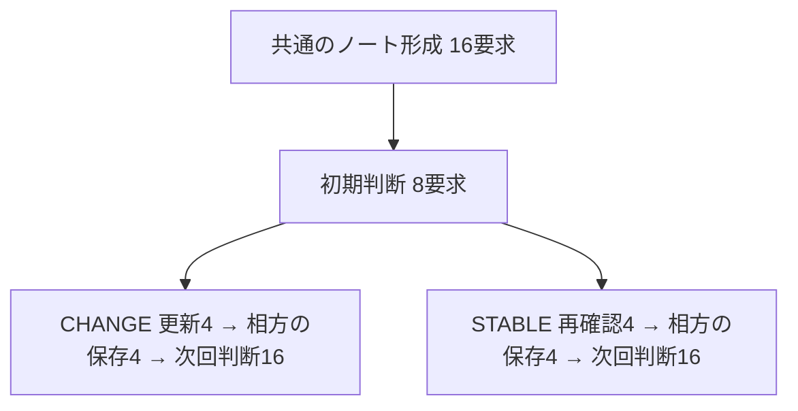

# SHARED-UPDATE-01 — 個別情報を保った共同状態の更新・引継ぎ

2026-09-18 / 設計案 v0.1 / **DESIGN_DRAFT_OFFLINE_CHECKED**

**共同の事情が変わったとき、各自の担当情報を守ったまま、二人とも新しい方針へ移れるか。** 通知を片方だけに渡し、生成した共同ノートを相方へ届け、その後はそれぞれが保存したノートだけで判断させる。変更がある場合と、従来どおりと再確認する場合を比べる。

推奨は**4組・二役、通常72要求の小試験**。今回完了したのは設計・材料・合成点検・記帳。研究モデル／認証要求0、取得器への接続なし。実測は後の接続準備と具体的な送信範囲へのGO後に行う。

## 1. 文系向けに、何を試すか

受付担当Aのお客さんは犬、Bのお客さんは猫の絵柄を希望している。二人の共同ノートでは「紙の案内なら全員に届く」となっている。

ここでAだけに、自分の担当範囲について「今は紙だと届かない人がいる。デジタルなら全員に届く」という正式な新情報が届く。Bの担当範囲では、もともと両方法が全員に届いている。Aが共同ノートを更新し、Bへ渡す。その後、AもBも自分で保存したノートを読んで次の受付を判断する。

| 対象 | 期待すること |
| --- | --- |
| Aの担当客 | 犬の希望を保持 |
| Bの担当客 | 猫の希望を保持 |
| 二人の共同方針 | 紙からデジタルへ更新 |
| 二人がそれぞれ保存した共同ノート | 最新の観測・方針・根拠を保持 |

比較側では「再確認したが到達状況は変わっていない」という通知を同じ手順で渡す。この側は案内方法を保持する。両側とも新しい観測票なので、値が同じでも観測票IDは新しいものへ更新する。

## 2. SC01から引き継ぐこと・今回加えること

[SC01の結果](shared-carry-01-results-v0.1-2026-09-18.md)では、個別＋共同ノートからの次回判断は16/16で成立した。一方、2組の共同ノートで原観測IDの欄に直接カード名が残り、形成F=2/4・主E=.5だった。個別のみでは情報があるのにUNKNOWNとした1回答もあった。

今回加えるのは、一回の正式な観測更新と、一方向のノート引継ぎ。ノートは新しく生成する。旧SC01のノートを正答に直して再投入したり、旧成績を新基準で救済したりしない。

同じ二題材・犬猫・紙／デジタルという既知の課題構造を使うため、新領域への一般化や未見問題の独立再現とはしない。個別性の操作対象は役ごとの担当客情報であり、自発的な人格・価値観の形成ではない。

## 3. 出典欄は二層を分ける

今回の直接参照は`*_read_refs`、元資料のIDは`origin_id`／`*_origin_ids`に保存する。例えば、二人の観測カードを読み共同ノートを作る場面なら、直接参照は`OBS_A, OBS_B`、原観測IDはカード内部にある`SZ, FU`という別々の欄になる。

この二層は**モデルが書く**。運転側が正しいIDへ変換・補完して成功させない。未知ID・重複・層の取り違えは意味上の不適合として記録し、構造が有効なら次へ渡す。欄名変更だけで問題が解消するとは仮定せず、出典の成績を別に残す。

共有用に個別ノートのcoverageを抜き出し、外側のレコード名・生成した役・配送先を付ける支援は残す。ノート本文の人物や値、出典は真値で訂正しない。共同ノート内のread_refsは、その版を作った時の参照記録。次回に直接読めるPRIVATE/GROUPとは区別する。

以前の誤記4原文（正常2・不適合2）を出典二層の局在記録 (see the evidence index)へ読み取り専用で整理した。これで今回の事前整理を区切る。出典欄だけの新規LLM比較は追加しない。

## 4. 固定する4組と二つの仮想世界

| 組 | 題材 | Aの担当客 | Bの担当客 | 初期の全体案内 | 通知受領役 | 相方 | CHANGEの全体案内 |
| --- | --- | --- | --- | --- | --- | --- | --- |
| G01 | 工作会 | 犬 | 猫 | 紙 | A | B | デジタル |
| G02 | 工作会 | 猫 | 犬 | デジタル | B | A | 紙 |
| G03 | 展示会 | 猫 | 犬 | デジタル | A | B | 紙 |
| G04 | 展示会 | 犬 | 猫 | 紙 | B | A | デジタル |

相方の担当範囲は初期から両方法ALL。通知受領役の範囲は初期に一方法ALL・他方法NOT_ALL。CHANGEではその二値を反転し、STABLEでは維持する。通知は受領役だけの範囲を対象にし、相方の原観測や担当客の希望を含めない。

共通の初期状態からCHANGE/STABLEへ分岐。二枝の通知は同じ書式・同じ新観測IDを持ち、paper/digitalの値だけが異なる。二枝は独立した仮想世界であり、同じIDでも条件間の通信や回答の共有はしない。条件名・正答・採点結果はモデル入力へ渡さない。

両条件とも「最新の正式な再確認で、古い同じ範囲の観測に置き換わる」と教える。古い通知の遅配、日付の競合、嘘の知らせは今回の問いに含めない。通知受領役・犬猫・案内方向は釣合いを取るが、4組で全要因は直交しておらず、役や題材の個別効果は推定しない。

## 5. 工程と入力の所在

| 段階 | モデルに渡すもの | 保存するもの | 要求数 |
| --- | --- | --- | ---: |
| ENCODE | 自分の元予約票・元観測票 | 個別ノート | 8 |
| DRAFT | 両役の生成coverageだけ | 共同ノート下書き | 4 |
| EDIT | 同じcoverage＋相手の下書き | 初期共同ノート | 4 |
| BASE | 自分の個別＋初期共同ノート | 初期判断。後続へは渡さない | 8 |
| UPDATE | 受領役の個別＋初期共同＋新通知 | 受領役の個別ノートと共同版 | 8 |
| RECEIVE | 相方の個別＋初期共同＋送られた共同版 | 相方の個別ノートと共同版 | 8 |
| PROBE | それぞれが自分で保存した個別＋共同版 | 次回判断、同入力で各2回 | 32 |
| 合計 | 初回8＋生成物に依存する後続64 |  | **72** |

UPDATEでは、担当客を含む個別ノートもモデルに再記録させる。運転側が担当客を固定して個別保持を自明な成功にしない。受領役が誤った犬猫を書けば、その誤りを自分の次回入力にも渡す。

RECEIVEへ渡すのは受領役の共同版だけ。元通知、受領役の個別ノートや担当客の希望を相方へ回さない。相方には自分の担当客と自分範囲の観測を保持させ、共同状態を受け継がせる。

PROBEでは、受領役はUPDATEで作った自分の版、相方はRECEIVEで作った自分の版を使う。相方の編集を受領役へ自動反映しない。したがって「二人とも同じ最新版を保存した」は観測対象であり、配送プログラムが保証する条件ではない。原票・初期ノート・通知・以前の判断は最終入力へ再掲しない。

毎回新しい文脈で、保存JSONを明示的に再投入する。モデル内部の永続記憶は仮定しない。段階間に完了境界を置き、2回目のPROBEは1回目と同一入力・逆の取得順で呼ぶ。前のPROBE回答は見せない。これは更新を二度経験する試験ではなく、更新後の同じ入力に対する2反復。

## 6. 成功をどこで測るか

設計時カード (see the evidence index)を合成コードより先に保存した。主対象は**予定4組のうち、CHANGEとSTABLEの両方で全経路を通せた割合C_PAIR**。

| 構成要素 | 成立条件 |
| --- | --- |
| B：共通の初期状態 | 両個別・初期最終共同ノートが正確で、両役の初期判断・二層の参照も成立 |
| U：通知受領役の保存 | 自分の担当客を保持し、自分の最新観測・相方の不変観測・全体案内・二層の出典を正しく保存 |
| R：相方への引継ぎ | 相方の個別情報を保持し、現在の共同状態と二層の出典を保存 |
| J：次回利用 | 両役が自分の担当客と現在の全体案内を正しく選び、実際に渡したノートに対応する直接参照と原票IDを示す |

各枝のCはB・U・R・両反復のJが全て成立した時だけ1。主C_PAIRは同じ組の両枝Cが成立した時だけ1とし、その4組平均を取る。予想はC_PAIR=1、CHANGE/STABLEとも4/4。下書きの誤りは一度のEDITで直れば初期成立を妨げず、修正箇所を別記する。

保存物が誤っていても最後の回答が合う例、相方だけ更新できない例、同じ誤答で一致する例を見分けるため、B/U/R/Jと次を必須併記する。

- 内容だけのC_CONTENT：人物・犬猫・観測値・案内の正確さ。出典条件だけを外す。主成績の救済には使わない。
- 初期／最終の担当客I・全体案内G、受領役／相方別、UNKNOWNと二層の出典不適合。
- 二人の共同選択が一致した割合と、世界設定に対して正しかった割合。両方UNKNOWNや同じ誤答でも一致は起き得る。
- 同入力2反復の回答差、保存版の食い違い、構造不備と依存未発行。

副予想は、CHANGEで両役の全体案内が正しく反転し、STABLEで保持され、担当客は両枝とも維持されること。最終I/Gは各枝16/16を予想する。STABLEでも通知受領役の観測IDは新しくなるので、古いIDのままは出典保持の成功にしない。

主判定はC_PAIRの欠測下限が1ならMET_IN_FIXED_SAMPLE、上限が1未満ならNOT_MET_IN_FIXED_SAMPLE、他はINCONCLUSIVE。各枝Cと枝差も出す。4組×2枝や同入力反復を独立集団Nへ増やさず、p値・同等性・非劣性は認定しない。SC01とは書式・工程・主指標が異なるため、SC01の.5との数値比較を「改善効果」と呼ばない。

## 7. 固定JSON・欠測・停止

自由理由と採点LLMは使わない。個別ノートはcustomer/coverage、共同ノートは両coverage・channel・channel_read_refs・channel_origin_ids。確認回答はmascot/channelと、それぞれのread_refs/origin_idsの6欄。各欄の型・列挙値・余分キー・重複キーを検査する。

確認回答の成分は独立に保持し、参照欄だけがnullなら正しい選択まで消さない。UPDATE/RECEIVEも個別ノートと共同ノートを別に保持する。ただし後続に必要な二つのどちらかが構造不備なら、下表の範囲だけ依存未発行にする。

| 構造不備の場所 | 依存未発行にする後続枠 |
| --- | ---: |
| 一方のENCODE | 同組16枠 |
| DRAFT | 同組15枠 |
| EDIT | 同組14枠 |
| UPDATE | 同枝RECEIVE1＋PROBE4＝5枠 |
| RECEIVE | 同枝PROBE4枠 |
| BASE/PROBE | 後続の入力依存なし。その不備成分だけ未知 |

意味上の誤りでは継続し、運転側はノートを直さない。Bが意味上不成立でも二枝へ進む。他組・他枝は構造依存が成立する限り継続する。未発行をUNKNOWN回答や0へ置き換えない。予定4組を分母に残し、既知の失敗があれば失敗、全成立なら成立、他は未知とする。欠測の上下限は信頼区間ではない。

部分応答、timeout、未知の輸送不備、保存・封印・入力整合性異常は全体停止。意味／形式を直すための再送、成功群の選別、N追加、会話延長はしない。

## 8. 資源・送信境界の案

| 項目 | 案 |
| --- | --- |
| 通常／最大研究要求 | 72／76。採点モデル要求0 |
| 取得稼働 | 60分、残り200秒で新規発行停止 |
| モデル・経路 | Luna medium、既存OpenAI `chatgpt.com/backend-api/codex/responses`、toolsなし、新規文脈、同時1 |
| 再送 | 空の明示的混雑のみ同一bytes。全体追加4、各枠初回込み最大3試行、30/90秒待機 |
| 入出力上限 | 入力32768／出力4096 UTF-8 bytes |
| 支払い・保持 | 追加支払い0、ローカル期限2026-10-12 17:41:23 JST |

合成正常応答から作った72入力は計170,308 UTF-8 bytes、1件1,535〜3,309 bytes。token消費や実入力の確定値ではない。初回8の全文と動的組立規則を固定し、後続64の実本文は親生成物ができてから確定する。

モデル・CLI・認証・実通信の確認は今回行っていない。上記は設計値であり実送信承認ではない。接続準備では現在のCLIと既存送信器へ改めて結び付け、保存付きの合成一巡を行う。旧SC01の取得器を設定だけ変えて実走しない。

## 9. オフライン点検の結果

**19テスト、合成23ケース、別実装10,279照合がPASS。** 正常例、古い状態の維持、不要な反転、担当客の同一化、相方の古い保存版、観測者の誤記、参照二層の入替え、再確認での古いID残存、選択の誤答／保留、欄欠測、重複JSON、各段階の依存停止、既知誤りと欠測の同居を点検した。

最終入力がそれぞれの役の実際の保存版を使うこと、相方へ元通知・相手の担当客情報が漏れないこと、BASEが後続入力に使われないこと、二枝の初期状態が同じこと、同入力2反復の一致を確認した。出典欄の欠測でも選択を保持し、二人が同じ誤答をしたケースでは一致=1でも正答率が下がる。

別実装は生成・採点コードをimportせず、保存した合成原文からの主成績と入力への投影を照合した。同じ担当による別実装であり、第三者／別モデルの独立査読ではない。全て人工的な応答であり、モデルで更新・引継ぎが成立した証拠ではない。実通信・ツール遮断・再送上限・SSE保存の実行器への接続は次工程に残る。

## 10. この試験の終点と保留棚

**推奨はこの72要求案。** 変更と再確認の両方を見て、初期不備・更新失敗・引継ぎ失敗・読取りの揺れを分ける。符号や合否にかかわらず一巡で閉じる。

| 保留する案 | コスト・弱点／再検討条件 |
| --- | --- |
| 最終確認1反復の56要求案 | 16要求節約できるが、SC01で出た同入力の揺れを今回観測できない。次の予算判断で反復を省く目的を明示できた時に再検討 |
| 出典二層だけの比較 | モデルの自力の出典継承が主題になった時に別設計。今回は欄を分け、失敗もそのまま評価 |
| 自律的な共有範囲の選択 | 何を送るかを主体が選ぶ能力を問う時。今はcoverageだけを運転側が送る |
| 無通知対照、多回更新、多人数 | それぞれ無入力時の安定・長期化・規模効果を主題に選んだ時。今回へ追加しない |

主予想が成立すれば、明示手順下で一回の更新と個別保持が両立したと閉じる。未達なら、内容と出典、受領役と相方、保存と次回判断のどこに不備があるかを固定内訳で返す。欠測なら取得不足と意味上の不適合を分ける。HS02の大規模実測は保留継続。

材料 (see the evidence index) ／ 全72枠と依存 (see the evidence index) ／ 入力例 (see the evidence index) ／ 合成ケース一覧 (see the evidence index) ／ 別実装照合 (see the evidence index) ／ テスト記録 (see the evidence index)。

次は、設計確認後の接続準備。初期24の共通部分→二枝→役ごとの保存版→2反復を、保存原文・投影・送信bytesへ結び付けて点検する。今回の承認は設計であり、取得・実送信への承認には拡張しない。
