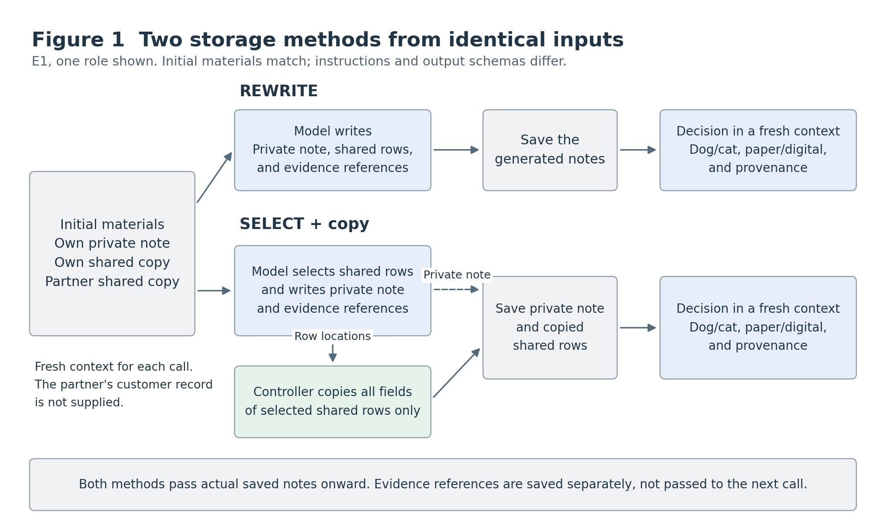
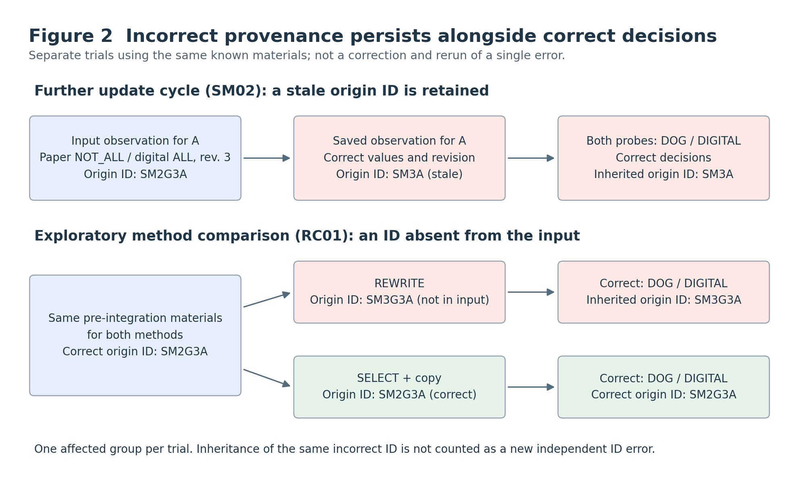
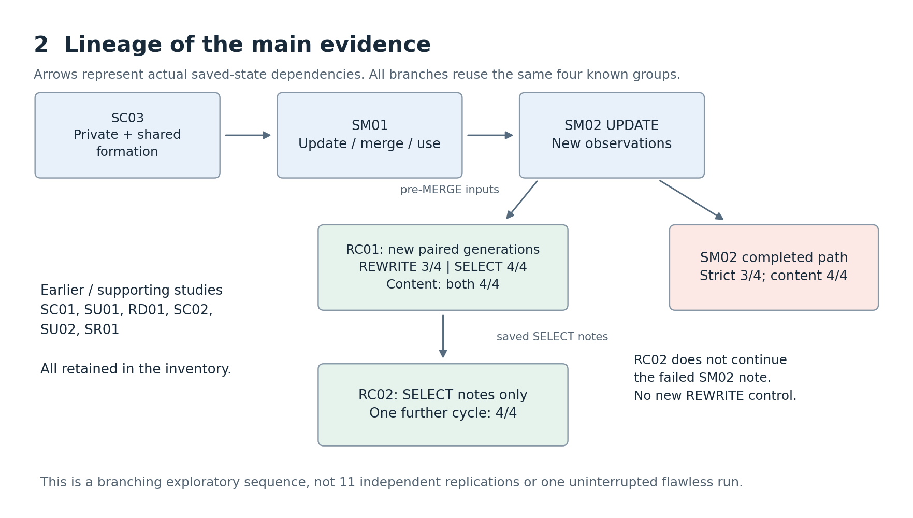
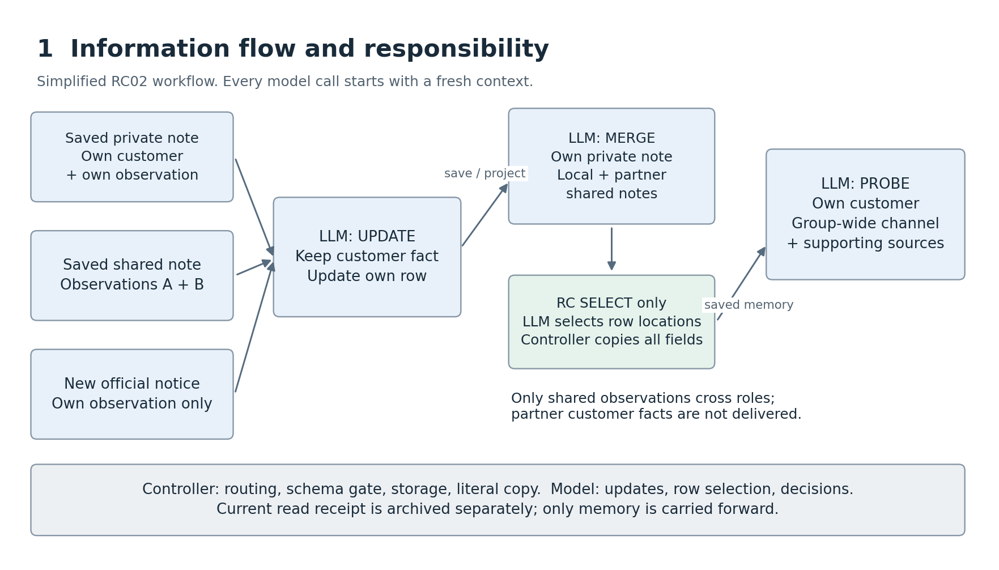

# Maintaining Role-Specific Information and Shared Records in LLM Memory Updates: An Exploratory Evaluation of Content, Provenance, and Continued Use

**Kentaro Sato**  
Independent Researcher  
Contact: `info@metaclan.jp`

## Abstract

When LLM agents share records over successive tasks, can they preserve information specific to each role and its provenance? We ran the same LLM as two roles in separate contexts on synthetic tasks requiring each role to retain its assigned customer's dog-or-cat preference while combining both roles' observations to choose paper or digital guidance. Saved notes were passed to subsequent calls to evaluate decision correctness, content–provenance correspondence, and revocation: invalidating a previously recorded observation using its provenance.

Exploratory trials identified correct decisions accompanied by incorrect origin IDs that persisted into subsequent responses. We then compared model-based rewriting of shared observations with model-based row selection followed by deterministic copying, using 64 previously unused groups. Selection plus copying preserved all shared observation rows correctly, but both methods achieved end-to-end success in 59/64 groups, with one rewriting group unresolved. Conservative 95% intervals for selection plus copying minus rewriting were calculated for every completion of the unresolved outcome. Their envelope was −17.36 to 16.60 percentage points. End-to-end superiority was not established. The remaining failures under selection plus copying occurred in the generation of role-specific information and in subsequent readout.

A diagnostic experiment varied stored origin IDs and the information in revocation notices. Revocation was completed when the target could be identified; otherwise, the system preserved information and deferred resolution. Tracking each stage from storage to subsequent use distinguished provenance defects accompanying correct answers, local storage success from end-to-end outcomes, and appropriate revocation from appropriate deferral.

**Keywords:** LLM agents; shared memory; provenance; state updates; revocation; exploratory evaluation

## 1. Introduction

Agents working together over time need to use shared information while retaining facts specific to their respective roles. When new information arrives, they must update observations while preserving assigned facts for which there is no reason to change. Final-answer correctness alone cannot establish whether these requirements were satisfied together.

For example, role A serves a customer who prefers a dog design, while role B serves one who prefers a cat design. Each role checks whether paper or digital guidance reaches everyone in its assigned area. Choosing a common guidance channel requires both observations, but does not require the customers' preferences to become identical. Moreover, a correct channel choice does not establish that the record still identifies whose observation came from which source.

This study examines **where content–provenance correspondence is preserved or damaged as roles retain their assigned facts and combine observations into a joint decision**. We report an adaptive exploratory series that revised the storage contract, followed by a method comparison and a revocation diagnostic motivated by its observations.

**Table 1. Three layers of evaluation and the findings they reveal.** Section 3.4 provides a worked example; Section 5 gives denominators and uncertainty.

| Evaluation layer | Question | Observation |
| --- | --- | --- |
| Decision | Does the model produce a valid answer from saved notes? | Dog/cat and channel decisions could be correct despite provenance defects. |
| Record | Are persons, values, and revisions correctly associated with their sources? | Successful storage of shared observation rows could coexist with defects in role-specific information or subsequent readout. |
| Subsequent operation | Can the system use provenance to revoke information, or defer when the target is unidentified? | It revoked identifiable targets and preserved non-target information while deferring under insufficient information. |

Linking these layers to actual saved states and subsequent inputs makes it possible to evaluate both record defects behind correct answers and the appropriateness of deferral.

## 2. Related Work

External-memory architectures include MemGPT's management of context across memory tiers, G-Memory's three-layer graph of collective experience, and MIRIX's coordination of multiple memory types, updates, and retrieval. We focus on content–provenance correspondence when such records are updated, saved, and read as subsequent inputs. [MemGPT](https://arxiv.org/abs/2310.08560v2); [G-Memory](https://arxiv.org/html/2506.07398v2); [MIRIX](https://arxiv.org/html/2507.07957v1).

**Table 2. Connections to the processes and evaluation targets in related work.** The table covers the methods and experiments discussed here, rather than every feature of each system.

| Work | Mechanism or evaluation considered | Connection to this study |
| --- | --- | --- |
| [CoMem](https://arxiv.org/html/2609.15009v1) | Storage of individual experience, evaluation-based promotion to shared memory, and retrieval from both; evaluated on ALFWorld and PDDL | Separating role-specific assigned facts from shared observations and evaluating their preservation through storage and reuse |
| [MAP-Graph](https://arxiv.org/html/2608.10509v1) | Provenance graphs, permissions, trust, and action constraints evaluated on synthetic tasks | Tracing the association between generated observations and their origins from storage to subsequent responses |
| [Collaborative Memory, Sections 3–5](https://arxiv.org/html/2505.18279v1) | Immutable provenance identifying contributors, resources, and timestamps; dynamic access control; accuracy and resource-use evaluation under changes to sharing and permissions | Separating an observation's origin from its current supporting evidence; revoking observation validity rather than access permission |
| [Governed Shared Memory, Section 7.3](https://arxiv.org/html/2606.24535v1#S7.SS3) | Traversal of derivation chains with recorded parent IDs, evaluating ancestor reachability, writer identity, and depth | Examining the generation of content–provenance associations as well as the storage and retrieval of provenance |
| [AIM, Section 5.2](https://arxiv.org/html/2609.12320v1) | Exact operation matching alongside a state-aware measure that accounts for conditions such as targets not created upstream | Reporting strict and content-only outcomes together to distinguish provenance defects when content is correct |
| [PROV-DM](https://www.w3.org/TR/prov-dm/) | A data model distinguishing entities, activities, agents, derivation, and related relations | Representing observation origins and current supporting input documents in separate fields of a custom JSON format |
| [CaMeL](https://arxiv.org/abs/2503.18813v1) | Separation of control and data flow for trusted requests and untrusted data, with capability-based policy enforcement | Assigning separate responsibilities to the model and controller through input/output validation and storage operations |
| [Agentic Unlearning, Section 3](https://arxiv.org/html/2602.17692v2) | SBU addresses both parameters and persistent memory, combining dependency-based removal or invalidation with parameter updates | Retaining values and origins in external records as history while evaluating invalidation state and subsequent use |

In particular, **faithfully preserving recorded provenance and associating stored content with the correct provenance are distinct evaluation targets**. Comparison with the cited Governed Shared Memory experiment clarifies our focus on the connections among generation, storage, and subsequent use. If its category of *provenance collapse* is understood broadly as loss of traceability, the stale-ID associations and generation-time ID errors reported below identify specific locations of damage within that problem area. This mapping is our interpretation of that paper's classification. [Governed Shared Memory, Section 4](https://arxiv.org/html/2606.24535v1#S4).

## 3. Task and Memory System

### 3.1 Assigned facts and joint decisions

Each group comprises two roles, A and B. Each role has an assigned customer who prefers either a dog or a cat design. This preference is a fact to preserve when shared information changes. The exploratory scenarios involved take-home bags at a community craft workshop and reception name tags at an exhibition. The method comparison used new materials generated under the same task rules.

The two roles observe whether paper and digital guidance reach everyone in their respective areas. The areas are disjoint and collectively cover the whole population. An observation is recorded as ALL if a channel reaches everyone and NOT_ALL otherwise. If exactly one channel reaches everyone in both areas, it is selected for the group. If both or neither qualify, the decision is deferred as UNKNOWN. The model must also defer if the input lacks necessary information about the other area.

Both channels can reach everyone in a role's own area even when a unique group-wide choice cannot yet be made. Replacing both observation values with UNKNOWN at storage time loses information needed for a later decision. Appendix A.7 describes a supplementary experiment on this distinction between recording and deciding.

### 3.2 Records and evaluation terminology

Each role holds a private note and a local copy of the current shared note. The shared note contains both roles' observations. Before exchange, A's copy may contain A's new observation and B's old observation, while B's copy contains A's old observation and B's new observation.

**Table 3. Terms and corresponding record keys.** Evaluation criteria are distinguished from units of aggregation.

| Term | Record key or designation | Function |
| --- | --- | --- |
| Private note | `private_note` | Retains the role's assigned customer, observations, and provenance for that role's subsequent use |
| Shared note | `shared_note` | Stores A/B observations in each role's copy for exchange with the other role |
| Origin ID | `origin_id` | Identifies the source of an observation or assigned fact |
| Declared evidence references | `read_receipt` and related fields | Identifies current input documents supporting the adopted content; saved separately from the notes |
| Structural/reference validation | Structural/reference validation | Checks syntax, types, and the existence of referenced input documents |
| Strict evaluation | `strict` | Requires correct content, provenance, and support from the current input |
| Content-only evaluation | `content` | Retains person, value, revision, and decision requirements while omitting provenance, reference, and input-support requirements |

If an observation originally has ID X and arrives through a shared note, its origin ID remains X, whereas its immediate supporting document is the shared note. Declared evidence references are output claims; they do not measure internal attention or the actual reading process.

The evaluation units are observation rows, responses, and groups. In the method comparison, *end-to-end success* requires all four responses in a group—both roles' integration/storage responses and subsequent decision responses—to pass. Strict and content-only outcomes are reported at the same group level.

### 3.3 Responsibilities of the model and storage controller

Every model call uses a fresh context. The controller constructs subsequent inputs from notes that were actually saved. The model selects evidence and makes decisions; the controller handles delivery, structural/reference validation, storage, and condition-dependent row copying. Fixed-rule Python code scores persons, values, revisions, provenance, and decisions (Appendix C). Errors that remain structurally usable are saved and passed onward. If a structural defect prevents construction of a subsequent input, that dependent model call is not issued.

Under **rewriting (REWRITE)**, the model rewrites the persons, values, revisions, and origin IDs of shared observations. Under **selection plus copying (SELECT)**, it specifies row locations in the input, and the storage controller copies every field of each selected row. There are five candidates: one private observation row, two rows in the role's own shared copy, and two in its partner's shared copy. If the model selects an old row or a row belonging to the wrong person, that row is still saved. Private notes and declared evidence references are generated by the model under both methods.



**Figure 1. Workflow of the transcription-method comparison (E1).** Both methods receive the same initial materials and use their own saved notes for subsequent decisions. One role is shown; the other follows the same procedure. Deterministic copying applies to shared observation rows. The update stage used separately in the exploratory series is shown in Appendix A.

### 3.4 A worked example: correct decisions with defective provenance

The **truncated customer origin-ID example (E1-G49/B)** traces the same input through storage and subsequent use. The customer's input record was as follows. JSON excerpts show only the fields needed for the explanation.

```json
{"animal":"CAT","origin_id":"RAD9D1FEC60F1FA2","subject":"B"}
```

Rewriting preserved this record. Under selection plus copying, however, the model-generated customer field in the private note lost the final character of the origin ID:

```json
{"animal":"CAT","origin_id":"RAD9D1FEC60F1FA","subject":"B"}
```

**Table 4. Storage and subsequent decisions from the same input.** Both methods saved the shared observation rows correctly.

| Stage | Rewriting | Selection plus copying |
| --- | --- | --- |
| Input customer record | Cat; origin ID `RAD9D1FEC60F1FA2` | Same |
| Saved customer record | Cat; origin ID `RAD9D1FEC60F1FA2` | Cat; origin ID `RAD9D1FEC60F1FA` |
| Subsequent decision | Cat/paper; correct origin ID | Cat/paper; truncated origin ID inherited |

The subsequent SELECT response retained the following fields:

```json
{"decision":{"mascot":"CAT","channel":"PAPER"},"origin_ids":{"mascot":["RAD9D1FEC60F1FA"]}}
```

The latest observations indicated that paper reached everyone in both areas, while digital guidance did not. Cat/paper was therefore correct. The defect arose in an individual field outside the scope of deterministic copying and passed into the next response alongside a correct decision. Section 5.2 reports outcomes for the complete methods. [Supplement S2: worked examples](examples-v0.1-2026-09-23.md) links the excerpts to complete responses and saved states; its explanatory text is in Japanese.

## 4. Evaluation Methods

### 4.1 From exploratory trials to two additional experiments

The 11 earlier trials constituted an adaptive exploratory series using four known groups across two scenarios. Observed failures motivated revisions to the storage contract. Table 5 introduces the four studies central to the main text.

**Table 5. Studies discussed in the main text and their purposes.** Appendix A lists all 11 exploratory trials and their dependencies.

| Descriptive name | ID | Purpose |
| --- | --- | --- |
| A further update cycle | SM02 | Test preservation of assigned facts, observations, and provenance during continued updates to saved notes |
| Exploratory transcription-method comparison | RC01 | Compare rewriting with selection plus copying on the same four known groups |
| Transcription-method comparison on unused materials | E1 | Compare local storage and end-to-end outcomes on 64 new groups |
| Revocation diagnostic | E2 | Evaluate revocation and deferral under different origin IDs and notice information in eight separate cases |

An observation of a stale origin ID attached to correctly updated content motivated the exploratory transcription comparison. Appendix A documents the materials and rules fixed before each run, execution order, dependencies, and all outcomes.

RC01's pre-run prediction was selection plus copying minus rewriting ≥.25: an engineering prediction of at least one additional successful group among four known groups. After observing 3/4 versus 4/4 under a rule prohibiting further collection based on the sign of the difference, we designed E1 with unused materials and E2 with separate materials. Both plans were fixed before execution. [RC01 pre-run plan](../../docs/study2/row-carry-01-plan-v0.1-2026-09-19.md).

### 4.2 E1: a paired comparison on 64 unused groups

E1 evaluated both rewriting and selection plus copying on each of 64 newly generated groups. The material-generation seed was 2026092101. An 8-by-8 cross of scenario names and venue names varied customers, current and old observation values and revisions, and presentation order. We checked equivalence under A/B, paper/digital, and dog/cat reversals after excluding names and IDs, and excluded overlap with earlier materials and E2. Origin IDs consisted of `R` followed by 15 uppercase hexadecimal characters, without prefixes encoding role or revision.

Each group required eight responses: two methods × two roles × integration/storage and subsequent decision. There were 512 responses in total. Initial materials for the two methods were byte-identical. Each role's subsequent decision input was built from the notes it had actually integrated and saved. Deterministic copying in SELECT applied to shared observation rows; the model generated private notes, declared evidence references, and subsequent decisions under both methods. The allocation seed was 2026092102. Execution was divided into four blocks of 16 groups. Within each block, each method went first for eight groups, with the order reversed at the subsequent decision stage. Calls ran serially in fresh contexts.

The primary outcome was the proportion of groups in which all four integration/storage and subsequent decision responses, across both roles, satisfied requirements for persons, observation values, revisions, origin IDs, current references, input support, and subsequent decisions. We defined Δ as selection plus copying minus rewriting. The conjunction of all requirements was chosen to measure how often assigned information, shared records, and subsequent decisions succeeded together. If correct initial materials led to an incorrect saved record that was then faithfully read, the group still failed the end-to-end criterion.

To distinguish local storage performance, stage-specific components and content-only evaluation were specified as secondary outcomes before execution. Content-only evaluation retained person, value, revision, and decision requirements while omitting provenance and reference requirements. Aggregating the four shared rows at group level, breaking results down by scenario and venue, and describing output length were post hoc supplements (Appendix D). No additional significance tests were performed for secondary outcomes.

The pre-run directional prediction was Δ>0. We fixed in advance a two-sided exact McNemar test for complete data and the following interval procedure. We constructed 97.5% Clopper–Pearson intervals separately for the proportions of SELECT-only and REWRITE-only successes, then combined their lower and upper bounds to obtain a conservative 95% interval for the difference using Bonferroni coverage. With missing outcomes, we considered all completions consistent with known results. The minimum and maximum Δ give the missing-outcome bounds, while the envelope of the corresponding 95% intervals describes inferential uncertainty. Under missingness, the primary p-value is not calculated and the denominator remains 64 groups. Inference uses independent, identically distributed groups as a working assumption. [Pre-run design](../../docs/study2/paper-01-pair-plan-v0.1-2026-09-21.md).

The pre-run power calculation assumed N=64, no missingness, independent and identically distributed groups, and a two-sided exact McNemar test at α=.05. Power was 82.7% for a true difference of 20 percentage points with a discordance rate of .30, 66.8% for the same difference with discordance .40, and 23.6% for a difference of 10 points with discordance .30. The 20-point scenario represented a compromise between cost and detectable effect size and informed the fixed N. Pre-run budget and power estimates (see the evidence index).

### 4.3 E2: origin IDs crossed with notice information

E2 used eight cases that did not overlap with E1. It manipulated provenance in otherwise correct private and shared notes prepared by the study controller. The target observer was A in four cases and B in four. Across all copies of the target observation, its origin ID was set to the correct ID, an old source-record ID, or an ID absent from the source-record history. Persons, values, and revisions were held constant. Incorrect IDs did not collide with other valid rows or customer information. OLD and ABSENT were historical categories available to the analysis; the model received the current notes and notice.

Revocation notices came from a trusted issuer. An ID-only notice named the target origin ID; a detailed notice added the observer, revision, and paper/digital values to the same ID. The fixed contract prioritized an ID match. If that failed, the details had to uniquely identify an observation matching the observer, revision, and both values. All copies of an identified observation were invalidated while retaining their original values, revisions, and origin IDs as history. If the target could not be identified, all rows were preserved and the notice was recorded as unresolved.

The saved notes and revocation record were passed to the subsequent decision stage. A resolved revocation required an UNKNOWN/REVOKED channel outcome; an unresolved notice required UNKNOWN/PENDING. Evaluation also covered preservation of the customer's preference and provenance, active observations, the set of revoked observers, and unresolved notices.

The design comprised eight cases × three origin-ID conditions × two notice conditions × two roles × two stages, totaling 192 responses. Each condition retained a denominator of eight cases. Across both roles and stages, we separately counted (1) supported target resolution and completion, and (2) evidence-appropriate handling. Completion in all 8/8 correct-ID cases under each notice type was a gate for interpreting the diagnostic, and all six conditions were reported. No p-values were assigned to this small, fixed diagnostic.

Inability to complete revocation with an incorrect ID and an ID-only notice follows from the materials and matching contract. The empirical question in these conditions was whether the system would avoid guessing a target, preserve assigned information and non-target observations, and carry the unresolved state forward. Detailed notices used uniquely matching materials. Post hoc intervals were nominal 95% Clopper–Pearson intervals treating the eight cases in each cell as independent, identically distributed binomial trials; they were not simultaneous intervals for all six conditions.

### 4.4 Missingness, continuation after a stop, and verification

Each component was classified as success, failure, or unresolved. When aggregating a group's end-to-end outcome, a known failure took precedence over unresolved components. Missing-outcome bounds with fixed denominators were distinguished from inferential confidence intervals.

After one local validation stop, the original no-resumption rule was changed and the change documented before the remaining 63 responses were obtained. The original stop record was preserved, and the continuation was aggregated separately (Appendix A.8).

E1's malformed JSON response remained unresolved in the formal analysis. A post hoc analysis removing one extra brace from a derived copy is reported separately in Appendix E. Separate checking code verified raw responses, saved states, subsequent inputs, and hashes, and regenerated the main tables from saved responses (Appendix B).

## 5. Results

We report group or case counts first, followed by differences in proportions and their uncertainty. Table 6 distinguishes the interval types; Appendix D gives their calculation components.

**Table 6. Intervals used in this section.**

| Interval | Target and interpretation |
| --- | --- |
| Main-comparison interval | E1's conservative 95% interval for the method difference, calculated using the procedure fixed before execution and taking the envelope over all completions of unresolved outcomes; the same procedure applies to content-only evaluation |
| Supplementary component interval | A nominal 95% interval added post hoc after aggregating shared observation rows at group level |
| Revocation-diagnostic interval | A nominal 95% binomial interval added post hoc for the eight cases in each E2 condition; not simultaneous across the six conditions |

### 5.1 Exploration: provenance defects alongside correct decisions and in later responses

In the further-update exploration (SM02), end-to-end success was 4/4 groups under content-only evaluation and 3/4 under strict evaluation. In the **stale origin-ID example (G03/B)**, B correctly saved partner A's new values and revision 3 but retained the old origin ID `SM3A` instead of the new `SM2G3A`. Both subsequent decision responses correctly selected dog/digital and also inherited the old ID. [Exploratory results](../../docs/study2/shared-merge-02-results-v0.1-2026-09-19.md).

The exploratory transcription comparison (RC01) generated fresh responses under both methods from those pre-integration materials. Strict end-to-end success was 3/4 for rewriting and 4/4 for selection plus copying; both achieved 4/4 under content-only evaluation. In the **origin-ID-absent-from-input example (REWRITE G03/B)**, the model associated correct values, person, and revision with `SM3G3A` and carried that ID into a correct dog/digital decision. SELECT chose the row with the correct `SM2G3A` and copied all its fields. [Exploratory comparison results](../../docs/study2/row-carry-01-results-v0.1-2026-09-19.md).



**Figure 2. Provenance traces from two trials sharing known materials.** The further-update trial retained a stale origin ID; the exploratory transcription comparison generated an ID absent from the input. Both defects coexisted with correct content and subsequent decisions. These were distinct errors in separate trials, and the method difference was localized to one group.

### 5.2 E1: successful copying targets and failures in surrounding stages

**Both methods achieved end-to-end success in 59/64 groups.** Depending on the unresolved REWRITE group's outcome, the success counts would be equal or REWRITE would have one additional success. The main-comparison interval was −17.36 to 16.60 percentage points. End-to-end superiority of selection plus copying was not established.

At the stage level, all shared observation rows under SELECT passed strict evaluation. The defects in its five unsuccessful groups occurred in the generation of role-specific information or in subsequent readout. Table 7 places the copying target alongside the surrounding stages.

**Table 7. Stage-specific results under strict evaluation.** Rows, responses, and groups aggregate the same materials at different levels.

| Stage and evaluation target | Rewriting | Selection plus copying |
| --- | --- | --- |
| Integration/storage: shared observation rows | 253/256 rows | 256/256 rows |
| Integration/storage: assigned customer in private note | 128/128 records | 127/128 records |
| Integration/storage: own observation in private note | 128/128 records | 128/128 records |
| Subsequent decision: complete response | 124 successes, 3 failures, 1 unresolved / 128 responses | 123 successes, 5 failures / 128 responses |
| End-to-end: both roles and both stages | 59 successes, 4 failures, 1 unresolved / 64 groups | 59 successes, 5 failures / 64 groups |

Evaluation of shared rows included content, provenance, and support from the current input through declared evidence references. For example, one REWRITE group (G11) failed a reference requirement. These results therefore measure more than exact copying of selected rows. Aggregating the four shared rows across both roles gave 61/64 groups for REWRITE and 64/64 for SELECT: a difference of +4.69 percentage points, with a supplementary component interval of −5.87 to 14.44 points (Appendix D.2).

SELECT defects included an incorrectly saved and subsequently inherited customer origin ID (G49 in Section 3.4) and a truncated origin ID during readout of a correctly saved observation (G16/A). G03, G16, and G49 passed content-only evaluation, whereas G27 and G45 also failed the channel-decision requirement. The five groups and six responses are detailed in the [supplementary component audit](../../supplements/paper-01-e1-components/observations.json).

We also observed incorrect saved content affecting a later decision. One REWRITE role (G36/A) changed partner B's paper-coverage value from ALL to NOT_ALL during integration. Its subsequent decision deferred in accordance with that incorrect saved record. This distinguished inheritance of a storage defect from a defect newly introduced during readout. Raw-response and component inspection (see the evidence index).

**Table 8. Formal primary results and the content-only evaluation specified before execution, for the fixed 64 groups.** Differences are SELECT minus REWRITE. Missing-outcome bounds describe completions of unresolved results within these 64 groups; they are distinct from inferential confidence intervals.

| End-to-end criterion | Rewriting: success / failure / unresolved | Selection plus copying: success / failure / unresolved | Missing-outcome bounds for the difference | Main-comparison interval |
| --- | --- | --- | --- | --- |
| Strict, primary | 59 / 4 / 1 | 59 / 5 / 0 | −1.56 to 0.00 percentage points | −17.36 to 16.60 percentage points |
| Content-only | 60 / 3 / 1 | 62 / 2 / 0 | +1.56 to +3.13 percentage points | −11.35 to 16.38 percentage points |

Both methods succeeded in 54 groups; only REWRITE succeeded in five; only SELECT succeeded in four; and one group had an unresolved REWRITE outcome with a successful SELECT outcome. All 512 planned responses were obtained, but one final REWRITE response (G23/B) contained an extra `}`, leaving 511 structurally evaluable responses. Under the missingness rule fixed before execution, **the formal primary p-value was not calculated**. [Formal aggregate results](../../supplements/paper-01-pair-resume1-20260921/combined-analysis.json).

Appendix D reports interval components for each completion and breakdowns by scenario and venue. The post hoc one-brace correction is reported separately in Appendix E.

### 5.3 E2: completion and appropriate deferral

The revocation diagnostic produced 192 saved responses and 96 sets of post-revocation notes. Revocation was completed in every case under conditions that identified the target, and resolution was deferred in every case under conditions that did not. The requirements to preserve assigned customer information and non-target active observations and to carry the processing state forward were also satisfied.

**Table 9. Completion and deferral by stored provenance and notice information.** Every cell uses the same eight cases and combines both roles and both stages.

| Stored origin ID | Revocation notice | Completion | Evidence-appropriate handling | Subsequent state |
| --- | --- | ---: | ---: | --- |
| Correct ID | ID only | 8/8 | 8/8 | Revoked |
| Correct ID | With details | 8/8 | 8/8 | Revoked |
| Old ID | ID only | 0/8 | 8/8 | Pending |
| Old ID | With details | 8/8 | 8/8 | Revoked |
| ID absent from history | ID only | 0/8 | 8/8 | Pending |
| ID absent from history | With details | 8/8 | 8/8 | Revoked |

The correct-ID baseline passed with both notice types. Even with an incorrect stored ID, uniquely matching details led to invalidation of all copies of the target observation. With ID-only notices, the model preserved records instead of guessing a target to revoke. Evidence-appropriate handling was observed in 192/192 responses and 8/8 cases within each condition. [Continuation and combined results](../../docs/study2/paper-01-pair-resume1-results-2026-09-21.md).

For example, the subsequent response to an ID-only notice given notes containing an ID absent from history (G01/A) included:

```json
{"channel":"UNKNOWN","channel_status":"PENDING","revoked_observers":[],"pending_notice_ids":["R07D126D1015A6A8"]}
```

The channel decision was deferred, no observer was revoked, and the unresolved notice ID was retained. The complete response also preserved the customer and active observations. It was scored as incomplete but evidence-appropriate (Supplement S2).

The channel decision was UNKNOWN in every condition. Evaluating target identification, invalidation state, and unresolved notices separately distinguished completion from appropriate deferral. The revocation-diagnostic intervals were 63.06–100% for 8/8 and 0–36.94% for 0/8. The 0/8 completion result with an incorrect ID and an ID-only notice follows from the information and matching contract specified in Section 4.3.

## 6. Discussion

### 6.1 Evaluate content, provenance, and subsequent operations separately

The two exploratory examples and the customer origin-ID example in Section 3.4 showed that correct decisions can coexist with incorrect origin IDs, and that those defects can pass from saved states to subsequent responses. Linking raw responses, actual saved states, and subsequent inputs makes content correctness, content–provenance correspondence, and inheritance separately observable.

E2 examined a subsequent operation that uses provenance through a fixed diagnostic. It distinguished matching by a correct ID, matching by unique details, and deferral when the target remained unidentified, while checking preservation of assigned information and non-target observations. This separated whether sufficient information for completion was available from whether the operation was appropriate to the supplied evidence.

### 6.2 Inspect copying targets together with surrounding stages

Selection plus copying assigns row selection to the model and faithful copying of the selected row to the controller. RC01's 16/16 correct selections and 16/16 exact copies, and E1's 256/256 successful shared observation rows, are outcomes observed under this division of responsibility. In E1, defects in all five unsuccessful SELECT groups occurred outside the copying target—in individual fields or subsequent decisions. The evaluation thus identified both successful shared-row storage and remaining end-to-end failures.

This suggests three targets for design evaluation: the scope of copied information, generation outside that scope, and decisions that read the saved states. The small difference favoring SELECT under content-only evaluation did not persist under the primary criterion incorporating provenance and references, further motivating separate evaluation of these components. Because both intervals include zero, this breakdown supplies hypotheses for subsequent comparisons.

E1's upper bound, obtained using the interval procedure fixed before execution, was 16.60 percentage points, below the 25-point difference observed in the four earlier groups. Under the working model of independent, identically distributed groups, the results do not support extrapolating an average improvement of that magnitude to E1's materials. E1's own pre-run prediction was Δ>0; its comparison with the results is reported in Section 5.2.

### 6.3 Separate origins from current evidence to locate defects

Keeping origin IDs separate from declared evidence references helped identify which relationship failed. An exploratory case carrying forward old reference names mixed historical references with current direct references (Appendix A.7). The stale and input-absent origin IDs in Section 5.1 instead broke the association between saved content and its origin. E1 separately recorded customer origin-ID errors introduced at storage, errors introduced during readout of correctly saved observations, and missing or excessive evidence references.

This distinction clarifies whether to inspect the reference-field contract or the transcription of observation rows. A future isolated comparison could distinguish a reference contract requiring only support for adopted rows from one also requiring documents consulted for comparison.

### 6.4 Evaluate role-specific information and shared state through paired retention and update requirements

The task required A and B to retain their respective customer facts while selecting a common guidance channel from shared observations. Defining in advance which role-specific differences should remain and which decisions should agree after sharing made their coexistence evaluable at each stage.

E2 also tested preservation of assigned facts and active observations for which no change was warranted while a target observation was invalidated. Pairing retention and update requirements provides a basis for extending evaluation to inconsistent notices or repeated runs under the same contract for assigned facts and observations.

## 7. Limitations and Reproducibility

### Sample and statistical inference

The 11 earlier trials were adaptive exploration on four known groups in two scenarios. E1's 64 groups and E2's eight cases were fixed before execution, but were generated by shared rules and evaluated with one model. They were not random samples from multiple domains. Groups and cases are the inferential units; roles, rows, stages, or aggregation with earlier trials do not increase N. E1's intervals assume independent, identically distributed groups. Their conservatism does not necessarily accommodate dependence due to common templates or labels. Resolving small differences or establishing equivalence was outside the design's scope.

### Run-to-run variability

Each planned response in E1 and E2 was measured once. Observed discordance can include run-to-run variability, but this design cannot separately estimate within-material, within-method variation and heterogeneity in method differences across materials. A retry after a stop and repeated final decisions in parts of the exploratory series do not substitute for planned replication. Scenario- and venue-level breakdowns are descriptive (Appendix D).

### Operationalization and external validity

The measured information consisted of assigned customer preferences and guidance-coverage values expressed in a fixed vocabulary, rather than spontaneously formed personalities or values. We evaluated short trajectories using explicit revisions, self/other distinctions, controller-managed delivery, and external notes. Extension to practical settings requires evaluation with ambiguous descriptions, contradictions, multiple sources, larger histories, decision costs, more roles, and longer operation.

### Conditions of the revocation diagnostic

Notices were trusted, incorrect IDs did not collide with other rows, and details uniquely identified targets. Ambiguous details, details with no matching target, contradictory details, autonomous recovery, provenance authentication, adversarial inputs, and defenses against information leakage were not evaluated.

Nor were naturally occurring defects from the method comparison fed directly into E2. The Section 3.4 example concerned customer provenance, whereas E2 targeted guidance-coverage observations. Combining the method-comparison error rate with the diagnostic completion rate therefore cannot estimate operational loss. Intervals for conditions made unresolvable by design are not estimates of an unknown ability to resolve targets.

### Intervention and mechanism

The method comparison evaluated complete methods, including instructions, output formats, output amounts, and storage operations. Appendix D.7 reports output lengths, but the separate effects of these factors remain unidentified. Finding SELECT's remaining defects outside the copying target does not establish that copying causally moved failures to another stage.

The exploratory additions of shared information and changes to reference fields also changed multiple factors. They did not isolate the effects of shared formation, partner editing, or separation of declared references (Appendices A.4 and A.7). Effects of ID format and the internal mechanisms of ID errors were not measured (Appendix A.9).

### Execution environment and audit

The model configuration was `gpt-5.6-luna`, reasoning `medium`, no tools, fresh contexts, and serial execution through an authorized ChatGPT account route. This is the identifier used at submission, not a published set of fixed model weights. Generalization to other models and third-party regeneration of identical outputs have not been tested. E2 included a documented rule change and continuation after interruption (Appendix A.8). Development, execution, fixed-code scoring, and editorial auditing took place within the same project; independent third-party blinded rescoring was not performed.

### Reproduction resources and scope of comparison

A package regenerates the main tables from saved responses (Appendix B). This computational reproducibility is distinct from stability under rerunning the model. We compared methods and evaluation targets in related work; we did not perform direct performance comparisons, an exhaustive priority survey, or PROV-conformance testing. Publication status and declarations are given in Section 9.

## 8. Conclusion

This study **traced answer correctness, content–provenance correspondence, and subsequent operations using that correspondence from storage to the next input**. It identified correct content and decisions accompanied by incorrect origin IDs, with defects carried into subsequent responses.

In E1's comparison on unused materials, SELECT achieved strict success on 256/256 shared observation rows. Defects in its five unsuccessful end-to-end groups occurred in the generation of role-specific information or subsequent readout. Although an end-to-end method advantage was not established, the evaluation identified successful local storage alongside remaining challenges in surrounding stages. Under E2's fixed information conditions and matching contract, it distinguished completed revocation from appropriate deferral due to insufficient evidence, while evaluating preservation and subsequent use of assigned facts and non-target observations.

The coexistence of role-specific information and shared state can be examined by separately specifying facts to retain for each role, information to update jointly, its provenance, and subsequent operations. This report provides a single-model, synthetic-task case study that carries out this evaluation on actual saved states.

## 9. Ethics, Competing Interests, Author Contributions, and Data Availability

The materials comprise fictional customers and synthetic observations. Model outputs are experimental materials; no real customer records or human-participant responses were used. The author has yet to confirm the determination of whether ethics review was required and any review history.

LLM assistance was used in design, implementation, execution procedures, scoring rules and code, and writing. Responses from the model under study were scored by fixed Python code (Appendix C.2). Interpretation of examples and LLM reader feedback were separate from the process that produced formal outcome labels. Detailed author contributions, funding, and competing-interest declarations will be finalized by the author before public release.

Data and code have been assembled in a local reproduction package under the approved retention policy with no deletion deadline (Appendix B). This manuscript is intended for release as a preprint on Zenodo. The manuscript and reproduction materials remain unpublished; release scope, licenses, DOI, and a backup on separate media are not yet finalized. Authentication credentials, account identifiers, and raw communication headers are excluded from materials proposed for release.

## References

The versions below were checked on September 20–22, 2026. arXiv versions are distinguished from the W3C standard document. Conference and journal acceptance status was not comprehensively verified.

1. Chengxin Yu et al. (2026). [CoMem: Collective-Individual Memory Synergy for Evolutionary Multi-Agent Systems](https://arxiv.org/abs/2609.15009v1). arXiv:2609.15009v1.
2. Yiqi Wang et al. (2026). [MAP-Graph: Provenance-Aware Shared Memory for Multi-Agent Workflows](https://arxiv.org/abs/2608.10509v1). arXiv:2608.10509v1.
3. Yanki Margalit, Nurit Cohen-Inger, Erni Avram, Ran Taig, and Oded Margalit (2026). [Governed Shared Memory for Multi-Agent LLM Systems](https://arxiv.org/abs/2606.24535v1). arXiv:2606.24535v1.
4. Zachary Johnson et al. (2026). [AIM: A Privacy-Aware Interoperable Memory Framework for Multi-Agent Multi-User LLM Systems](https://arxiv.org/abs/2609.12320v1). arXiv:2609.12320v1.
5. W3C (2013). [PROV-DM: The PROV Data Model](https://www.w3.org/TR/prov-dm/). W3C Recommendation, 30 April 2013.
6. Alireza Rezazadeh et al. (2025). [Collaborative Memory: Multi-User Memory Sharing in LLM Agents with Dynamic Access Control](https://arxiv.org/abs/2505.18279v1). arXiv:2505.18279v1.
7. Guibin Zhang et al. (2025). [G-Memory: Tracing Hierarchical Memory for Multi-Agent Systems](https://arxiv.org/abs/2506.07398v2). arXiv:2506.07398v2.
8. Yu Wang and Xi Chen (2025). [MIRIX: Multi-Agent Memory System for LLM-Based Agents](https://arxiv.org/abs/2507.07957v1). arXiv:2507.07957v1.
9. Charles Packer et al. (2024; initial version 2023). [MemGPT: Towards LLMs as Operating Systems](https://arxiv.org/abs/2310.08560v2). arXiv:2310.08560v2.
10. Edoardo Debenedetti et al. (2025). [Defeating Prompt Injections by Design](https://arxiv.org/abs/2503.18813v1). arXiv:2503.18813v1.
11. Bin Wang et al. (2026). [Agentic Unlearning: When LLM Agent Meets Machine Unlearning](https://arxiv.org/abs/2602.17692v2). arXiv:2602.17692v2.

## Appendix A. Scope of the Included Trials

### A.1 Complete trial inventory

The first table lists the 11 earlier exploratory trials; the second lists the two additional experiments. These 13 studies constitute the report. Planned/executed counts refer to logical response slots and actual research API calls, not independent samples. Structural missingness and dependent calls not issued are listed separately. Square brackets denote missing-outcome bounds. MET and NOT_MET compare the fixed sample with the pre-run prediction; they do not indicate suitability for publication or acceptance of a method.

| ID and full name | Planned / executed | Structural missing / dependent calls not issued | Saved primary result | Sensitivity or supplementary result | Original designation |
| --- | ---: | ---: | --- | --- | --- |
| SC01 SHARED-CARRY-01 | 64 / 64 | 0 / 0 | E_BOTH=4/8 group–replicate combinations; formation 2/4 | E_VALUE=4/8; final BOTH decisions 16/16 | NOT_MET |
| SU01 SHARED-UPDATE-01 | 72 / 67 | 1 / 5 | C_PAIR=0/4 groups | Content C_PAIR=[0,.25] | NOT_MET |
| RD01 RECORD-DECISION-01 | 32 / 32 | 0 / 0 | ALL/ALL preservation: with decision rules 1/8; recording only 8/8 | Difference +.875; four source records × two repetitions per condition | LOCAL_POSITIVE |
| SC02 SHARED-CARRY-02 | 48 / 12 | 4 / 36 | E_BOTH=[0,1]; formation F=[0,1] | E_NOREF=[0,1] | INCONCLUSIVE |
| SC03 SHARED-CARRY-03 | 48 / 48 | 0 / 0 | E_BOTH=8/8 group–replicate combinations; formation 4/4 | E_NOREF=8/8 | MET |
| SU02 SHARED-UPDATE-02 | 48 / 48 | 0 / 0 | C_PAIR=3/4 groups | Content-only 3/4 | NOT_MET |
| SR01 SHARED-RECENCY-01 | 32 / 32 | 0 / 0 | E_PAIR=0/4 groups across both orders | Content-only 4/4 | NOT_MET |
| SM01 SHARED-MERGE-01 | 32 / 32 | 0 / 0 | M_PAIR=4/4 groups | Content-only 4/4 | MET |
| SM02 SHARED-MERGE-02 | 32 / 32 | 0 / 0 | M_PAIR_2=3/4 groups | Content-only 4/4 | MET |
| RC01 ROW-CARRY-01 | 32 / 32 | 0 / 0 | M_END: REWRITE 3/4; SELECT 4/4 groups | Content-only 4/4 for both | MET |
| RC02 ROW-CARRY-02 | 24 / 24 | 0 / 0 | M_CONT=4/4 groups | Content-only 4/4 | MET |

SU02 predicted success in all four groups, whereas SM02 predicted at least 3/4; the same 3/4 result therefore received different original designations. We do not reclassify them under a common pass/fail threshold. SC02 could not be evaluated beyond its structural missingness. SC01's E_VALUE is not equivalent to the content-only criterion used later.

The collection and analysis scope of the additional experiments is shown below. E2's continuation and E1's post hoc sensitivity analysis do not add independent samples.

| Experiment | Planned responses / actual API calls | Responses, structure, and stops | Formal result |
| --- | ---: | --- | --- |
| E1 ROW-CARRY-CONFIRM-01 | 512 / 512 | 512 responses; 511 structurally valid; one malformed JSON response | 64 groups; REWRITE 59 successes, 4 failures, 1 unresolved; SELECT 59 successes, 5 failures; primary p-value not calculated |
| E2 PROVENANCE-REVOKE-01 | 192 / 193 | 129 initial responses plus 63 after authorized continuation; 192 structurally valid; one stopped attempt retained | Eight cases × six conditions; evidence-appropriate handling 8/8 in each; completion 0/8 for each incorrect-ID + ID_ONLY condition and 8/8 otherwise |

Together, the experiments involved 705 actual API calls, 704 response texts, and 703 structurally valid responses plus E1's one malformed JSON response. E2's additional block involved 63 calls over 14.15 minutes, bringing cumulative E2 time to 43.31 minutes. E1's post hoc reference analysis (Appendix E) issued zero new requests and did not replace the original response.

### A.2 Dependencies and decisions fixed before execution

The earlier exploratory series comprises SC01 through RC02. Within each trial, materials, instructions, planned response slots, scoring, missingness rules, resource limits, and stopping rules were fixed before live requests. The manuscript's organization and central claims were developed after observing these results. The 11 trials are therefore not treated as one preregistered confirmatory study. They form an adaptive exploratory series in which earlier failures informed later storage contracts.



**Figure A1. The main sequence based on actual saved states.** Both RC01 conditions generated fresh responses from the materials after SM02's UPDATE and before its MERGE. RC02 inherited RC01 SELECT's saved notes. This was neither a correction and rescoring of SM02's defect nor a third cycle continuing directly from SM02's failed notes. The tables in Appendix A include the 11 earlier trials containing this main sequence and the subsequently added E1 and E2.

SC03 allocated 48 responses: eight private records, four shared drafts, four partner edits, and 32 subsequent decisions. Decisions crossed private-only versus private-plus-shared input, both roles, and two repetitions. SM01 and SM02 each allocated 32 responses: eight updates, eight integrations, and 16 decisions, with only the final decision repeated twice on identical inputs. RC01 used four groups × two roles × two conditions × integration and decision, totaling 32 responses. RC02 used four groups × two roles × update, integration, and decision, totaling 24.

RC01 used the same initial materials for each role under both conditions and checked byte equality by hash. Condition order was balanced across roles and groups and reversed for subsequent decisions. Within-stage order used the fixed seed 2026091905. RC02 used seed 2026092001 and balanced LOCAL_GROUP/PARTNER_GROUP presentation order with two instances of each order per role. These procedures controlled execution order; they did not make the four groups random samples from a population.

RC01's directional prediction arose from SM02's retention of an old origin ID alongside new observation values and revision. Its pre-run plan left row selection to the model while replacing transcription of persons, values, revisions, and provenance with controller-side copying to prevent within-row mixing. Exact copying is a property of that mechanism, so the empirical question was whether the model could select the correct row, retain role-specific information, and support a correct subsequent decision. [RC01 pre-run plan, Sections 1 and 5](../../docs/study2/row-carry-01-plan-v0.1-2026-09-19.md).

The prediction was SELECT−REWRITE ≥.25, or at least one additional successful group among four known groups. This was a small-sample engineering prediction motivated by a known defect, not an estimated population effect of 25 percentage points or a probability expressing confidence. The plan explicitly required closure as NOT_MET even if both methods achieved 4/4 and the difference was zero, and prohibited further collection if the difference was negative. This local prediction is distinct from E1's later extension to unused materials.

### A.3 Success, content-only evaluation, and missingness

Evaluation of the main sequence checked the assigned customer, observer, observation values, revision, origin ID, current references, and whether the actual input supported the output. Intermediate saved states were evaluated alongside final decisions. Later primary outcomes were the proportion of groups whose two roles satisfied every required stage.

| Trial | Primary outcome unit and definition | Pre-run local prediction |
| --- | --- | --- |
| SC03 | `E_BOTH`: group–replicate combinations with successful shared formation and both roles' decisions and evidence under BOTH; four groups × two repetitions | Formation 4/4; E_BOTH=1; customer difference L=0; channel difference A=1 |
| SM01 | `M_PAIR`: groups in which both roles' UPDATE, MERGE, and two PROBE responses all pass / 4 | ≥.75 |
| SM02 | `M_PAIR_2`: groups satisfying the same end-to-end criterion in the second cycle / 4 | ≥.75 |
| RC01 | `M_END`: groups in which both roles' MERGE and PROBE responses—all four—pass under a method / 4 | SELECT−REWRITE ≥.25 |
| RC02 | `M_CONT`: groups in which both roles' UPDATE, MERGE, and PROBE responses—all six—pass / 4 | ≥.75 |

These thresholds were local predictions for small trials, not general reliability guarantees or power-based acceptance criteria. A trial whose prediction was met at 3/4 was not described as error-free.

From SM01 onward, content-only evaluation followed a rule fixed before execution: omit origin-ID, declared-reference, and input-support requirements while retaining persons, values, revisions, and final decisions. It did not replace the primary result. Earlier trials used different sensitivity definitions, so their original metric names are retained here. Primary and sensitivity results across all 11 trials are not averaged as if they shared one scale.

With missing data, the lower bound is the number of known successes divided by the fixed denominator; the upper bound adds unresolved outcomes to known successes. A group with a known failed component is a failure even if another response is unresolved. These are identification bounds due to missingness, not confidence intervals. Responses that never reached content evaluation because of structural defects are distinguished from responses with observed content errors.

### A.4 Observed coexistence of role-specific information and joint decisions

SC03 achieved shared formation in all four groups. `E_BOTH` was 8/8 group–replicate combinations, as was `E_NOREF`, which relaxed provenance requirements. With private notes alone, customer designs were correct in 16/16 responses and the group-wide channel was appropriately deferred in 16/16. With private plus shared notes, both customer and channel decisions were correct in 16/16. On these materials, adding shared information enabled a group-wide decision while preserving differences between assigned customers. [SC03 results](../../docs/study2/shared-carry-03-results-v0.1-2026-09-18.md).

Adding shared information also supplied information about the partner's area. The shared draft and edited JSON were identical in all four groups. The result establishes successful decisions using shared information; Section 7 discusses the inability to isolate shared formation or partner editing itself.

SM01 gave each role's SC03 saved notes its own new notice, integrated both new observations, and proceeded to subsequent decisions. Both the primary end-to-end outcome and content-only evaluation were 4/4 groups. The 16 saved note states and 16 final decisions met their respective fixed criteria. In these four groups, one integration cycle incorporated the partner's new observation while retaining the role's own new observation. [SM01 results](../../docs/study2/shared-merge-01-results-v0.1-2026-09-19.md).

### A.5 Rewriting versus copying complete selected rows

RC01 generated new REWRITE and SELECT responses from SM02's pre-integration materials. Strict end-to-end success was 3/4 groups for REWRITE and 4/4 for SELECT, a difference of .25. Content-only evaluation was 4/4 for both. [RC01 results](../../docs/study2/row-carry-01-results-v0.1-2026-09-19.md).

| Matched group | REWRITE end-to-end | SELECT end-to-end | Content-only evaluation |
| --- | --- | --- | --- |
| G01 | Success | Success | Both succeed |
| G02 | Success | Success | Both succeed |
| G03 | Provenance failure | Success | Both succeed |
| G04 | Success | Success | Both succeed |
| Total | 3/4 | 4/4 | 4/4 each |

| Target | REWRITE | SELECT |
| --- | ---: | ---: |
| Entire integrated note correct under strict evaluation | 7/8 | 8/8 |
| Shared observation rows correct under strict evaluation | 15/16 | 16/16 |
| Saved assigned facts and own observations | 8/8 | 8/8 |
| Final customer and channel decisions both correct | 8/8 | 8/8 |

REWRITE G03/B changed the correct origin ID `SM2G3A` to `SM3G3A`, which did not occur in the input. Values, person, and revision were correct, and the declared reference pointed to the appropriate partner document, but that document did not support the incorrect ID. The defect persisted into a correct DOG/DIGITAL decision. This differs from SM02's retention of the old `SM3A`.

Under SELECT, the model selected the latest row in 16/16 instances, and the controller's materialized row exactly matched the selected row in 16/16. The first is an observed model-selection outcome; the second verifies copying behavior. Exact copying is not counted as an additional improvement in model capability. The mechanism does not correct a wrongly selected row, and it can preserve an ID already miswritten during UPDATE.

The difference was localized to one group. The intervention jointly changed instructions, output schema, selection space, output amount, and storage processing, so it cannot identify the isolated effect of copying. No difference was observed in final decisions or retention of assigned facts in this comparison.

### A.6 One further cycle from SELECT's saved states

RC02 used the eight notes actually saved by the roles under RC01 SELECT and performed UPDATE→MERGE→PROBE once each. All 24 responses passed; both `M_CONT` and content-only evaluation were 4/4 groups. Both roles' observations advanced from revision 3 to revision 4. All four groups correctly chose the opposite channel from the preceding cycle while preserving customer dog/cat preferences. Latest-row selection and copying all fields of those rows each succeeded in 16/16 instances. [RC02 results](../../docs/study2/row-carry-02-results-v0.1-2026-09-20.md).

This was a continuation conditioned on known materials and successful SELECT saved states. Without a new REWRITE control, it is not a replication of a between-method difference. Each PROBE was also run only once, so this trial does not evaluate stability over repetitions of the same input.

### A.7 Early failures and supplementary diagnostics

SC01 achieved shared formation in 2/4 groups and end-to-end `E_BOTH` in 4/8 group–replicate combinations. Some groups failed provenance requirements during shared formation despite correct final BOTH decisions. In SU01, initial ALL/ALL observations were replaced with UNKNOWN/UNKNOWN and passed onward. Primary `C_PAIR` was 0/4, with one structurally missing response and five dependent calls not issued. Later successes do not overwrite these results. [SC01 results](../../docs/study2/shared-carry-01-results-v0.1-2026-09-18.md); [SU01 results](../../docs/study2/shared-update-01-results-v0.1-2026-09-18.md).

RD01 compared recording the same initial source records with and without three lines of group-decision rules in the instructions. For four ALL/ALL source records × two repetitions, correct observation preservation was 1/8 with the decision rules and 8/8 with recording-only instructions. For mixed-value source records, both conditions achieved 8/8. This offers local evidence for separating recording from decision instructions, but does not isolate instruction meaning, length, or allocation of attention. [RD01 results](../../docs/study2/record-decision-01-results-v0.1-2026-09-18.md).

SC02 executed 12 of 48 planned responses. Four shared drafts returned arrays instead of A/B objects, so 36 dependent calls were not issued. The primary outcome bounds were [0,1], yielding INCONCLUSIVE. This is neither a 0% content-success result nor a success obtained by converting arrays after the fact. [SC02 results](../../docs/study2/shared-carry-02-results-v0.1-2026-09-18.md).

SU02 achieved 3/4 groups under both primary and content-only evaluation, below its prediction of success in all groups. In G03's change condition, the partner with correct notes deferred the channel decision in one of two repetitions of the same input. SR01 varied the arrival order of old and new versions. Content-only success was 4/4 groups, while strict end-to-end success across both orders was 0/4. None of the final 16 decisions reverted to old content, but 10 of 16 saved states retained historical reference names in the current direct-reference field. This differs from confusing observers or corrupting observation values. [SU02 results](../../docs/study2/shared-update-02-results-v0.1-2026-09-19.md); [SR01 results](../../docs/study2/shared-recency-01-results-v0.1-2026-09-19.md).

### A.8 Interruption and continuation

The initial run saved all 512 E1 responses and 129 E2 responses. The next E2 request received an HTTP 200 and a completed provider response, but local output validation timed out at its two-second limit, triggering a stop under the fixed rule. The cause remains unidentified. After the stop report, the user authorized changing the original no-resumption rule. The stopped response slot and 62 unissued slots were then run. The stopped slot was retried once with byte-identical request content, while the original 129 responses and stop record were retained. Instructions, scoring, and the two-second validation limit remained unchanged during continuation. [Original stop report](../../docs/study2/paper-01-pair-results-2026-09-21.md); change record before continuation (see the evidence index).

All 63 continuation responses in E2 were structurally valid. Including the stopped attempt, E2 involved 193 model calls and the combined E1/E2 total was 705, with 704 saved responses. Planned responses, actual calls, and saved responses are recorded separately.

### A.9 Mechanistic distinctions and the earlier workflow

In SC03, adding shared information also increased information about the partner; drafts and edited records were identical in all four groups. The transition from SR01 to SM01 also changed multiple elements. Neither design isolated shared formation, partner editing, or separation of declared references.

E1's ID format was not randomly compared against the earlier format, and the internal mechanism of ID errors was not measured. SM02's UPDATE references were not passed to MERGE, so the study did not establish a causal path from those references to stale-ID retention.



**Figure A2. RC02's update, integration, and use workflow.** One role is shown; its partner follows the same process. Shared portions are exchanged, and MERGE uses selection and copying for shared observation rows. UPDATE, private notes, and declared evidence references are model-generated. Unlike E1 in Figure 1, this workflow includes an update stage and uses different comparison conditions.

## Appendix B. Evidence and Reproduction Resources

[Supplement S1: reproduction package](../../evidence/paper-01/README.md) provides a portable manuscript, figures, implementation supplement, materials, instructions, allocations, responses, saved states, subsequent inputs, scoring code, hashes, and computational reproduction. Figures and supplementary materials use relative paths in both this manuscript and the packaged version. The existing package contains the Japanese manuscript and supporting documentation; the English manuscript is a separate working edition.

The package contains 1,127 original responses. Frozen evaluators rescore 704 E1/E2 responses and 88 SM02/RC01/RC02 responses, totaling 792. The other eight trials contribute 335 responses preserved with their original evidence, saved aggregates, and frozen code. The 31 files containing the earlier scoring code and its local dependencies retain their original bytes. Formal and post hoc reference tables are regenerated separately from saved evidence, without issuing model requests with changed instructions or scoring.

**Retention and versions.** Explicit authorization on September 22, 2026 established local retention with no deletion deadline for the specified reproduction materials, ZIP, supplementary code, and repackagings of the same evidence. File lists and hashes are retained. The [current retention policy](../../evidence/paper-01/references/papers/paper-01/retention-policy-v0.1-2026-09-22.md) supersedes the old October 12 deadline remaining in original configurations. This exception does not encompass whole original run directories or unrelated experiments. Extracted older versions and current materials remain available after removal of older ZIPs. Availability record (see the evidence index).

Source indexes: evidence mapping for the 11 earlier trials (see the evidence index); [formal combined E1/E2 analysis](../../supplements/paper-01-pair-resume1-20260921/combined-analysis.json); [pre-run design](../../docs/study2/paper-01-pair-plan-v0.1-2026-09-21.md); change record after the stop (see the evidence index); supplementary calculations (see the evidence index). Original study reports and procedural documents are in Japanese.

## Appendix C. Implementation and Evaluation Principles

### C.1 Share the contract and construct subsequent inputs from actual saved states

The schema in the instructions and the post-response validator use a shared contract for required fields, types, and current references. Hashes link each role's saved notes to subsequent inputs. At each stage, the controller projects the private portion for its owner and the shared portion for exchange. Current declared references are stored separately as audit records.

### C.2 Separate structural validation from fixed-rule content scoring

Structural/reference validation checks syntax, types, and the existence of referenced documents. Scores are produced by deterministic Python code comparing persons, values, revisions, origin IDs, input support, decisions, and revocation states against fixed expectations. E1 uses frozen RC02 scoring through `e1_evaluate`; E2 uses `e2_evaluate`. No separate LLM or human interprets each free-text answer to assign outcome labels. Structurally usable errors are saved and passed onward, and their inheritance is scored.

### C.3 Verify selection, copying, and subsequent use separately

Under SELECT, the model specifies a row in the actual input, and the controller copies its person, values, revision, and origin ID together. Agreement with the selected row verifies a property of the storage operation. Correct row selection and subsequent decisions are evaluated as research outcomes. Private notes and declared references remain model-generated. Missingness is recorded with planned IDs and parent dependencies, and formal analyses are separated from post hoc derived analyses.

Pseudocode, the codec, trial-specific scoring entry points, input/output validation, retry and stopping rules, E2 continuation, and structural correction are documented in [Supplement S3: implementation details](implementation-notes-v0.3-2026-09-23.md), in Japanese. The frozen scorers and dependencies (see the evidence index) and Appendix B's offline reproduction link implementation to reported outcomes.

## Appendix D. Interval Estimates and Post Hoc Descriptive Supplements

### D.1 E1 intervals: all completions and their components

Let `a = SELECT-only successes`, `b = REWRITE-only successes`, and `Δ = SELECT − REWRITE`. For the two discordant proportions, use 97.5% Clopper–Pearson intervals and form the difference interval as `[La−Ub, Ua−Lb]`. By Bonferroni, the marginal intervals jointly cover their targets with probability at least 95%. Each marginal uses a binomial model, requiring the working assumption of independent, identically distributed groups. For unresolved outcomes, take the envelope over all completions. All numerical bounds below are percentages or percentage points.

| Criterion / G23 REWRITE completion | a | b | La | Ua | Lb | Ub | Difference lower bound | Difference upper bound |
| --- | ---: | ---: | ---: | ---: | ---: | ---: | ---: | ---: |
| strict / False | 5 | 5 | 2.160258 | 18.762297 | 2.160258 | 18.762297 | -16.602039 | 16.602039 |
| strict / True | 4 | 5 | 1.398607 | 16.644683 | 2.160258 | 18.762297 | -17.363690 | 14.484426 |
| content / False | 4 | 2 | 1.398607 | 16.644683 | 0.262821 | 12.098875 | -10.700269 | 16.381862 |
| content / True | 3 | 2 | 0.749783 | 14.435629 | 0.262821 | 12.098875 | -11.349092 | 14.172807 |

Strict envelope: -17.363690 to 16.602039 percentage points.

Content-only envelope: -11.349092 to 16.381862 percentage points.

The primary-analysis envelope is −17.363690 to 16.602039. The post hoc brace correction corresponds to the completion in which G23 succeeds, yielding −17.363690 to 14.484426. The lower endpoints coincide because that completion already determines the envelope's lower endpoint. The calculation does not set marginal lower bounds to zero. This table connects the original formula to the reported values; the formal primary p-value remains uncalculated.

An independent implementation inverted direct sums of binomial probabilities by bisection. It agreed within 1e-10 with the beta quantiles used by the original code and SciPy's exact-interval API. It reads saved scores without importing the live research runner.

### D.2 Group-level aggregation of shared observation rows only

The number of groups in which all four shared rows—A/B observations in both roles' copies—passed strict evaluation was 61/64 for REWRITE and 64/64 for SELECT. REWRITE failures were G06, G11, and G36. This is a post hoc group-level aggregation of existing component scores, without an additional test. Strict evaluation includes current-input references as well as content and provenance, so it does not identify the isolated effect of copying. The 256 rows are not treated as an independent N.

The observed difference was SELECT−REWRITE = 3/64 = +4.6875 percentage points. Applying the same pair of 97.5% Clopper–Pearson intervals and difference construction as in D.1 to three SELECT-only successes and zero REWRITE-only successes gives a post hoc nominal 95% interval of −5.867991 to 14.435629 points. The marginal intervals were 0.749783–14.435629% for SELECT-only success and 0–6.617775% for REWRITE-only success. This descriptive supplement was added in Japanese manuscript v0.7. It depends on the working independence assumption and does not adjust for post hoc selection of this component. The local sample difference is reported alongside uncertainty about generalization. As specified in the original plan, no additional significance test is applied to secondary outcomes.

Stage-specific components were already secondary outcomes in the original design. It is this aggregation and presentation, rather than component evaluation as a whole, that is post hoc.

### D.3 Breakdowns by scenario and venue labels

The materials cross eight scenario names with eight venues, generating distinct observation values and origin IDs for each of 64 groups. This is not a design with eight repeated measurements of each of eight parent datasets. Shared labels and templates may still have effects; these tables do not establish independence. No additional test or bootstrap was performed to claim robustness with eight clusters.

#### Scenario names

| Label | N | Both succeed | R only | S only | Both fail | Unresolved |
| --- | ---: | ---: | ---: | ---: | ---: | ---: |
| Book exchange | 8 | 5 | 2 | 1 | 0 | 0 |
| Community gardening class | 8 | 7 | 0 | 1 | 0 | 0 |
| Stargazing event | 8 | 7 | 1 | 0 | 0 | 0 |
| Cooking workshop | 8 | 7 | 0 | 1 | 0 | 0 |
| Historical walking tour | 8 | 7 | 0 | 0 | 0 | 1 |
| Science craft exhibition | 8 | 7 | 1 | 0 | 0 | 0 |
| Disaster-preparedness class | 8 | 7 | 0 | 1 | 0 | 0 |
| Music appreciation event | 8 | 7 | 1 | 0 | 0 | 0 |

The book-exchange label had three resolved discordances—two R-only and one S-only—while six other scenarios had one each. The historical walking tour had no resolved discordance and one unresolved group. This concentration is descriptive: the arrangement with eight scenario names cannot distinguish scenario effects from chance or other material attributes.

#### Venues

| Label | N | Both succeed | R only | S only | Both fail | Unresolved |
| --- | ---: | ---: | ---: | ---: | ---: | ---: |
| Hill venue | 8 | 7 | 1 | 0 | 0 | 0 |
| Central venue | 8 | 7 | 0 | 1 | 0 | 0 |
| North venue | 8 | 7 | 1 | 0 | 0 | 0 |
| South venue | 8 | 7 | 0 | 0 | 0 | 1 |
| Riverside venue | 8 | 7 | 1 | 0 | 0 | 0 |
| East venue | 8 | 5 | 1 | 2 | 0 | 0 |
| West venue | 8 | 6 | 1 | 1 | 0 | 0 |
| Station-front venue | 8 | 8 | 0 | 0 | 0 | 0 |

### D.4 Descriptive intervals for E2

| Condition | Completion | Completion CP95% | Evidence-appropriate handling | Handling CP95% |
| --- | ---: | --- | ---: | --- |
| ABSENT/DETAILS | 8/8 | 63.06%–100.00% | 8/8 | 63.06%–100.00% |
| ABSENT/ID_ONLY | 0/8 | 0.00%–36.94% | 8/8 | 63.06%–100.00% |
| CORRECT/DETAILS | 8/8 | 63.06%–100.00% | 8/8 | 63.06%–100.00% |
| CORRECT/ID_ONLY | 8/8 | 63.06%–100.00% | 8/8 | 63.06%–100.00% |
| OLD/DETAILS | 8/8 | 63.06%–100.00% | 8/8 | 63.06%–100.00% |
| OLD/ID_ONLY | 0/8 | 0.00%–36.94% | 8/8 | 63.06%–100.00% |

These nominal 95% intervals were added post hoc for individual cells; they are not simultaneous intervals. They are reference intervals under a model treating the eight fixed cases as exchangeable, independent Bernoulli trials. The six conditions share the same eight cases and do not create 48 independent cases. Zero completion under an incorrect ID plus ID_ONLY follows from a condition made unresolvable under the scoring contract; its 0/8 interval is not an estimate of an unknown target-resolution ability. The 8/8 evidence-appropriate result records preservation and deferral without inventing targets on these inputs.

### D.5 Verification of the pre-run power calculations

The following scenarios appeared in the September 20, 2026 estimates and September 21 pre-run plan. They were independently checked by summing multinomial probabilities.

| N | True difference | Discordance rate | Power |
| ---: | ---: | ---: | ---: |
| 64 | 10 percentage points | 0.30 | 23.59% |
| 64 | 20 percentage points | 0.30 | 82.69% |
| 64 | 20 percentage points | 0.40 | 66.76% |

Assumptions were fixed N, no missingness, independent and identically distributed groups, and a two-sided exact McNemar test at α=.05. The 20-point scenario was a compromise between cost and detectable effect size, not an empirical estimate of the expected effect. Section 4.2 states this design rationale. The formal data contain nine resolved discordances and one unresolved group, yielding a total discordance range of 9–10/64 (14.06–15.63%). No post hoc power calculation uses these observed values.

Discordance rate alone does not determine whether sensitivity increases or decreases. Under the working independent-group model, let D = SELECT success − REWRITE success, Δ = E[D], and q = P(D≠0). Then Var(mean(D)) = (q−Δ²)/N. Holding Δ constant, a decrease in q reduces variance; holding the imbalance among discordances constant also changes Δ. The difference between the planned q=.30 and the descriptive observed range therefore does not, by itself, establish lower realized power.

### D.6 Recalculation

Verification code (see the evidence index). Appendix B gives instructions for the reproduction package.

The checked environment was Python 3.13.5 / SciPy 1.17.0. Input files, hashes, unrounded values, and verification results are recorded in `numerical-audit.json` alongside the code. The script regenerates only its derived JSON and audit report in that directory.

### D.7 Output lengths of original responses

This post hoc description was added in Japanese manuscript v0.7 using all 512 saved original responses. It counts the original bytes, including the one malformed JSON response, without correction or exclusion.

| Method | Stage | Responses | Mean UTF-8 bytes | Median | Minimum | Maximum |
| --- | --- | ---: | ---: | ---: | ---: | ---: |
| REWRITE | MERGE | 128 | 587.3125 | 587.0 | 579 | 607 |
| SELECT | MERGE | 128 | 487.6172 | 489.0 | 481 | 493 |
| REWRITE | PROBE | 128 | 225.0234 | 226.0 | 224 | 227 |
| SELECT | PROBE | 128 | 224.7188 | 224.5 | 207 | 226 |

These are lengths of response text returned by the model, not internal reasoning, token counts, input lengths, total transmitted data, or notes after controller-side copying. At MERGE, the difference also reflects the schemas: SELECT specifies locations, whereas REWRITE emits complete rows. Length differences do not establish a causal explanation for outcome differences. Neither 128 responses per cell nor 512 total responses replaces the number of independent materials.

Unrounded output-length and shared-observation interval results (see the evidence index). The portable package's `replay.py` also recomputes these supplements from original responses and fixed scoring.

## Appendix E. Post Hoc Reference Analysis after a One-Brace Correction

After collection ended, a derived copy of E1's unresolved response was made by removing only the extra final `}`—one byte. The text changed from 227 to 226 bytes, with no other modification. Content, provenance, and current references were then evaluated using the original criteria. Because this was the final PROBE, no subsequent input was generated from the corrected copy. The original response, structural outcome, and formal primary aggregate were retained.

| Post hoc reference result: fixed 64 groups | REWRITE | SELECT |
| --- | ---: | ---: |
| Strict end-to-end success | 60/64 (93.75%) | 59/64 (92.19%) |
| Content-only evaluation | 61/64 (95.31%) | 62/64 (96.88%) |

The reference primary difference was −1.5625 percentage points, with a nominal 95% interval of −17.36 to 14.48 points using the original formula. There were five REWRITE-only and four SELECT-only successful groups, giving a two-sided exact McNemar **reference p=1.000**. No second p-value was assigned to the content-only result. This is a reference value for a correction selected after observing the result, not the formal primary p-value. The interval likewise does not account for post hoc selection of the correction. A p-value of 1 neither proves equivalence nor means a 100% probability of no difference. [Post hoc sensitivity analysis and derived materials](../../docs/study2/paper-01-e1-brace-sensitivity-2026-09-21.md).
