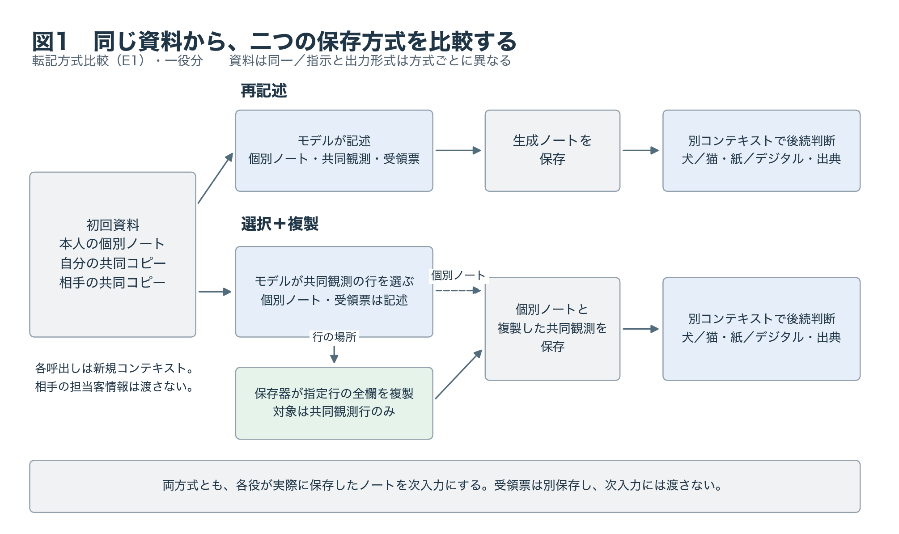
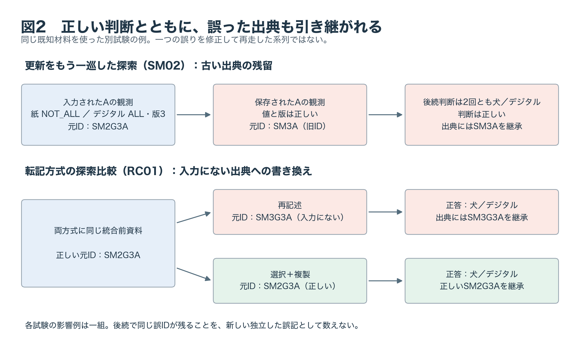
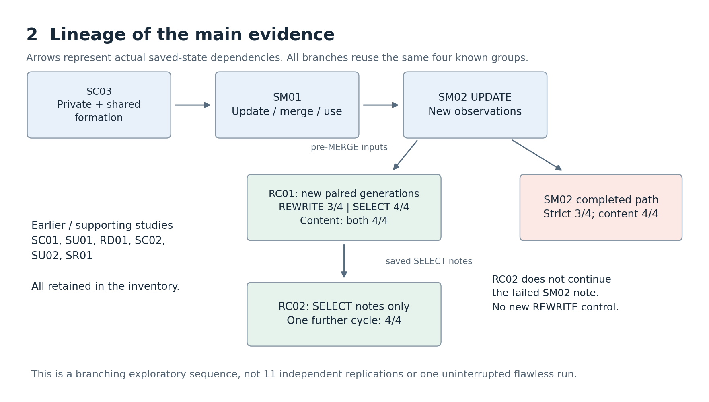
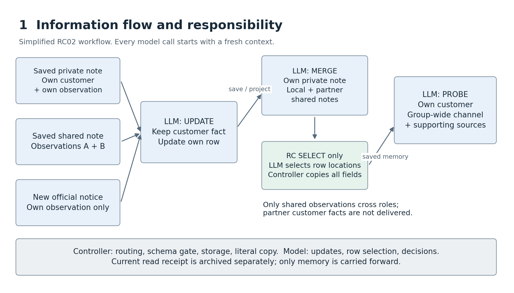

# 個別情報と共有記録を両立するLLMメモリ更新：内容・出典・継続利用の探索的評価

**Kentaro Sato**  
独立研究者（Independent Researcher）  
連絡先：`info@metaclan.jp`

## 要旨

LLMエージェントが記録を共有して仕事を続けるとき、各役に固有の情報と、その出典を正しく保てるか。本研究では、同一LLMを別コンテキストで二役として実行し、担当客の犬猫希望を保持しながら、双方の観測から紙／デジタルの案内方法を選ぶ合成課題を用いた。保存ノートを次の入力へ引き継ぎ、判断の正しさ、内容と出典の対応、出典を使う撤回処理を評価した。

探索では、判断は正しいのに出典IDが誤り、その誤りが次の回答にも残る事例を確認した。これを受け、モデルが共同観測を書き直す方式と、行を選んで保存器が複製する方式を、未使用の64組で比較した。選択＋複製では共同観測行はすべて正しく保存されたが、全工程成立は両方式59/64組で、再記述の一組が未確定だった。方式差（選択＋複製−再記述）の保守的95%区間は、未確定の全補完を含む包絡で−17.36〜16.60ポイントとなり、全工程の優越性は確認できなかった。選択＋複製に残った不備は、個別情報の記述と後続の読出しにあった。

出典と撤回通知の情報量を変えた診断では、対象を特定できる条件で撤回を完遂し、特定できない条件で情報を保って保留した。正答に併存する出典不備、局所保存と全工程の成否の差、適切な撤回・保留は、保存から後続利用までを工程ごとに追跡することで識別できる。

**キーワード：** LLMエージェント、共有メモリ、出典、状態更新、撤回、探索的評価

## 1. 問題設定

共同で仕事を続ける主体には、共有すべき情報を利用しながら、各役に固有の情報も保持することが求められる。新しい情報を受け取る際には、観測を更新し、変える理由のない担当情報を維持する必要がある。最終回答の正誤だけでは、これらが同時に満たされたかを判別できない。

例えば、Aは犬の絵柄を希望する客を、Bは猫の絵柄を希望する客を担当する。二人はそれぞれの担当範囲で、紙とデジタルのどちらの案内が全員に届くかを調べる。共同の案内方法には双方の観測が必要だが、担当客の希望まで同じにする必要はない。また、正しい案内方法を選べても、その観測を誰のどの資料から得たかが正しく残っているとは限らない。

本稿は、**役ごとの担当事実を保持し、双方の観測から共同判断を作る過程で、内容と出典の対応がどこで維持・破損するか**を調べる。保存形式を改訂した探索と、その観測から設計した方式比較・撤回診断を報告する。

**表1. 三つの評価層と、本稿で得られた知見。** 具体例を§3.4、各結果の分母と不確実性を§5に示す。

| 評価する層 | 問うこと | 観測したこと |
| --- | --- | --- |
| 判断 | 保存ノートから妥当な答えを出すか | 出典に不備があっても、犬猫・案内の判断は正しい事例があった |
| 記録 | 人物・値・版と出典の対応を保つか | 共同観測行の保存が成立しても、個別情報や後続の読出しに不備が残った |
| 後続操作 | 出典を使って撤回し、対象不明なら保留できるか | 対象を特定できる情報条件で撤回し、不足する条件では対象外情報を保って保留した |

この三層を実保存物と次の入力に結び付けることで、正答に併存する記録の不備と、処理を保留することの妥当性を評価する。

## 2. 関連研究との位置関係

外部記憶の構成と活用には、MemGPTの階層間の文脈管理、G-Memoryの集団経験を扱う三層グラフ、MIRIXの複数種の記憶と更新・検索の協調がある。本稿は、こうした記憶を更新・保存し、次入力として読む際の内容と出典の対応に焦点を置く。[MemGPT](https://arxiv.org/abs/2310.08560v2)、[G-Memory](https://arxiv.org/html/2506.07398v2)、[MIRIX](https://arxiv.org/html/2507.07957v1)

**表2. 近接研究との、観測工程・評価対象の対応。** 各研究の全機能を列挙した表ではなく、本文で参照する方法・実験に範囲を限る。

| 研究 | 参照する仕組み・評価 | 本稿が接続する点 |
| --- | --- | --- |
| [CoMem](https://arxiv.org/html/2609.15009v1) | 個別経験の保存、評価に基づく共有領域への昇格、両領域からの検索。ALFWorld・PDDLで評価 | 役固有の担当事実と共同観測を分け、保存・再利用の各工程で保持を評価する |
| [MAP-Graph](https://arxiv.org/html/2608.10509v1) | 由来のグラフ、権限、信頼度、行為の制約を合成課題で評価 | 生成した観測と発生元の対応を、保存から後続回答までたどる |
| [Collaborative Memory, §3–5](https://arxiv.org/html/2505.18279v1) | 寄与主体・資源・時刻の不変の来歴と動的アクセス制御。共有範囲・権限変更に伴う精度・資源利用等を評価 | 発生元と現在の根拠を分ける。撤回診断では、利用権限ではなく観測の有効性を変更する |
| [Governed Shared Memory, §7.3](https://arxiv.org/html/2606.24535v1#S7.SS3) | 親IDを記録した派生チェーンをたどり、祖先への到達・書込み主体の一致・深さを評価 | 来歴を保存・取得する工程に加え、内容に来歴を結び付ける生成工程を追う |
| [AIM, §5.2](https://arxiv.org/html/2609.12320v1) | 操作の厳密一致と、上流で作られなかった対象等を考慮する状態考慮指標を併記 | 出典込み評価と内容のみ評価を併記し、内容が正しい場合に残る出典不備を分ける |
| [PROV-DM](https://www.w3.org/TR/prov-dm/) | 実体・活動・主体・由来等の関係を区別するデータモデル | 観測の発生元と、今回の根拠となる資料を独自JSONの別欄に置く |
| [CaMeL](https://arxiv.org/abs/2503.18813v1) | 信頼する要求と未信頼データの制御・データフローを分け、capabilityで方針を適用 | モデルと管理側の責任を、入出力検査と保存操作で分ける |
| [Agentic Unlearning, §3](https://arxiv.org/html/2602.17692v2) | SBUがパラメータと永続記憶の両経路を扱い、依存関係に沿う除去・失効とパラメータ更新を組み合わせる | 外部記録の値・出典を履歴として残し、失効状態と後続利用を評価する |

特に、**記録された来歴を忠実に保存することと、保存する内容に正しい来歴を結び付けること**は、別の点検対象である。Governed Shared Memoryの上記実験との対照から、本稿は生成・保存・後続利用の接続部分を具体化する。同論文のprovenance collapse（由来をたどれなくなること）を広い問題領域と捉えると、後述する古いIDの結合と生成時のID誤記は、その破損箇所を示す事例と位置づけられる。これは同論文の分類に対する本稿側の解釈である。[同論文§4](https://arxiv.org/html/2606.24535v1#S4)

## 3. 課題と記憶システム

### 3.1 担当情報と共同判断

各組はAとBの二役からなる。各役の担当客には犬または猫の絵柄の希望があり、共同情報が変わっても保持すべき事実とした。探索の題材は地域工作会の持帰り袋と展示会の受付名札で、方式比較では同じ課題規則から新しい材料を生成した。

二役は互いに重ならず全体を覆う担当範囲で、紙・デジタルの案内が全員に届くかを観測する。「全員に届く」はALL、「全員には届かない」はNOT_ALLと記録する。双方の範囲で全員に届く手段が一つなら、その手段を全体案内として選ぶ。該当手段が二つまたはゼロなら、判断は保留（UNKNOWN）とする。必要な相手情報が入力にない場合も保留する。

自分の範囲で紙・デジタルの両方が全員に届くことと、全体案内がまだ一つに決まらないことは両立する。観測を保存する際に両方の値をUNKNOWNへ置き換えると、後で判断するための情報を失う。この保存と判断の区別を検討した補助試験は付録A.7に示す。

### 3.2 記録と評価の用語

各役は自分の個別ノートと、その時点の共同ノートのコピーを持つ。共同ノートは双方の観測をまとめたもので、交換前にはAのコピーがA新版／B旧版、BのコピーがA旧版／B新版となり得る。

**表3. 本文の用語と、記録上のキー。** 評価基準と集計単位を分けて用いる。

| 本文の呼称 | 記録上のキー・対訳 | 役割 |
| --- | --- | --- |
| 個別ノート | `private_note` / private note | 本人の担当客・観測・出典を保持し、本人へ引き継ぐ |
| 共同ノート | `shared_note` / shared note | A/Bの観測を各役が保存し、相手と交換する |
| 元ID | `origin_id` / origin ID | 観測や担当事実の発生元を示す識別子 |
| 現在参照・受領票 | `read_receipt` 等 / declared evidence references | 今回の採用内容を支える入力資料の申告。ノートと別に保存する |
| 構造・参照検査 | structural/reference validation | 構文・型・参照先の実在を検査する |
| 出典込み評価 | `strict` / strict evaluation | 内容に加え、出典と現在入力による支持も要求する |
| 内容のみ評価 | `content` / content-only evaluation | 人物・値・版・判断を残し、出典・参照・入力支持の条件を除く |

元の観測がXというIDを持ち、共同ノートを経由して届いたなら、元IDはX、今回の直接の根拠はその共同ノートである。受領票は出力上の申告を表し、内部の注意や実際の読取り経路とは区別する。

評価の単位には観測行、回答、組がある。方式比較の「全工程成立」は、両役の統合・保存と後続判断、計4回答がすべて成立した組を数える。出典込みと内容のみを、同じ組単位で併記する。

### 3.3 モデルと保存器の責任分担

各モデル呼出しを新しいコンテキストで実行し、管理側が実際に保存されたノートから次の入力を作る。モデルは資料の採用と判断を担い、管理側は配送、構造・参照検査、保存、条件に応じた行複製を担う。人物・値・版・出典・判断の採点には、固定規則のPythonコードを使う（付録C）。形式上読める誤りは保存して後続へ渡す。形式不備で次入力を作れない場合、その後続のモデル呼出しは行わない。

**再記述（REWRITE）**では、モデルが共同観測の人物・値・版・元IDを書き直す。**選択＋複製（SELECT）**では、モデルが入力中の行の場所を指定し、保存器がその全欄を複製する。候補は本人の個別観測1行、自分の共同コピー2行、相手の共同コピー2行の計5行である。旧行や別人の行が指定されても、その行を保存する。個別ノートと受領票は両方式ともモデルが記述する。



**図1. 転記方式比較（E1）の流れ。** 両方式には同じ初回資料を与え、それぞれが保存したノートを後続判断に使う。一役分を示し、相手役も同じ処理を行う。機械複製の対象は共同観測行である。探索系列で別に行った更新工程は付録Aへ示す。

### 3.4 実回答で見る、正答と出典不備の併存

**担当客の出典が欠けた例（E1-G49/B）**を使い、同じ入力から保存・後続判断までを追う。入力の担当客情報は次のとおりだった。JSONは説明に必要な欄の抜粋である。

```json
{"animal":"CAT","origin_id":"RAD9D1FEC60F1FA2","subject":"B"}
```

再記述ではこの情報がそのまま保存された。一方、選択＋複製でモデルが書いた個別ノートの担当客欄は、出典の末尾1文字を失っていた。

```json
{"animal":"CAT","origin_id":"RAD9D1FEC60F1FA","subject":"B"}
```

**表4. 同じ入力からの、二方式の保存と後続判断。** 共同観測行は両方式で正しく保存されている。

| 段階 | 再記述 | 選択＋複製 |
| --- | --- | --- |
| 入力の担当客 | 猫、元ID `RAD9D1FEC60F1FA2` | 同左 |
| 保存された担当客 | 猫、元ID `RAD9D1FEC60F1FA2` | 猫、元ID `RAD9D1FEC60F1FA` |
| 後続判断 | 猫／紙、元IDは正しい | 猫／紙、末尾が欠けた元IDを継承 |

選択＋複製の後続回答にも、次の欄が残った。

```json
{"decision":{"mascot":"CAT","channel":"PAPER"},"origin_ids":{"mascot":["RAD9D1FEC60F1FA"]}}
```

この組の最新観測は、双方の担当範囲で紙が全員に届き、デジタルは全員には届かないというものだった。そのため、猫／紙が正答となる。機械複製の対象外である個別欄が壊れ、正しい判断とともに次の回答へ渡った。方式全体の成績は§5.2で示す。抜粋と完全な原回答・保存物の対応は[補足資料S2：通し例](examples-v0.1-2026-09-23.md)に収録した。

## 4. 評価方法

### 4.1 探索から二実験への接続

旧11試験は二題材の既知4組を用い、観測された失敗から保存契約を改訂した適応的探索である。本稿の中心となる四試験を表5に示す。

**表5. 本文で扱う試験と目的。** 全11探索試験の一覧・依存関係は付録Aに示す。

| 呼び名 | 略号 | 目的 |
| --- | --- | --- |
| 更新をもう一巡した探索 | SM02 | 保存ノートの継続更新で、担当情報・観測・出典を保持できるか |
| 転記方式の探索比較 | RC01 | 既知の同じ4組で、再記述と選択＋複製を比較する |
| 未使用材料での転記方式比較 | E1 | 新しい64組で、局所保存と全工程の成否を比較する |
| 撤回診断 | E2 | 別の8場面で、出典と通知情報に応じた撤回・保留を評価する |

更新の探索で「正しい新版に古い元IDが残る」事例を受け、転記方式の探索比較を設計した。各試験で実行前に固定した材料・規則、実行順・依存・全成績を付録Aに示す。

RC01の実行前予想は選択＋複製−再記述 ≥.25、すなわち既知4組で1組以上の改善という工学的な局所予想だった。差の符号による追加取得をしない規則の下で3/4対4/4を観測した後、未使用材料のE1と別材料のE2を設計し、両方の計画を実行前に固定した。[RC01実行前計画](../../docs/study2/row-carry-01-plan-v0.1-2026-09-19.md)

### 4.2 転記方式比較（E1）：未使用64組の対応比較

転記方式比較（E1）は、新たに作った64組を再記述と選択＋複製の両方式へ割り付ける対応比較である。材料生成seedは2026092101。場面名8種類×会場名8種類の交差配置で、担当客、最新・旧観測の値と版、提示順を変えた。名称とIDを除いたA/B・紙/デジタル・犬/猫の反転同値性を点検し、旧材料およびE2との重複を除いた。元IDは`R`＋15桁の大文字16進文字とし、役・版を表す接頭辞を使わなかった。

各組は二方式×二役×統合・保存と後続判断の8回答、計512回答とした。両方式の初回資料を同一のバイト列で与え、各役自身の統合・保存したノートから後続判断の入力を作った。選択＋複製の機械複製は共同観測行に適用し、個別ノート・受領票・後続判断は両方式ともモデルが生成する。割付seedは2026092102。16組ずつ四つの実行区間に分け、各区間で先行方式を8組ずつ、後続判断で先後を反転させ、新規コンテキスト・単列で実行した。

主指標は、人物・観測値・版・元ID・現在参照・入力支持・後続判断を含む、両役の統合・保存と後続判断の計4回答がすべて成立した組の割合である。差Δを選択＋複製−再記述とする。全条件の同時成立を主指標にした理由は、担当情報・共同記録・次の判断が同時に成立する割合を測るためである。正しい初期資料から誤保存が生じ、後続がその誤りを忠実に読んだ場合も全工程は不成立とする。

局所保存を分けて評価するため、工程別成分と内容のみ評価を実行前に副指標へ定めた。内容のみ評価は人物・値・版・判断を残し、出典・参照条件を除く。共同行4行の組単位集約、場面名・会場別内訳、出力長は事後の記述補足である（付録D）。副指標に追加の有意差検定は行わない。

事前方向予想はΔ>0。欠測なしの場合に両側exact McNemar検定を用いる規則と、次の区間計算を実行前に固定した。選択＋複製だけ成立する割合と再記述だけ成立する割合の各97.5% Clopper–Pearson区間から、差の下限・上限を組み合わせてBonferroniの保守的95%区間を作る。欠測ありでは、既知の成績を保つ全補完について、Δの最小・最大を欠測上下限、各95%区間の包絡を推定の不確実性として示す。主pは未算出とし、分母64組を維持する。推論は組間の独立同分布を作業仮定とする。[実行前の設計](../../docs/study2/paper-01-pair-plan-v0.1-2026-09-21.md)

事前見積もりはN=64・欠測なし・独立同分布の組・両側exact McNemar α=.05を仮定した。真差20ポイント・食違い率.30で検出力82.7%、同.40で66.8%、真差10ポイント・.30で23.6%だった。20ポイントは費用と検出解像度の折合いであり、この見積もりに基づいて固定Nを選んだ。実行前の見積書 (see the evidence index)

### 4.3 撤回診断（E2）：出典と通知情報の組合せ

撤回診断（E2）は、E1と重複しない8場面で、研究側が用意した正しい個別・共有ノートの出典を操作する診断である。対象観測者をA/B各4場面とし、対象観測の全コピーの出典を正ID、旧原票ID、原票履歴にないIDへ変えた。人物・値・版は揃え、誤IDは別の有効行や担当客情報に衝突しないようにした。旧ID／存在しないIDは分析側の履歴区分で、モデルへの入力は現在のノートと通知である。

信頼する発行元からの撤回通知を、対象出典IDのみの通知と、同じIDに観測者・版・紙／デジタル値を加えた詳細付き通知に分けた。固定契約はID一致を優先し、不一致なら詳細の観測者・版・二つの値がすべて一致する観測を一意に特定する。特定した観測の全コピーを失効状態へ変更し、元の値・版・出典を履歴として残す。対象を特定できなければ全行を保持し、未解決として記録する。

撤回処理で保存したノートと処理記録を後続判断へ引き継ぐ。特定済み撤回では全体判断を判断保留／撤回済み、未解決なら判断保留／未解決とし、担当客の希望・出典、有効観測、失効した観測者、未解決通知の保持も評価する。

8場面×出典3条件×通知2条件×二役×二工程＝192回答で、各条件の分母を8場面に固定した。両役・両工程を合わせ、①支持された対象解決・完遂、②根拠に適合した処理を別集計する。正IDで各通知8/8場面の完遂を解釈のゲートとし、全六条件を報告する。小規模な固定診断としてp値は付けない。

誤ID＋IDのみの完遂不能は材料と契約の帰結である。そこで測るのは、対象を推測せず、本人情報・対象外観測を維持し、保留状態を後続へ渡す動作である。詳細付き通知は一意に照合できる材料を用いた。事後の補足区間は各セルの8場面を独立同分布の二項試行とみなす名目95% Clopper–Pearson区間であり、六条件の同時区間ではない。

### 4.4 欠測、停止後継続、照合

各成分を成立／不成立／未確定の三値で記録し、組の全工程を判定するときは、既知の不成立を未確定より優先する。固定分母を保つ欠測上下限と、推定の信頼区間を分ける。

一件のローカル検査停止後、再開しないという当初規則を変更・記録し、残り63件の回答を得た。停止前の記録を保持し、継続分を分けて集計した（付録A.8）。

E1のJSON不備は正式解析で未確定とした。取得後の括弧1文字補正は派生コピーの事後参考分析として付録Eへ分ける。原回答・保存物・次入力の対応と照合用ハッシュ値を別コードで照合し、主要表を保存済み回答から再生成した（付録B）。

## 5. 結果

結果は組数・場面数を先に示し、次に割合の差と不確実性を示す。区間の種類は表6で区別し、計算成分を付録Dにまとめた。

**表6. 本節で用いる区間の読み方。**

| 呼称 | 対象と性質 |
| --- | --- |
| 主比較の区間 | E1で実行前に固定した計算法による、方式差の保守的95%区間。未確定の全補完の包絡。内容のみ評価も同じ計算法 |
| 成分別の補足区間 | 共同観測行を組単位にまとめ、事後に追加した名目95%区間 |
| 撤回診断の区間 | E2の各条件8場面に事後に付した二項の名目95%区間。六条件の同時区間ではない |

### 5.1 探索：正答に併存し、次の回答へ残る出典不備

更新をもう一巡した探索（SM02）では、内容のみの全工程成立は4/4組、出典込みでは3/4組だった。**古い出典が残った例（G03/B）**は、相手Aの新しい値・版3を正しく保存しながら、元IDを新しい`SM2G3A`にせず、古い`SM3A`のままとした。その保存物を読む後続判断は2回とも犬／デジタルと正答し、旧IDも継承した。[探索結果](../../docs/study2/shared-merge-02-results-v0.1-2026-09-19.md)

転記方式の探索比較（RC01）は、その統合前資料から両方式を新たに生成した。出典込みの全工程成立は再記述3/4、選択＋複製4/4、内容のみでは双方4/4だった。**入力にない出典を書いた例（再記述のG03/B）**は、正しい値・人物・版に`SM3G3A`を結び付け、正しい犬／デジタル判断にも継承した。選択＋複製は正しい`SM2G3A`を持つ行を選び、その全欄を複製した。[探索比較の結果](../../docs/study2/row-carry-01-results-v0.1-2026-09-19.md)



**図2. 既知材料を共有する二試験での出典追跡。** 更新の探索は古い元ID、転記方式の探索比較は入力にない元IDを、正しい内容・後続判断とともに保存した。別試験で観測した異なる誤りであり、方式間の差は一組に局在した。

### 5.2 転記方式比較（E1）：複製対象の成立と、周辺に残った不備

**全工程成立は両方式で59/64組だった。** 再記述に残った未確定1組の判定によって、成立数は同数か、再記述が1組多い場合となる。主比較の区間は−17.36〜16.60ポイントで、選択＋複製の全工程での優越性は確認できなかった。

工程ごとに見ると、選択＋複製の共同観測行はすべて成立し、不成立5組の不備は個別情報の記述または後続の読出しにあった。表7は、複製対象と周辺工程を並べたものである。

**表7. 出典込み評価による工程別の成績。** 行・回答・組は同じ材料を異なる単位で集約している。

| 工程と評価対象 | 再記述 | 選択＋複製 |
| --- | --- | --- |
| 統合・保存：共同観測行 | 253/256行 | 256/256行 |
| 統合・保存：個別ノートの担当客 | 128/128件 | 127/128件 |
| 統合・保存：個別ノートの本人観測 | 128/128件 | 128/128件 |
| 後続判断：回答全体 | 124成立・3不成立・1未確定／128回答 | 123成立・5不成立／128回答 |
| 全工程：両役・両工程 | 59成立・4不成立・1未確定／64組 | 59成立・5不成立／64組 |

共同観測行の評価には、内容・出典と、受領票による現在入力の支持を含む。例えば再記述の一組（G11）には参照条件の不成立があった。指定行の機械的な複製一致だけを数えた成績ではない。両役の共同4行を組単位にまとめると再記述61/64、選択＋複製64/64となり、差+4.69ポイント、成分別の補足区間は−5.87〜14.44ポイントだった（付録D.2）。

選択＋複製の不備は、担当客出典の保存とその継承（§3.4のG49）、正しく保存された観測の読出し時の出典欠落（G16/A）などに分かれた。G03・G16・G49は内容のみでは成立し、G27・G45は案内判断も不成立だった。計5組・6回答の内訳を[補足の成分別照合](../../supplements/paper-01-reader-claude-20260922/observations.json)に示す。

保存内容の誤りが判断へ渡る例もあった。再記述の一役（G36/A）は、統合時に相手Bの紙到達値を「全員に届く」から「全員には届かない」へ変え、後続判断はその誤保存に沿って保留した。保存時の不備の継承と、読出し時に新たに生じる不備を区別できた。原回答と成分の点検 (see the evidence index)

**表8. 固定64組での正式な主集計と、実行前に定めた内容のみ評価。** 差は選択＋複製−再記述。欠測上下限は、この64組で未確定を補った際の範囲であり、推定の信頼区間とは異なる。

| 全工程の評価基準 | 再記述：成立／不成立／未確定 | 選択＋複製：成立／不成立／未確定 | 差の欠測上下限 | 主比較の区間 |
| --- | --- | --- | --- | --- |
| 出典込み（主指標） | 59／4／1 | 59／5／0 | −1.56〜0.00ポイント | −17.36〜16.60ポイント |
| 内容のみ | 60／3／1 | 62／2／0 | +1.56〜+3.13ポイント | −11.35〜16.38ポイント |

両方式成立は54組、再記述だけ成立は5組、選択＋複製だけ成立は4組、再記述未確定かつ選択＋複製成立は1組である。予定した512回答はすべて得られたが、再記述の最終回答1件（G23/B）に余分な`}`があり、評価可能な形式は511件だった。事前の欠測規則に従い、**正式な主p値は算出しない**。[正式集計](../../supplements/paper-01-pair-resume1-20260921/combined-analysis.json)

各補完の区間成分と場面・会場別内訳は付録Dに示す。括弧1文字補正による事後参考分析は付録Eへ分けた。

### 5.3 撤回診断（E2）：完遂と適切な保留

撤回診断では192回答と96件の撤回後ノートを保存した。対象を特定できる条件では全場面で撤回を完遂し、特定できない条件では全場面で保留した。担当客・対象外の有効観測を保ち、処理状態を次の利用へ渡す要件も満たした。

**表9. 出典と通知情報による完遂・保留。** 各セルは同じ8場面を使い、両役・両工程を合わせて評価する。

| 保存された出典 | 撤回通知 | 完遂 | 根拠に適合した処理 | 後続状態 |
| --- | --- | ---: | ---: | --- |
| 正ID | IDのみ | 8/8 | 8/8 | 撤回済み |
| 正ID | 詳細付き | 8/8 | 8/8 | 撤回済み |
| 旧ID | IDのみ | 0/8 | 8/8 | 保留 |
| 旧ID | 詳細付き | 8/8 | 8/8 | 撤回済み |
| 存在しないID | IDのみ | 0/8 | 8/8 | 保留 |
| 存在しないID | 詳細付き | 8/8 | 8/8 | 撤回済み |

正IDの基準条件は両通知で成立した。誤IDでも詳細が一意に一致すれば対象の全コピーを失効させ、IDのみなら推測で撤回せず保持した。根拠に適合した処理は回答単位で192/192、場面単位では各条件8/8だった。[継続・合算結果](../../docs/study2/paper-01-pair-resume1-results-2026-09-21.md)

例えば、存在しないIDを保存したノートへIDのみの通知を与えた後続回答（G01/A）には、次の欄があった。

```json
{"channel":"UNKNOWN","channel_status":"PENDING","revoked_observers":[],"pending_notice_ids":["R07D126D1015A6A8"]}
```

案内判断は保留、撤回した観測者はなく、未解決の通知IDが残っている。完全な回答には担当客と有効観測も保持されており、採点は「完遂せず、根拠に適合」となった（補足資料S2）。

全条件で案内判断はUNKNOWNだったが、対象の特定・失効状態・未解決通知を分けて評価することで、完遂と適切な保留を区別できた。撤回診断の区間は8/8で63.06〜100%、0/8で0〜36.94%である。誤ID＋IDのみの完遂0/8は、§4.3で定めた情報と照合契約の帰結である。

## 6. 考察

### 6.1 内容・出典・次の操作を別々に評価する

二つの探索事例と、§3.4の担当客出典の例は、正しい判断に誤出典が併存し、保存物から次の回答へ継承されることを示した。原回答・実保存物・次入力を対応づけることで、内容の正しさ、出典との結び付き、その継承を別々に追跡できる。

撤回診断（E2）では、出典を使う次の操作を固定診断として調べた。正IDによる照合、一意の詳細による照合、対象不明時の保留を分け、本人情報と対象外観測の保持まで点検した。これにより、「完遂に必要な情報が揃っているか」と「与えられた根拠に適合して処理したか」を区別できた。

### 6.2 複製対象と周辺工程を対にして点検する

選択＋複製は、行の選択をモデル、指定行の忠実な複製を管理側へ分担する。探索比較（RC01）の正しい選択16/16と複製一致16/16、未使用材料での比較（E1）の共同観測行256/256の成立は、この分担の下で観測した成績である。E1では不成立5組の不備が複製対象外の個別欄・後続判断にあり、共同観測行の保存成立と、全工程の残存不備を同時に特定できた。

設計上の点検対象は、複製する情報の範囲、対象外に残る生成、保存物を読む後続判断の三つとなる。内容のみ評価では選択＋複製側へ小さな差があり、出典・参照を含む主指標ではその差が残らなかったことも、これらを分けて評価する意義を示す。両区間がゼロを含むため、この内訳は次の比較で検証する仮説の材料となる。

実行前に固定した区間推定法によるE1の上限は16.60ポイントで、旧4組で観測した25ポイントを下回った。組間独立同分布の作業モデルの下では、旧4組と同程度の平均改善をE1の材料群へ外挿する解釈は支持されない。E1の事前予想はΔ>0で、その照合結果は§5.2に示した。

### 6.3 発生元と現在の根拠を分けて故障箇所を特定する

元IDと受領票を別欄に置くことで、不備の生じた関係を識別できた。過去の参照名を持ち越した探索事例は、今回の直接参照と履歴の混在を示した（付録A.7）。§5.1の古い元IDと入力にない元IDは、保存内容と発生元の対応不備に当たる。E1でも、保存時の担当客出典の誤記、正しく保存された観測の読出し時の誤記、根拠参照の過不足を分けて記録した。

この区別は、参照欄の契約と観測行の転記のどちらを点検すべきかを具体化する。採用行の支持だけを求める受領票と、比較のために読んだ資料も含める受領票の違いは、次の単独比較の候補となる。

### 6.4 個別情報と共同状態の両立を、保持・更新の要件で測る

本課題は、A/Bがそれぞれの担当客情報を保持し、共有した観測から共同の案内方法を選ぶことを成立条件とした。役ごとに残すべき違いと、共有後に一致すべき判断を先に定義することで、個別情報と共同状態の両立を各工程で点検できた。

撤回診断（E2）では、撤回対象を更新するときにも、変更の根拠がない担当情報・有効観測を維持する要件を評価した。保持と更新を対にするこの設計は、同じ担当事実と観測の契約を保ちながら、通知の不一致や実行反復へ検証を広げる足場となる。

## 7. 限界と再現可能性

### 標本と統計的推論

旧11試験は二題材・既知4組で保存契約を改訂した適応的探索である。E1の64組とE2の8場面は実行前に固定したが、共通の生成規則による単一モデル上の材料であり、多領域からの無作為標本ではない。推論の単位は組・場面で、役、行、工程、旧系列との合算でNを増やさない。E1の区間は組間独立同分布を仮定し、その保守性で共通テンプレートやラベル由来の依存を吸収できるとは限らない。小差・同等性の決着は設計の射程外である。

### 実行のばらつき

E1・E2は各予定応答を一回測定した。食違いには実行ごとのゆらぎも含まれ得るが、同一材料・方式での試行間分散と、材料ごとの方式差の異質性を別々に推定できない。停止後の再送や探索の一部で行った後続判断の反復は、計画的反復の代わりにならない。場面名・会場別の内訳は記述的に示す（付録D）。

### 操作化と外部妥当性

対象は固定語彙で表す担当客の希望と案内到達値であり、自発的な人格・価値観の保持まで測ったものではない。正式な版、自他区分、管理側の配送、外部ノートを使う短い経路を評価した。実務への拡張には、曖昧な記述、矛盾、複数情報源、履歴量、判断の損失、多数の役、長期間の運転を含む検証が必要である。

### 撤回診断の条件

通知は信頼され、誤IDは別行に衝突せず、詳細は一意に照合できる。曖昧・不存在・矛盾する詳細、自律的な復旧、出典認証、敵対的入力や情報漏洩への防御は評価していない。

方式比較で自然発生した不備をそのまま撤回診断へ投入したわけでもない。§3.4の例は担当客出典、撤回診断は案内到達の観測が対象である。そのため、方式比較の誤り率と撤回診断の完遂率から実運用の損失率は推定できない。設計上完遂不能な条件の区間も、未知の解決能力の推定には用いない。

### 介入と機構

転記方式の比較は、指示、出力形式、出力量、保存器を含む方式全体の比較である。出力長は付録D.7に示すが、各要素の単独効果は未同定である。選択＋複製の残存不備が対象外にあったという観測から、複製によって故障が別工程へ移ったという因果関係は導けない。

探索で行った共同情報の追加や参照欄の変更も、複数の要素を同時に変えており、共同形成・相方編集・受領票分離の単独効果は切り分けていない（付録A.4・A.7）。ID形式の効果や誤記の内部機構も未測定である（付録A.9）。

### 実行環境と監査

モデル設定は`gpt-5.6-luna`、reasoning `medium`、toolsなし、新規コンテキスト、単列実行で、承認されたChatGPTアカウント経路を用いた。これは送信時の識別子であり、公開された固定重みではない。別モデルへの一般化と第三者による同一出力の再生成は未検証である。撤回診断は中断後の規則変更・継続を含む（付録A.8）。開発・実行・固定コード採点・編集監査は同一プロジェクト内であり、独立した第三者の盲検再採点は実施していない。

### 再現資源と比較の範囲

保存済み回答から主要表を再生成するパッケージを整えた（付録B）。この再計算可能性と、モデルを再実行したときの再現安定性は別の性質である。先行研究とは方法・評価対象を照合しており、直接の性能比較、網羅的な優先権調査、PROV準拠の検証は行っていない。公開状況と申告事項は§9に示す。

## 8. 結論

本稿は、**答えの正しさ、内容と出典の対応、その対応を使う後続操作を、保存から次入力まで追跡して評価した。** 正しい内容・判断に誤出典が併存し、その不備が次の回答へ継承される事例を確認した。

未使用材料での転記方式比較（E1）の選択＋複製では共同観測行256/256行が出典込みで成立し、全工程不成立5組の不備は個別情報の記述または後続の読出しにあった。全工程の方式差は確定しなかったが、局所保存の成立と周辺工程の課題を同時に示せた。撤回診断（E2）では、固定した情報条件・照合契約の下で、撤回の完遂と根拠不足への適切な保留を区別し、担当情報・対象外観測の保持と後続利用まで評価した。

個別情報と共同状態の両立を調べる際には、役ごとに保持すべき情報、共同で更新する情報、それらの出典、次の操作を分けて点検できる。本報告は、その評価を実保存物で実施した単一モデル・合成課題の事例を提供する。

## 9. 倫理・利益相反・著者貢献・データ可用性

材料は架空の担当客と合成観測である。モデル生成物を実験資料として扱い、実在する顧客記録・人間参加者の回答は使用していない。倫理審査の要否判断・審査履歴は著者確認待ちである。

設計、実装、実行手順、採点規則・コード、執筆にLLM支援を用いた。研究対象LLMの回答は固定したPythonコードで採点した（付録C.2）。事例の解釈やLLMの読後評は、正式な成否ラベルを生成する工程と区別する。著者貢献の詳細、資金源、利益相反は公開前に著者が確定する。

データ・コードはローカル再現パッケージにまとめ、承認済みの削除期限なし保管を適用した（付録B）。本稿はZenodoでのプレプリント公開を予定している。本文・再現資料は現段階では未公開であり、公開範囲・ライセンス、DOI、別媒体バックアップは未確定である。認証情報・アカウント識別情報・生の通信ヘッダは公開候補から除く。

## 参考文献

以下は2026年9月20〜22日に照合した版。arXiv掲載版とW3Cの標準文書を区別する。学会・誌面への採択状況の網羅的確認は行っていない。

1. Chengxin Yu et al. (2026). [CoMem: Collective-Individual Memory Synergy for Evolutionary Multi-Agent Systems](https://arxiv.org/abs/2609.15009v1). arXiv:2609.15009v1.
2. Yiqi Wang et al. (2026). [MAP-Graph: Provenance-Aware Shared Memory for Multi-Agent Workflows](https://arxiv.org/abs/2608.10509v1). arXiv:2608.10509v1.
3. Yanki Margalit, Nurit Cohen-Inger, Erni Avram, Ran Taig, and Oded Margalit (2026). [Governed Shared Memory for Multi-Agent LLM Systems](https://arxiv.org/abs/2606.24535v1). arXiv:2606.24535v1.
4. Zachary Johnson et al. (2026). [AIM: A Privacy-Aware Interoperable Memory Framework for Multi-Agent Multi-User LLM Systems](https://arxiv.org/abs/2609.12320v1). arXiv:2609.12320v1.
5. W3C (2013). [PROV-DM: The PROV Data Model](https://www.w3.org/TR/prov-dm/). W3C Recommendation, 30 April 2013.
6. Alireza Rezazadeh et al. (2025). [Collaborative Memory: Multi-User Memory Sharing in LLM Agents with Dynamic Access Control](https://arxiv.org/abs/2505.18279v1). arXiv:2505.18279v1.
7. Guibin Zhang et al. (2025). [G-Memory: Tracing Hierarchical Memory for Multi-Agent Systems](https://arxiv.org/abs/2506.07398v2). arXiv:2506.07398v2.
8. Yu Wang and Xi Chen (2025). [MIRIX: Multi-Agent Memory System for LLM-Based Agents](https://arxiv.org/abs/2507.07957v1). arXiv:2507.07957v1.
9. Charles Packer et al. (2024; initial version 2023). [MemGPT: Towards LLMs as Operating Systems](https://arxiv.org/abs/2310.08560v2). arXiv:2310.08560v2.
10. Edoardo Debenedetti et al. (2025). [Defeating Prompt Injections by Design](https://arxiv.org/abs/2503.18813v1). arXiv:2503.18813v1.
11. Bin Wang et al. (2026). [Agentic Unlearning: When LLM Agent Meets Machine Unlearning](https://arxiv.org/abs/2602.17692v2). arXiv:2602.17692v2.


## 付録A. 全試験の採用範囲

### A.1 全試験一覧

まず旧探索系列の11試験を示す。続いて追加二実験を示し、両表の13試験を本報告の対象とする。予定／実行は論理枠／物理研究要求であり、独立標本数ではない。構造欠測と依存未発行は別欄とする。角括弧は欠測上下限。MET／NOT_METは固定標本での事前予想との照合で、採否や論文化に有利かどうかの区分ではない。

| 略号・正式名 | 予定／実行 | 構造欠測／依存未発行 | 保存済み主結果 | 感度・補助結果 | 原判定 |
| --- | ---: | ---: | --- | --- | --- |
| SC01 SHARED-CARRY-01 | 64／64 | 0／0 | E_BOTH=4/8組×反復、形成2/4 | E_VALUE=4/8。BOTH最終判断16/16 | NOT_MET |
| SU01 SHARED-UPDATE-01 | 72／67 | 1／5 | C_PAIR=0/4組 | 内容C_PAIR=[0,.25] | NOT_MET |
| RD01 RECORD-DECISION-01 | 32／32 | 0／0 | ALL/ALL保存：規則あり1/8、記録のみ8/8 | 差+.875。各4原票×2反復 | LOCAL_POSITIVE |
| SC02 SHARED-CARRY-02 | 48／12 | 4／36 | E_BOTH=[0,1]、形成F=[0,1] | E_NOREF=[0,1] | INCONCLUSIVE |
| SC03 SHARED-CARRY-03 | 48／48 | 0／0 | E_BOTH=8/8組×反復、形成4/4 | E_NOREF=8/8 | MET |
| SU02 SHARED-UPDATE-02 | 48／48 | 0／0 | C_PAIR=3/4組 | 内容3/4 | NOT_MET |
| SR01 SHARED-RECENCY-01 | 32／32 | 0／0 | 両順序E_PAIR=0/4組 | 内容4/4 | NOT_MET |
| SM01 SHARED-MERGE-01 | 32／32 | 0／0 | M_PAIR=4/4組 | 内容4/4 | MET |
| SM02 SHARED-MERGE-02 | 32／32 | 0／0 | M_PAIR_2=3/4組 | 内容4/4 | MET |
| RC01 ROW-CARRY-01 | 32／32 | 0／0 | M_END：REWRITE 3/4、SELECT 4/4組 | 内容は両方式4/4 | MET |
| RC02 ROW-CARRY-02 | 24／24 | 0／0 | M_CONT=4/4組 | 内容4/4 | MET |

SU02は全4組成立を、SM02は3/4以上を予想していたため、同じ3/4でも原判定が異なる。本文で両者を同一の合否として再分類しない。SC02は構造欠測から先を評価できない。SC01のE_VALUEは後半の内容のみ評価と同義ではない。

追加二実験の取得・解析範囲は以下である。E2の継続とE1の事後感度分析は別の独立標本を追加しない。

| 試験 | 論理枠／物理要求 | 回答・形式・停止 | 正式な結果 |
| --- | ---: | --- | --- |
| E1 ROW-CARRY-CONFIRM-01 | 512／512 | 回答512、構造成立511、JSON不備1 | 64組。REWRITE 59成立・4不成立・1未確定、SELECT 59成立・5不成立。主p未算出 |
| E2 PROVENANCE-REVOKE-01 | 192／193 | 初回129＋承認継続63回答、構造成立192。旧停止試行1を保持 | 8場面×六条件。根拠適合は各8/8、完遂は誤ID＋ID_ONLYで各0/8、他は各8/8 |

両実験の合計は705物理要求、704回答テキスト、703構造成立とE1のJSON不備1である。E2の追加区間は63要求・14.15分、初回とのE2累積時間は43.31分だった。E1の事後参考値（付録E）は新規要求0で、原回答を置き換えていない。

### A.2 試験間の依存と事前固定

旧探索系列の対象はSC01からRC02までの11試験である。各試験では、実送信前に材料、指示、予定枠、採点、欠測、上限、停止を固定した。旧系列をまとめる論文構成や中心主張は、その結果を見た後に定めたものであり、11試験を一つの事前登録済み確認研究とは扱わない。先行試験の故障を見て後続の保存契約を改訂しているため、系列全体は適応的な探索である。



**図A1.** 実保存物に基づく主系列。SM02のUPDATE後・MERGE前の資料から、RC01の両条件を新たに生成した。RC02はRC01 SELECTの保存ノートを継ぐ。SM02の不備を修正して再採点した経路でも、SM02の失敗ノートからそのまま続く三巡目でもない。図に示した主系列を含む旧11試験と、その後に追加したE1・E2の一覧を付録Aに示す。

SC03では個別記録8、共同下書き4、相方による編集4、後続判断32の48枠を設けた。後続判断は個別のみ／個別＋共同の二条件、両役、各2反復である。SM01とSM02では更新8、統合8、判断16の各32枠を設け、最後の判断だけを同入力で2回実行した。RC01は4組×2役×2条件×統合・判断の32枠、RC02は4組×2役×更新・統合・判断の24枠である。

RC01では同じ役の初回資料を両条件に使い、その一致をhashで照合した。条件の先後は役と組で釣り合わせ、後続判断で反転させた。段階内の順序は固定seed 2026091905による。RC02はseed 2026092001を用い、LOCAL_GROUP／PARTNER_GROUPの提示順を役ごとに2件ずつとした。これらは実行順の制御であり、4組が母集団から無作為抽出されたことを意味しない。

RC01の方向予想は、SM02で新しい観測値と版に古い元IDが残ったことから生まれた。取得前の計画では、採る行の判断をモデルに残し、人物・値・版・出典の転記を管理側の複製に置き換えることで、行内の混在を防ぐ方針を定めた。複製の一致そのものは仕組みの性質なので、実測の問いは「正しい行を選び、個別情報を保ち、次の判断まで成立させられるか」とした。[RC01取得前計画§1・§5](../../docs/study2/row-carry-01-plan-v0.1-2026-09-19.md)

当時の方向予想はSELECT−REWRITE ≥.25、すなわち既知4組で1組以上の改善である。これは既知の故障を受けた工学的な小標本予想で、母集団で25ポイントの効果を見込む推定や、確信度を表す確率ではない。計画には両方式4/4・差0でも予想未達として閉じ、差が負でも追加しないことを明記していた。この局所予想と、その後に未使用材料へ広げたE1を区別する。

### A.3 成立、内容のみ評価、欠測

主系列の評価では、担当客、観測者、観測値、版、元ID、現在参照、および実入力が出力を支えるかを確認する。最終判断だけでなく、途中の保存物も対象とする。後半の主指標は、必要な全工程を両役が通せた組の割合である。

| 試験 | 主指標の単位と定義 | 事前の局所予想 |
| --- | --- | --- |
| SC03 | `E_BOTH`：共同形成と、BOTH条件で両役の判断・根拠が成立した組×反復。4組×2反復 | 形成4/4、E_BOTH=1、本人差L=0、案内差A=1 |
| SM01 | `M_PAIR`：両役のUPDATE・MERGE・各2PROBEがすべて成立した組／4 | ≥.75 |
| SM02 | `M_PAIR_2`：二巡目の同じ全工程条件を満たす組／4 | ≥.75 |
| RC01 | `M_END`：各方式で両役のMERGE・PROBE計4枠がすべて成立した組／4 | SELECT−REWRITE ≥.25 |
| RC02 | `M_CONT`：両役のUPDATE・MERGE・PROBE計6枠がすべて成立した組／4 | ≥.75 |

これらの閾値は小試験の局所予想であり、一般的な信頼性保証や検出力に基づく採用基準ではない。3/4で予想に届く試験でも、全例無誤りとは呼ばない。

SM01以降の内容のみ評価は、元ID・受領票・入力支持の条件を除き、人物・値・版・最終判断を残す事前規則である。主成績の代わりに使わない。初期試験には異なる感度定義があり、付録では元の指標名を保つ。11試験の主・感度を共通尺度として平均しない。

欠測がある場合は、固定分母に対する既知成功数を下限、既知成功と不明の和を上限とする。組内に既知の不成立があれば、他の枠が不明でもその組は不成立である。この範囲は欠測による識別範囲であり、信頼区間ではない。構造が成立しないため意味評価まで到達しない枠と、意味の誤りを観測できた枠を分ける。

### A.4 個別情報と共同判断が両立した範囲

SC03では全4組で共同形成が成立し、`E_BOTH`は8/8組×反復、出典条件を緩めた`E_NOREF`も8/8だった。個別ノートだけの条件では、担当客の絵柄は16/16回答で正しく、全体案内は16/16で適切に保留された。個別＋共同条件では、担当客と全体案内がいずれも16/16で正しかった。共同情報の追加によって、この材料では担当客の区別を失わずに全体判断が可能になった。[SC03結果](../../docs/study2/shared-carry-03-results-v0.1-2026-09-18.md)

共同追加は相手範囲の情報の追加を伴い、全4組で下書きと編集後のJSON内容も同じだった。この結果が捉えるのは、共同情報を利用した判断の成立である。共同形成や相方編集そのものの効果の切分けは§7で扱う。

SM01では、SC03の各役の保存ノートにそれぞれの新通知を与え、双方の新版を統合して次の判断へ進めた。全工程主指標は4/4組、内容のみ評価も4/4組だった。保存ノート16件と最終判断16件で、それぞれ固定基準を満たした。本人の新しい観測を捨てず、相手の新しい観測も取り込む一回の統合が、この4組で成立した。[SM01結果](../../docs/study2/shared-merge-01-results-v0.1-2026-09-19.md)

### A.5 再記述と、選択した行の一括複製

RC01では、SM02の統合前資料を使ってREWRITE／SELECTの両条件を新たに生成した。出典等を含む全工程成立はREWRITE 3/4組、SELECT 4/4組で、差は.25だった。内容のみ評価は双方4/4組である。[RC01結果](../../docs/study2/row-carry-01-results-v0.1-2026-09-19.md)

| 同じ組 | REWRITE全工程 | SELECT全工程 | 内容のみ評価 |
| --- | --- | --- | --- |
| G01 | 成立 | 成立 | 両方式成立 |
| G02 | 成立 | 成立 | 両方式成立 |
| G03 | 出典の不成立 | 成立 | 両方式成立 |
| G04 | 成立 | 成立 | 両方式成立 |
| 合計 | 3/4 | 4/4 | 各4/4 |

| 観測対象 | REWRITE | SELECT |
| --- | ---: | ---: |
| 統合ノート全体が出典込みで正確 | 7/8 | 8/8 |
| 共同観測行が出典込みで正確 | 15/16 | 16/16 |
| 保存した本人の担当情報・本人観測 | 8/8 | 8/8 |
| 最終の担当客・案内がともに正答 | 8/8 | 8/8 |

G03/BのREWRITEは、正しい元ID`SM2G3A`を、入力に存在しない`SM3G3A`へ書き違えた。値・人物・版は正しく、受領票も適切な相手資料を指したが、その資料は誤ったIDを支持しない。この不備は後続の正しいDOG／DIGITAL判断にも残った。SM02の古い`SM3A`の保持とは異なる事例である。

SELECTでは、モデルによる最新行の選択が16/16、選択行と管理側による実体化の一致も16/16だった。前者は観測したモデル選択の成績、後者は複製処理の確認である。複製の一致をモデル能力の改善として加算しない。誤った行の選択を訂正する仕組みではなく、UPDATE段階で既に誤ったIDを書けば、その誤りを保存し得る。

差は一つの組に局在する。介入は指示、出力schema、選択空間、出力量、保存時処理をまとめて変えているため、コピー処理だけの単独効果は同定できない。また、最終判断と担当情報の保持には、この比較で差を観測していない。

### A.6 選択方式の保存物からの追加一巡

RC02では、RC01 SELECTで各役が実際に保存した計8冊を使い、UPDATE→MERGE→PROBEを一回ずつ行った。全24枠が成立し、主`M_CONT`と内容のみ評価はいずれも4/4組だった。両役の観測を版3から4へ更新し、全4組で直前と逆の案内方法を正しく選びながら、担当客の犬猫情報を保持した。最新行の選択と、その行の全欄複製はそれぞれ16/16だった。[RC02結果](../../docs/study2/row-carry-02-results-v0.1-2026-09-20.md)

この試験は既知材料と成功したSELECT保存物に条件づけた継続である。新しいREWRITE対照は置いていないため、方式間の差の再現とは呼ばない。PROBEも各一回であり、この試験から同入力反復の安定性は評価できない。

### A.7 初期試験の失敗と補助診断

SC01では共同形成が2/4組、全工程`E_BOTH`が4/8組×反復だった。最終BOTH判断は正しくても、共同形成時の出典欄が契約に届かない組が残った。SU01では初期のALL/ALL観測がUNKNOWN/UNKNOWNへ置き換わり、その記録が後続に流れた。主`C_PAIR`は0/4で、構造欠測1、依存未発行5もあった。これらを後の成功で上書きしない。[SC01結果](../../docs/study2/shared-carry-01-results-v0.1-2026-09-18.md)、[SU01結果](../../docs/study2/shared-update-01-results-v0.1-2026-09-18.md)

RD01では、同じ初期原票の記録指示から全体判断の規則3行を除く条件を比較した。ALL/ALL原票4件×2反復では、規則ありの正確な観測保存が1/8、記録のみが8/8だった。混合値の原票では双方8/8だった。これは記録と判断の指示を分ける局所的根拠であるが、指示の意味、長さ、注意の配分を個別には分離していない。[RD01結果](../../docs/study2/record-decision-01-results-v0.1-2026-09-18.md)

SC02は予定48枠のうち12枠を実行し、共同下書き4件がA/B objectではなく配列を返したため、後続36枠を発行しなかった。主指標の範囲は[0,1]でINCONCLUSIVEである。0%の意味失敗とも、配列を後から変換した成功とも扱わない。[SC02結果](../../docs/study2/shared-carry-02-results-v0.1-2026-09-18.md)

SU02は主・内容のみ評価とも3/4組で、全組成立という予想に届かなかった。G03の変更条件では、正しいノートを持つ相手役が同入力2反復の一方で案内を保留した。SR01は旧版・新版の到着順を変え、内容のみ評価4/4組、出典等を含む両順序の全工程成立0/4組だった。最終16判断では旧内容への巻戻りはなかったが、保存16件中10件で過去の参照名が今回の直接参照欄に残った。これは観測者の取り違えや観測値の破損とは区別する。[SU02結果](../../docs/study2/shared-update-02-results-v0.1-2026-09-19.md)、[SR01結果](../../docs/study2/shared-recency-01-results-v0.1-2026-09-19.md)

### A.8 中断と継続の記録

初回にE1の512回答とE2の129回答を保存した。次のE2要求は提供側のHTTP 200・完了応答を受けたが、ローカル出力検査が2秒制限でタイムアウトし、固定規則で全体を停止した。原因は未特定である。停止報告後、ユーザー承認により「停止後は再開しない」という原規則を変更し、停止枠1件と未発行62件を追加取得した。停止枠は同一要求bytesの通算第2試行とし、旧129回答と原停止記録を保持した。指示・採点・検査の2秒制限は継続区間でも維持した。[原停止報告](../../docs/study2/paper-01-pair-results-2026-09-21.md)、継続前の変更記録 (see the evidence index)

E2の継続63回答はすべて構造を満たした。停止試行を含むモデル呼出しはE2で193回、E1との合計705回で、保存回答は704件だった。予定した応答数、実際の呼出し回数、保存回答数を分けて記録する。

### A.9 機構の切分けと旧工程図

SC03では共同情報の追加が相手情報も増やし、下書きと編集後は全4組で同一だった。SR01からSM01の変更も複数あり、共同形成・相方編集・受領票分離を単独で検証していない。

E1のID形式は旧形式との無作為比較ではなく、ID誤記の内部機構も未測定である。SM02のUPDATE受領票はMERGEへ渡されておらず、旧ID残留との因果経路を確認したものではない。



**図A2. RC02の更新・統合・利用の流れ。** 一役の処理を示し、相手も同じ処理を行う。共同部分を交換し、MERGEの共同観測行に選択・複製を使う。UPDATE、個別ノート、受領票はモデルが記述する。本文図1のE1とは、更新工程の有無と比較条件が異なる。

## 付録B. 証拠と再現の入口

[補足資料S1：再現パッケージ](../../evidence/paper-01/README.md)から、可搬版の本文・図・実装補足、材料・指示・割付、回答・保存物・次入力、採点コード、hash一覧、再計算へ辿れる。本稿・収録版とも、図と補足資料を相対パスで参照する。

原回答1,127件を収録し、E1/E2の704回答とSM02・RC01・RC02の88回答、計792回答を凍結評価器で再採点する。その他8試験335回答は、原証拠・保存済み集計・凍結コードを収録する範囲である。旧系列の採点コードとローカル依存31ファイルも原bytesで保持した。指示や採点を変えるモデル要求を発行せず、保存済み証拠から正式表と事後参考表を別々に再生成する。

**保存期間と版。** 2026年9月22日の明示承認により、限定した再現資料・ZIP・補足コードと同一証拠による再梱包版を、削除期限なしでローカル保管する。対象一覧・hashを保持し、元設定に残る旧10月12日期限より[現在の保存方針](retention-policy-v0.1-2026-09-22.md)を優先する。元実行フォルダ全体・対象外実験はこの例外に含まれない。旧ZIPの整理後も、展開済み旧版と現行資料は保持している。所在記録 (see the evidence index)

元資料への索引：旧11試験の証拠対応 (see the evidence index)、[E1/E2正式合算](../../supplements/paper-01-pair-resume1-20260921/combined-analysis.json)、[取得前設計](../../docs/study2/paper-01-pair-plan-v0.1-2026-09-21.md)、停止後の変更記録 (see the evidence index)、補足の計算 (see the evidence index)。

## 付録C. 実装と評価の原理

### C.1 契約を共有し、実保存物を次入力へ渡す

指示に示すschemaと受領後の検証器に共通の契約を使い、必須欄・型・現在参照を点検した。各役の保存ノートと次入力をhashで対応づけ、本人の個別部分と交換する共同部分を工程ごとに投影した。今回の受領票は監査記録へ分離する。

### C.2 構造検査と固定規則による内容採点を分ける

構造・参照検査は構文・型・参照先の実在を検査する。成績は、人物・値・版・元ID・入力支持・判断・撤回状態を固定した期待値と照合する決定論的Pythonコードで算出した。E1は`e1_evaluate`から凍結RC02採点を使い、E2は`e2_evaluate`で評価する。別のLLMや人間が答案ごとに自由文を解釈して成否を決める工程はない。形式上読める誤記は保存して後続へ渡し、そこでの継承も採点する。

### C.3 選択・複製・後続利用を別々に確認する

SELECTではモデルが実入力中の行を指定し、管理側が人物・値・版・元IDをまとめて複製する。指定行との一致を保存器の性質として確認し、正しい行の選択と後続判断を研究成績として評価した。個別ノートや受領票はモデルが生成する。欠測は予定ID・親依存とともに記録し、正式解析と事後派生解析を分離する。

疑似コード、codec、試験別採点の入口、入出力検査、再送・停止規則、E2継続、形式補正の詳細は[補足資料S3：実装補足](implementation-notes-v0.3-2026-09-23.md)に収録した。凍結採点コードと依存の一覧 (see the evidence index)と、付録Bのオフライン再計算から実装と成績を照合できる。

## 付録D. 区間推定と事後の記述補足

### D.1 E1の区間：全補完と各成分

`a = SELECTのみ成立、b = REWRITEのみ成立、Δ = SELECT − REWRITE`。各食違い率の97.5% Clopper–Pearson区間を使い、差を `[La−Ub, Ua−Lb]` とする。周辺区間を同時に覆う確率はBonferroniにより少なくとも95%。各周辺は二項モデルを仮定し、組間独立同分布の作業仮定が必要。欠測については全補完の包絡を取る。表の数値はすべて百分率またはポイント。

| 指標／G23 REWRITE補完 | a | b | La | Ua | Lb | Ub | 差の下限 | 差の上限 |
| --- | ---: | ---: | ---: | ---: | ---: | ---: | ---: | ---: |
| strict／False | 5 | 5 | 2.160258 | 18.762297 | 2.160258 | 18.762297 | -16.602039 | 16.602039 |
| strict／True | 4 | 5 | 1.398607 | 16.644683 | 2.160258 | 18.762297 | -17.363690 | 14.484426 |
| content／False | 4 | 2 | 1.398607 | 16.644683 | 0.262821 | 12.098875 | -10.700269 | 16.381862 |
| content／True | 3 | 2 | 0.749783 | 14.435629 | 0.262821 | 12.098875 | -11.349092 | 14.172807 |

strictの包絡：-17.363690〜16.602039ポイント。


contentの包絡：-11.349092〜16.381862ポイント。


主解析の包絡は−17.363690〜16.602039。事後の括弧補正はG23成立の行に対応し、−17.363690〜14.484426。下端が同じなのは、その補完が元から包絡の下端を与えていたため。周辺下限を0に置く計算ではない。本表は元の式と報告値の対応を示す。正式主p値は未算出のまま。

独立実装は二項確率の直接和を二分探索で反転したもの。元コードと同じbeta分位点およびSciPyのexact区間APIと1e-10以内で一致した。研究実行器をimportせず、保存済み採点を読む。

### D.2 共同観測行だけの組単位集計

両役×A/Bの共同観測4行がすべてstrict成立した組：REWRITE 61/64、SELECT 64/64。REWRITEの不成立はG06・G11・G36。これは既存成分採点を今回組単位に集約した事後の記述で、追加検定はしない。strictには内容・出典に加え今回入力への参照も含まれるため、純粋な複製操作の単独効果とは呼ばない。行数256を独立Nにもしない。

観測差はSELECT−REWRITE＝3/64＝+4.6875ポイント。SELECTのみ成立3組、REWRITEのみ成立0組に、D.1と同じ各97.5%CP区間と差の組合せを用いると、事後の名目95%区間は−5.867991〜14.435629ポイントとなる。SELECTのみの周辺区間は0.749783〜14.435629%、REWRITEのみは0〜6.617775%。これはv0.7で加えた記述補足で、組間独立の作業仮定に依存し、事後にこの成分を選んだ多重性は調整しない。局所成績の標本差と、その一般化の不確実性を併記する。原計画どおり、副指標の追加有意差検定は行わない。

原設計には工程別成分の副指標が既に存在する。「成分を評価すること」全体が事後に生まれたわけではなく、今回の集約・表示が事後である。

### D.3 場面名と会場ラベル別の内訳

材料は8場面名×8会場の交差配置で64組それぞれ別の観測値・出典を生成している。8個の親データから8回ずつ再測定した設計ではない。同じラベルや共通テンプレートの影響は残るため、独立性を立証する表ではない。8クラスタの頑健性を保証する追加検定やbootstrapは行わない。

#### 場面名

| ラベル | N | 両成立 | Rのみ | Sのみ | 両不成立 | 未確定 |
| --- | ---: | ---: | ---: | ---: | ---: | ---: |
| 図書交換会 | 8 | 5 | 2 | 1 | 0 | 0 |
| 地域園芸講座 | 8 | 7 | 0 | 1 | 0 | 0 |
| 天体観察会 | 8 | 7 | 1 | 0 | 0 | 0 |
| 料理体験会 | 8 | 7 | 0 | 1 | 0 | 0 |
| 歴史散策会 | 8 | 7 | 0 | 0 | 0 | 1 |
| 科学工作展 | 8 | 7 | 1 | 0 | 0 | 0 |
| 防災学習会 | 8 | 7 | 0 | 1 | 0 | 0 |
| 音楽鑑賞会 | 8 | 7 | 1 | 0 | 0 | 0 |

図書交換会では確定食違いが3組（Rのみ2、Sのみ1）、他の6場面では各1組だった。歴史散策会には確定食違いがなく、未確定1組がある。この偏りを記述するが、8場面名のこの配置では、場面の影響と偶然・他の材料属性を区別できない。

#### 会場

| ラベル | N | 両成立 | Rのみ | Sのみ | 両不成立 | 未確定 |
| --- | ---: | ---: | ---: | ---: | ---: | ---: |
| 丘の会場 | 8 | 7 | 1 | 0 | 0 | 0 |
| 中央会場 | 8 | 7 | 0 | 1 | 0 | 0 |
| 北会場 | 8 | 7 | 1 | 0 | 0 | 0 |
| 南会場 | 8 | 7 | 0 | 0 | 0 | 1 |
| 川辺会場 | 8 | 7 | 1 | 0 | 0 | 0 |
| 東会場 | 8 | 5 | 1 | 2 | 0 | 0 |
| 西会場 | 8 | 6 | 1 | 1 | 0 | 0 |
| 駅前会場 | 8 | 8 | 0 | 0 | 0 | 0 |

### D.4 E2の記述用区間

| 条件 | 完遂 | 完遂 CP95% | 根拠適合 | 根拠適合 CP95% |
| --- | ---: | --- | ---: | --- |
| ABSENT/DETAILS | 8/8 | 63.06%〜100.00% | 8/8 | 63.06%〜100.00% |
| ABSENT/ID_ONLY | 0/8 | 0.00%〜36.94% | 8/8 | 63.06%〜100.00% |
| CORRECT/DETAILS | 8/8 | 63.06%〜100.00% | 8/8 | 63.06%〜100.00% |
| CORRECT/ID_ONLY | 8/8 | 63.06%〜100.00% | 8/8 | 63.06%〜100.00% |
| OLD/DETAILS | 8/8 | 63.06%〜100.00% | 8/8 | 63.06%〜100.00% |
| OLD/ID_ONLY | 0/8 | 0.00%〜36.94% | 8/8 | 63.06%〜100.00% |

今回追加した名目95%の各セル区間であり、同時区間ではない。固定された8場面を、交換可能な独立Bernoulli試行とみなす場合の参考。六条件は同じ8場面を共有し、48独立場面にはならない。誤ID＋ID_ONLYの完遂0は採点契約で特定不能にした条件の帰結で、その0/8区間を未知の「解決能力」の推定と解釈しない。根拠適合8/8の観測は、これらの入力で対象を捏造せず保持・保留したことを表す。

### D.5 事前の検出力検討の照合

2026-09-20の見積りおよび9月21日の実行前計画に存在したシナリオ。独立の多項確率の和で再照合した。

| N | 真差 | 食違い率 | 検出力 |
| ---: | ---: | ---: | ---: |
| 64 | 10pt | 0.30 | 23.59% |
| 64 | 20pt | 0.30 | 82.69% |
| 64 | 20pt | 0.40 | 66.76% |

固定N・欠測なし・組間独立同分布・両側exact McNemar α=.05という仮定。20ptは費用と検出解像度の折合いであり期待効果の実測推定ではない。本文§4.2にもこの計画根拠を示した。正式データの確定食違いは9組、未確定は1組で、総食違い率の範囲は9〜10/64（14.06〜15.63%）である。これを使う事後検出力の計算は行わない。

食違い率だけから感度の増減は決まらない。組間独立同分布の作業モデルでD＝SELECT成立−REWRITE成立、Δ＝E[D]、q＝P(D≠0)とおくと、Var(mean(D))＝(q−Δ²)/Nとなる。同じΔならqの減少は分散を小さくするが、食違い内の偏りを固定すればΔ自体も変わる。事前のq＝.30と上記の記述値の違いだけから、実現した検出力が低下したとは結論しない。

### D.6 再計算

検算コード (see the evidence index)。パッケージでの実行手順は付録Bを参照。

Python 3.13.5 / SciPy 1.17.0。入力ファイル・hash・非丸め値・検査結果は同じフォルダの numerical-audit.json。スクリプトは同フォルダの派生JSONと本メモのみ再生成する。

### D.7 原回答の出力長

v0.7で保存済みの512原回答を集計した事後記述。JSON不備1件を含む原bytesを数え、補正・除外は行わない。

| 方式 | 工程 | 回答数 | 平均UTF-8 bytes | 中央値 | 最小 | 最大 |
| --- | --- | ---: | ---: | ---: | ---: | ---: |
| REWRITE | MERGE | 128 | 587.3125 | 587.0 | 579 | 607 |
| SELECT | MERGE | 128 | 487.6172 | 489.0 | 481 | 493 |
| REWRITE | PROBE | 128 | 225.0234 | 226.0 | 224 | 227 |
| SELECT | PROBE | 128 | 224.7188 | 224.5 | 207 | 226 |

これはモデルが返した回答テキストの長さであり、内部推論量、tokens、入力、送信全量、保存器による複製後のノート長ではない。MERGEではSELECTの位置指定とREWRITEの完全行の記述というschemaの違いも反映する。出力の長短が成績差を生んだという因果説明には用いない。回答数128や総回答数512を独立した材料Nに置き換えない。

出力長・共同観測成分区間の非丸め値と照合 (see the evidence index)。可搬再現資料の`replay.py`も原回答・固定採点からこの補足を再計算する。

## 付録E. 括弧1文字補正による事後参考分析

E1の未確定回答について、取得終了後に末尾の余分な`}`1 byteだけを削除した派生コピーを作成した。227 bytesから226 bytesへの変更以外は行わず、元の採点基準で内容・出典・現在参照の成立を確認した。最終PROBEなので、この処理から後続入力を生成していない。原回答・構造判定・正式な主集計は保持した。

| 事後参考値：固定64組 | REWRITE | SELECT |
| --- | ---: | ---: |
| 出典等を含む全工程成立 | 60/64（93.75%） | 59/64（92.19%） |
| 内容のみ評価 | 61/64（95.31%） | 62/64（96.88%） |

参考の主差は−1.5625ポイント、元の区間式による名目的な95%区間は−17.36〜14.48ポイントだった。片方だけ成立した組はREWRITE 5、SELECT 4で、両側exact McNemarの**参考p=1.000**となった。内容のみ評価に第二のp値は付けていない。これは結果を見た後に選んだ補正への参考値であり、正式な主p値ではない。区間も補正対象の事後選択を考慮した保証ではない。p=1は同等性の証明や「差がない確率100%」を意味しない。[事後感度分析と派生物](../../docs/study2/paper-01-e1-brace-sensitivity-2026-09-21.md)
