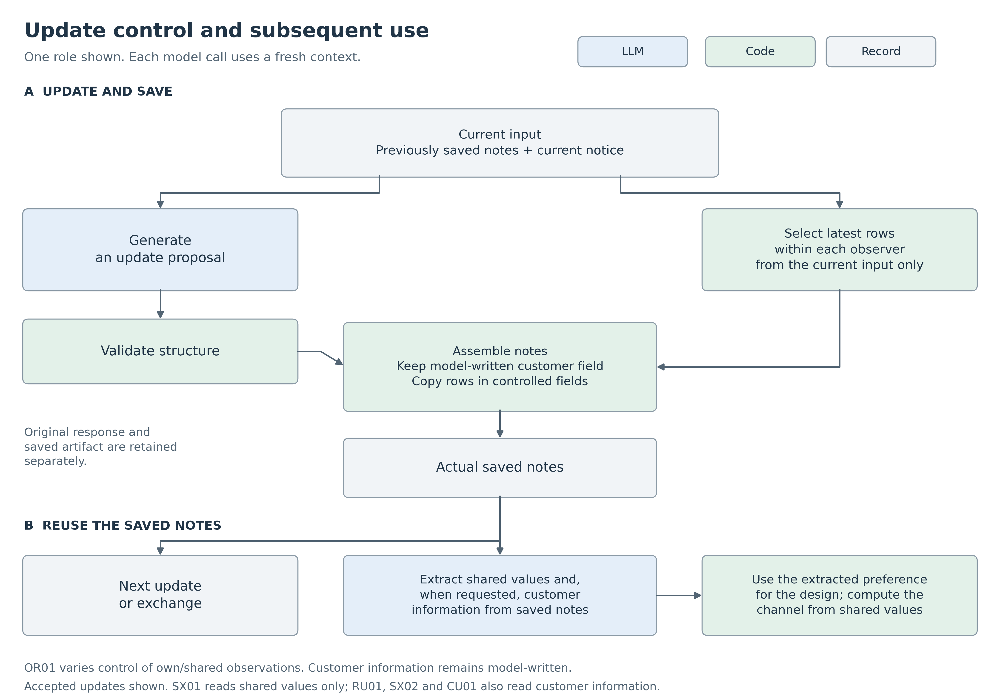
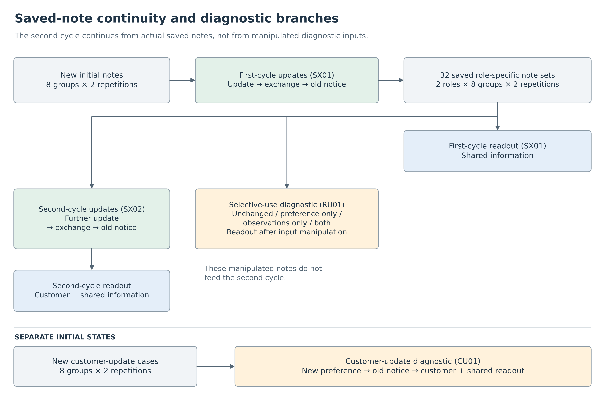

# Scope of Update Control in Private and Shared LLM Records: Field-Level Comparisons and Post-Update Rollback

**Kentaro Sato**  
Independent Researcher  
Contact: `info@metaclan.jp`

## Abstract

When an LLM continues to use private information and shared records, the correctness of a joint answer and the freshness of each record are distinct evaluation targets. We ran the same Qwen3.5-27B model as two roles in separate contexts on a synthetic task: retaining each assigned customer's dog-or-cat preference while combining both roles' observations to choose paper or digital guidance. We explored which record fields and update stages were supported by dividing responsibilities between the model and deterministic processing. Model proposals, actual saved notes, subsequent inputs, and later responses were linked to distinguish record correctness from readout fidelity.

A comparison applied different storage controls to the same 36 update proposals, generated from 18 previously used materials with two repetitions each. Updating only shared observations produced correct joint guidance in 36/36 proposals, while leaving four stale own-observation records. Repairing only those own observations fixed all four, but end-to-end success was unchanged because shared-field defects overlapped with them. Applying control to both observation fields supported two cycles of updates, exchanges, and reuse of actual saved notes. A separate diagnostic, using eight new cases with two repetitions each, allowed customer information outside deterministic latest-revision selection to change. All new preferences were initially adopted, but old notices subsequently rolled back the preference, origin ID, and revision in 14/16 trajectories. Later responses faithfully followed those stale records.

Within this fixed task and single model, the comparisons exposed both record defects hidden by correct answers and local repairs hidden by end-to-end outcomes. Retaining fixed information, adopting new information, and maintaining it after an update were evaluated as distinct requirements. The scope of a division of responsibilities should therefore be specified by record field and update stage, with saved artifacts linked to subsequent use.

**Keywords:** LLM agents; private memory; shared memory; state updates; provenance; deterministic processing; exploratory evaluation

## 1. Introduction

Consider two reception staff members serving different customers. Role A's customer wants a dog design, while role B's customer wants a cat design. To choose guidance for the venue as a whole, the two roles must combine their observations of paper and digital accessibility in their respective areas. They need to agree on joint guidance while giving each customer the requested design. Continuing both tasks through the same record pathway is the problem studied here.

Correct joint guidance can coexist with stale observations in a private note. Conversely, repairing those observations may leave end-to-end success unchanged if another field remains defective. **Final-answer correctness does not capture the correctness of the entire record, and end-to-end success does not capture every local repair.** Evaluating success requires relating the fields reached by a control to the defects that remain.

The first report traced the storage and subsequent use of assigned facts and shared observations, identifying provenance defects alongside correct answers. This report synthesizes an adaptive exploration with a different, open-weight model around the question: **Which record fields and update stages did the division of responsibilities support?** The central evidence is a comparison that varies the fields controlled for the same update proposal, together with a diagnostic tracing rollback after a legitimate change to customer information. Readout comparisons and two cycles of continued use establish how the saved artifacts could be used. Appendix A describes the connection to the first report and the initial transfer results. [First report, English version](../paper-01/manuscript-en-v0.2-2026-09-23.md).

**Table 1. Three findings and their supporting observations.** These are perspectives used to synthesize the exploratory results, not hypotheses fixed before the entire series. Section 4 specifies materials and units of analysis.

| Finding | Supporting observation | Section |
| --- | --- | --- |
| Record freshness, readout fidelity, and answer correctness can be observed separately | Accurate extraction from stale saved notes did not ensure agreement with the latest state; the customer-update diagnostic also faithfully used records that had rolled back | 5.1, 5.4 |
| Evaluation by record field reveals both remaining defects and local repairs | Correct joint guidance coexisted with stale own observations; repairing the own-observation field left end-to-end outcomes unchanged when shared-field defects overlapped | 5.2 |
| Retention, adoption of new information, and post-update maintenance impose different requirements | Fixed customer information was retained through two cycles and used for its intended task; a separate diagnostic found rollback after adoption of new preferences | 5.3, 5.4 |

Private information here consists of explicitly assigned customer facts and observations of each role's own area. Shared state is a structured record combining both roles' observations. This operationalization makes it possible to evaluate separate retention, necessary sharing, and use for the respective tasks.

## 2. Related Work

### 2.1 Memory updates and time

LLM systems with external memory have been evaluated on adapting stored content to new information. LongMemEval includes knowledge updates and temporal reasoning, while MemoryAgentBench addresses conflict resolution under incremental inputs. Supersede compares maintenance of bounded notes without re-presenting the original history against access to the full history. STALE separately evaluates current-state resolution, resistance to stale premises, and behavior appropriate to the current state. These studies provide a context for our distinction among retention, updating, and post-update maintenance. [LongMemEval](https://arxiv.org/abs/2410.10813v2); [MemoryAgentBench](https://arxiv.org/abs/2507.05257v1); [Supersede](https://arxiv.org/abs/2606.27472v1); [STALE](https://arxiv.org/abs/2605.06527v1).

For temporal representation, Zep distinguishes event time from ingestion time and represents fact validity intervals. MemConflict distinguishes genuine updates, later misinformation, and facts that coexist under different conditions. Our revision numbers define a contract for selecting the current state of an observation for the same person. We evaluate information age separately from arrival order, including notices that arrive later but contain an older revision. [Zep](https://arxiv.org/abs/2501.13956v1); [MemConflict](https://arxiv.org/abs/2605.20926v1).

### 2.2 Evaluating records separately from subsequent use

Prior stage-level evaluations include HaluMem, which separates extraction, updating, and question answering, and A-TMA, which separates state appropriateness in the memory bank, retrieved evidence, and answers. MemAudit evaluates recovery of user state from the resulting memory artifact separately from assistance-task success, comparing access to the entire store with the normal retrieval interface. These studies directly connect to our separate evaluation of final answers and record quality. [HaluMem](https://arxiv.org/abs/2511.03506v1); [A-TMA](https://arxiv.org/abs/2607.01935v1); [MemAudit](https://arxiv.org/abs/2606.24595v2).

Intermediate-process tracing also has precedents. MemTrace by Deng et al. analyzes where errors arise using execution graphs of memory operations and intermediate variables. A different paper, MemTrace by Long et al., probes the same knowledge point with current-state, historical-state, and change-trajectory questions, diagnosing evidence reachability and use. Our study belongs to this line of stage-level evaluation and links controls applied to different fields of the same update proposal with subsequent use of the actual saved artifact. [MemTrace: Deng et al.](https://arxiv.org/abs/2605.28732v1); [MemTrace: Long et al.](https://arxiv.org/abs/2606.17328v1).

### 2.3 Attribution and the division of model and code responsibilities

MemGPT addresses hierarchical context management, while Collaborative Memory provides private and shared memory areas with provenance-based access control. GroupMemBench evaluates speaker-attributed information and answers conditioned on the querying user in multi-party conversations. We separate customer information, own observations, and shared observations, measuring consistency when information about the same person appears in multiple record fields. Provenance representation also connects to PROV-DM's distinction among entities, activities, and agents. [MemGPT](https://arxiv.org/abs/2310.08560v2); [Collaborative Memory](https://arxiv.org/abs/2505.18279v1); [GroupMemBench](https://arxiv.org/abs/2605.14498v2); [PROV-DM](https://www.w3.org/TR/prov-dm/).

Reddy and Challaram divide responsibilities by assigning candidate extraction to an LLM and freshness selection to code. StateAuditor likewise uses code to verify quoted evidence and temporal ordering for proposed state transitions. CaMeL's separation of control and data flow provides a related design principle in a security setting. Our comparison varies the scope of latest-revision selection by person and whole-row copying: whether these operations apply to own observations, shared observations, or both. [Don't Ask the LLM to Track Freshness](https://arxiv.org/abs/2606.01435v1); [StateAuditor](https://arxiv.org/abs/2608.01619v1); [CaMeL](https://arxiv.org/abs/2503.18813v2).

**Table 2. Units of comparison in closely related work and this study.** Existing stage-level evaluations and divisions of responsibility are related to our local comparisons and observations along actual execution paths.

| Related work | Main unit of comparison or diagnosis | Correspondence examined here |
| --- | --- | --- |
| HaluMem; A-TMA | Memory operations; records, evidence, and answers appropriate to the state | Fidelity to saved artifacts versus agreement with the latest state |
| MemAudit | Assistance tasks versus state recovery from stored artifacts | Defects in own observations alongside correct joint answers |
| MemTrace (Deng et al.) | Memory operations and intermediate variables in execution graphs | Repairs and remaining defects across four branches of the same update proposal |
| Freshness-selection decomposition; StateAuditor | Extraction or transition proposals and rule-based selection or verification | Fields covered by control and fields outside its scope |
| STALE; MemTrace (Long et al.) | State, premises, and behavior; the time and use of the same fact | An adopted new state rolling back under an old notice and the resulting saved state being used |

Our focus is to use field-level comparisons of the same proposal to connect record defects hidden by correct answers with local repairs hidden by end-to-end outcomes, and to trace post-update rollback from actual saved notes to subsequent responses. We position this as an exploratory report with a fixed task and a single model, specifying the evaluation denominators and the fields covered by control.

## 3. Task and System

### 3.1 Private preferences and joint guidance

Each group comprises two roles, A and B. Both use the same model, with a fresh context for each call. Information across roles and across time is connected through notes and notices explicitly supplied by the controller.

Each role holds its assigned customer's dog-or-cat preference and observations of paper and digital accessibility in its own area. The two areas are disjoint and together cover the venue. Observation values are binary: ALL means that everyone can use the channel, and NOT_ALL means that not everyone can. If exactly one channel is ALL in both areas, that channel is selected for joint guidance. If neither or both qualify, the guidance decision is deferred as UNKNOWN.

For example, if everyone in A's area can use both channels but everyone in B's area can use only digital guidance, the joint channel is digital. The assigned customer's dog-or-cat preference is determined from information separate from that joint decision.

Each role's shared note is a copy of the A/B observation rows. Immediately after a new notice, its own new revision can coexist with its partner's old revision. During exchange, each role receives the observation row that its partner actually saved for itself. Customer preferences are not included in the exchanged observation row.

### 3.2 Three record fields and their responsibilities

A *record field* here is a logical area within a note targeted by an update operation. Customer information and own observations occupy separate fields of the private note, while shared observations occupy a field of the shared note. The distinction does not refer to the number of physical files or memory stores.

**Table 3. Record fields and the division of responsibilities in continued-use trials.** A role's own observations are distinct from information about its assigned customer.

| Record field | Content | Responsibility during updates | Subsequent use |
| --- | --- | --- | --- |
| Customer information | Assigned role, dog/cat preference, and origin ID; a separate customer revision is added in the customer-update diagnostic | Save the content written by the LLM | The LLM extracts the assigned role and preference; the preference determines the design |
| Own observations | The role's paper/digital observations, observer, origin ID, and revision | Code selects that person's latest candidate row from the input and copies the entire row | Check retention and updating of own observations; supply the row to the partner during exchange |
| Shared observations | Observation rows for A and B | Code selects and copies the latest row separately for each person | The LLM extracts four values; code computes the joint guidance channel |

The field-level comparison independently enables or disables the controls for own and shared observations in Table 3. Customer information remains model-written in every condition. Thus, control of the own-observation field does not replace the entire private note with ground truth.

Latest-revision selection first restricts candidates to the relevant observer and then compares revisions within that person's records. It does not compare A's revision numbers directly with B's. The selected row's person, two values, origin ID, and revision are copied together, and the source and before/after states are recorded. Candidates are limited to rows actually present in the current input. The storage controller never receives the expected state used for scoring.

### 3.3 Separating proposals, saved artifacts, and subsequent inputs

The model's raw response is retained, and the storage procedure is applied to structurally acceptable update proposals. Subsequent inputs are constructed by reading back the saved artifacts. Structurally acceptable but incorrect content is passed onward unchanged when it lies outside the designated storage control.



**Figure 1. Division of responsibilities in continued-use trials.** Observation-row copying is switched on or off in the field-level comparison. The final readout in the first cycle requests only the four shared values; the selective-use, second-cycle, and customer-update trials also request customer information. Raw responses and actual saved artifacts are retained separately at every stage.

### 3.4 Worked example: a correctly updated preference rolls back

In the first group in the execution order of the customer-update diagnostic, A's customer changed their preference from cat to dog. Table 4 follows the initial state, notices, actual saved states, and subsequent response. The example is CU01-C06-R1/A.

**Table 4. How old and new information passed through the same trajectory.** Origin IDs are reproduced exactly from the records.

| Stage | Preference | Revision | Origin ID |
| --- | --- | ---: | --- |
| Initial note | Cat | 76 | `K5E1ED87EFA479493` |
| New notice | Dog | 77 | `K0D9B80C5A23D1363` |
| Actual saved state after the new notice | **Dog** | **77** | **`K0D9B80C5A23D1363`** |
| Old notice arriving later | Cat | 76 | `K5E1ED87EFA479493` |
| Proposal and actual saved state after the old notice | **Cat** | **76** | **`K5E1ED87EFA479493`** |
| Final design answer | **Cat** | Re-citation not requested | Re-citation not requested |

The input receiving the old notice included the correctly saved dog preference at revision 77. The model reverted to the cat row at revision 76. Because customer information received no corrective storage control, that row passed into the next call. The relevant part of the subsequent response was:

```json
{"customer":{"subject":"A","animal":"CAT"}}
```

B's customer still preferred a dog, and the joint channel remained paper for both roles. The correct final outcome was therefore for both A and B to provide a dog design. **The criterion is agreement with each role's legitimate latest information, not whether the two answers are identical or different.** Section 5.4 reports all cases; Supplement S1 links the example to the raw responses.

## 4. Evaluation Methods

### 4.1 Adaptive exploration and relationships among trials

This exploration separated readout, storage, selective use, and continued updating in response to defects found during transfer. Materials, instructions, scoring rules, execution order, and stopping conditions were fixed locally before generation for each small trial. The series was not a confirmatory study fixed in full at its outset. The three findings in Table 1 synthesize the exploration at the writing stage; they do not change the pre-run criteria or formal results of individual trials.

**Table 5. Trials and evaluation units.** IDs are included for tracing source records. Repetitions use different generation seeds with the same materials.

| Trial | ID | Materials and repetitions | Comparison or trajectory |
| --- | --- | --- | --- |
| Readout decomposition | RS01 | 12 main materials and 4 boundary inputs, each repeated twice | Direct decision; extraction plus computation; model decision from correct four-value inputs |
| Saved-note readout | SVR01 | 16 current and 10 stale saved inputs, each repeated twice | Direct decision versus extraction plus computation |
| Field-level storage comparison | OR01 | 18 previously used materials, each repeated twice | The same 36 proposals branched into four own/shared-control conditions |
| First cycle | SX01 | 8 new groups, each repeated twice | Own-observation update, exchange, old notice, shared readout |
| Selective use | RU01 | 32 final role-specific note sets from the first cycle | Unchanged; preference changed; observations changed; both changed |
| Second cycle | SX02 | 32 final role-specific note sets from the first cycle | Further update, exchange, old notice, combined private/shared readout |
| Customer-update diagnostic | CU01 | A separate set of 8 new groups, each repeated twice | New customer preference, old notice, combined private/shared readout |

Readout decomposition reused materials from an earlier output-load diagnostic. Saved-note readout selected notes from the transfer trial that could be connected to subsequent calls, including all 10 qualifying stale inputs. The field-level comparison reused 18 materials from the subsequent update diagnostic. Supplement S1 records selection rules and links to the original inputs.

The first cycle, selective-use diagnostic, and second cycle all depend on the same eight groups. Selective use manipulates the saved-note inputs rather than updating them through actual notices. The second cycle begins with the notes actually saved in the first cycle, not the manipulated notes. The customer-update diagnostic uses new initial notes with a dedicated customer revision and is separate from the continuation into the second cycle.



**Figure 2. Continued use of saved artifacts and diagnostic branches.** Manipulated notes from the selective-use diagnostic are not passed to the second cycle. The customer-update diagnostic starts from separate initial states.

### 4.2 Readout and storage comparisons

The main readout comparison supplied identical private and shared notes to direct decision and extraction plus computation. Direct decision asked the model to choose paper, digital, or deferral. Extraction plus computation asked it to transcribe the four A/B-by-paper/digital values from the shared note; code then derived the channel from that actual response. A third condition supplied only the correct four values from the original material and asked the model to choose a channel. This was not a second model receiving the extraction condition's output.

In saved-note readout, both conditions were instructed to use the shared note. Scoring separately evaluated agreement with the supplied note and with the latest state represented by the original notices.

The storage comparison branched each LLM update proposal into four controls: neither field, shared observations only, own observations only, and both. Own observations were already current in the initial input, so their protection was evaluated. The 18 materials comprised 10 in which a new notice should update shared observations and eight in which the state should be retained despite an old notice.

Shared information was read from each branch's saved notes using the same extraction-plus-computation method. Before generation, readout calls were shared only when they belonged to the same update proposal and matched exactly in instructions, materials, schema, model, and seed. Thus, four conditions across 36 proposals represented 144 readout instances but required 55 actual responses. Generations were not shared across different materials or repetitions.

### 4.3 Continued use and changes to customer information

In the first cycle, both roles received new observations and exchanged their actual saved observation rows. They then received old notices and used the saved notes for joint guidance. Latest-revision selection by person was applied to both own and shared observation fields, as in Table 3. Customer preferences remained constant and were carried forward from the preceding private note without repeated external reinjection of ground truth.

Selective use produced four conditions from the final notes: change only the customer's preference, change only the paper/digital observations, change both, or leave them unchanged. When observations changed, their private and shared copies were kept consistent. The diagnostic tested whether manipulating customer information changed only the design and manipulating observations changed only joint guidance.

The second cycle supplied further observations to each role's saved notes and again proceeded through exchange, old notices, and readout. Both roles' observations changed so that the correct joint channel reversed relative to the preceding cycle. Customer information was retained, and customer and shared information were used together in the final response.

The customer-update diagnostic used eight cases combining initially matching or different preferences, target role A or B, and an initial dog or cat preference for the target. Both roles were told about one customer's new preference and later received that customer's old preference. The target role should update its own customer information, while the other role should retain information about its own customer. Customer revisions and observation revisions were managed separately. No deterministic latest-revision selection was applied to customer information; the existing storage controls maintained observation fields.

### 4.4 Scoring, aggregation, and stopping rules

Fixed Python code for each trial evaluated persons, customer preferences, observation values, origin IDs, revisions, and subsequent responses. Semantic scoring did not use a separate LLM judge. Alongside re-aggregation of raw responses, a separate implementation checked the correspondence among inputs, selected source rows, saved artifacts, and subsequent inputs.

Storage success required every field to match the expected state given the information available at that stage. Immediately after an own-observation update, the role was not required to possess its partner's new information before receiving it. Readout was evaluated for both fidelity to actual notes and correctness under the latest state. Origin IDs and revisions were evaluated during updating and storage; later simplified readouts did not request their re-citation.

End-to-end success in continued-use trials required all necessary storage and readout steps for both roles in one group–repetition trajectory to succeed. Selective use required success for both roles under all four conditions. The descriptive criterion for each of the first-cycle, selective-use, second-cycle, and customer-update trials was at least 14 of 16 trajectories, with at least seven of eight in each repetition. The storage comparison fixed criteria of at least 18/20 for new notices and 14/16 for old notices, alongside repetition-specific and customer-retention conditions. These were local criteria for small trials, not thresholds for statistical significance.

Structurally acceptable semantic errors were logged and passed onward. When an artifact could not be saved, dependent responses were treated as missing, with known outcomes distinguished from unresolved ones. All seven main trials reached the planned semantic evaluation, with no unresolved outcomes. Appendix A retains the original treatment of structural missingness and post hoc reference analyses in the transfer and earlier update diagnostics.

Analyses emphasize paired counts within fixed materials, component outcomes, and repetition-specific results. As planned for the individual trials, no p-values or population confidence intervals are calculated. Four branches of a common proposal, repetitions of the same material, reuse of a note, roles, and stages are not added as independent samples. Before execution, the customer-update diagnostic was designated to close after one fixed run regardless of outcome, followed by inspection of the raw records and preparation of this report.

### 4.5 Execution environment and structural validation

The seven main trials ran on Google Colab on September 25–26, 2026. The open-weight Qwen/Qwen3.5-27B model was loaded at a fixed revision and used with BF16, SDPA, and non-thinking mode. Generation settings were temperature 0.7, top-p 0.8, top-k 20, repetition penalty 1.0, a maximum input of 8,192 tokens, and a maximum output of 2,048 tokens. Seeds were recorded for materials and repetitions. The GPU was an NVIDIA RTX PRO 6000 Blackwell Server Edition. Appendix B lists the model revision and library versions. [Official model card](https://huggingface.co/Qwen/Qwen3.5-27B).

Readout decomposition and saved-note readout accepted bare JSON. Starting with the field-level storage comparison, a rule for removing only complete JSON code fences observed in the preceding diagnostic was incorporated before generation. The outer wrapper, JSON structure, and semantic correctness were treated as separate stages, retaining both original and normalized text. Selection and copying of observation rows were storage operations separate from wrapper normalization.

## 5. Results

### 5.1 Fidelity to records and agreement with the latest state diverged

Separating observation extraction from channel computation supported faithful use of both researcher-prepared notes and notes actually saved by the model. Because the same readout path also used stale notes accurately, **readout fidelity could be observed separately from the freshness of the stored state.**

In **readout decomposition (RS01)**, extraction plus computation produced the correct channel in all 24 main responses and all eight boundary responses. The four shared values also matched the input in all 32 responses: there were no cases in which an extraction error happened to yield the correct channel.

**Table 6. Readout comparisons within the same materials.** Entries are correct channel decisions divided by responses. Main materials have a unique paper or digital answer.

| Trial and materials | Direct model decision | Extraction plus code computation | Model decision from correct four values |
| --- | ---: | ---: | ---: |
| Readout decomposition: 12 main materials × 2 repetitions | 11/24 | **24/24** | 15/24 |
| Same trial: neither channel qualifies | 4/4 | 4/4 | 4/4 |
| Same trial: both channels qualify | 2/4 | 4/4 | 4/4 |
| Saved-note readout: 16 current inputs × 2 repetitions | 11/32 | **32/32** | Not run |

In the main paired comparison, both extraction plus computation and direct decision were correct in 11 cases, only extraction plus computation was correct in 13, and only direct decision was correct in zero. Model decisions supplied with the correct four values scored 15/24. On materials whose correct answer was paper, this condition produced fewer correct responses than direct decision and did not meet its fixed improvement criterion.

In **saved-note readout (SVR01)**, extraction matched all four shared values in all 52 responses: 32 from current notes and 20 from stale notes. For the current-note comparison, both conditions were correct in 11 cases, only extraction plus computation was correct in 21, and only direct decision was correct in zero.

For stale notes, the channel derived by extraction plus computation scored 20/20 against the record but 4/20 against the latest information. The materials and rules established this discrepancy before execution: faithful computation from stale values would produce it. What the trial established empirically was that the values were actually extracted correctly from every supplied note. This distinction motivated separate evaluation of updating/storage and readout in subsequent diagnostics.

### 5.2 Correct joint answers coexisted with defects in private records

Controlling only shared observations produced correct joint guidance in every case while leaving stale own observations. Controlling only own observations repaired those stale records but left the number of end-to-end successes unchanged because shared-field defects overlapped. The **field-level storage comparison (OR01)** branched the same 36 proposals into four conditions, exposing both defects behind correct answers and repairs invisible in end-to-end outcomes.

**Table 7. Control by record field and remaining defects.** The denominator is the same 36 proposals from 18 previously used materials with two repetitions each. “Own only” refers to the own-observation field.

| Storage control | Own observations correct | Shared observations correct | Joint guidance agrees with latest state | End-to-end success |
| --- | ---: | ---: | ---: | ---: |
| Neither field | 32/36 | 25/36 | 28/36 | 25/36 |
| Shared only | 32/36 | **36/36** | **36/36** | 32/36 |
| Own only | **36/36** | 25/36 | 28/36 | 25/36 |
| Both | **36/36** | **36/36** | **36/36** | **36/36** |

All 72 shared rows in the original proposals exactly matched rows present in the input, but 11 were not the latest revision for the relevant person. These defects involved selecting existing old rows. Customer information was correct in 36/36 proposals and retained under every branch. All 55 actual readout responses were faithful to the four shared values supplied to them.

With shared-only control, four own observations remained stale despite correct guidance in every case. For example, when an old revision-1 notice arrived while B's private note held revision 4, the proposal reverted both B's own-observation field and the shared B row to revision 1. Controlling only shared observations restored the shared B row to revision 4 and supported correct guidance, but left revision 1 in the own-observation field. Controlling both brought the two fields into agreement with the latest revision.

Own-only control repaired all four own-observation defects, yet shared-field defects remained in the same four proposals. End-to-end success therefore stayed at 25/36, as with neither field controlled. This is a **local repair hidden by end-to-end outcomes**, complementing the defects hidden by correct answers under shared-only control. Together with success in all 36 proposals when both fields were controlled, these results motivate reporting component outcomes alongside end-to-end outcomes.

### 5.3 Observation controls supported two cycles and selective use

Saving both own and shared observations by selecting the latest revision for each person supported two cycles of updates and exchanges using actual saved artifacts, as well as selective use of customer and shared information. Even along these successful trajectories, model proposals contained defects that storage control replaced. Table 8 links **proposals before storage to the records actually passed onward**.

**Table 8. Model proposals and actual saved states along continued-use trajectories.** Saved notes after observation control become subsequent model inputs. Both cycles involve the same eight groups with two repetitions each.

| Series | Updates with defective proposals | Mismatched observation rows | All fields match after storage | End-to-end success for both roles |
| --- | ---: | ---: | ---: | ---: |
| First cycle | 17/96 | 24 rows | 96/96 | 16/16 |
| Second cycle | 23/96 | 32 rows | 96/96 | 16/16 |

Note: A mismatched observation row is counted at each record field in each update, treating observer, paper/digital values, origin ID, and revision as one record. Multiple mismatched items in the same row count as one row; copies in own and shared fields are counted separately.

The first cycle's 24 mismatched rows comprised 19 that exactly matched old rows and five with an incorrect paper value despite correct revisions, origin IDs, and other items. All 32 mismatched rows in the second cycle were substitutions with old rows for the same person: nine in the own-observation field and 23 in shared observations. In particular, rollback appeared in 15/32 proposals at the old-notice stage of the second cycle. Storage control selected the latest input rows and replaced these mismatches before they passed onward. This table compares proposals and saved states within actual controlled trajectories; it is distinct from outcomes of trajectories run without control (Section 7).

In the **first cycle (SX01) and second cycle (SX02)**, customer information was retained in 96/96 updates in each cycle. End-to-end success for both roles was 16/16 trajectories in each cycle, or 8/8 in each repetition, meeting the fixed criteria. The first cycle began with eight new groups, and all 32 final shared readouts succeeded. The second cycle began with those actual saved notes, and all 32 final responses correctly extracted customer information and the four shared values. Joint guidance reversed correctly from the previous cycle in all 16 trajectories, while customer designs were retained.

The **selective-use diagnostic (RU01)** manipulated the first cycle's saved artifacts and correctly used customer and shared information in all 128 responses across four conditions. Table 9 shows the first group in execution order.

**Table 9. Input manipulations of the same saved artifacts and selective use for two tasks.** One group in a woodworking consultation scenario (RU01-C07-R1). Joint guidance was computed by code from the actual extracted values.

| Input condition | Design for A's customer | Design for B's customer | Joint guidance |
| --- | --- | --- | --- |
| Unchanged | Dog | Cat | Paper |
| Preference changed only | Cat | Dog | Paper |
| Observations changed only | Dog | Cat | Digital |
| Both changed | Cat | Dog | Digital |

Selective changes were confirmed in 64 paired customer-preference comparisons and 64 paired observation comparisons. End-to-end success across both roles and all four conditions was 16/16. These sets of 64 comparisons are diagnostics constructed from the same 128 responses. Figure 2 distinguishes the manipulated notes from the notes actually supplied to the second cycle.

### 5.4 Adoption of new information and post-update maintenance diverged

Whereas the two successful cycles held customer preferences fixed, the **customer-update diagnostic (CU01)** evaluated maintenance after legitimate changes to that information. New preferences were adopted and non-target information was retained in every case, but rollback remained after old notices. This separated the supported scope of retaining fixed information from that of preserving a change.

The target role adopted the new preference in 16/16 cases. The non-target role retained its own customer's information in 32/32 updates across new and old notices. The target role retained the new revision after an old notice in only 2/16 cases.

**Table 10. From new customer notices to subsequent use.** Eight cases with two repetitions each. Exact customer-field matching during updating includes the assigned role, preference, origin ID, and customer revision.

| Stage or evaluation target | Success | Meaning of denominator |
| --- | ---: | --- |
| Target role adopts the new preference | **16/16** | Target role; one new notice per group–repetition trajectory |
| Non-target role retains its customer information | **32/32** | Non-target role; new and old notices |
| Target role retains the new revision after an old notice | **2/16** | Target role; one old notice per group–repetition trajectory |
| Readout is faithful to saved notes | **32/32** | Final responses from both roles |
| Latest customer and shared information are used together | **18/32** | 16 non-target responses plus 2 target responses retaining the new revision |
| End-to-end success for both roles | **2/16** | New notices, old notices, and readout for both roles |

In all 14 rollbacks, the correct new revision had just been saved and was included in the next input. The proposal and actual saved state after the old notice exactly matched the initial row, including preference, origin ID, and revision. The subsequent response used that old preference. The correspondence illustrated in Section 3.4 was verified for all 14 cases.

Shared observations were saved correctly in 64/64 updates, and final joint guidance was correct in all 32 responses. Two proposals at the new-notice stage contained four incorrect paper-value entries across own and shared observations; the observation storage control copied the correct input rows. That same control was not applied to the 14 customer-information rollbacks.

End-to-end success was 1/8 in each repetition, below the fixed criterion of 14/16 overall and 7/8 per repetition. The two successful trajectories were repetitions of the same case. There was no missingness or structural failure: all failures involved semantic mismatches in the post-update record and its use.

## 6. Discussion

### 6.1 Faithful use of a record and correctness of that record

Readout decomposition supported a configuration that extracted four values from actual records and applied an explicit rule. Saved-note readout was also faithful to stale records, making the difference between record-based and latest-information scoring observable. In the customer-update diagnostic, this difference appeared along a generation–storage–use chain: a new preference was adopted, the saved content later rolled back, and readout correctly inherited that state.

A-TMA and STALE also separate state from its use. Our customer-update diagnostic characterizes the path in which storage reverts to an old state and a subsequent answer faithfully follows it. Evaluating continued use therefore benefits from inspecting both whether the saved state was appropriate and whether that state was used faithfully, alongside final-answer correctness. Establishing readout fidelity alone can help localize whether an error arose at or before storage or during readout.

### 6.2 Specify the record fields covered by each control

The possibility that local repair does not change end-to-end success follows from the metric's requirement that all conditions hold. What this comparison established empirically was that the four own-field defects in actual proposals overlapped with shared-field defects, so repairing the own field of those same proposals left end-to-end outcomes unchanged. Conversely, shared-only control produced correct guidance alongside stale own information. Linking field-specific states and subsequent use located the concrete defects and repairs hidden by the two aggregate measures.

The division of candidate processing between model and code has precedents, including Reddy and Challaram's freshness-selection method. Our comparison varied its application to own and shared observation fields. Latest-revision selection by person supports selecting an appropriate input row when the target person and revision are explicit, and saving that row unchanged. Under a contract with correct candidates and comparable revisions, matching the copied fields is supported by the properties of the code. The experiments examined outcomes when this operation was connected to model proposals, customer information outside its scope, and subsequent use of actual saved artifacts.

The label “latest-revision selection” alone does not specify whether a control applies to own observations, shared observations, or customer information. Mapping model-written fields, copied fields, and fields used downstream, as in Table 3, makes it possible to describe the supported scope and defects outside it.

### 6.3 Retention, change, and post-update maintenance are distinct requirements

The two continued-use cycles established a path that retained fixed customer preferences while incorporating new observations into joint guidance. Selective use showed that manipulations of customer preferences and shared observations affected their respective tasks. The customer-update diagnostic added a different requirement—a legitimate change to customer information itself—and found a separation between adopting new information or retaining non-target information and maintaining the updated state after an old notice.

Success across two cycles and failure to meet the customer-update criterion are compatible outcomes for different requirements. Separating the scope of successful retention, successful adoption, and defective post-update maintenance makes the supported conditions of the division of responsibilities explicit.

In this task, preserving private information means following legitimate information attributed to each role and updating that role's information when it changes. In Section 3.4, this correctly results in both roles providing a dog design. Attribution and agreement with the latest state, rather than answer similarity or difference, are the evaluation criteria.

### 6.4 Applicability conditions and untested situations

The observation controls that succeeded here operate under an input contract with explicit target persons, revisions, and candidate rows. Assessing the effectiveness of applying person/revision checks to customer information would require a comparison with and without control for that same field and the same materials. Deferral and re-confirmation for unidentified targets, missing revisions, or conflicting same-revision records also lie outside the current evaluation. Extending the task to historical states or conditional coexistence, as addressed by Long et al.'s MemTrace and MemConflict, would require specifying the time and conditions requested by a query rather than selecting only the maximum revision. The observed boundary is that a configuration supporting observation fields sustained two cycles of use, while rollback remained in the maintenance of changed customer information.

## 7. Scope and Limitations

**Model and task.** The main results concern a single Qwen3.5-27B revision, non-thinking mode, fixed generation settings, and short synthetic tasks in Japanese. Transfer from the first report changed both the model and the inference configuration and runtime. Dog/cat preferences are explicitly assigned facts, and shared state consists of structured observations from two roles. We did not measure personality formation, spontaneous consensus, or long-term coexistence through free conversation.

**Materials and repetitions.** The small trials combine diagnostics on previously used materials with tests using new materials in an adaptive exploration. Two repetitions partially characterize variation in execution but do not increase the number of materials. The first cycle, selective-use diagnostic, and second cycle depend on the same eight groups; the customer-update diagnostic also contains only eight groups. Success in all observed cases does not establish reliability on unknown tasks. Instructions, schemas, and output requirements differ across conditions, so the readout comparisons concern complete methods.

**Interventions and mechanisms.** The storage comparison branches the same proposal by controlled field. In contrast, the two continued-use cycles employ one configuration controlling both observation fields; proposal-defect rates are not outcomes of a multi-stage series run with control disabled. Customer and observation fields in the customer-update diagnostic also differ in content and contract. Their difference cannot be treated as a causal effect estimate without comparing control on and off for the same field. We did not experimentally decompose old-notice adoption into mechanisms such as presentation position, revision comparison, or internal attention.

**Input contract.** Latest-revision selection depends on rows actually present in the input and on comparable revisions. The implementation detects conditions such as conflicting candidates for the same person and revision, but the model trials used consistent candidates. Whether the maximum revision is correct in the real world, whether the sender is authorized to change the information, and how to seek clarification for an unidentified target require separate evaluation.

**Scoring and verification.** Semantic scoring used fixed code, and raw responses and saved artifacts were checked with a separate implementation. Design, implementation, scoring, verification, and writing occurred within the same project, rather than through independent blinded rescoring. Simplified readout evaluates the assigned role, dog/cat preference, and four shared values; it is not the same measure as the first report's strict evaluation, which also requires re-citation of origin IDs and current evidence references.

## 8. Conclusion

This study evaluated private and shared LLM records by **linking the fields and update stages supported by control to actual saved artifacts and subsequent use**. Comparisons that varied storage control for the same update proposal revealed both private-record defects accompanying correct joint answers and local repairs invisible in end-to-end outcomes. Separating readout fidelity, record freshness, and task correctness located the respective defects.

A configuration saving own and shared observations at the latest revision for each person supported retention of fixed customer information and use of new shared observations through a second cycle. In a separate diagnostic that allowed customer preferences to change, old notices caused rollback after the new preference had been adopted, and subsequent responses were faithful to the resulting record. Retention, adoption of new information, and post-update maintenance had different supported scopes in this configuration.

The result within this fixed task is an evaluation that specifies success by controlled field, update stage, and downstream use. Reporting local storage outcomes alongside system-wide outcomes helps characterize the applicability of designs that continue to use private information and shared state.

## 9. Data Availability and Declarations

This is an internal English manuscript based on the finalized Japanese version. The materials consist of fictional customer preferences and venue observations; this trial series uses no real customer information or personal social-media posts. Raw responses, inputs, actual saved artifacts, scoring code, environment records, and hash lists are retained locally. [Supplement S1](evidence-index-en-v0.1-2026-09-27.md) maps the main results to their evidence. These research materials are retained without a deletion deadline under the trials' storage policies.

A public repository, DOI, and data license have not yet been assigned. A public release will link manuscript and evidence versions so that readers can inspect saved artifacts and scoring. Current relative links refer to files within the research workspace.

The author determined the research direction, authorized execution, ran the model in Colab, and reviewed the manuscript. LLM assistance was used for design documents, implementation, deterministic scorers, offline verification, and writing. Funding, conflicts of interest, and author-contribution declarations for public release remain subject to the author's final confirmation.

## References

1. Sato, K. (2026). *Maintaining Role-Specific Information and Shared Records in LLM Memory Updates: An Exploratory Evaluation of Content, Provenance, and Continued Use*. English manuscript v0.2, corresponding to Japanese v0.11. Unpublished. [Local manuscript](../paper-01/manuscript-en-v0.2-2026-09-23.md).
2. Packer, C., Wooders, S., Lin, K., Fang, V., Patil, S. G., Stoica, I., & Gonzalez, J. E. (2024). *MemGPT: Towards LLMs as Operating Systems*. arXiv:2310.08560v2 (first version, 2023). [Primary source](https://arxiv.org/abs/2310.08560v2).
3. Rezazadeh, A., Li, Z., Lou, A., Zhao, Y., Wei, W., & Bao, Y. (2025). *Collaborative Memory: Multi-User Memory Sharing in LLM Agents with Dynamic Access Control*. arXiv:2505.18279v1. [Primary source](https://arxiv.org/abs/2505.18279v1).
4. Moreau, L., & Missier, P. (Eds.). (2013). *PROV-DM: The PROV Data Model*. W3C Recommendation. [Primary source](https://www.w3.org/TR/prov-dm/).
5. Debenedetti, E., Shumailov, I., Fan, T., Hayes, J., Carlini, N., Fabian, D., Kern, C., Shi, C., Terzis, A., & Tramèr, F. (2025). *Defeating Prompt Injections by Design*. arXiv:2503.18813v2. [Primary source](https://arxiv.org/abs/2503.18813v2).
6. Qwen Team. (2026). *Qwen3.5-27B model card*. The model revision used in the experiments is listed in Appendix B. [Official source](https://huggingface.co/Qwen/Qwen3.5-27B).
7. Wu, D., et al. (2025). *LongMemEval: Benchmarking Chat Assistants on Long-Term Interactive Memory*. arXiv:2410.10813v2 (first version, 2024). [Primary source](https://arxiv.org/abs/2410.10813v2).
8. Hu, Y., Wang, Y., & McAuley, J. (2025). *Evaluating Memory in LLM Agents via Incremental Multi-Turn Interactions*. arXiv:2507.05257v1. [Primary source](https://arxiv.org/abs/2507.05257v1).
9. Patel, V. (2026). *Supersede: Diagnosing and Training the Memory-Update Gap in LLM Agents*. arXiv:2606.27472v1. [Primary source](https://arxiv.org/abs/2606.27472v1).
10. Chao, H., et al. (2026). *STALE: Can LLM Agents Know When Their Memories Are No Longer Valid?*. arXiv:2605.06527v1. [Primary source](https://arxiv.org/abs/2605.06527v1).
11. Rasmussen, P., et al. (2025). *Zep: A Temporal Knowledge Graph Architecture for Agent Memory*. arXiv:2501.13956v1. [Primary source](https://arxiv.org/abs/2501.13956v1).
12. Tao, Z., et al. (2026). *MemConflict: Evaluating Long-Term Memory Systems Under Memory Conflicts*. arXiv:2605.20926v1. [Primary source](https://arxiv.org/abs/2605.20926v1).
13. Chen, D., et al. (2025). *HaluMem: Evaluating Hallucinations in Memory Systems of Agents*. arXiv:2511.03506v1. [Primary source](https://arxiv.org/abs/2511.03506v1).
14. Shi, Z., Tang, Y., & Tung, A. K. H. (2026). *A-TMA: Decoupling State-Aware Memory Failures in Long-Term Agent Memory*. arXiv:2607.01935v1. [Primary source](https://arxiv.org/abs/2607.01935v1).
15. Ma, E., et al. (2026). *MemAudit: Auditing Long-Term Agent Memory via Hidden User-State Recovery*. arXiv:2606.24595v2 (v1 was titled MemProbe). [Primary source](https://arxiv.org/abs/2606.24595v2).
16. Deng, X., et al. (2026). *MemTrace: Tracing and Attributing Errors in Large Language Model Memory Systems*. arXiv:2605.28732v1. [Primary source](https://arxiv.org/abs/2605.28732v1).
17. Long, X., et al. (2026). *MemTrace: Probing What Final Accuracy Misses in Long-Term Memory*. arXiv:2606.17328v1. [Primary source](https://arxiv.org/abs/2606.17328v1).
18. Yang, J., et al. (2026). *GroupMemBench: Benchmarking LLM Agent Memory in Multi-Party Conversations*. arXiv:2605.14498v2. [Primary source](https://arxiv.org/abs/2605.14498v2).
19. Reddy, V., & Challaram, S. (2026). *Don't Ask the LLM to Track Freshness: A Deterministic Recipe for Memory Conflict Resolution*. arXiv:2606.01435v1. [Primary source](https://arxiv.org/abs/2606.01435v1).
20. Sun, H., & He, L. (2026). *When Memory Updates but Behavior Does Not: Repairing Implicit Stale Dependencies in Personalized Agent Responses*. arXiv:2608.01619v1. [Primary source](https://arxiv.org/abs/2608.01619v1).

## Appendix A. Entry Points and Supplementary Analyses Preserving Formal Outcomes

### A.1 From model transfer to readout

The transfer trial (XM01) moved the first report's transcription-method comparison to Qwen using the same 64 materials, each repeated three times. Of 1,536 planned responses across two methods, two roles, and note creation/subsequent decision stages, 1,008 were obtained. The remaining 528 were dependent missing responses because parent notes did not pass the storage contract.

Across 192 group–repetition units per method, rewriting had zero successes, 185 failures, and seven unresolved outcomes; selection plus copying had zero successes, 187 failures, and five unresolved outcomes. Among the 240 subsequent responses that could be connected, all dog/cat decisions were correct, but only 30 guidance decisions were correct, and none passed strict evaluation including provenance and current evidence references. Of 230 responses whose shared notes matched the latest state, 171 deferred guidance. Storage defects alone therefore could not explain readout defects. [Transfer results, Japanese](../../experiments/XM01/docs/cross-model-e1-01-result-2026-09-25.md).

An output-load diagnostic (RL01) then held correct notes fixed. Across 12 main materials with two repetitions each, a condition requesting dog/cat, guidance, and evidence scored 3/24; removing evidence requests scored 7/24; requesting only joint guidance also scored 7/24. Reducing output requirements did not meet the fixed criterion, leading to the readout decomposition in the main text. [Output-load results, Japanese](../../experiments/RL01/docs/readout-load-01-result-2026-09-25.md).

### A.2 Separating JSON wrappers from update content

An earlier update diagnostic (UR01), using extraction plus computation for readout, obtained 72 update responses from 18 materials, two repetitions, and two methods. Of these, 37 wrapped JSON in code fences and were rejected under the format rules then in force; their 37 subsequent responses were not generated. The 35 accepted notes were read faithfully in 35/35 cases, but shared observations matched the latest state in 24/35, and guidance matched the latest state in 25/35. [Formal results, Japanese](../../experiments/UR01/docs/update-readout-01-result-2026-09-25.md).

A separate post hoc analysis removed only complete outer wrappers. Of those 37 responses, 27 then matched the required update content. Combined with the originally accepted responses, update content matched in 51/72; the remaining 21 contained stale shared rows. Three own-observation defects were also present, including one that placed the partner's observation in the own-observation field. This analysis did not fill in unperformed subsequent responses or change formal end-to-end outcomes. [Post hoc reference analysis, Japanese](../../docs/study2/update-readout-01-envelope-reference-2026-09-25.md).

Starting with the subsequent field-level storage comparison, this restricted wrapper handling was fixed before generation and applied consistently. A readable wrapper, correct attribution of an observation, and selection of the appropriate revision were evaluated separately.

## Appendix B. Implementation and Aggregation Details

### B.1 Execution settings

The model revision was `fc05daec18b0a78c049392ed2e771dde82bdf654`. The seven main trials used Python 3.13.15, PyTorch 2.11.0+cu128, Transformers 5.17.0, and Accelerate 1.15.0. Only the first half of the transfer trial used an A100-SXM4-80GB; its second half and the subsequent main trials used an RTX PRO 6000 Blackwell Server Edition. Generation seeds, actual prompts, finish reasons, token counts, and environments were recorded with responses.

Each call was text generation without tool operations. Python handled note delivery, storage, exchange, structural validation, and scoring. Normalization handles only a complete pair of `json` code fences around a response that ends with EOS. It does not repair internal keys, values, IDs, or types. Structural defects such as duplicate keys, and conflicting candidates for the same person and revision, are checked separately.

### B.2 Response accounting for the main trials

| Trial | Update responses | Readout or other responses | Total | Outer-fence removals |
| --- | ---: | ---: | ---: | ---: |
| Readout decomposition | 0 | 96 | 96 | 0 |
| Saved-note readout | 0 | 104 | 104 | 0 |
| Field-level storage comparison | 36 | 55 (shared across 144 condition instances) | 91 | 20 |
| First cycle | 96 | 32 | 128 | 54 |
| Selective use | 0 | 128 | 128 | 125 |
| Second cycle | 96 | 32 | 128 | 79 |
| Customer-update diagnostic | 64 | 32 | 96 | 75 |

All actual responses in this table ended with EOS and passed structural validation. This establishes completion of the format-processing path, which is counted separately from semantic or end-to-end success. Materials and contracts differ among trials, so no pooled success rate is calculated from this table.

### B.3 Evidence access

Supplement S1 links manuscript tables and the worked example to result reports, fixed re-aggregations, original ZIP archives, raw-response correspondences, and storage/readout code. Readout decomposition, field-level comparison, continued use, and customer-update outcomes can be traced at their original aggregation units. [Supplement S1: Evidence index](evidence-index-en-v0.1-2026-09-27.md).

The continuation in Figure 2 passes the first cycle's actual saved artifacts to the second cycle. Selective use creates four branches from those saved artifacts; the customer-update diagnostic starts from separate new initial states. Expected states used for scoring and the actual artifacts supplied to subsequent calls are retained in separate files.
