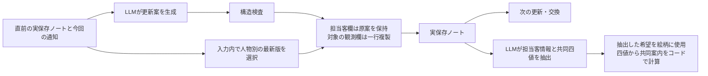
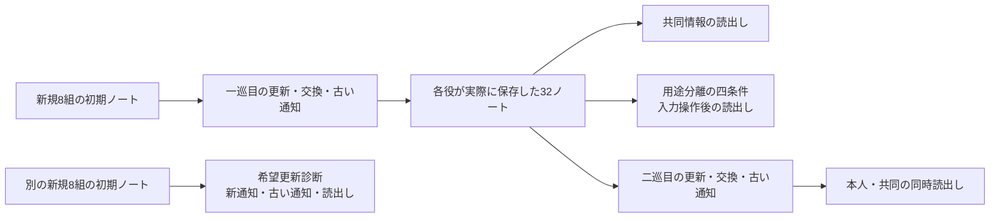

# LLMの個別・共有記録における更新制御の適用範囲：保存先別比較と変更後の巻戻りの追跡

**Kentaro Sato**  
独立研究者（Independent Researcher）  
連絡先：`info@metaclan.jp`

## 要旨

LLMが個別情報と共有記録を使い続けるとき、共同の答えの正しさと、各記録の最新性は別々の評価対象になる。本研究は、同一のQwen3.5-27Bを別コンテキストの二役として実行し、担当客の犬猫希望と、双方の観測から決める紙／デジタルの共同案内を用いた合成課題で、モデルと決定論的処理の分担が支える情報欄と更新段階を探索的に評価した。モデル原案、実保存物、次の入力、後続回答を対応付け、記録の適切さと読出しの忠実性を分けて測定した。

既知18材料から各2反復で得た36更新案を共通に用いた保存先別比較では、共同観測だけを最新版にすると、共同案内は36/36で正しかった一方、本人観測には4件の旧情報が残った。本人観測だけを修復した条件では、その4件が直っても、共同側の不備が重なっていたため全工程の成立数は変わらなかった。両方の観測欄を処理する構成は、実保存物を引き継ぐ二巡の更新・交換・利用に接続できた。一方、機械的な最新版選択の対象外である担当客情報を変更可能にした新規8ケース・各2反復の別診断では、新希望の採用が全件成立した後、古い通知によって14/16経路で希望・元ID・版が巻き戻った。後続回答はその古い記録に忠実だった。

この固定課題・単一モデルでの比較は、最終正答に隠れる記録の不備と、全工程の成否に隠れる局所的な修復の両方を示した。また、固定情報の保持、新情報の採用、変更後の維持を、異なる要求として評価できた。処理分担の成立範囲は、どの情報欄のどの更新段階を支えたかまで明示し、実保存物と後続利用を結び付けて記述する必要がある。

**キーワード：** LLMエージェント、個別記憶、共有記憶、状態更新、出典、決定論的処理、探索的評価

## 1. 問題設定

二人の受付係が、それぞれ別のお客さんを担当しているとする。Aの担当客は犬、Bの担当客は猫の絵柄を希望する。一方、会場全体の案内方法を決めるには、二人が別々の担当範囲で調べた紙・デジタルの利用状況を持ち寄る必要がある。共同の案内を揃えながら、担当客にはそれぞれの希望に合うものを用意する。この二つの仕事を同じ記録経路で続けることが、本稿の課題である。

この課題では、共同の案内が正しくても、個別のノートに古い観測が残ることがある。反対に、その古い観測を直しても、別の欄に不備が残れば全工程の成否は変わらない。**最終正答は記録全体の適切さを、全工程の成否は各欄で達成した修復を、それぞれ捉え切れない。** 成功を評価するには、処理が届いた情報欄と、残った不備を対応付ける必要がある。

第一報は、担当情報と共同観測の保存・後続利用を追い、正答に併存する出典の不備を報告した。本稿では、公開重みの別モデルを用いた適応的探索を、**処理分担は、どの情報欄のどの更新段階までを支えたか**という問いから統合する。中心となる証拠は、同じ更新案から保存先を変える比較と、担当客情報を正当に変更した後の巻戻りを追う診断である。読出しの比較と二巡の継続試験は、その保存物をどのように利用できたかを確かめる。第一報との接続と転移直後の成績は付録Aにまとめる。[第一報・日本語稿](../paper-01/manuscript-v0.11-2026-09-23.md)

**表1. 本稿の三つの知見と、それを支える観測。** 探索結果を統合する観点であり、系列全体の取得前仮説ではない。材料と集計単位は§4に示す。

| 知見 | 根拠となる観測 | 本文 |
| --- | --- | --- |
| 記録の最新性、読出しの忠実性、回答の正しさは別々に観測できる | 古い保存物から正確に値を取り出しても最新状態には合わず、希望更新診断でも巻き戻った記録を忠実に利用した | §5.1・§5.4 |
| 保存先別の評価は、残存不備と局所的な修復の両方を捉える | 共同案内が正しくても本人観測は古いまま残り、本人欄を直しても共同欄に不備が重なると全工程の成否は変わらなかった | §5.2 |
| 固定情報の保持、新情報の採用、変更後の維持は異なる要求になる | 担当客情報を保持する二巡は成立し、用途別に利用できた。別診断では新希望を採用した後の維持に巻戻りが残った | §5.3・§5.4 |

本稿で扱う個別情報は、各役に明示的に割り当てた担当客の事実と、自分の範囲の観測である。共同状態は、双方の観測をまとめた構造化記録を指す。この操作化によって、情報を分けて保つこと、必要な情報を共有すること、各用途へ使うことを具体的に評価する。

## 2. 関連研究との位置関係

### 2.1 記憶の更新と時間の扱い

外部記憶を持つLLMシステムでは、保存内容を新しい情報に合わせることが評価されてきた。LongMemEvalは知識更新と時間推論を含み、MemoryAgentBenchは増分的な入力からの競合解決を扱う。Supersedeは、元の履歴を再提示しない有限ノートの維持を、全履歴を参照できる条件と比較する。STALEは、現在状態の把握、古い前提への抵抗、その状態に応じた行動を別々に測る。これらは本稿の保持・変更・変更後維持を位置づける先行研究である。[LongMemEval](https://arxiv.org/abs/2410.10813v2)、[MemoryAgentBench](https://arxiv.org/abs/2507.05257v1)、[Supersede](https://arxiv.org/abs/2606.27472v1)、[STALE](https://arxiv.org/abs/2605.06527v1)

時間の表現では、Zepが出来事の時刻と取込時刻を分け、事実の有効期間を扱う。また、MemConflictは真の更新、後着の誤情報、条件ごとに共存する情報を区別する。本稿の版番号は、同じ人物・同じ観測について現在状態を選ぶための契約である。後着の通知が旧版の場合も含め、到着順と情報の新旧を分けて評価する。[Zep](https://arxiv.org/abs/2501.13956v1)、[MemConflict](https://arxiv.org/abs/2605.20926v1)

### 2.2 記録と、その後の利用を分けた評価

記憶の不備を工程ごとに測る先行例として、HaluMemは抽出・更新・質問応答を、A-TMAは記憶バンク・検索証拠・回答の状態適合性を分ける。MemAuditは、支援課題の成功とは別に、残された記録からユーザー状態を復元し、保存物全体と通常の検索経路で結果を比較する。これらは、最終正答と記録品質を別々に点検する本稿の評価と直接接続する。[HaluMem](https://arxiv.org/abs/2511.03506v1)、[A-TMA](https://arxiv.org/abs/2607.01935v1)、[MemAudit](https://arxiv.org/abs/2606.24595v2)

中間過程の追跡にも先行研究がある。DengらのMemTraceは、記憶操作と中間変数の実行グラフから誤りの発生箇所を分析する。別論文であるLongらのMemTraceは、同じ知識点を現在・過去・変化経路などの問いで調べ、証拠への到達と利用を診断する。本稿はこの工程別評価の流れに位置し、同一の更新案に対する保存先別の処理と、実保存物からの後続利用を対応づける。[MemTrace：Deng et al.](https://arxiv.org/abs/2605.28732v1)、[MemTrace：Long et al.](https://arxiv.org/abs/2606.17328v1)

### 2.3 情報の帰属と、モデル・コードの分担

MemGPTは階層的な文脈管理を、Collaborative Memoryは個別・共有の領域と来歴に基づくアクセス制御を扱う。GroupMemBenchは、多者会話で話者に帰属する情報と、質問者に応じた答えを評価する。本稿では担当客情報、本人観測、共同観測を分け、同じ人物の情報が複数の保存先にあるときの整合性を測る。出典の表現はPROV-DMの実体・活動・主体の区別とも接続する。[MemGPT](https://arxiv.org/abs/2310.08560v2)、[Collaborative Memory](https://arxiv.org/abs/2505.18279v1)、[GroupMemBench](https://arxiv.org/abs/2605.14498v2)、[PROV-DM](https://www.w3.org/TR/prov-dm/)

モデルと規則を分担する設計には、候補抽出をLLMへ、鮮度選択をコードへ渡すReddyとChallaramの方式がある。StateAuditorも、状態遷移案の引用根拠と時間順をコードで検証する。CaMeLの制御・データフロー分離は、セキュリティの文脈での接点である。本稿で比較するのは、人物別の最新版選択と行の複製を、本人・共同のどの観測欄へ適用したかという範囲である。[Don't Ask the LLM to Track Freshness](https://arxiv.org/abs/2606.01435v1)、[StateAuditor](https://arxiv.org/abs/2608.01619v1)、[CaMeL](https://arxiv.org/abs/2503.18813v2)

**表2. 近接研究と本稿の比較単位。** 既存の工程別評価と処理分担に、本稿の局所比較と実経路の観測を対応づける。

| 近接する研究 | 主な比較・診断の単位 | 本稿が詳しく追う対応 |
| --- | --- | --- |
| HaluMem、A-TMA | 記憶操作、状態に合う記録・証拠・回答 | 保存物への忠実性と、最新状態への一致 |
| MemAudit | 支援課題と、保存物からの状態復元 | 共同の正答に併存する本人観測の不備 |
| MemTrace（Dengら） | 実行グラフ上の記憶操作と中間変数 | 同じ更新案の四分岐における修復と残存不備 |
| 鮮度選択の分担、StateAuditor | 抽出・遷移案と規則による選択・検証 | 制御を適用する保存先と、その外側の欄 |
| STALE、MemTrace（Longら） | 状態・前提・行動、同一事実の時点と用途 | 正しく採用した新版が旧通知で巻き戻り、その保存物が使われる経路 |

本稿の中心は、同一原案の保存先別比較によって、正答に隠れる記録の不備と全工程の成否に隠れる局所修復を対応づけ、変更後の巻戻りを実保存から後続回答まで追跡することである。評価の分母と処理の適用欄を明示した、固定課題・単一モデルでの探索的報告として位置づける。

## 3. 課題とシステム

### 3.1 個別の希望と共同の案内

各組はAとBの二役からなる。両役は同一のモデルを用い、各呼出しを新しいコンテキストで実行する。役をまたぐ情報と時間をまたぐ情報は、管理側が明示的に渡すノート・通知によって接続する。

各役は自分の担当客の犬猫希望と、自分の担当範囲における紙・デジタルの利用状況を持つ。二つの担当範囲は重ならず、合わせて会場全体を覆う。観測値は「全員が利用できる」ALLと「全員は利用できない」NOT_ALLの二値である。A/B双方でALLとなる方法が一つなら、その方法を共同案内に選ぶ。該当方法がゼロまたは二つなら、案内は保留UNKNOWNとする。

例えば、Aでは紙・デジタルとも全員が使え、Bではデジタルだけを全員が使えるなら、共同案内はデジタルとなる。担当客の犬猫希望は、この共同案内とは別の情報から決まる。

共同ノートは、各役が持つA/B観測のコピーである。新しい通知を受けた直後には、自分の新版と相手の旧版が同居する。交換では、相手が実際に保存した自分の観測一行を受け取る。担当客の希望は交換する観測行に含めない。

### 3.2 三つの保存先と処理の担当

本稿でいう保存先は、ノート内で更新処理の対象となる論理的な情報欄を指す。担当客情報と本人観測は個別ノート内の別欄、共同観測は共同ノート内の欄であり、ファイルや記憶ストアの数を指すものではない。

**表3. 保存先と、継続試験での処理分担。** 「本人の観測」と「本人が担当する客の情報」を区別する。

| 保存先 | 内容 | 更新時の担当 | 後続での用途 |
| --- | --- | --- | --- |
| 担当客情報 | 担当役、犬猫希望、元ID。希望更新診断では専用の版も追加 | LLMが記述した内容を保存 | LLMが担当役と希望を抽出し、その希望を絵柄に使う |
| 本人観測 | 自分の紙・デジタル観測、観測者、元ID、版 | 入力候補から自分の最新版をコードが選び、一行全体を複製 | 本人観測の保持・更新を確認し、相手への交換に使う |
| 共同観測 | A/Bそれぞれの観測行 | 人物別の最新版をコードが選び、一行全体を複製 | LLMが四値を抽出し、コードが共同案内を計算 |

保存先の比較では、表3の本人観測・共同観測の処理をそれぞれ有効／無効にする。担当客欄は全条件でモデルの記述を保持する。したがって「本人側も保護する」という条件名が指すのは本人の**観測欄**であり、個別ノート全体をコードが正解へ置き換えることではない。

最新版を選ぶ処理は、まず観測者で候補を絞り、その人物の版番号を比較する。Aの版とBの版を直接比べない。選んだ行の人物・二値・元ID・版をまとめて複製し、選択元と変更前後を記録する。候補はその呼出しの入力に実在する行に限る。採点用の期待状態を保存器へ渡すことはない。

### 3.3 原案、保存物、次の入力を分ける

モデルの原回答を保存し、形式上受理できる更新案に保存処理を適用する。その保存物を読み戻して次の入力を作る。内容が誤っていても形式上受理できる欄は、定めた保存処理の対象外であれば、そのまま後続へ渡す。



**図1. 継続試験で使う処理分担。** 保存先比較では観測欄の複製を切り替える。一巡目の最終読出しは共同四値のみを求め、用途分離・二巡目・希望更新診断では担当客情報も求める。各工程の原回答と実保存物を別々に保持する。

### 3.4 通し例：正しく変更した希望が古い通知で戻る

希望更新診断の最初の割付組では、Aの担当客が猫から犬へ希望を変えた。初期状態、通知、実保存、後続回答を表4に示す。例の識別子はCU01-C06-R1/Aである。

**表4. 新旧の情報が、同じ経路でどう引き継がれたか。** 元IDは原記録どおり示す。

| 段階 | 犬猫希望 | 版 | 元ID |
| --- | --- | ---: | --- |
| 初期ノート | 猫 | 76 | `K5E1ED87EFA479493` |
| 新通知 | 犬 | 77 | `K0D9B80C5A23D1363` |
| 新通知後の実保存 | **犬** | **77** | **`K0D9B80C5A23D1363`** |
| 後から届く古い通知 | 猫 | 76 | `K5E1ED87EFA479493` |
| 古い通知後の原案・実保存 | **猫** | **76** | **`K5E1ED87EFA479493`** |
| 最後の絵柄回答 | **猫** | 再引用は求めない | 再引用は求めない |

古い通知を受けた入力には、直前に正しく保存した犬・版77のノートが含まれていた。モデルはそこから猫・版76の行へ戻し、担当客欄には保存処理による補正を入れないため、その内容が次へ渡った。後続回答の該当部分は次のとおりだった。

```json
{"customer":{"subject":"A","animal":"CAT"}}
```

Bの担当客は犬のまま、共同案内は双方とも紙のままだった。この例の正しい最終状態は、AもBも担当客に犬を用意することである。**二人の答えが同じか違うかだけでなく、各役の正当な最新情報に合うか**を評価する。全件の結果は§5.4、原回答との対応は補足資料S1に示す。

## 4. 評価方法

### 4.1 段階的な探索と試験の関係

本研究は、転移試験で見つかった不備に応じて、読出し、保存、用途別利用、継続更新を順に切り分けた探索である。各小試験の材料、指示、採点規則、実行順、終了条件は、その試験の生成前にローカルで固定した。系列全体を最初から固定した確認研究とは区別する。表1の三つの知見は、この探索を執筆時に統合したものであり、各試験の取得前の目安や正式結果は変更していない。

**表5. 本文の試験と評価単位。** 略号は原資料を追うために併記する。反復は生成seedを変え、同じ材料を用いる。

| 呼び名 | 略号 | 材料と反復 | 比較・経路 |
| --- | --- | --- | --- |
| 読出し分離 | RS01 | 主12材料＋境界4入力、各2反復 | 直接判断／抽出＋計算／正しい四値だけからのモデル判断 |
| 実保存読出し | SVR01 | 最新16保存入力＋古い10保存入力、各2反復 | 直接判断／抽出＋計算 |
| 保存先比較 | OR01 | 既知18材料、各2反復 | 共通更新案36件を、本人・共同の処理有無で四分岐 |
| 一巡目 | SX01 | 新規8組、各2反復 | 本人観測の更新→交換→古い通知→共同読出し |
| 用途分離 | RU01 | 一巡目の最終32ノート | 元のまま／希望だけ変更／観測だけ変更／両方変更 |
| 二巡目 | SX02 | 一巡目の最終32ノート | 次の更新→交換→古い通知→本人・共同の同時読出し |
| 希望更新診断 | CU01 | 別の新規8組、各2反復 | 担当客の新希望→古い通知→本人・共同の同時読出し |

読出し分離は、先行する出力負荷診断の材料を再利用した。実保存読出しは、転移試験で後続まで接続できたノートから選定し、古いノートは該当10入力を全件含めた。保存先比較は、その後の更新診断で使用した18材料を再利用した。各選定規則と元入力との対応を補足資料S1にまとめる。

一巡目、用途分離、二巡目は同じ8組に基づく。用途分離の変更条件は、研究者が保存ノートの入力内容を操作した読出し診断であり、実通知による更新ではない。二巡目は、その操作後ノートではなく、一巡目で実際に保存されたノートから開始した。希望更新診断は専用の版を追加した新しい初期ノートを使い、二巡目の続きとは分けた。



**図2. 保存物の継続と、診断の分岐。** 用途分離の操作後ノートは二巡目へ渡さない。希望更新診断には独立した初期状態を用いる。

### 4.2 読出しと保存の比較

読出し分離の主比較では、同じ個別・共同ノートを直接判断と抽出＋計算へ渡した。直接判断はモデルに紙／デジタル／保留を答えさせる。抽出＋計算はモデルに共同ノートのA/B×紙/デジタルの四値を転記させ、その実回答からコードで案内を導く。第三条件には原材料の正しい四値のみを提示し、案内の判断をモデルへ求める。この第三条件は、抽出条件の回答を受け取る二段目のモデルではない。

実保存読出しでは、両条件の根拠を共同ノートに揃えた。採点は、渡されたノートへの一致と、元通知が表す最新状態への一致を別々に行った。

保存先比較では、共通のLLM更新案から、観測行の処理を「なし」「共同のみ」「本人のみ」「両方」の四条件へ分岐した。本人観測は初期入力ですでに最新版であり、その保護を測る。18材料の内訳は、新通知で共同欄を更新する10材料と、古い通知が届いても状態を維持する8材料である。

各分岐の保存ノートから、同じ抽出＋計算方式で共同情報を読む。同じ更新案に属し、指示・資料・schema・モデル・seedが完全一致する後続入力だけは、生成前に共用した。そのため、四条件×36案の144条件分に対し、実際の読出しは55回答だった。異なる材料・反復の生成は共用していない。

### 4.3 継続利用と担当客の変更

一巡目では、両役へそれぞれ新しい観測を与え、各役の実保存観測一行を相手へ渡す。その後、古い通知を与え、実保存ノートを共同の案内に使う。本人・共同の観測欄には、表3の人物別最新版選択を適用する。担当客の希望はこの間一定とし、毎回外部の正解を再注入せず、直前の個別ノートから引き継ぐ。

用途分離では、その最終ノートに対し、担当客の犬猫希望だけ、紙・デジタルの観測だけ、両方、変更なしの四条件を作る。観測を変える際には、個別・共同の同じ観測の写しを整合させる。担当客情報の操作で絵柄だけが、観測の操作で共同案内だけが変わるかを点検する。

二巡目では、一巡目の各役の保存物へ次の観測を与え、再び交換・古い通知・読出しまで進める。両役の観測を変え、正しい共同案内が前回と反転するようにした。担当客は保持し、最後に担当客と共同情報を同じ回答から利用する。

希望更新診断では、初期希望が同じ／異なる、変更対象がA／B、対象の希望が犬／猫の組合せによる8ケースを用いた。一人の担当客の新しい希望を両役へ知らせ、その後、同じ対象について古い希望を知らせる。対象役は自分の情報を更新し、非対象役は自分の担当客情報を保持する。対象役の担当客版と観測版は別に管理し、担当客欄への機械的な最新版選択は行わない。観測欄は既存の保存処理で維持する。

### 4.4 採点、集計単位、終了条件

人物、犬猫希望、観測値、元ID、版、後続回答の適合は、試験ごとに固定したPythonコードで判定した。意味評価に別のLLM判定を用いていない。原回答からの再集計に加え、別実装によって入力、選択元、保存物、後続入力の対応を照合した。

保存の成立は、各段階で与えられた情報に応じた期待状態との全欄一致である。本人更新の直後には、相手の未受領の新情報を要求しない。読出しでは、実際のノートへの忠実性と、最新状態に基づく正しさを分ける。元IDと版は更新・保存時に評価し、後半の簡略化した読出しでは再引用を求めない。

継続試験の全工程成立は、一つの組・反復に属する両役の必要な保存と読出しがすべて成立することとした。用途分離では両役×四条件の成立を要求する。一巡目・用途分離・二巡目・希望更新診断の記述的な到達目安は、それぞれ16経路中14以上、かつ各反復8経路中7以上である。保存先比較では新通知18/20以上、古い通知14/16以上、反復別と担当客保持の条件を固定した。これらは小試験の局所的な到達目安であり、統計的有意差の基準ではない。

形式上受理できる意味誤りは記録して継続する。保存不能の場合は依存する後続を欠測とし、既知の結果と未確定を分ける。主要7試験では予定した意味評価まで到達し、未確定はなかった。転移・先行更新診断の形式欠測と事後参考分析は、付録Aに元の判定を残す。

分析は固定材料内の対応件数、成分別成績、反復別成績を中心とする。p値と母集団の信頼区間は、各小試験の計画どおり算出しない。共通更新案の四分岐、同一材料の反復、同じノートの再利用、役と工程を、それぞれ追加の独立標本として足さない。希望更新診断は結果によらず固定一巡で閉じ、原記録の診断後に本稿へ進む規則を取得前に定めた。

### 4.5 実行環境と構造検査

本文の主要7試験は2026年9月25〜26日にGoogle Colabで実行した。モデルは公開重みのQwen/Qwen3.5-27Bを固定revisionで読み込み、BF16、SDPA、non-thinkingで使用した。温度0.7、top-p 0.8、top-k 20、repetition penalty 1.0、最大入力8,192・最大出力2,048トークンとし、材料・反復に対応するseedを保存した。GPUはNVIDIA RTX PRO 6000 Blackwell Server Editionである。固定revisionとライブラリ版は付録Bに示す。[公式モデルカード](https://huggingface.co/Qwen/Qwen3.5-27B)

読出し分離と実保存読出しは裸JSONとして受理した。保存先比較以降では、先行診断で確認した完全なJSONコードフェンスだけを除去する規則を、生成前に組み込んだ。外側の囲い、JSONの構造、内容の正しさを別工程として扱い、原文と正規化後文を保持する。観測行の選択・複製は、外装正規化とは別の保存処理である。

## 5. 結果

### 5.1 記録への忠実性と、最新状態への一致が分かれた

観測値の抽出と案内計算を分ける構成は、研究者が用意したノートとモデルの実保存ノートの双方で、記録どおりの利用を成立させた。その読出し経路で古いノートも正確に利用できたため、**読出しの忠実性と、保存された状態の最新性を分けて観測できた。**

**読出し分離（RS01）**では、抽出＋計算が主24回答、境界8回答のすべてで正しい案内を出した。共同四値そのものも全32回答で入力と一致し、誤った抽出に偶然の案内正答が重なった例はなかった。

**表6. 同じ材料内の読出し比較。** 数値は案内の正答数／回答数。主材料は、紙またはデジタルが一意に決まるものを指す。

| 試験・材料 | モデルの直接判断 | 抽出＋コード計算 | 正しい四値からのモデル判断 |
| --- | ---: | ---: | ---: |
| 読出し分離：主12材料×2反復 | 11/24 | **24/24** | 15/24 |
| 同：利用可能な方法がゼロ | 4/4 | 4/4 | 4/4 |
| 同：利用可能な方法が二つ | 2/4 | 4/4 | 4/4 |
| 実保存読出し：最新16入力×2反復 | 11/32 | **32/32** | 実施せず |

主比較の抽出＋計算と直接判断の対応内訳は、両条件正答11、抽出＋計算のみ正答13、直接判断のみ正答0だった。正しい四値のみを示したモデル判断は15/24で、紙を正答とする材料では直接判断より正答が少なく、固定した改善目安には届かなかった。

**実保存読出し（SVR01）**でも、抽出は最新ノート32回答と古いノート20回答の計52回答すべてで共同四値に一致した。最新ノートの主比較では、両条件正答11、抽出＋計算のみ正答21、直接判断のみ正答0だった。

古いノートでは、抽出＋計算による案内は記録基準20/20、最新情報基準4/20となった。古い四値から忠実に計算すればこの差が出ることは、材料と規則から取得前に分かっていた。実測で確かめたのは、そのノートから値を実際に全件正しく取り出せたことになる。この差を基準に、後続の診断では更新・保存と読出しを別々に評価する。

### 5.2 共同正答と個別記録の不備が併存した

共同観測だけを処理すると、共同案内は全件正しくても、本人観測には旧情報が残った。反対に、本人観測だけを処理すると、その旧情報は直ったが、共同側の不備が重なっていたため全工程の成立数は変わらなかった。**保存先比較（OR01）**は、同じ36更新案からの四分岐により、正答の裏に残る不備と、全工程の成否だけでは見えない修復の両方を示した。

**表7. 保存先ごとの処理と、残った不備。** 分母は既知18材料×2反復の共通更新案36件。条件名の「本人」は本人観測欄を指す。

| 保存処理 | 本人観測が正しい | 共同観測が正しい | 最新状態に合う共同案内 | 全工程成立 |
| --- | ---: | ---: | ---: | ---: |
| なし | 32/36 | 25/36 | 28/36 | 25/36 |
| 共同のみ | 32/36 | **36/36** | **36/36** | 32/36 |
| 本人のみ | **36/36** | 25/36 | 28/36 | 25/36 |
| 両方 | **36/36** | **36/36** | **36/36** | **36/36** |

元案の共同72行はすべて入力に実在する行と完全一致したが、そのうち11行は当該人物の最新版ではなかった。ここでの不備は、入力に存在する旧行の選択だった。担当客欄は原案36/36で正しく、全分岐でその内容を保持した。実際に生成した55読出しも、すべて渡された共同四値に忠実だった。

共同のみの条件では案内が全件正しくても、本人観測の4件は旧版のままだった。例えばBの個別ノートが版4を持っていたところへ版1の通知が届くと、原案は本人欄と共同B欄をともに版1へ戻した。共同のみを処理すると共同B欄は版4に戻り、正しい案内を出せたが、本人欄の版1は残った。両方を処理したときに、二つの保存先が最新版へ揃った。

本人のみの条件は、本人欄4件を正しくしても、同じ4件に共同欄の不備が残るため、全工程は処理なしと同じ25/36だった。共同のみの条件が示す「正答に隠れる不備」と対をなす、**全工程の成否に隠れる局所的な修復**である。両方を処理する条件で全36件が成立したことと合わせ、成分別の成績と全工程の成績を併記する理由になる。

### 5.3 観測欄の処理を、二巡の更新と用途別利用へ接続できた

本人・共同の観測欄を人物別の最新版として保存する構成は、実保存物を引き継ぐ二巡の更新・交換と、担当情報・共同情報の用途別利用へ接続できた。この成立した経路の中でも、モデル原案には不備があり、保存処理が該当欄を置き換えていた。表8は、**保存前の原案と、実際に次へ渡された記録**の対応を示す。

**表8. 継続経路におけるモデル原案と実保存の対応。** 観測欄の処理を通した実保存ノートが、後続のモデル入力になる。二巡は同じ8組×2反復の継続である。

| 系列 | 原案に不備のあった更新 | 不一致の観測行数 | 保存後の全欄一致 | 二役の全工程 |
| --- | ---: | ---: | ---: | ---: |
| 一巡目 | 17/96 | 24行 | 96/96 | 16/16 |
| 二巡目 | 23/96 | 32行 | 96/96 | 16/16 |

注：不一致の観測行数は、各更新の各保存先にある観測者・紙／デジタルの値・元ID・版の組を単位に数える。同じ行で複数項目が違っても1行とし、本人欄と共同欄の写しは別々に数える。

一巡目の24行は、旧行と完全一致する19行と、版・元ID等は正しいが紙の値が違う5行だった。二巡目の32行はすべて同じ人物の旧行への置換で、本人欄の9行、共同欄の23行だった。特に二巡目の古い通知の工程では、原案15/32更新に巻戻りがあった。保存処理は入力中の最新版の行を選び、こうした不一致を次へ渡す前に置き換えていた。この表は実運転中の保存前後の比較であり、処理なしで継続した系列の成績とは区別する（§7）。

**一巡目（SX01）と二巡目（SX02）**では、それぞれ96/96更新で担当客情報が保持され、両役の全工程は各16/16経路、各反復8/8で成立し、固定した到達目安を満たした。一巡目は新規8組から始め、最後の共同読出しは32/32成立した。二巡目はその実保存ノートから始め、最後の32回答で担当客と共同四値を正しく取り出した。共同案内は全16経路で前回から正しく反転し、担当客への絵柄は維持された。

情報の用途を分けて確かめた**用途分離（RU01）**では、一巡目の保存物を操作した四条件の全128回答で、担当客と共同情報を正しく利用した。最初の割付組の結果を表9に示す。

**表9. 同じ保存物への入力操作と、二つの仕事の使い分け。** 木工相談会の一組（RU01-C07-R1）。共同案内は実際の抽出値からコードで算出した。

| 入力条件 | Aの担当客への絵柄 | Bの担当客への絵柄 | 共同案内 |
| --- | --- | --- | --- |
| 元のまま | 犬 | 猫 | 紙 |
| 希望だけ変更 | 猫 | 犬 | 紙 |
| 観測だけ変更 | 犬 | 猫 | デジタル |
| 両方変更 | 猫 | 犬 | デジタル |

担当客希望に関する64対応と観測に関する64対応で、操作に対応する選択的な変化を確認した。二役×四条件をまとめた全工程も16/16で成立した。ここでの64対応は同じ128回答から作る診断である。用途分離の操作後ノートと、二巡目へ実際に渡したノートの違いは図2に示す。

### 5.4 新情報の採用と、変更後の維持が分かれた

担当客の希望を一定としていた二巡の成功に対し、**希望更新診断（CU01）**は、その情報を正当に変更した後も維持できるかを評価した。新希望の採用と非対象情報の保持は全件成立したが、古い通知後の維持には巻戻りが残った。これにより、固定情報を保つという要求と、変更後の情報を守るという要求の成立範囲が分かれた。

対象役による新しい希望の採用は16/16、非対象役による自分の担当客情報の保持は新旧通知を合わせて32/32で成立した。一方、古い通知後の新版維持は2/16にとどまった。

**表10. 担当客の新通知から後続利用まで。** 8ケース×2反復。更新の全欄一致には担当役・希望・元ID・担当客版を含む。

| 工程・評価対象 | 成立 | 分母の意味 |
| --- | ---: | --- |
| 対象役が新しい希望へ更新 | **16/16** | 対象役、一組一回の新通知 |
| 非対象役の担当情報を保持 | **32/32** | 非対象役、新通知と古い通知の二回 |
| 対象役が古い通知後も新版を維持 | **2/16** | 対象役、一組一回の古い通知 |
| 保存ノートへの忠実な読出し | **32/32** | 両役の最終回答 |
| 最新の担当情報と共同情報を同時利用 | **18/32** | 非対象16＋新版を維持した対象2 |
| 二役の全工程 | **2/16** | 両役の新通知・古い通知・読出し |

14件の巻戻りはすべて、直前に正しい新版が保存され、次の入力にも含まれた状態で生じた。古い通知後の原案と実保存は、初期の希望・元ID・版を含む行と完全一致し、後続回答もその古い希望を使用した。§3.4の通し例と同じ対応を、14件全件で確認した。

共同観測は64/64更新で正しく保存され、最後の共同案内は32/32正しかった。新通知時の原案2更新では、本人観測と共同観測の紙の値に計4欄の不一致があり、観測欄の保存処理が入力の正しい行を複製した。担当客の14件の巻戻りには同じ処理を適用していない。

全工程は各反復1/8で、目安の全体14/16かつ各7/8を満たさなかった。成立した2件は同じ1ケースの二反復である。欠測・形式不備はなく、未達はすべて変更後の記録とその利用に関する意味上の不一致だった。

## 6. 考察

### 6.1 記録の忠実な利用と、記録の適切さを分ける

読出しの分離によって、実際の記録から四値を取り出し、明示規則を適用する構成が成立した。実保存読出しでは、古い記録にも忠実だったため、記録基準と最新情報基準の差を観測できた。希望更新診断では、この差が生成・保存・後続利用の連鎖として現れた。新しい希望を採用した後に保存内容が巻き戻り、読出しはその状態を正しく引き継いだ。

A-TMAやSTALEも状態とその利用を分けて評価する。本稿の希望更新診断は、そのうち保存側が旧状態へ戻り、後続回答がその状態を忠実に使う経路を具体化する。したがって、継続利用の評価では、最終回答の正誤に加えて、保存する状態が適切だったか、保存された状態を忠実に利用したかを別々に点検できるようにすることが有用である。忠実な読出しを確認するだけでも、誤りが保存以前に生じたのか、読出しで生じたのかを絞れる。

### 6.2 処理の分担は保存先まで明示する

全工程指標が局所修復を反映しない可能性は、すべての条件の成立を要求する定義から生じる。本比較で確認したのは、実際の原案における本人欄4件の不備が共同欄の不備と重なり、同じ原案の本人欄を修復しても全工程の成否が変わらなかったことである。一方、共同のみを処理した条件では、正しい案内と本人欄の旧情報が併存した。保存先別の状態と後続利用を対応づけることで、二つの集約指標に隠れる不備と修復の具体的な所在を示せた。

ReddyとChallaramによる鮮度選択の分担と同様に、候補の処理をモデルとコードへ分けることには先行例がある。本稿では、その適用先を本人・共同の観測欄へ分けて比較した。人物別最新版選択が支えるのは、対象人物と版が明確な入力候補から適切な行を選び、そのまま保存する工程である。候補が正しく、比較可能な版があるという契約の下では、複製する欄の一致はコードの性質によって支えられる。実験では、その処理をモデル原案、処理対象外の担当客情報、実保存からの後続利用へ接続した際の成否を確認した。

「最新版を選ぶ機能」という名称だけでは、本人観測・共同観測・担当客情報のどこを処理するかが定まらない。表3のように、モデルが生成する欄、入力から複製する欄、後続で使う欄を対応付けると、今回成立した範囲と、その外側に残る不備を記述できる。

### 6.3 保持、変更、変更後の維持を別の要求として捉える

二巡の継続試験で確認したのは、希望が一定の担当客情報を保ち、新しい観測を共同案内へ反映する経路の成立である。用途分離では、担当客希望と共同観測の操作が、それぞれの仕事へ選択的に反映された。希望更新診断は、そこへ「担当客情報自体の正当な変更」という別の要求を加え、新情報の採用・非対象の保持と、古い通知後の維持との間に差を示した。

二巡の成功と希望更新診断の未達は、それぞれの要求に対する結果として両立する。固定情報を保持できた範囲、変更を採用できた範囲、変更後の維持に不備が残った範囲を分けることで、処理分担の成立条件が具体的になる。

この課題で個別情報を守ることは、各役に属する正当な情報に従い、変更があればその役の情報だけを更新することである。§3.4の例では、その結果として二人とも犬を用意するのが正しい。回答の同異ではなく、帰属先とその最新状態への一致が評価の基準となる。

### 6.4 適用条件と未評価の状況

本稿で成立した観測欄の処理は、対象人物・版・候補行が明示されている入力契約に対応する。担当客欄にも対象・版照合を適用する案の有効性は、同じ欄と資料での処理有無の比較によって評価する必要がある。対象不明、版欠落、同版の矛盾に対する保留・再確認も今回の評価範囲外である。また、LongらのMemTraceやMemConflictが扱う過去の状態や条件付きの共存へ用途を広げる場合には、最大版を選ぶだけでなく、問いが要求する時点と条件を指定する必要がある。確認できた境界は、観測欄を支える構成で二巡の利用が成立した一方、担当客情報の変更後の維持には巻戻りが残ったことである。

## 7. 測定範囲と限界

**モデルと課題。** 本文の結果は、単一のQwen3.5-27B revision、non-thinking、固定生成設定、日本語の短い合成課題に基づく。第一報からの転移ではモデルだけでなく推論設定と実行系も変わった。犬猫希望は明示的な担当事実、共有状態は二人の構造化観測であり、人格の形成、自発的な合意形成、自由対話による長期共存は測っていない。

**材料と反復。** 小試験は既知材料の診断と新しい材料の接続を組み合わせた適応的探索である。二反復は同じ材料での実行の揺れを部分的に示すが、材料数は増やさない。一巡目・用途分離・二巡目は同じ8組へ依存し、希望更新診断も8組に限られる。観測した全件成立を未知課題での信頼性保証へ広げることはできない。条件ごとに異なる指示・schema・出力範囲を使うため、読出し比較は方式全体の比較となる。

**介入と機構。** 保存先比較は同じ原案に対する保存先別の分岐を持つ。一方、二巡の継続試験は両方の観測欄を処理する一構成であり、原案の不備率は処理を無効にした多段系列の成績ではない。希望更新診断の担当客欄と観測欄も、内容と契約が異なる。同一欄での処理有無を比較せず、その差を因果効果量とすることはできない。古い通知の採用を、提示位置、版数比較、内部の注意などの機構へ分解する実験は行っていない。

**入力契約。** 最新版選択は、入力内に存在する行と比較可能な版に依存する。同一人物・同一版の矛盾等は実装上検出するが、今回の実モデル試験は整合した候補を使う。最大版が現実世界でも正しい情報か、通知者に変更の権限があるか、対象不明の連絡へどう確認するかは、別の評価が必要となる。

**採点と監査。** 意味採点は固定コードで行い、原回答と保存物を別実装で照合した。設計・実装・採点・照合・執筆は同一プロジェクト内で行われ、第三者による盲検再採点ではない。簡略化した読出しは担当役・犬猫と共同四値を評価し、第一報の元ID・現在参照の再引用まで含む厳密指標と同じ尺度ではない。

## 8. 結論

本研究は、LLMの個別・共有記録について、**処理が支える情報欄と更新段階を、実保存物から後続利用まで対応付けて評価した。** 同じ更新案から保存先を変えた比較では、共同の正答に併存する個別記録の不備と、全工程の成否には表れない局所的な修復の両方を観測した。読出しの忠実性、記録の最新性、各仕事の正しさを分けることで、それぞれの不備の所在を記述できた。

本人・共同の観測欄を人物別の最新版として保存する構成は、固定した担当客情報の保持と、新しい共同観測の利用を二巡目まで支えた。一方、担当客の希望を変更可能にした別診断では、新希望を採用しても古い通知によって巻き戻り、後続回答はその記録に忠実だった。固定情報の保持、新情報の採用、変更後の維持は、今回の構成で異なる成立範囲を持った。

この固定課題で得た到達点は、処理分担の成功を、対象欄・更新段階・後続用途まで明示して評価できたことである。局所的な保存の成立とシステム全体の成否を併記することが、個別情報と共同状態を使い続ける設計の適用範囲を捉える手がかりになる。

## 9. データ可用性と申告

本稿は日本語の内部草稿である。材料は架空の担当客希望と会場観測からなり、この試験系列に実在の顧客情報や個人の投稿を用いていない。原回答、入力、実保存物、採点コード、環境記録、hash一覧をローカルに保管し、本文の主要成績からの対応を[補足資料S1](evidence-index-v0.4-2026-09-27.md)に示す。これらの研究結果資料は各試験の保存方針に従い、削除期限なしで保管している。

公開リポジトリ、DOI、資料のライセンスは未設定である。公開版では、論文の版と再現資料の版を対応付け、読者が保存物と採点を検証できる形へ整える。現段階の相対リンクは、研究フォルダ内の資料を指す。

研究の方向決定、実行承認、Colabでのモデル実行、原稿確認は著者が行った。設計文書、実装、決定論的採点器、オフライン照合、執筆にLLM支援を用いた。資金提供・利益相反・著者貢献の公開用申告は、公開版作成時に著者が最終確認する。

## 参考文献

1. Sato, K. (2026). *個別情報と共有記録を両立するLLMメモリ更新：内容・出典・継続利用の探索的評価*. 日本語稿v0.11、未公開。[ローカル原稿](../paper-01/manuscript-v0.11-2026-09-23.md)。
2. Packer, C., Wooders, S., Lin, K., Fang, V., Patil, S. G., Stoica, I., & Gonzalez, J. E. (2024). *MemGPT: Towards LLMs as Operating Systems*. arXiv:2310.08560v2（初版2023年）。[一次資料](https://arxiv.org/abs/2310.08560v2)。
3. Rezazadeh, A., Li, Z., Lou, A., Zhao, Y., Wei, W., & Bao, Y. (2025). *Collaborative Memory: Multi-User Memory Sharing in LLM Agents with Dynamic Access Control*. arXiv:2505.18279v1。[一次資料](https://arxiv.org/abs/2505.18279v1)。
4. Moreau, L., & Missier, P. (Eds.). (2013). *PROV-DM: The PROV Data Model*. W3C Recommendation。[一次資料](https://www.w3.org/TR/prov-dm/)。
5. Debenedetti, E., Shumailov, I., Fan, T., Hayes, J., Carlini, N., Fabian, D., Kern, C., Shi, C., Terzis, A., & Tramèr, F. (2025). *Defeating Prompt Injections by Design*. arXiv:2503.18813v2。[一次資料](https://arxiv.org/abs/2503.18813v2)。
6. Qwen Team. (2026). *Qwen3.5-27B model card*. 実験で使用したモデルrevisionは付録Bに記載。[公式資料](https://huggingface.co/Qwen/Qwen3.5-27B)。

7. Wu, D., et al. (2025). *LongMemEval: Benchmarking Chat Assistants on Long-Term Interactive Memory*. arXiv:2410.10813v2（初版2024年）。[一次資料](https://arxiv.org/abs/2410.10813v2)。
8. Hu, Y., Wang, Y., & McAuley, J. (2025). *Evaluating Memory in LLM Agents via Incremental Multi-Turn Interactions*. arXiv:2507.05257v1。[一次資料](https://arxiv.org/abs/2507.05257v1)。
9. Patel, V. (2026). *Supersede: Diagnosing and Training the Memory-Update Gap in LLM Agents*. arXiv:2606.27472v1。[一次資料](https://arxiv.org/abs/2606.27472v1)。
10. Chao, H., et al. (2026). *STALE: Can LLM Agents Know When Their Memories Are No Longer Valid?*. arXiv:2605.06527v1。[一次資料](https://arxiv.org/abs/2605.06527v1)。
11. Rasmussen, P., et al. (2025). *Zep: A Temporal Knowledge Graph Architecture for Agent Memory*. arXiv:2501.13956v1。[一次資料](https://arxiv.org/abs/2501.13956v1)。
12. Tao, Z., et al. (2026). *MemConflict: Evaluating Long-Term Memory Systems Under Memory Conflicts*. arXiv:2605.20926v1。[一次資料](https://arxiv.org/abs/2605.20926v1)。
13. Chen, D., et al. (2025). *HaluMem: Evaluating Hallucinations in Memory Systems of Agents*. arXiv:2511.03506v1。[一次資料](https://arxiv.org/abs/2511.03506v1)。
14. Shi, Z., Tang, Y., & Tung, A. K. H. (2026). *A-TMA: Decoupling State-Aware Memory Failures in Long-Term Agent Memory*. arXiv:2607.01935v1。[一次資料](https://arxiv.org/abs/2607.01935v1)。
15. Ma, E., et al. (2026). *MemAudit: Auditing Long-Term Agent Memory via Hidden User-State Recovery*. arXiv:2606.24595v2（v1の題名はMemProbe）。[一次資料](https://arxiv.org/abs/2606.24595v2)。
16. Deng, X., et al. (2026). *MemTrace: Tracing and Attributing Errors in Large Language Model Memory Systems*. arXiv:2605.28732v1。[一次資料](https://arxiv.org/abs/2605.28732v1)。
17. Long, X., et al. (2026). *MemTrace: Probing What Final Accuracy Misses in Long-Term Memory*. arXiv:2606.17328v1。[一次資料](https://arxiv.org/abs/2606.17328v1)。
18. Yang, J., et al. (2026). *GroupMemBench: Benchmarking LLM Agent Memory in Multi-Party Conversations*. arXiv:2605.14498v2。[一次資料](https://arxiv.org/abs/2605.14498v2)。
19. Reddy, V., & Challaram, S. (2026). *Don't Ask the LLM to Track Freshness: A Deterministic Recipe for Memory Conflict Resolution*. arXiv:2606.01435v1。[一次資料](https://arxiv.org/abs/2606.01435v1)。
20. Sun, H., & He, L. (2026). *When Memory Updates but Behavior Does Not: Repairing Implicit Stale Dependencies in Personalized Agent Responses*. arXiv:2608.01619v1。[一次資料](https://arxiv.org/abs/2608.01619v1)。

## 付録A. 探索の入口と、正式結果を保った補助分析

### A.1 転移試験から読出しへ

第一報の転記方式比較を同じ64材料でQwenへ移した転移試験（XM01）は、各材料を三反復した。二方式×二役×ノート作成・後続判断の計1,536予定回答のうち、1,008回答を得た。残る528回答は親ノートが保存契約を通らなかったことによる依存欠測だった。

再記述の全工程は192組・反復中0成立・185不成立・7未確定、選択＋複製は0成立・187不成立・5未確定だった。接続できた後続240回答では担当客の犬猫は全件正しかったが、共同案内は30回答で正しく、出典・現在参照まで含む厳密成立は0だった。共同ノート自体が最新と一致する230回答のうち171回答が案内を保留しており、保存不備だけでは読出し不備を説明できなかった。[転移結果](../../experiments/XM01/docs/cross-model-e1-01-result-2026-09-25.md)

そこで、正しいノートを固定した出力負荷診断（RL01）を行った。主12材料×二反復で、犬猫・案内・根拠を求める条件は3/24、根拠を外した条件は7/24、共同案内だけを求める条件も7/24で正答した。出力要求を減らしても固定目安に届かなかったため、本文の読出し分離へ進んだ。[負荷診断結果](../../experiments/RL01/docs/readout-load-01-result-2026-09-25.md)

### A.2 JSON外装と更新内容を分ける

読出しを抽出＋計算にした先行更新診断（UR01）は、18材料×二反復×二方式の72更新回答を得た。このうち37回答がJSONの外側にコードフェンスを付けたため当時の形式規則では不受理となり、後続37回答は未実施だった。受理された35ノートは35/35で忠実に読まれたが、共同観測の最新性は24/35、最新状態に合う案内は25/35だった。[正式結果](../../experiments/UR01/docs/update-readout-01-result-2026-09-25.md)

取得後の別枠分析では、完全な外側の囲いのみを除去した37回答中27件が更新内容まで一致した。元の受理分と合わせた更新内容は51/72一致となり、残る21件には古い共同行があった。本人観測の不備3件も含まれ、うち一件は本人欄へ相手の観測が入るものだった。この分析は未実施の後続回答を補わず、正式な全工程成績を変更していない。[事後参考分析](../../docs/study2/update-readout-01-envelope-reference-2026-09-25.md)

後続の保存先比較以降では、この限定的な外装処理を生成前に固定して共通適用した。外装が読めること、観測の人物が合うこと、適切な版を採ることを、それぞれ別の検査対象とした。

## 付録B. 実装・集計を追うための情報

### B.1 実行設定

モデルrevisionは `fc05daec18b0a78c049392ed2e771dde82bdf654`。本文主要7試験はPython 3.13.15、PyTorch 2.11.0+cu128、Transformers 5.17.0、Accelerate 1.15.0で実行した。転移の前半のみA100-SXM4-80GBを用い、後半と以後の主要試験はRTX PRO 6000 Blackwell Server Editionを用いた。生成seed、実際のprompt、終了理由、token数、環境は回答とともに記録した。

各呼出しはツール操作を伴わないテキスト生成であり、ノートの受渡し、保存、交換、構造検査、採点はPython側で行う。正規化では、EOSで終わった回答に対し、完全な `json` コードフェンス一組のみを扱う。内側のキー・値・ID・型を補修しない。重複キー等の構造不備や、同一人物・同一版の候補が食い違う場合は、別途検査する。

### B.2 主要試験の回答収支

| 試験 | 更新回答 | 読出し等の回答 | 計 | 外装フェンス除去 |
| --- | ---: | ---: | ---: | ---: |
| 読出し分離 | 0 | 96 | 96 | 0 |
| 実保存読出し | 0 | 104 | 104 | 0 |
| 保存先比較 | 36 | 55（144条件分で共用） | 91 | 20 |
| 一巡目 | 96 | 32 | 128 | 54 |
| 用途分離 | 0 | 128 | 128 | 125 |
| 二巡目 | 96 | 32 | 128 | 79 |
| 希望更新診断 | 64 | 32 | 96 | 75 |

表の実回答はすべてEOSで終了し、構造検査を通過した。これは形式上の到達を示し、内容や全工程の成立とは別に数える。試験間で材料と契約が異なるため、表を合算した成功率は作らない。

### B.3 証拠への入口

補足資料S1は、本文の表・通し例から、結果報告、固定再集計、原ZIP、原回答対応、保存・読出しコードへの入口をまとめる。読出し分離、保存先比較、継続、希望更新の各数値を、同じ集計単位で追えるようにした。[補足資料S1：証拠対応表](evidence-index-v0.4-2026-09-27.md)

図2の継続経路は、一巡目の実保存から二巡目への引継ぎである。用途分離はその保存物からの四分岐、希望更新診断は別の新規初期状態からの診断として記録する。採点用の期待状態と、実際に後続へ渡した保存物は、別ファイルとして保持している。
