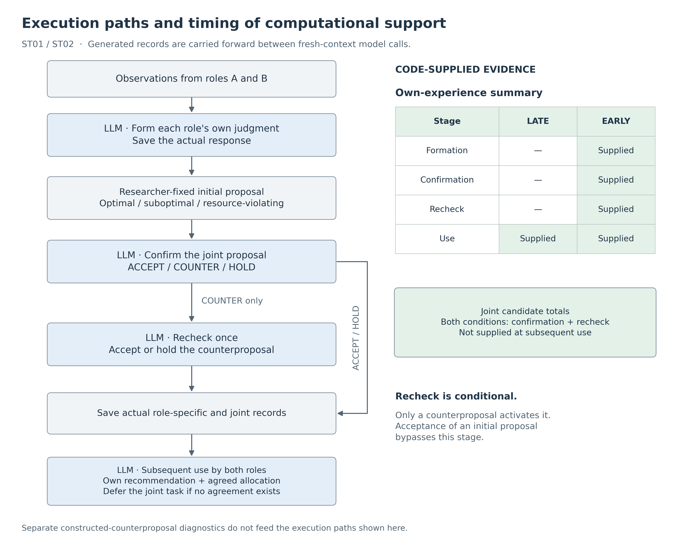
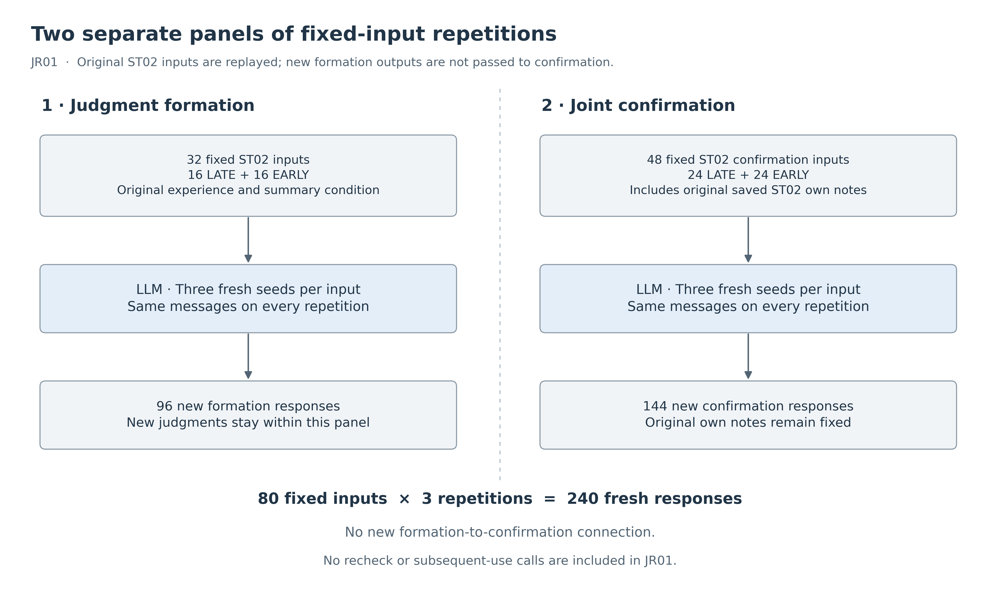

# Separating the Stability of Role-Specific Judgments from the Quality of Joint Agreements
## Timing of Computational Support and Fixed-Input Repetitions in a Two-Role LLM Task

**Kentaro Sato**  
Independent Researcher  
Contact: info@metaclan.jp ([email](mailto:info@metaclan.jp))

## Abstract

For LLM roles to collaborate while maintaining judgments grounded in their own experience, role-specific recommendations, joint agreement quality, and faithful execution must be evaluated separately. We ran the same Qwen3.5-27B model as two roles in separate contexts. Each role recommended a guidance medium for its own area, while the joint task allocated limited equipment between the roles. Generated role-specific and joint records were passed to subsequent inputs to trace intermediate judgments and final use.

We compared supplying a computed summary of each role's experience only at final use with supplying it from judgment formation onward. In two trials, using previously used and previously unused numerical materials, respectively, role-specific correctness throughout the pathway increased from 15/24 to 24/24 pathways. Final use met its criteria in all cases under both conditions, concealing the intermediate difference. In one pathway with new materials, a lower-total joint allocation was accepted despite correct role-specific judgments and supplied candidate totals. The resulting agreement was then used faithfully.

We subsequently repeated the actual inputs from the same eight materials three times in separate judgment-formation and joint-confirmation panels. All 16 formation inputs passed in every repetition with summaries; without summaries, 13, 13, and 11 passed. The same incorrect joint acceptance also recurred in all three fresh repetitions. In another case, the defective field changed across repetitions even though the combined outcome failed each time. These small comparisons locate the stages supported by computational summaries and distinguish remaining defects in joint approval from fidelity in subsequent use.

**Keywords:** LLM agents; collaboration; role-specific judgments; joint agreements; computational support; stability across repetitions

## 1. Introduction

Consider two guidance staff members who have tried paper and digital guidance in their respective areas. For their own area alone, each can recommend the medium that performed better in past observations. At a joint event, however, only one paper guidance station and one digital terminal are available. Assigning one role a medium different from its own recommendation may produce the best combined outcome.

An agreement to use paper in the joint task does not imply that paper worked better in that role's own experience. Both judgments can be maintained in accordance with their respective purposes and evidence. Likewise, both roles following the same allocation does not establish that accepting that allocation was appropriate.

**Along actual execution paths, role-specific correctness, joint agreement quality, and faithful use of the agreement came apart. In fixed-input repetitions, role-specific judgments and joint responses differed in their persistence and variability; even when the combined outcome remained the same, the location of the defect could change.** We measured these distinctions by storing experience-based recommendations and joint assignments in separate fields and passing the actual records to subsequent inputs.

The broader research program concerns design principles for forming and updating shared state while preserving what is specific to each agent. Here, we operationalize one part of that question: whether a role can maintain a recommendation grounded in its own experience without conflating it with its joint assignment. The exploratory series began with both retaining a judgment for unchanged experience and appropriately revising it when experience changed. Identical recommendations from the two roles are appropriate when each follows its own evidence.

**Table 1. Three findings examined in this report.**

| Finding | Main evidence | Evaluation target |
| --- | --- | --- |
| A correct final recommendation can coexist with incorrect judgments saved earlier | Two comparisons of summary-supply timing | Role-specific judgments and references from formation through use |
| Consistently correct role-specific judgments can coexist with repeated incorrect joint acceptance | An actual pathway using new materials and three fixed-input repetitions | Separate correctness of role-specific judgments and joint responses |
| The same combined outcome can conceal different defect locations and downstream consequences | Repetitions with changing defective components; faithful use of an incorrect agreement | Fields within each response and correspondence between storage and use |

These findings organize an adaptive exploration; they were not hypotheses fixed before the entire series. Before each main trial, we fixed its materials, conditions, scoring, number of responses, and stopping rules in local documents. This report organizes those fixed results around the three questions above.

## 2. Related Work

### 2.1 Evaluating individual objectives and joint outcomes

SOTOPIA evaluates interactions with assigned roles and social goals along multiple dimensions, including goal achievement and relationships [1]. NegotiationArena measures proposals, acceptance, and negotiation outcomes through resource exchange, allocation, and bargaining tasks [2]. These studies evaluate role-specific objectives and relationships without reducing interaction performance to the correctness of a single answer.

Our task elicits a numerically determined recommendation from each role's experience separately from its joint assignment. The joint task explicitly specifies a shared objective of maximizing the combined total. Maintaining one's own recommendation is therefore distinct from prioritizing self-interest over collective benefit. Short response sequences restricted to acceptance, counterproposal, and deferral expose performance on the two tasks.

### 2.2 Stage-level evaluation and reliability across repetitions

MultiAgentBench evaluates milestone contributions, communication, and planning alongside final task performance [3]. AgentBoard's progress rate captures intermediate achievement that final success rates may not distinguish [4]. MAST classifies failures in multi-agent execution traces involving system design, inter-agent misalignment, and verification [5]. Stage-level evaluation and analysis of failure locations thus have established precedents.

Similarly, τ-bench evaluates consistent success across repeated runs of the same task using pass^k [6]. Our repetitions hold saved inputs fixed and examine how correctness of role-specific judgments and joint responses combines across three fresh responses. We focus on cases in which the combined outcome remains unsuccessful while the incorrect component switches between the role-specific and joint fields.

### 2.3 Dividing computation and judgment

PAL delegates execution of LLM-generated programs to an interpreter, separating language processing from computation [7]. In a negotiation setting, OG-Narrator uses a deterministic Offer Generator to set offer prices and an LLM to express them in natural language [8]. Moving computation or candidate construction into code also has precedents.

In our task, code produces own-experience summaries and totals for joint candidates. The LLM still selects a role-specific recommendation and responds to the joint proposal. Within this division of responsibilities, we measure intermediate records under different supply timings and approval errors that remain despite access to computed evidence.

**Table 2. Units of evaluation in related work and in this study.**

| Related work | Main evaluation unit | Correspondence examined here |
| --- | --- | --- |
| SOTOPIA; NegotiationArena | Social interaction; negotiation objectives and outcomes | Experience-based recommendations versus joint assignments |
| MultiAgentBench; AgentBoard; MAST | Stages of achievement; collaboration processes; execution failures | Field-level correctness, saved judgments, and subsequent use |
| τ-bench | Consistent success across repetitions of a task | Whether defect locations also remain stable across fixed-input repetitions |
| PAL; OG-Narrator | Division of computation or candidate construction and generation | Timing of computed evidence and approval decisions retained by the LLM |

Our study combines **the timing of computational support, subsequent use of actual records, and fixed-input repetitions in a task that elicits role-specific judgments and joint responses together**. The [literature review memo](related-work.md) records the primary-source passages checked and the scope adopted in this manuscript; the memo is in Japanese.

## 3. Task: Separating a Role's Recommendation from Its Joint Assignment

### 3.1 Two judgments derived from experience

We execute the same model as guidance roles A and B. Each generation starts in a fresh context with the role, observations, and required saved records. Each role has observation rows from its own area for paper and digital guidance. Each row records the observer, session, number of people trying each medium, number successfully guided, and experience ID.

For the role-specific task, both media are available. The role recommends the medium with the higher cumulative success rate across all observations, including earlier sessions. For the joint task, one paper station and one digital terminal must be allocated to maximize the combined projected number successfully guided, assuming 40 people in each area. The projected value for role i and medium m is:

\[
q_i(m)=40\frac{\sum_t s_{i,t,m}}{\sum_t n_{i,t,m}}
\]

Here, s is the number of successes and n is the number of trials. A role-specific judgment compares only that role's q values. The joint judgment compares the sums for the two feasible allocations: A paper/B digital and A digital/B paper. These are projections defined within the task, not estimated intervention effects on real users.

The `local` response field contains the role's own recommendation and experience IDs. During confirmation, the `reply` field contains the action on the joint proposal, the A/B allocation, the record being answered, and both roles' experience IDs. During subsequent use, the `team` field contains either an allocation following the saved joint decision or a deferral, together with references to the relevant records. Fixed rules check observation ownership and references.

### 3.2 Worked example: Digital for one's own task, paper for the joint task

**Table 3. Projected values for one previously unused material (ST02, N05).**

| Role | Paper | Digital | Correct role-specific recommendation |
| --- | ---: | ---: | --- |
| A | 17 | 27 | Digital |
| B | 18 | 20 | Digital |

The joint total is 45 for A digital/B paper and 37 for A paper/B digital. An appropriate response from B therefore combines “I recommend digital for my own area” with “I will take paper in the joint allocation.” Keeping these separate avoids rewriting the role's experience-based judgment to match its joint assignment.

In the observed responses for this material, the model sometimes accepted the 37-total allocation while correctly retaining its own recommendation. Section 5.2 traces that response through storage and use; Section 5.3 examines repeated responses to the same confirmation input.

## 4. Methods

### 4.1 Two execution-path comparisons and a fixed-input repetition study

The main text covers three trials: **summary-supply timing with previously used materials (ST01)**, **the same comparison with previously unused numerical materials (ST02)**, and **three fresh repetitions of actual saved inputs (JR01)**. Appendix A summarizes the preceding exploration.

In each timing comparison, both roles formed their judgments once per condition for each of eight materials. Each condition's 16 role-specific responses were reused across three types of initial joint proposal: optimal, feasible but suboptimal, and resource-violating. This produced 24 pathways per condition. Only if the confirming role counterproposed did the initiating role perform one recheck. Both roles subsequently used the resulting actual records.



**Figure 1. Execution paths in the supply-timing comparisons.** Solid arrows show the progression of the task and the handoff of generated records. The schedule distinguishes computed support from model-generated responses. Both conditions receive an own-experience summary at subsequent use. Joint candidate totals are supplied at confirmation and recheck, not at use. The separate constructed-counterproposal diagnostic does not feed this pathway. [Vector version](figures/fig01-support-timing-en-v1.svg).

ST01 reused all eight materials from an earlier trial. ST02 retained the eight strata defined by initiating role A/B, matching/differing role-specific recommendations, and a joint-total gap of 2/8, while replacing experience values and IDs. Each role had observations from two sessions, and the initiating role had one additional session, giving five experience rows per material. Before generation, we checked experience arrays and the two roles' cumulative projections against saved inputs from the preceding 11 trials, treating role and medium permutations as equivalent. No duplicates were found. “Previously unused” refers to these numerical materials; the task format remained the same.

JR01 included all 32 formation inputs and 48 confirmation inputs from ST02, each repeated with three fresh generation seeds. **The two panels were not connected: confirmation always received the role-specific notes actually saved in ST02.** Incorrect old notes were retained. This differs from repeating the entire pathway with newly formed judgments passed to new confirmation calls.



**Figure 2. Separate fixed-input repetition panels in JR01.** The formation and confirmation panels comprise 80 fixed inputs and 240 fresh responses in total. Newly generated role-specific judgments do not enter the confirmation panel. Confirmation repeatedly receives the original input, including the role-specific note saved in ST02. Recheck and subsequent use are outside this repetition study. [Vector version](figures/fig02-fixed-input-panels-en-v1.svg).

### 4.2 Conditions for supplying computed evidence

**Table 4. Timing of own-experience summary supply.**

| Stage | Supplied only at final use (LATE) | Supplied from formation onward (EARLY) |
| --- | --- | --- |
| Judgment formation | All own experience | Same experience + own-experience summary |
| Joint confirmation and recheck | All experience + actual role-specific record + joint candidates and totals | Same types of evidence + own-experience summary |
| Subsequent use by both roles | All experience + actual role-specific record + actual joint records + own-experience summary | Same types of evidence |

Code computes each own-experience summary from only the role's observations in the input. It contains projections for each medium, total trial counts, and experience IDs. It occupies a separate field from joint candidate totals and does not label a recommended medium. At formation, the conditions differ only in the presence of this summary field; instructions and output format are shared. Later stages carry forward the actual responses generated under each condition.

JR01 uses the same summary-field contrast for formation. At confirmation, both the summary and the old role-specific note can differ between conditions. We therefore treat confirmation as a conditional comparison that includes the original saved state. Repetition numbers, condition labels, and responses from other repetitions are not supplied to the model.

### 4.3 Defining appropriate acceptance, deferral, and use

At joint confirmation, a feasible initial proposal with the highest total should be accepted unchanged. For a suboptimal or resource-violating proposal, the role should either counterpropose the optimal feasible allocation or defer only the joint task. At recheck, an optimal counterproposal with appropriate allocation and references should be accepted; otherwise it should be deferred. Further counterproposals are disallowed, closing the exchange after at most one counterproposal and recheck.

To separate agreement quality from fidelity of use, subsequent use was defined as carrying out an approved feasible agreement, or deferring only the joint task when no agreement existed. Execution is measured by a JSON answer specifying the allocation for the next task; no real equipment or users are operated. Re-optimization of the joint allocation is not requested at this stage. Role-specific judgments are evaluated against the experience available at each stage, so faithfully retaining an incorrect saved judgment does not count as correct.

**Table 5. Evaluation units used in the main text.**

| Metric | Unit | Success criterion |
| --- | --- | --- |
| Judgment formation | One role's formation response | Correct recommendation and appropriate references to its own experience |
| End-to-end role-specific correctness (I) | One material–initial-proposal pathway | Role-specific judgments and references are appropriate in both formation responses, confirmation, recheck when applicable, and both use responses |
| End-to-end correctness (J) | Same pathway | Both role-specific and joint responses, references, and use are appropriate at every applicable stage |
| Appropriate agreement (G) | Joint records at the end of the exchange | Agreement is reached on a feasible allocation with the highest total and appropriate required references |
| Subsequent use | One role's use response | Correct role-specific judgment and references, faithful execution of agreement or appropriate deferral without agreement, and appropriate joint references |
| Repeated joint confirmation | One response to one fixed input | Role-specific judgment and references (B), joint response and references (C), and both together (V), evaluated separately |

Appropriate deferral can pass the joint-response criterion but does not count as agreement G. Because J evaluates the response contract at every stage, a pathway ending in appropriate deferral can also satisfy J. We therefore report J alongside agreement, deferral, and incorrect acceptance. A counterproposal likewise remains unapproved until the other role responds; we do not infer a final agreement rate from JR01's initial confirmation responses alone.

### 4.4 Generation, scoring, and record verification

We used Qwen/Qwen3.5-27B at fixed revision `fc05daec18b0a78c049392ed2e771dde82bdf654`, running on an RTX PRO 6000 Blackwell Server Edition in Colab. Settings were BF16, SDPA, non-thinking mode, batch size 1, temperature 0.7, top_p 0.8, top_k 20, and repetition penalty 1. Software versions were Transformers 5.17.0 and Accelerate 1.15.0. Input and output limits were 8,192 and 1,024 tokens, respectively. Each scheduled response was generated once.

JR01 assigned three fresh seeds to each fixed input. Corresponding conditions and the three initial-proposal types within the same material shared seeds. Conditions were executed adjacently within each repetition, with their order reversed in the second repetition. All repetitions ran within one GPU session.

Code fixed before execution performed formal scoring of structure, role identity, experience IDs, numerical role-specific judgments, joint allocations, response targets, and action contracts. A separate implementation, without importing the scoring module, checked rational arithmetic, references, record handoffs, and aggregates against raw responses and actual inputs. Selected original texts were examined through non-blinded, LLM-assisted reading within the same project. No new LLM-judge votes or open-ended semantic ratings entered the main-trial counts.

We retained raw responses, saved JSON, subsequent inputs, and hashes of parent records. Structurally readable but inappropriate responses were passed onward unchanged. Format defects or missing required parents were treated as unresolved, separately from substantive failures. In the three main trials, missing responses, format defects, normalization, and regeneration were all zero. The 235 responses in ST01 and 231 in ST02 each include 24 separate constructed-counterproposal rechecks. When no counterproposal was made, recheck was omitted by protocol and was not counted as missing. JR01 produced 240 responses.

### 4.5 Denominators and stopping rules

For each condition, the timing comparisons comprise 24 pathways branching from eight materials, and the repetition study comprises 16 formation inputs or 24 confirmation inputs. One formation response is reused across three pathways, so an increase in successful pathways is not an equal number of independent improvements at formation. Likewise, totals of 48 or 72 repeated responses describe the same inputs measured three times.

Before execution, ST01/ST02 fixed a directional prediction for the condition difference in I, and JR01 predicted a positive formation difference in all three repetitions. The missing-outcome rule was to report bounds obtained by assigning unresolved outcomes 0 or 1; no main-trial outcome was unresolved. Differences are descriptive results for fixed materials. We do not calculate population confidence intervals or p-values. The engineering progression criteria for ST01/ST02 combined several role-specific and joint requirements, listed in Appendix B. Meeting those criteria is reported separately from the direction of the comparison. Repetitions were not added in response to the results.

## 5. Results

### 5.1 Early summaries supported intermediate role-specific judgments, with the same direction across three repetitions

**Table 6. Summary-supply timing and correctness from formation through use.**

| Metric | Used materials, ST01: LATE | ST01: EARLY | New materials, ST02: LATE | ST02: EARLY |
| --- | ---: | ---: | ---: | ---: |
| Judgment formation | 13/16 | 16/16 | 13/16 | 16/16 |
| End-to-end role-specific correctness I | 15/24 | **24/24** | 15/24 | **24/24** |
| End-to-end role-specific and joint correctness J | 14/24 | 23/24 | 15/24 | 23/24 |
| Appropriate agreement G | 22/24 | 23/24 | 24/24 | 23/24 |
| Incorrect agreement | 0/24 | 0/24 | 0/24 | **1/24** |
| Subsequent use by both roles | 48/48 | 48/48 | 48/48 | 48/48 |

Note: Subsequent use evaluates role-specific judgments and references, fidelity to an approved feasible agreement (or appropriate deferral without agreement), and joint references. Maximizing the joint total is evaluated separately by G.

In each trial, 15 pathways satisfied I under both conditions, while nine additional pathways satisfied I only with summaries supplied from formation onward. The difference was 9/24, or 37.5 percentage points. In each trial, the difference originated in three formation responses, each reused across three initial-proposal types. The role–material combinations producing these errors differed between the trials.

Under late supply, incorrect role-specific judgments sometimes remained in records passed to later stages. At final use, both conditions received own-experience summaries. Correct judgments were recovered in nine ST01 responses and four ST02 responses whose immediate input still contained an incorrect saved judgment. Thus, identical final-use scores of 48/48 concealed different intermediate records.

Repeating the fixed formation inputs from the new-material trial produced the following results.

**Table 7. Three fresh-seed repetitions of 16 fixed formation inputs per condition (JR01).**

| Fresh repetition | Without summary | With summary | Paired difference in passes |
| --- | ---: | ---: | ---: |
| 1 | 13/16 | **16/16** | +3 |
| 2 | 13/16 | **16/16** | +3 |
| 3 | 11/16 | **16/16** | +5 |

The predicted direction held in all three repetitions. The mean difference was 3.67/16, with a range of 3–5/16. Without summaries, 10 of the 16 inputs passed all three times, four had mixed outcomes, and two failed all three times. With summaries, all 16 passed all three times. Own-experience references were correct in every response; the difference concerned the selected medium.

For example, one input without a summary yielded paper in all three repetitions despite projections of 15 for paper and 18 for digital. Another input, with paper 20 and digital 19, yielded paper, digital, and digital. The summary comparison used all inputs, including both persistent and variable errors.

### 5.2 Correct role-specific judgments coexisted with a suboptimal joint agreement

Under early supply in the new-material trial, the material in Table 3 produced the only incorrect agreement. The actual input included joint candidate totals of 45 and 37, a correct role-specific note, and an own-experience summary. Nevertheless, B accepted the initial proposal with a total of 37.

**Table 8. Actual saved records and subsequent responses (ST02, EARLY, N05, suboptimal initial proposal).**

| Stage | Role-specific field | Joint field | Evaluation |
| --- | --- | --- | --- |
| Confirmation by B | Digital | Accept A paper/B digital | Correct role-specific judgment; inappropriate joint response |
| Storage of joint records | Role-specific field retained | Feasible agreement totaling 37 | Agreement reached; total not maximized |
| Subsequent use by A | Digital | Execute A paper/B digital | Correct role-specific judgment; faithful use of agreement |
| Subsequent use by B | Digital | Execute A paper/B digital | Correct role-specific judgment; faithful use of agreement |

The following excerpt contains only judgment fields from the actual saved confirmation JSON. Reference fields are omitted for display; Supplement S1 links the complete response.

```json
{
  "local": {"subject": "B", "choice": "DIGITAL"},
  "reply": {"action": "ACCEPT", "allocation": {"A": "PAPER", "B": "DIGITAL"}}
}
```

Because no counterproposal was made, recheck was not activated. Both roles subsequently used the 37-total agreement as recorded. Role-specific and joint reference IDs were also appropriate. Appropriate agreement at 23/24 can coexist with subsequent use at 48/48 because the latter scores fidelity to an approved agreement.

In contrast, the used-material trial included one inappropriate joint response in each condition that counterproposed a total of 37 in place of the optimal initial total of 39. The other role deferred at recheck, preventing an incorrect agreement. These examples show that a defective joint response can lead to different downstream paths depending on whether it is passed to recheck as a counterproposal or accepted immediately.

### 5.3 Repeating fixed inputs did not align role-specific and joint stability

**Table 9. Three repetitions of 24 fixed confirmation inputs per condition (JR01).**

| Metric | Without summary: repetitions 1, 2, 3 | With summary: repetitions 1, 2, 3 |
| --- | --- | --- |
| Role-specific judgment and references B | 22/24, 23/24, 21/24 | **24/24, 24/24, 24/24** |
| Joint response and references C | 22/24, 23/24, 24/24 | 22/24, 23/24, 23/24 |
| Both role-specific and joint criteria V | 20/24, 22/24, 21/24 | 22/24, 23/24, 23/24 |

The old role-specific notes were held fixed in the confirmation inputs. Among the 24 inputs with summaries, 22 passed the joint criterion in all three repetitions, one had mixed outcomes, and one failed all three times. Without summaries, 22 passed all three times and two had mixed outcomes. Joint references were appropriate in all 144 responses.

**Persistent incorrect acceptance.** For the fixed input corresponding to Table 8, all three fresh responses correctly retained the digital recommendation but accepted the 37-total allocation. The JSON contents of the three responses were identical. These repetitions were part of the full set of 24 confirmation inputs included regardless of their earlier success or failure; they were not additional runs selected for this one input.

**A response that varied across repetitions.** For an optimal initial proposal in another material, only repetition 1 in each condition counterproposed a total of 46 instead of the optimal 48. Repetitions 2 and 3 accepted 48. The role-specific digital recommendation was correct all three times. Because corresponding conditions shared seeds, the matching pattern across conditions is not counted as two independent replications.

**A failure whose components changed.** For the same material as Table 3, without a summary and starting from a resource-violating proposal, the components changed as follows.

**Table 10. Combined criterion V failed three times, but the defective component changed (JR01, LATE, N05).**

| Repetition | Role-specific judgment B | Joint response C | Both V |
| --- | --- | --- | --- |
| 1 | Recover digital: correct | Accept digital allocated to both roles: incorrect | Fail |
| 2 | Recover digital: correct | Accept the same resource-violating allocation: incorrect | Fail |
| 3 | Retain paper from the old note: incorrect | Counterpropose the feasible optimal allocation totaling 45: correct | Fail |

Counting only three failures obscures that role-specific recovery and joint correction did not occur together in the same response. Relating the combined outcome to the fields and to the accept/counterpropose actions exposed this variation.

## 6. Discussion

### 6.1 Support timing affects the quality of intermediate saved judgments

The two execution-path comparisons and the three formation repetitions showed the same direction: supplying own-experience summaries early supported more correct role-specific judgments. In the pathway comparisons, both conditions gave correct final-use responses, yet the intermediate saved judgments differed. When one stage uses another stage's role-specific record, those intermediate states are meaningful evaluation targets alongside the final answer.

This effect was observed with explicit summaries computed separately for each experience owner. The LLM still selected the answer and generated its references from those summaries. The timing comparison evaluates reconstructing and saving role-specific judgments from evidence available at each stage, rather than maintaining information internally over long periods.

### 6.2 Approving an agreement and following it are different tasks

A correctly supplied table of joint totals did not guarantee an appropriate acceptance decision. In Table 8, storage and use were correctly connected after the incorrect acceptance. Improving downstream fidelity alone would therefore not necessarily recover agreement quality along this pathway.

**Judging appropriately at recheck and activating that stage are also separate evaluation targets.** The protocol invokes recheck only after a counterproposal; acceptance of the initial proposal bypasses it. The suboptimal acceptance in Table 8 proceeded to storage and use without recheck, exactly as the protocol specified. Locating a check for incorrect acceptance requires examining the branches that reach the checking stage as well as the checking role's responses.

### 6.3 Specify what remains stable

Three failures establish that the combined outcome was unchanged. An AND-defined criterion can conceal defect locations by construction. Beyond that logical property, we observed the defective component switch between the role-specific and joint fields across three responses to the same saved input.

Conversely, three correct role-specific judgments did not imply three correct joint responses. Combining fixed-stage repetitions with pathways that connect actual saved artifacts distinguishes which input–response relationships varied from what a response enabled downstream.

## 7. Scope and Limitations

**Materials and repetitions.** The main results involve one model, eight previously used materials, eight new numerical materials with the same task format, and a short exchange with at most one counterproposal and recheck. JR01 reused the latter materials and ran three seeds in one GPU session. Inputs, branches, and repetitions are dependent; three successes or failures do not establish population probabilities. An earlier own-summary comparison had 32/32 correct formation responses in both conditions, so summary supply did not always add a benefit (Appendix A).

**Scope of intervention.** ST01/ST02 supplied summaries early at formation, confirmation, and recheck together, leaving their individual contributions unresolved. JR01's formation comparison varies only the summary field, but its confirmation comparison also includes condition-specific old notes. The evidence does not identify a single cause of incorrect joint acceptance, such as the summary, an old judgment, or self-prioritization. We collected neither free-form rationales nor internal reasoning; the analysis concerns input–output correspondence.

**Operationalization.** Role-specific judgment is a recommendation derived from explicitly supplied synthetic observations, not a spontaneously formed personality or value system. Experience is presented at each stage, and initial joint proposals are researcher-constructed. Long-term continuation, asymmetric information, larger groups, spontaneous negotiation, and memory retention without renewed evidence supply remain untested. Joint “quality” is the task's specified total-maximization objective, rather than a general account of fairness or diverse real-world preferences.

**Evaluation contract.** Subsequent use scores fidelity to a feasible approved agreement without requesting re-optimization. Under this contract, faithful use of a low-quality agreement passes the use criterion. A system that rechecks quality immediately before execution would require a different task contract and comparison. Success in constructed-counterproposal diagnostics was not pooled as evidence that the same checking opportunity arose naturally.

**Design, scoring, and availability.** The series was an adaptive exploration in which earlier results informed subsequent comparisons, not a publicly preregistered confirmatory study. Fixed scoring was checked with separate code and original responses, but development, verification, and writing remained within the same project. No blinded third-party rescoring was performed. Current supplementary materials index local research records rather than constitute a public reproducibility package.

## 8. Conclusion

Separately storing and evaluating experience-based recommendations and joint assignments distinguished the stages supported by role-specific summaries from remaining defects in joint approval. Early summary supply improved role-specific correctness along the pathways in both material sets, and the formation comparison retained the same direction across three fixed-input repetitions.

At the same time, suboptimal acceptance recurred from an input containing a correct role-specific judgment and computed joint totals. Along the actual pathway, the resulting agreement was subsequently used faithfully. A combined outcome could also remain unsuccessful while the incorrect component changed between the role-specific and joint fields.

**Maintaining one's own judgment, agreeing on a good joint allocation, and executing the agreement faithfully should be checked separately against saved artifacts and the inputs to each stage.** This report provides concrete examples of how that evaluation decomposition reveals both the reach of computational support and the defects that remain.

## 9. Ethics, Author Contributions, and Data Availability

All task materials are synthetic, and the responses are LLM-generated. The study involves no human-participant experiment or personal data from real customers. The author determined the research direction and execution scope, ran the Colab experiments, assessed results, and reviewed the manuscript. LLM assistance was used for design, implementation, scoring code, verification, literature research, and writing. Model-assisted reading and feedback are distinguished from independent peer review or third-party rescoring.

At manuscript preparation, research materials are retained privately without a deletion deadline. [Supplement S1](evidence-index-en-v0.1-2026-09-29.md) links fixed plans, original ZIP archives, aggregates, response diagnostics, and scoring and verification code. A public repository, persistent identifier, and license will be selected during publication preparation. Formal funding and conflict-of-interest declarations require the author's confirmation for the public version.

## References

1. Xuhui Zhou, Hao Zhu, Leena Mathur, Ruohong Zhang, Haofei Yu, Zhengyang Qi, Louis-Philippe Morency, Yonatan Bisk, Daniel Fried, Graham Neubig, and Maarten Sap. 2024. *SOTOPIA: Interactive Evaluation for Social Intelligence in Language Agents.* ICLR 2024. [arXiv:2310.11667v2](https://arxiv.org/abs/2310.11667v2).
2. Federico Bianchi, Patrick John Chia, Mert Yuksekgonul, Jacopo Tagliabue, Dan Jurafsky, and James Zou. 2024. *How Well Can LLMs Negotiate? NegotiationArena Platform and Analysis.* [arXiv:2402.05863v1](https://arxiv.org/abs/2402.05863v1).
3. Kunlun Zhu, Hongyi Du, Zhaochen Hong, Xiaocheng Yang, Shuyi Guo, Zhe Wang, Zhenhailong Wang, Cheng Qian, Xiangru Tang, Heng Ji, and Jiaxuan You. 2025. *MultiAgentBench: Evaluating the Collaboration and Competition of LLM agents.* ACL 2025, 8580–8622. [DOI:10.18653/v1/2025.acl-long.421](https://aclanthology.org/2025.acl-long.421/).
4. Chang Ma, Junlei Zhang, Zhihao Zhu, Cheng Yang, Yujiu Yang, Yaohui Jin, Zhenzhong Lan, Lingpeng Kong, and Junxian He. 2024. *AgentBoard: An Analytical Evaluation Board of Multi-turn LLM Agents.* NeurIPS 2024. [arXiv:2401.13178v2](https://arxiv.org/abs/2401.13178v2).
5. Mert Cemri et al. 2025. *Why Do Multi-Agent LLM Systems Fail?* [arXiv:2503.13657v3](https://arxiv.org/abs/2503.13657v3).
6. Shunyu Yao, Noah Shinn, Pedram Razavi, and Karthik Narasimhan. 2024. *τ-bench: A Benchmark for Tool-Agent-User Interaction in Real-World Domains.* [arXiv:2406.12045v1](https://arxiv.org/abs/2406.12045v1).
7. Luyu Gao, Aman Madaan, Shuyan Zhou, Uri Alon, Pengfei Liu, Yiming Yang, Jamie Callan, and Graham Neubig. 2023. *PAL: Program-aided Language Models.* ICML 2023, PMLR 202:10764–10799. [PMLR](https://proceedings.mlr.press/v202/gao23f.html).
8. Tian Xia, Zhiwei He, Tong Ren, Yibo Miao, Zhuosheng Zhang, Yang Yang, and Rui Wang. 2024. *Measuring Bargaining Abilities of LLMs: A Benchmark and A Buyer-Enhancement Method.* Findings of ACL 2024, 3579–3602. [DOI:10.18653/v1/2024.findings-acl.213](https://aclanthology.org/2024.findings-acl.213/).

## Appendix A. Task and Evaluation Scope Established by the Preceding Exploration

This table preserves an entry point to the exploratory series. Results from trials with different methods or materials are not pooled into a single effect estimate. Supplement S1 provides the formal results, outcomes unresolved because of format defects, and post hoc reference analyses for each trial.

| Trial | Evaluation target | Relation to the main text |
| --- | --- | --- |
| ES01: Own experience and joint records | Reversed experience; a diagnostic reversing only the joint allocation; subsequent use | Basic task separating one's recommendation from a joint assignment |
| AC01: Agreement on tied candidates | Responses and agreement for two tied allocations | Distinguishing an appropriate proposal from an agreed proposal |
| EU01: Experience updates | Legitimate own updates, preservation of the other role's judgment, and joint allocation | A correct own update can coexist with a resource violation |
| FC01/FC02: Feasible candidates | Directly writing versus selecting a joint allocation; transfer to unused experience | Separating feasibility from optimality |
| CT01: Candidate totals | Supplying computed totals | Optimal selection increased from 20/32 to 32/32 within the comparison; defects remained in the role-specific field and confirmation |
| OS01: Own-experience summaries | Summary supply at proposal and use | Formation was 32/32 in both conditions; 56 responses with extra keys remain formally unresolved |
| BJ01: Boundary-judge evaluation | Judge calibration separating structure and content | Of 64 judgments, 53 agreed, 4 disagreed, and 7 were unresolved; this did not justify replacing main-trial scoring with an LLM judge |
| CS01: Support at confirmation | Supplying joint candidates and totals to the confirming role | Appropriate confirmation increased from 28/32 to 32/32; appropriate response to constructed incorrect proposals increased from 1/8 to 7/8 |
| CR01: Counterproposal recheck | One recheck and subsequent use by both roles | Subsequent-use correctness can conceal defects in earlier role-specific formation |

The absence of a formation difference in OS01 and the formal failure to meet progression criteria in ST02, including its incorrect agreement, remain part of the evidence on computational support. Earlier format defects are not repaired and counted as successes in the main results of this report.

## Appendix B. Progression Criteria, Constructed Diagnostics, and Implementation

The ST01/ST02 progression criteria required end-to-end J ≥ 22/24; J ≥ 7/8 for each initial-proposal type; I = 24/24; zero incorrect agreements; G ≥ 7/8 for optimal initial proposals and ≥ 6/8 for each of the suboptimal and resource-violating types; and 12/12 in the constructed diagnostic. These were engineering criteria for progression within fixed materials, not statistical-significance thresholds.

**Table B1. Constructed diagnostics and overall progression, kept separate from the main evaluation.**

| Trial | LATE: constructed diagnostic | EARLY: constructed diagnostic | LATE: overall criteria | EARLY: overall criteria |
| --- | ---: | ---: | --- | --- |
| ST01 | 9/12 | 12/12 | Not met | Met within the fixed sample |
| ST02 | 12/12 | 12/12 | Not met | Not met: 1 incorrect agreement |

The constructed diagnostic used four materials and three counterproposals per material to check acceptance of optimal proposals and deferral of suboptimal or resource-violating proposals. It was counted separately from pathways where actual confirmation generated a counterproposal. JR01 added no recheck, subsequent use, or constructed diagnostic.

The implementation separated input evidence, model generation, structural validation, storage, and substantive scoring. Storable responses were not filtered by correctness labels, allowing incorrect judgments to travel downstream. References in role-specific and joint fields were checked separately. Copying an input-only summary into an extra output field counted as a structural defect. Saved record contents were passed as data rather than executed as new instructions.

Supplement S1 retains hashes linking scores, raw generation, and subsequent inputs, together with the reading records, including successful cases. The extracted tables and examples were derived from existing aggregates. Scoring rules and formal experimental results were not changed for manuscript preparation.
