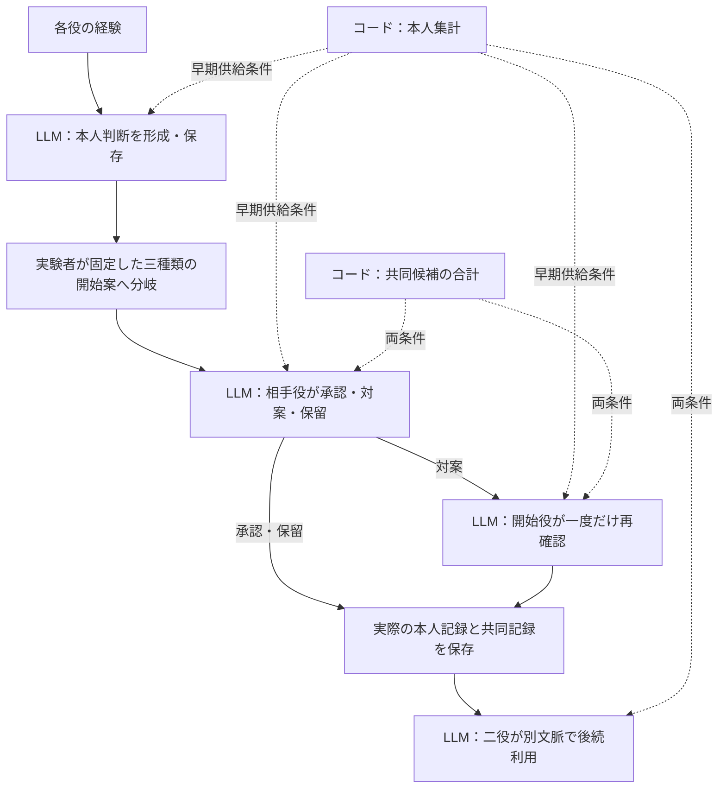
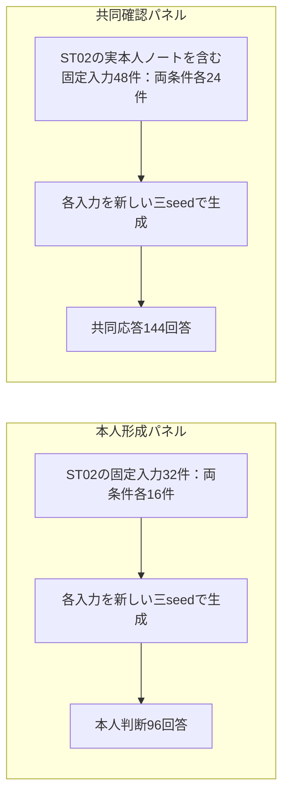

# 本人判断の安定性と共同合意の質を分けて評価する
## LLM二役における集計支援の供給時期と固定入力反復

Kentaro Sato  
独立研究者（Independent Researcher）  
連絡先：info@metaclan.jp（[メール](mailto:info@metaclan.jp)）

2026年9月29日｜日本語草稿 v0.2｜内部検討用・未公開

## 要旨

LLMが各役の経験に沿った判断を保ちながら共同作業を行うには、本人の推奨、共同合意の質、合意に沿った実行を区別する必要がある。本研究では、同一のQwen3.5-27Bを別コンテキストで二役として実行し、各役が自区画の経験から案内方法を選ぶ仕事と、限られた設備を二人に配分する共同の仕事を扱った。生成した本人記録と共同記録を後続入力へ渡し、途中の判断と最後の利用を追跡した。

本人の経験集計を最後の利用時だけ渡す条件と、判断形成から渡す条件を比較した。既知材料と未使用の数値材料を用いた二試験で、全工程を通じた本人判断の適合は、それぞれ15/24経路から24/24経路へ増えた。一方、最後の利用は両条件で全件適合しており、終点だけでは途中の差が見えなかった。未使用材料の一経路では、本人判断が正しく、共同候補の計算済み合計も提示されていたが、より低い合計の案が承認され、その合意が後続で忠実に利用された。

続いて同じ8材料の実入力を、本人形成と共同確認を接続しない二パネルで各三回反復した。本人形成の16入力は、集計ありで三回とも全件適合し、集計なしは13・13・11件の適合だった。前述の共同誤承認も新しい三回すべてで再観測された。さらに、本人と共同を合わせた成否が三回とも不成立でも、誤る欄が反復間で入れ替わる例があった。これらの小規模比較は、本人判断への支援が届いた範囲と、共同の承認・後続利用に残る境界を、工程と評価対象ごとに示している。

**キーワード：** LLMエージェント、協調、役固有の判断、共同合意、計算支援、反復安定性

## 1. 問題設定と本稿の貢献

二人の案内係が、それぞれの区画で紙とデジタルの案内を試してきたとする。各自の区画だけなら、経験上よく機能した方法を選べばよい。しかし合同開催では、紙の案内台とデジタル端末が一つずつしかない。一人が自分の推奨と異なる設備を担当することが、全体にとって最もよい場合がある。

このとき「共同で紙を担当する」と決まったことは、「自分の経験でも紙の方がよかった」ことを意味しない。二つの判断は、それぞれの目的と資料に沿って保持できる。また、二人が同じ共同案に従ったことだけでは、その案を選んだ判断が適切だったか分からない。

本稿では、**実経路において、本人判断の正しさ、共同合意の質、合意への忠実な利用が分かれた。固定入力の反復では、本人判断と共同応答で成否の持続や変動が異なり、総合成否が同じでも不備の位置が変わる場合があった。** 役ごとの経験から作った判断と、共同で引き受ける担当を別欄に保存し、その実記録を次の入力へ引き継ぐことで、この区別を測定する。

研究全体は、各主体の固有性を保ちながら共有状態を形成・更新する設計原理を対象とする。ここではその一部を、「本人の経験に沿った推奨を、共同担当と混同せずに保持できるか」として操作化する。同じ経験に対して答えを変えないことに加え、経験が変われば推奨も適切に変わることが、系列の出発点にある。二役の推奨が同じになる場合も、それぞれの経験に沿っていれば適切である。

**表1　本稿で詳しく扱う三つの知見**

| 知見 | 主な証拠 | 評価で捉える対象 |
|---|---|---|
| 最後に本人判断を正せても、途中の保存判断は誤っている場合がある | 集計供給時期の二比較 | 形成から利用までの本人判断と参照 |
| 本人判断が安定して正しくても、共同の誤承認は繰り返される場合がある | 未使用材料の実経路と固定入力の三反復 | 本人判断と共同応答の別々の成否 |
| 同じ総合成否でも、不備の場所や後続への影響は異なる | 成分が入れ替わる反復、誤合意の忠実な利用 | 回答内の各欄と、保存から利用への対応 |

三つの知見は適応的探索を統合する観点であり、系列全体の取得前仮説として提示するものではない。各主実験では、その実行前に材料・比較条件・採点・回数・終了条件をローカル文書として固定した。本稿は固定結果をこの三つの問いに沿って整理する。

## 2. 関連研究

### 2.1 個々の目的と共同の結果を評価する研究

SOTOPIAは、役や社会的目標を与えた相互作用を、目標達成や関係性など複数の次元で評価する［1］。NegotiationArenaは、資源交換・分配・売買を通じてLLM同士の提案と受諾、交渉結果を測る［2］。これらは、相互作用の成績を単一の回答正誤へ還元せず、各役の目的や相手との関係を評価する先行例である。

本稿は、各役の経験から数値的に定まる推奨を、共同の担当とは独立に回答させる。共同課題では合計最大化という共通の目的を明示するため、本人の推奨を保持したことを、自己利益を共同利益より優先したことと同一視しない。承認・対案・保留に限定した短い応答系列から、二つの課題の成否を読み取る。

### 2.2 工程を分ける評価と、繰り返したときの信頼性

MultiAgentBenchは、最終的な課題成績に加え、マイルストーンへの貢献やコミュニケーション・計画の評価を設ける［3］。AgentBoardのprogress rateは、最終成功率だけでは区別しにくい途中の達成を扱う［4］。MASTは、複数エージェントの実行履歴から、システム設計・役間の不整合・検証にまたがる失敗を分類する［5］。したがって、工程別評価や失敗位置の分析そのものには先行研究がある。

また、τ-benchは同じ課題を繰り返したときの一貫した成功をpass^kで評価する［6］。本稿の反復は、保存済み入力を固定して、本人判断と共同応答の成否が各三回でどう組み合わさるかを調べる。全体が同じ不成立でも、本人欄の正誤と共同欄の正誤が入れ替わる実例まで追う点に重点を置く。

### 2.3 計算と判断の分担

PALは、LLMが生成したプログラムの実行を処理系へ委ね、言語処理と計算を分担する［7］。交渉に近い例として、OG-Narratorは決定論的なOffer Generatorが提示価格を作り、LLMがそれを自然言語化する［8］。計算や候補作成をコードへ移す構成にも先例がある。

本稿でコードが作るのは、本人の経験集計と共同候補の合計である。本人の選択や共同案への応答はLLMに残す。この分担の下で、資料を渡す時期を変えた場合の途中記録と、計算済み資料が存在しても残る承認誤りを測る。

**表2　先行研究と本稿で比較する単位**

| 研究群 | 主に評価する単位 | 本稿が追う対応 |
|---|---|---|
| SOTOPIA、NegotiationArena | 社会的相互作用、交渉の目標・結果 | 本人の経験に基づく推奨と共同担当の使い分け |
| MultiAgentBench、AgentBoard、MAST | 達成工程、協調過程、実行の失敗箇所 | 各欄の成否、保存判断、後続利用の連鎖 |
| τ-bench | 課題を繰り返したときの成功の一貫性 | 固定入力の反復内で、不備位置まで安定しているか |
| PAL、OG-Narrator | 計算・候補作成と生成の分担 | 計算資料の供給時期と、LLMに残した承認判断 |

本研究は、**本人判断と共同応答を同時に出力する課題で、支援の供給時期、実記録の後続利用、固定入力の反復を結び付けて比較する**。関連研究の確認箇所と、本稿に採用した記述の範囲は[調査メモ](related-work-review-v0.1-2026-09-29.md)に示す。

## 3. 課題：本人の推奨と共同の担当を分ける

### 3.1 経験から定まる二種類の判断

同一モデルを案内係A・Bとして実行する。各生成は新しいコンテキストで開始し、役・経験・必要な保存記録を入力する。各役には自区画で紙とデジタルを使った観測行があり、行ごとに観測者、回、各媒体の試行人数、成功人数、経験IDを持つ。

本人の仕事では両媒体を利用でき、古い回を含む全経験の累積成功率が高い媒体を推奨する。共同の仕事では紙の案内台とデジタル端末を一つずつ配分し、各区画40人を案内したときの予測成功人数の合計を最大にする。役i、媒体mの予測値は次の通りである。

\[
q_i(m)=40\frac{\sum_t s_{i,t,m}}{\sum_t n_{i,t,m}}
\]

ここでsは成功人数、nは試行人数である。本人判断は自分のqだけを比較する。共同判断は、実行可能な二案「A紙・Bデジタル」と「Aデジタル・B紙」について、qの合計を比較する。これらは課題内で定めた予測値であり、実在の利用者への介入効果ではない。

回答の`local`欄に本人の推奨と本人の経験IDを置く。確認時の`reply`欄には、共同案への行為、A/Bへの割付、応答先、両役の経験IDを置く。後続利用の`team`欄には、保存された共同決定に沿った割付または保留と、その記録への参照を置く。観測の所有者と参照先は固定規則で検査する。

### 3.2 具体例：本人にはデジタル、共同では紙が適切な場合

**表3　未使用材料の一例（ST02・N05）の予測値**

| 役 | 紙 | デジタル | 本人の適切な推奨 |
|---|---:|---:|---|
| A | 17 | 27 | デジタル |
| B | 18 | 20 | デジタル |

共同では、Aデジタル・B紙なら合計45、A紙・Bデジタルなら37になる。したがってBの適切な回答は、「自分の区画だけならデジタルを勧める」と「共同では紙を引き受ける」を両立する。この区別が保たれれば、共同の配分に合わせて本人の経験を書き換える必要はない。

この材料の実測では、本人の推奨を正しく保ったまま37案を承認する応答があった。表3を、§5.2ではその保存と利用、§5.3では同じ確認入力の反復へつなげる。

## 4. 方法

### 4.1 二つの実経路比較と、固定入力の反復

本文では三つの主実験を扱う。**既知材料での供給時期比較（ST01）**、**未使用の数値材料での同じ比較（ST02）**、**実入力の三反復（JR01）**である。前段の探索は付録Aにまとめる。

二つの供給時期比較では、各8材料について、二役の本人判断を条件別に一回ずつ形成した。各条件の16本人回答を、共同開始案が最適・合法だが劣位・資源違反という三つの枝へ共用し、24経路を作った。確認役が対案を出した場合だけ、開始役が一度再確認する。その実記録を二役が後続で利用する。



**図1　供給時期比較の実経路。** 矢印は生成した実回答の受渡しを表す。後続利用には両条件とも本人集計を供給する。共同候補の合計は確認・再確認へ渡し、利用時には渡さない。別枠の人工対案診断は本経路に接続しない。

ST01は先行試験で用いた8材料を全件再利用した。ST02は、開始役A/B、本人推奨が同じ/異なる、共同候補の合計差2/8という8区分の骨格を保ち、経験値と経験IDを新しくした。各役に二回分、開始役にはさらに一回分の観測があり、各材料は計5経験行からなる。保存済みの前段11試験の入力群に対し、役・媒体の交換を同一視した経験配列と二役の累積予測値に重複がないことを、生成前に確認した。未使用という範囲はこの数値材料であり、課題形式は共通である。

JR01では、ST02の本人形成32入力と共同確認48入力を全件採用し、それぞれ新しい三つの生成seedで反復した。**二パネルは接続せず、共同確認にはST02で実際に保存した本人ノートを固定して渡した。** 誤った旧ノートも保持した。新しい本人形成の回答を新しい確認へ渡す全経路反復とは区別する。



**図2　固定入力反復の二パネル（JR01）。** 本人形成と共同確認で計80入力・240回答。今回生成した本人判断は、共同確認へ渡さない。共同確認には、ST02で保存した本人ノートを含む元の入力を毎回渡す。再確認・後続利用は本反復の対象に含まれない。

### 4.2 計算資料の供給条件

**表4　本人集計の供給時期**

| 工程 | 最後だけ供給（LATE） | 形成から供給（EARLY） |
|---|---|---|
| 本人形成 | 本人の全経験 | 同じ経験＋本人集計 |
| 共同確認・再確認 | 全経験＋実本人記録＋共同候補・合計 | 左記＋本人集計 |
| 二役の後続利用 | 全経験＋実本人記録＋実共同記録＋本人集計 | 同じ種類の資料 |

本人集計は、入力にある本人の経験だけからコードが計算した各媒体の予測値、試行人数合計、経験IDを持つ。共同候補の合計とは別欄に置き、推奨媒体のラベルは付けない。本人形成での条件差はこの集計欄の有無で、指示と出力形式は共通である。後続では条件ごとに異なる実回答を引き継ぐ。

JR01の本人形成も同じ集計欄の有無を比較する。共同確認では集計と旧本人ノートの両方が条件間で異なり得るため、元の保存状態を含む条件付き比較として扱う。反復回・条件名・他の反復の回答はモデルへ渡さない。

### 4.3 適切な承認、保留、利用の定義

共同確認では、開始案が実行可能かつ合計最大なら、同じ案を承認する。劣位案または資源違反案なら、最適な実行可能案を対案として出すか、共同だけを保留する。対案への再確認では、割付と参照が適切な最適案を承認し、それ以外は保留する。再対案は許さず、一往復で閉じる。

合意の質と利用の忠実性を分けるため、後続利用は「承認済みの合法な合意を実施し、未合意なら共同だけ保留する」課題とした。実施は次の仕事の割付をJSONで回答することで測り、現実の設備や利用者を操作するものではない。ここで共同案を再最適化することは求めない。本人判断は各時点の経験に照らして評価し、保存済みの誤判断をそのまま維持することを正解にしない。

**表5　本文で用いる評価単位**

| 評価 | 単位 | 成立条件 |
|---|---|---|
| 本人形成 | 1役の形成回答 | 本人推奨と本人経験の参照がともに適切 |
| 全工程の本人保持（I） | 1材料・1開始案の経路 | 二役形成、確認、適用時の再確認、二役利用の全てで本人判断・本人参照が適切 |
| 全工程適合（J） | 同上 | 本人に加え、各適用工程の共同応答・参照・利用も適切 |
| 適切合意（G） | 一往復を閉じた共同記録 | 合意が成立し、割付が実行可能・合計最大で必要な参照も適切 |
| 後続利用 | 1役の利用回答 | 本人判断・本人参照と、合意実施/未合意保留・共同参照が適切 |
| 反復の共同確認 | 1固定入力への1回答 | 本人判断・参照（B）、共同応答・参照（C）、両方（V）を別評価 |

適切な保留は共同応答として成立し得るが、合意Gには数えない。Jは全工程の応答契約を評価するため、適切な保留に終わる経路も成立し得る。そこでJ、合意、保留、誤承認を併記する。対案を出した時点も相手未承認なので、JR01の初回確認だけから最終合意率を算出しない。

### 4.4 生成、採点、記録の照合

使用モデルはQwen/Qwen3.5-27Bの固定revision `fc05daec18b0a78c049392ed2e771dde82bdf654`。Colab上のRTX PRO 6000 Blackwell Server Editionで、BF16、SDPA、非思考モード、batch 1、temperature 0.7、top_p 0.8、top_k 20、repetition penalty 1とした。Transformers 5.17.0、Accelerate 1.15.0を使用した。入力上限8,192、出力上限1,024トークンで、各予定回答は一回生成した。

JR01は各固定入力に新しい三seedを割り当て、対応する二条件と同じ材料の三開始型ではseedを共用した。各反復内で二条件を隣接して実行し、二回目は条件の先行順を逆にした。反復は同一GPUセッション内で実施した。

構造・人物・経験ID・本人の数値判断・共同割付・応答先・行為契約の正式採点は、実行前に固定したコードが行う。採点器を読み込まない別実装でも、原回答と実入力から分数算術・参照・受渡し・集計を照合した。指定原文は同一プロジェクト内のLLM支援による非盲検読解で点検した。主実験の数値に、新しいLLM judgeの投票や自由な意味評定は用いていない。

原回答、保存JSON、次に渡した入力、親記録のハッシュを保持した。構造が読める不適切な回答は、そのまま後続へ渡す。形式不備や必要な親の欠落は未確定とし、意味的な不成立と区別する。今回の三主実験では取得欠測・形式不備・正規化・再生成はいずれも0だった。ST01の235回答とST02の231回答には、別枠の人工再確認が各24回答含まれる。対案が出ない場合の再確認は規則どおり省略され、欠測には数えない。JR01は240回答を取得した。

### 4.5 分母と結果の閉じ方

主比較の単位は、二つの実経路試験で各8材料から分岐した24経路、反復試験で16本人入力または24共同確認入力である。一つの形成回答が三経路に共用されるため、改善した経路数を独立した形成改善数に読み替えない。反復の48・72回答も、同じ入力を三回測った記述合計である。

ST01/ST02では本人保持Iの条件差、JR01では本人形成の差が三反復とも正になるという方向予想を取得前に固定した。欠測時は未確定を0/1に置く上下限を示す方針だったが、今回の主実験に未確定はなかった。これらの差は固定材料での記述であり、p値・母集団の信頼区間は算出しない。ST01/ST02の工学的な進行目安は本人と共同の複数条件を組み合わせたもので、付録Bに記載する。目安への到達と、比較の方向は分けて報告し、結果による反復追加は行わなかった。

## 5. 結果

### 5.1 早期の集計供給で途中の本人判断が保たれ、その方向は三反復でも続いた

**表6　集計供給時期と、途中から利用までの適合**

| 評価 | 既知材料 ST01：最後だけ | ST01：形成から | 未使用材料 ST02：最後だけ | ST02：形成から |
|---|---:|---:|---:|---:|
| 本人形成 | 13/16 | 16/16 | 13/16 | 16/16 |
| 全工程の本人保持 I | 15/24 | **24/24** | 15/24 | **24/24** |
| 本人・共同の全工程 J | 14/24 | 23/24 | 15/24 | 23/24 |
| 適切合意 G | 22/24 | 23/24 | 24/24 | 23/24 |
| 誤合意 | 0/24 | 0/24 | 0/24 | **1/24** |
| 二役の後続利用 | 48/48 | 48/48 | 48/48 | 48/48 |

注：後続利用は、本人判断・本人参照と、実行可能な承認済み合意への忠実性（未合意なら適切な保留）・共同参照を評価する。共同案の合計最大化は、適切合意Gで別に評価する。

各試験の本人保持は、両条件で成立15経路、形成から供給した条件だけ成立9経路で、差は9/24＝37.5ポイントだった。差の起点はいずれも三つの本人形成であり、それぞれが三開始型へ共用された。三つの誤りを生んだ役・材料は二試験で異なる。

最後だけ集計を渡す条件では、途中の誤った本人記録が後続へ残ることがあった。最後の利用時には両条件へ本人集計を渡しており、ST01では誤記録が直前に残った9回答、ST02では4回答が適切な本人判断へ回復した。最後の48/48だけを見れば同じでも、全経路の記録は異なる。

次に、未使用材料試験の形成入力を固定した三反復では、次の結果になった。

**表7　本人形成の固定16入力を、新しい三seedで反復した結果（JR01）**

| 新反復 | 集計なし | 集計あり | 適合数の対応差 |
|---|---:|---:|---:|
| 1 | 13/16 | **16/16** | ＋3 |
| 2 | 13/16 | **16/16** | ＋3 |
| 3 | 11/16 | **16/16** | ＋5 |

方向予想は三回とも一致し、差の平均は3.67/16、範囲は3〜5/16だった。集計なしでは、16入力中10入力が三回適合、4入力が成否混在、2入力が三回不適合。集計ありでは16入力全てが三回適合した。本人の経験IDの参照は全回答で正しく、差は媒体の選択にあった。

例えば、集計なしの一入力では紙15・デジタル18に対して三回とも紙を選び、別の入力では紙20・デジタル19に対して紙・デジタル・デジタルと変わった。集計供給の比較は、持続する誤りと反復で揺れる誤りの両方を含む全入力で行われた。

### 5.2 正しい本人判断と、劣る共同案への合意が同じ経路に共存した

未使用材料の形成から供給する条件では、表3の材料で唯一の誤合意が生じた。共同候補の合計45と37、正しい本人ノート、本人集計が実入力にそろっていたが、Bは合計37の開始案を承認した。

**表8　実際の保存記録と後続回答の対応（ST02・EARLY・N05・劣位案開始）**

| 段階 | 本人欄 | 共同欄 | 評価 |
|---|---|---|---|
| Bの確認回答 | デジタル | A紙・Bデジタルを承認 | 本人は適切、共同応答は不適切 |
| 共同記録の保存 | 本人欄を保持 | 合計37の合法な合意 | 合意成立、合計最大化は未達 |
| Aの後続利用 | デジタル | A紙・Bデジタルを実施 | 本人適切、合意に忠実 |
| Bの後続利用 | デジタル | A紙・Bデジタルを実施 | 本人適切、合意に忠実 |

確認回答の内容を示すため、実保存JSONから判断欄のみを抜き出す。参照欄を省いた表示であり、完全回答は補足S1に対応付ける。

```json
{
  "local": {"subject": "B", "choice": "DIGITAL"},
  "reply": {"action": "ACCEPT", "allocation": {"A": "PAPER", "B": "DIGITAL"}}
}
```

対案が出なかったので再確認は発動しなかった。後続二役は、この37の合意を保存記録どおりに利用した。本人・共同の参照IDにも不備はなかった。適切合意23/24と後続利用48/48が同時に成立するのは、利用の採点が承認済みの合意への忠実性を測っているためである。

一方、既知材料試験では、最適39の開始案を37へ差し戻す共同誤応答が両条件で一件あったが、相手の再確認が保留して誤合意を止めた。この比較は、同じ共同不備でも、対案として次の確認に渡る場合と、その場で承認される場合とで、後続の経路が異なることを示す。

### 5.3 固定入力を反復しても、本人と共同の安定性は一致しなかった

**表9　固定した24共同確認入力の三反復（JR01）**

| 評価 | 集計なし：反復1・2・3 | 集計あり：反復1・2・3 |
|---|---|---|
| 本人判断・参照 B | 22/24・23/24・21/24 | **24/24・24/24・24/24** |
| 共同応答・参照 C | 22/24・23/24・24/24 | 22/24・23/24・23/24 |
| 本人と共同の両方 V | 20/24・22/24・21/24 | 22/24・23/24・23/24 |

共同確認の入力には旧本人ノートを固定している。集計ありの24入力では、22入力が共同側も三回適合、1入力が成否混在、1入力が三回不適合だった。集計なしでは22入力が三回適合、2入力が混在した。共同側の全144回答で参照は適切だった。

**持続した誤承認。** 表8に対応する固定入力では、新しい三回とも本人のデジタル推奨を正しく保ち、37案を承認した。三回答のJSON内容も同一だった。この一入力に合わせて反復を追加したのではなく、成否によらず採用した全24確認入力の一つとして三回測った。

**反復で変わった応答。** 別の材料の最適案開始では、両条件の反復1だけが合計48の最適案を46へ差し戻し、反復2・3は48を承認した。本人のデジタル判断は三回とも適切だった。対応条件のseedは共通なので、両条件の同じパターンを独立した二回の再現とは数えない。

**不成立の内訳が入れ替わった応答。** 表3と同じ材料の、集計なし・資源違反案開始では、次のように成分が変わった。

**表10　総合Vは三回不成立でも、本人と共同の不備は入れ替わる（JR01・LATE・N05）**

| 反復 | 本人判断 B | 共同応答 C | 両方 V |
|---|---|---|---|
| 1 | デジタルへ回復：適切 | デジタルを二人に割り当てる案を承認：不適切 | 不成立 |
| 2 | デジタルへ回復：適切 | 同じ資源違反案を承認：不適切 | 不成立 |
| 3 | 旧ノートの紙を残す：不適切 | 合法で最適な45案を対案提示：適切 | 不成立 |

三回とも「失敗」と数えるだけでは、本人判断の回復と共同案の修正が同じ回答で両立していないことが見えない。今回の反復では、総合成否、各欄の成否、承認・対案という行為を対応付けることで、この変動を確認できた。

## 6. 考察

### 6.1 支援の供給時期は、途中に保存される判断の品質に関わる

二つの実経路比較と形成入力の三反復は、本人の経験集計を早く供給する条件で、本人判断の適合が高いという同じ方向を示した。特に実経路比較では、最後の利用が両条件とも正答でも、途中の保存判断に差があった。本人の記録を別の工程が利用する用途では、終点の正答に加えて、その途中状態を評価する意味がある。

この効果は、経験の所有者別の集計値を明示的に供給した構成で得られた。集計から答えの選択と参照を生成する仕事はLLMに残っている。供給時期の比較は、記憶を内部に長く保持する能力ではなく、各段階にある資料から本人判断を作り直し、保存する運用を評価している。

### 6.2 合意の承認と、合意に従うことは別の仕事である

共同合計の表が正しく入力されていることは、モデルがその表に適合した承認を返すことを保証しなかった。表8では、誤承認後の保存と利用は正しく接続された。そのため、下流の忠実性だけを改善しても、この経路の合意の質を回復できるとは限らない。

**再確認で適切に判断できることと、その工程が呼ばれることも、別の評価対象である。** 本手順では対案が出た場合だけ再確認し、開始案が承認されるとその工程を省略する。表8の劣位案への誤承認は、この規則どおり再確認を経由せずに保存・利用へ進んだ。誤承認を検出する処理の配置を考えるには、確認役の回答だけでなく、そこへ至る分岐も点検する必要がある。

### 6.3 安定性は、何の安定性かを明示する

三回とも不成立であることから分かるのは、総合指標の成否が同じだったことである。ANDで定義した指標が不備位置を隠す可能性は、その論理構造から生じる。本研究で実測したのは、その一般論に加えて、同じ保存入力に対する三回答で本人欄と共同欄の不備が入れ替わったことだった。

逆に、本人が三回正しいことから共同判断の三回成功を推論することもできなかった。工程を固定した反復と、実保存物をつなぐ経路比較を併用すると、「どの入力への応答が揺れたか」と「その応答が後続で何を成立させたか」を分けて扱える。

## 7. 適用範囲と限界

**材料と反復。** 主結果は単一モデル、既知8材料と同じ課題形式の新8材料、短い一往復に基づく。JR01は後者を再利用し、三seedを同じGPUセッションで実行した。入力・分岐・反復には依存があり、三回の成立や不成立は母集団確率を確定しない。前段の本人集計比較には両条件32/32で形成差がなかった試験もあり、集計供給が常に上積みを生むわけではない（付録A）。

**介入の範囲。** ST01/ST02では本人集計を形成・確認・再確認にまとめて早期供給したため、各段階の寄与を分離していない。JR01の形成は集計欄だけの比較だが、確認は条件別の旧本人ノートも含む。共同誤承認が現れた理由を、本人集計、旧判断、自己優先などの一要因へ帰属する証拠はない。自由な理由文や内的思考を取得しておらず、ここで扱うのは入出力の対応である。

**操作化。** 本人判断は、明示された合成経験を集計して選ぶ推奨であり、自発的な人格や価値観ではない。各工程に経験を再提示し、共同開始案は研究者が作成した。長期継続、情報の非対称性、多数役、自発的な交渉、本人資料を再供給しない記憶保持への適用は未評価である。共同の「よさ」も本課題で合意した合計最大化であり、公平性や現実の多様な選好を代表しない。

**評価契約。** 合意後の利用では再最適化を求めず、合法な承認済み合意への忠実性を採点した。この契約により、低品質な合意の利用も利用指標では適切になる。現実の運用で実行直前にも品質を再検証する構成へ移す場合は、別の課題契約と比較が必要になる。人工対案診断の成功を、自然経路で同じ検証機会が生じる証拠として合算していない。

**設計・採点・公開。** 系列は前の結果を受けて次の比較を選んだ適応的探索で、公開事前登録済みの確認研究ではない。固定規則の採点を別コードと原文で照合したが、開発・監査・執筆は同一プロジェクト内にある。第三者による盲検再採点は実施していない。現時点の補足資料はローカル研究資料への索引であり、公開再現パッケージではない。

## 8. 結論

二役の経験に基づく推奨と共同の担当を別々に保存・評価したことで、本人判断への支援が届いた工程と、共同の承認に残る不備を区別できた。本人用集計の早期供給は、二つの材料集合で途中の本人保持を改善し、固定入力の三反復でも形成の改善方向を示した。

その一方で、本人判断が正しく、共同候補の合計も提示された入力から、劣位案への誤承認が繰り返された。実経路では、その合意が後続で忠実に利用された。また総合成否が同じでも、本人と共同のどちらを誤るかは反復間で変わり得た。

**本人の判断を保つこと、よい共同案に合意すること、合意どおりに実行することを、保存物と各工程への入力から別々に確認する。** 本稿は、この評価の分解が、支援の到達点と残る不備を読み取るために有用な具体例を示した。

## 9. 倫理・著者貢献・データ可用性

全て合成された課題材料とLLMの応答を用い、人間参加者の実験や実在顧客の個人情報は扱っていない。著者は研究方針と各実行範囲を決定し、Colabでの実行、結果の検討、原稿の確認を行った。設計、実装、採点コード、照合、文献調査、執筆にはLLM支援を用いた。モデルによる原文点検と読後評は、独立した第三者の査読・再採点とは区別する。

本稿作成時点で、研究資料は非公開・削除期限なしで保管している。[補足資料S1](evidence-index-v0.2-2026-09-29.md)から、固定計画、原ZIP、再集計、原回答の診断、採点と照合コードへ進める。公開先・永続識別子・ライセンスは公開準備時に決定する。資金提供および利益相反の正式な申告文は、公開版に向けて著者の確認を要する。

## 参考文献

1. Xuhui Zhou, Hao Zhu, Leena Mathur, Ruohong Zhang, Haofei Yu, Zhengyang Qi, Louis-Philippe Morency, Yonatan Bisk, Daniel Fried, Graham Neubig, and Maarten Sap. 2024. *SOTOPIA: Interactive Evaluation for Social Intelligence in Language Agents.* ICLR 2024. [arXiv:2310.11667v2](https://arxiv.org/abs/2310.11667v2).
2. Federico Bianchi, Patrick John Chia, Mert Yuksekgonul, Jacopo Tagliabue, Dan Jurafsky, and James Zou. 2024. *How Well Can LLMs Negotiate? NegotiationArena Platform and Analysis.* [arXiv:2402.05863v1](https://arxiv.org/abs/2402.05863v1).
3. Kunlun Zhu, Hongyi Du, Zhaochen Hong, Xiaocheng Yang, Shuyi Guo, Zhe Wang, Zhenhailong Wang, Cheng Qian, Xiangru Tang, Heng Ji, and Jiaxuan You. 2025. *MultiAgentBench: Evaluating the Collaboration and Competition of LLM agents.* ACL 2025, 8580–8622. [DOI:10.18653/v1/2025.acl-long.421](https://aclanthology.org/2025.acl-long.421/).
4. Chang Ma, Junlei Zhang, Zhihao Zhu, Cheng Yang, Yujiu Yang, Yaohui Jin, Zhenzhong Lan, Lingpeng Kong, and Junxian He. 2024. *AgentBoard: An Analytical Evaluation Board of Multi-turn LLM Agents.* NeurIPS 2024. [arXiv:2401.13178v2](https://arxiv.org/abs/2401.13178v2).
5. Mert Cemri et al. 2025. *Why Do Multi-Agent LLM Systems Fail?* [arXiv:2503.13657v3](https://arxiv.org/abs/2503.13657v3).
6. Shunyu Yao, Noah Shinn, Pedram Razavi, and Karthik Narasimhan. 2024. *τ-bench: A Benchmark for Tool-Agent-User Interaction in Real-World Domains.* [arXiv:2406.12045v1](https://arxiv.org/abs/2406.12045v1).
7. Luyu Gao, Aman Madaan, Shuyan Zhou, Uri Alon, Pengfei Liu, Yiming Yang, Jamie Callan, and Graham Neubig. 2023. *PAL: Program-aided Language Models.* ICML 2023, PMLR 202:10764–10799. [PMLR](https://proceedings.mlr.press/v202/gao23f.html).
8. Tian Xia, Zhiwei He, Tong Ren, Yibo Miao, Zhuosheng Zhang, Yang Yang, and Rui Wang. 2024. *Measuring Bargaining Abilities of LLMs: A Benchmark and A Buyer-Enhancement Method.* Findings of ACL 2024, 3579–3602. [DOI:10.18653/v1/2024.findings-acl.213](https://aclanthology.org/2024.findings-acl.213/).

## 付録A　前段の探索が定めた課題と評価の範囲

本表は探索の全入口を保持するための索引である。方式や材料を変更した試験間の成績を、一つの効果量として合算しない。各試験の正式結果・形式未確定・事後参考評価は補足S1から確認できる。

| 試験 | 評価した対象 | 本文への関係 |
|---|---|---|
| ES01：本人経験と共同記録 | 経験反転、共同割付だけを反転した診断、後続利用 | 本人の推奨と共同担当を分ける基本課題 |
| AC01：同点案の合意 | 同点の二案への応答と合意 | 適切な案であることと合意したことの区別 |
| EU01：経験更新 | 本人の正当な更新、相手保持、共同配分 | 本人更新ができても資源制約は別に破り得る |
| FC01・FC02：実行可能候補 | 共同案の直接記述と候補選択、未使用経験への転移 | 候補の合法性と最適性を分ける |
| CT01：候補の合計 | 計算済み合計の供給 | 同一比較で最適選択20/32→32/32。本人欄と確認に不備が残る |
| OS01：本人用集計 | 提案時と利用時の集計の有無 | 形成は双方32/32。56回答の指定外キーを正式には未確定として保持 |
| BJ01：境界のjudge点検 | 構造と内容を分けた判定器較正 | 64判定は53一致・4不一致・7未判定。主実験の採点をLLM judgeへ置換する根拠とはしなかった |
| CS01：相手確認の支援 | 共同候補・合計を確認側へ供給 | 適切確認28/32→32/32、人工的な誤提案への応答1/8→7/8 |
| CR01：対案の再確認 | 一度の再確認と二役の後続利用 | 利用だけでは途中の本人形成の不備が見えない |

特にOS01で形成差がなかった結果と、ST02の誤合意を含む正式な未達は、支援の効果を読む際にも保持する。前段の形式問題を修正済みの成功として本稿の主結果へ混ぜていない。

## 付録B　進行目安、人工診断、保存・実装の要点

ST01/ST02の進行目安は、全工程J≥22/24、各開始型J≥7/8、本人保持I=24/24、誤合意0、適切合意Gが最適開始≥7/8・劣位/資源違反開始各≥6/8、人工診断12/12を要求した。これは固定材料内で次の運用へ進めるかの目安で、統計的有意性の条件ではない。

**表B1　主評価と別に保持した人工診断・総合目安**

| 試験 | 最後だけ：人工診断 | 形成から：人工診断 | 最後だけ：総合 | 形成から：総合 |
|---|---:|---:|---|---|
| ST01 | 9/12 | 12/12 | 未達 | 固定標本内で到達 |
| ST02 | 12/12 | 12/12 | 未達 | 未達：誤合意1件 |

人工診断は四材料×三対案を用い、最適対案の承認と、劣位・資源違反対案の保留を点検した。実際の確認で対案が生じた経路と別に数える。JR01には再確認・後続利用・人工診断を追加していない。

実装では、入力資料、モデル生成、構造検査、保存、意味採点を分けた。保存可能な回答を正答ラベルで選別しないため、誤判断が後続へ渡る経路を観測できる。本人欄と共同欄の参照を別々に検査し、入力用集計が回答の余分な欄へ複製された場合は構造不備として扱う。保存記録の内容はデータとして渡し、新しい命令として実行しない。

採点結果、生成原文、次入力を結び付けるハッシュと、正常例を含む原文点検の記録を補足S1に残した。主要表と事例の抽出データは元の再集計から作成し、論文化のために実験の採点規則や正式成績を変更していない。
