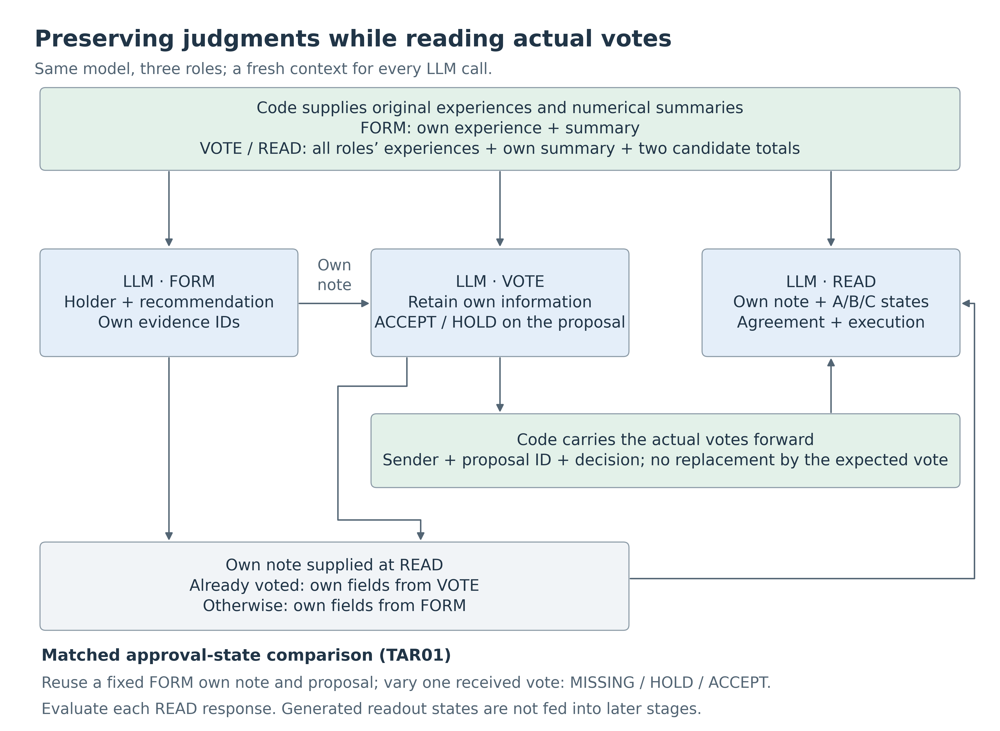
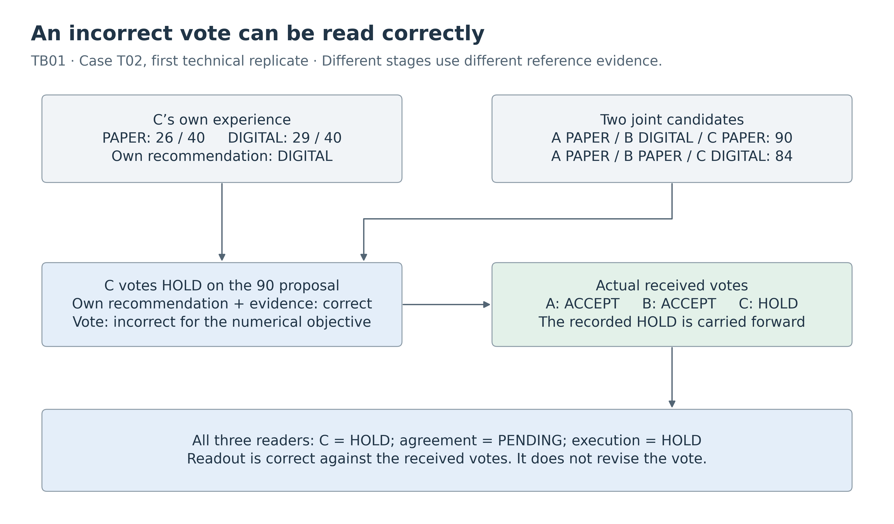

# Boundaries Between Role-Specific Judgment, Individual Approval, and Group Agreement in Three LLM Roles
## Carrying Actual Votes Forward and Comparing Matched Approval States

Kentaro Sato  
Independent Researcher  
Contact: info@metaclan.jp ([email](mailto:info@metaclan.jp))

October 13, 2026 | English draft v0.1 | For internal review; unpublished

## Abstract

For LLM roles to cooperate while preserving their own judgments, they must distinguish the quality of a joint proposal from who has approved it. We ran the same Qwen3.5-27B model as three roles in separate contexts and evaluated recommendations based on each role's experiences, votes on joint proposals, and agreement and execution decisions derived from received votes. The task allocated paper and digital guidance equipment among three roles. Code supplied summaries of each role's experiences and totals for two joint candidates; the LLM produced recommendations, votes, and interpretations of the approval state.

In a connected sequence using three cases with two technical replicates each, one role correctly retained its own judgment but withheld approval of the higher-total proposal. All three subsequent readers correctly preserved the absence of agreement based on that actual vote. A matched comparison then held own notes and the proposal fixed while changing one role's vote among missing, explicit hold, and approval. Across three cases, two technical replicates, and three readers, all 54 responses correctly preserved role-specific judgments and agreement and execution decisions, but one response recorded a missing vote as an explicit hold. We also compared a condition that required the model to state the ranking of the candidates before voting. It produced 54/54 correct votes versus 52/54 in the direct condition on previously used cases; both conditions achieved 54/54 on numerical cases not previously used in this study.

These results show that voting appropriately, faithfully handling actual votes, and correctly recording each role's approval state are distinct evaluation targets. Combining downstream use of actual votes with matched interventions on approval states made it possible to trace cooperation that preserved role-specific judgments, as well as state errors hidden by correct final decisions.

**Keywords:** LLM agents, three-role cooperation, role-specific judgment, individual approval, unanimous agreement, state readout, fixed-input repetition

## 1. Problem Setting and Contributions

Suppose three guides have each tried paper and digital guidance in their own area. Working alone, each could choose the medium that worked better in their own experience. In a joint task, however, only one digital device is available. Even if digital guidance works better in a particular guide's area, allocating the device to another area and assigning paper to that guide may produce a higher total across the three areas.

Two judgments can therefore hold together: “Digital works better in my own experience” and “I will use paper in the joint task.” Proposal quality and approval are also distinct. If two roles have approved but the third has not replied, a task requiring everyone's explicit approval cannot yet begin.

This paper **evaluates the appropriateness of votes separately from fidelity to the records after voting. It also shows that a correct agreement and execution decision can coexist with an incorrect record of who expressed what.** We examine a path that passes LLM-generated own notes and actual votes into subsequent inputs, together with a comparison that changes only one role's approval state while retaining the same saved material.

**Table 1. Three findings and the comparisons supporting them**

| Finding | Observed relationship | Main evidence |
|---|---|---|
| Vote appropriateness and fidelity to actual votes can diverge | Three subsequent roles treated an incorrect HOLD on the higher-total proposal as the recorded hold | A connected path from own-note formation through voting to readout |
| Incorrect individual states can remain behind correct final decisions | A missing vote was recorded as an explicit hold, while pending agreement and deferred execution were correct | Three approval states with the same own notes and proposal |
| Differences associated with a comparison field varied across cases and replicates | Two additional votes were correct on previously used cases; both conditions were entirely correct on new cases | Matched comparisons of fixed voting inputs and a check on new cases |

These findings organize the exploratory results; they were not a single hypothesis specified before the entire series. For each comparison, inputs, allocation, scoring, counts, and stopping conditions were fixed in local documents before execution. The final three-state comparison was likewise designed in light of earlier findings, with a commitment to close the 54-response run regardless of the direction of its results.

The broader research program concerns forming shared states while preserving the distinctiveness of individual agents. Here, part of that aim is operationalized as **reporting recommendations and evidence grounded in each role's experiences without confusing them with joint assignments or approval states**. The task does not measure personality or autonomous values by requiring the roles to keep giving different answers.

## 2. Related Work

### 2.1 Reaching Joint Answers Through Debate and Voting

Kaesberg et al. compare consensus mechanisms, including unanimity, with several voting mechanisms to examine relationships between decision protocols and tasks [1]. ReConcile improves answers through iterative discussion and aggregation in which diverse LLMs consult one another's answers, explanations, and confidence [2]. Choi et al. separate discussion from voting over initial answers to evaluate the contributions of discussion and aggregation [3].

Against this background, using three roles or a unanimity rule is not itself this paper's contribution. We focus on the relationship between votes on proposals that can be evaluated from numerical evidence and **the subsequent interpretation of each role's actual received vote**. Voting refers to candidate totals, whereas readout refers to received votes. Consequently, the same HOLD has different evaluative meanings at different stages.

### 2.2 Individual Objectives and Verifiable Cooperative States

SOTOPIA evaluates interactions involving roles and social goals along multiple dimensions [4]. NegotiationArena examines proposals, acceptance, and negotiation outcomes in resource exchange, allocation, and buying and selling [5]. In our task, an own recommendation is determined by cumulative success rates in a role's experiences. The joint task has a common objective of maximizing the total. Preserving an own recommendation is therefore distinct from pursuing a self-interested negotiation strategy.

MASBench studies collaboration under partial observability. In scheduling tasks, it distinguishes failures in candidate search from failures in verification and uses memory of candidate and rejected options together with phase-specific JSON voting [6]. Albayaydh and Zhao present a framework that checks negotiation-message schemas and protocol invariants at runtime [7]. These studies provide closely related designs that distribute candidate search, structured voting, state management, and verification across components.

We fix candidate search by supplying all three roles' numerical evidence and a precomputed candidate table at joint-decision stages. Holding own notes and the proposal constant, we compare inputs in which the same role's vote is absent, explicitly on hold, or approving. The focus is to inspect each reader's own-information fields, per-role approval states, agreement, and execution assignment together.

### 2.3 Stage-Specific Evaluation and Repeated Reliability

MultiAgentBench evaluates contributions and collaboration processes as well as task performance [8]. MAST categorizes failures spanning system design, inter-agent misalignment, and verification from execution histories [9]. The τ-bench benchmark evaluates consistent success over repeated attempts at the same task [10]. Sharing these concerns, we describe how the correctness of votes and approval states persists or varies when saved identical inputs are repeated.

**Table 2. Related evaluation targets and the present comparisons**

| Research area | Targets in prior work | What this paper fixes or varies |
|---|---|---|
| Consensus and voting for answer aggregation [1–3] | Decision protocols, debate, task performance after aggregation | Evaluation of two candidates and subsequent readout of generated votes |
| Social interaction and negotiation [4,5] | Role-specific goals, proposals and acceptance, joint outcomes | Experience-based own recommendations and joint assignments |
| Cooperative states and protocol verification [6,7] | Candidate search, state management, voting, constraint checks | Three approval states with fixed own notes and a fixed proposal |
| Stage-specific failures and repetition [8–10] | Intermediate achievement, failure location, consistency of success | Saved records, individual output fields, and correctness variation on identical inputs |

The contribution is **to connect a path that carries actual votes into subsequent judgments with a matched comparison varying only approval states, so that role-specific judgments, votes, state records, and execution decisions can be evaluated against the same evidence**.

## 3. Task and Evaluated Boundaries

### 3.1 Own Recommendations and Joint Assignments

The same model is run as roles A, B, and C. Every generation uses a fresh context with the role name, experience records, and required saved records explicitly supplied. Each role has two experience rows. A row records its owner, session, trial and success counts for paper and digital guidance, and an experience ID. Each medium has 20 trials per session, or 40 across the two sessions.

For its own task, a role recommends the medium with the higher cumulative success rate over all its own experiences. For role \(i\) and medium \(m\), the predicted number of successes per 40 people is

\[
q_i(m)=40\frac{\sum_t s_{i,t,m}}{\sum_t n_{i,t,m}}.
\]

Here, \(s\) denotes successes and \(n\) denotes trials. In the joint task, one medium is available for one role and the other for two roles. For the two feasible candidates \(c\) supplied by code, the model compares the total under assignment \(a_c(i)\):

\[
Q(c)=\sum_{i\in\{A,B,C\}}q_i(a_c(i))
\]

Throughout this paper, the “higher-total proposal” means **the proposal with the higher total among the two presented candidates**. The model does not search all possible assignments. Neither own recommendations nor candidate totals contain ties.

Own-note formation receives the role's own experiences and summary. Voting and readout receive all three roles' experiences, the reader's or voter's own summary, and the per-role predictions and total for each candidate. The purpose is to examine which evidence is used for different judgment targets, rather than whether the model can correctly add the totals.

### 3.2 From Individual Votes to Agreement

An own note stores its holder, recommended medium, and own experience IDs. When voting, the role must output ACCEPT for the higher-total proposal and HOLD for the lower-total proposal. A proposal ID identifies the proposal being voted on, separately from candidate IDs.

Code carries forward the sender, proposal ID, and ACCEPT/HOLD decision from each generated vote as a received vote record. Each reader reports the individual approval states, overall agreement, and its execution assignment. Agreement requires everyone's explicit approval: only three ACCEPT votes on the same proposal produce AGREED; otherwise the state is PENDING. For AGREED, the reader outputs its assigned medium under the proposal. For PENDING, it outputs HOLD to defer execution.

**Table 3. Evidence and expected answers for each judgment target**

| Judgment target | Output field | Evidence used to determine the expected answer |
|---|---|---|
| Role-specific judgment | `own`: holder, recommendation, experience IDs | The role's original experiences and the role addressed by the call |
| Vote on a joint proposal | `vote`: proposal ID, ACCEPT/HOLD | Totals of the two presented candidates and the current proposal |
| Each role's approval state | `approval_state`: separate states for A/B/C | Vote records actually present in the current readout input |
| Group agreement | `agreement`: AGREED/PENDING | Explicit approval by all three roles for the same proposal |
| Execution decision | `joint_action`: PAPER/DIGITAL/HOLD | Agreement and the reader's assignment under the proposal |

A HOLD vote records an explicit decision to withhold approval. MISSING means that the role's vote is absent from the input. Both prevent group agreement, but they differ in what the role has expressed. Readout is not a new vote: even if HOLD is recorded for the higher-total proposal, the reader must not correct it to ACCEPT.



**Figure 1. Information flow under evaluation.** Every LLM operation uses a fresh context. Code supplies evidence and actual records without substituting the expected vote or agreement decision. In the connected path, a reader's own note comes from its voting response if it has already voted, or from its formation response otherwise. In the matched approval-state comparison, the same formation-stage own note is used across all states.

### 3.3 Worked Example: A Role's Preferred Medium and the Joint Allocation

Table 4 shows predicted successes for one case. Role A recommends digital guidance for itself. In the joint task, where only one role can receive the digital device, the candidate assigning it to B has the higher total of the two.

**Table 4. Own and joint judgments derived from the same experiences (case N01)**

| Role | Paper prediction | Digital prediction | Own recommendation | Assignment in the higher-total proposal |
|---|---:|---:|---|---|
| A | 24 | 29 | DIGITAL | PAPER |
| B | 24 | 35 | DIGITAL | DIGITAL |
| C | 32 | 16 | PAPER | PAPER |
| Two candidate totals | A DIGITAL, B PAPER, C PAPER: 85 | A PAPER, B DIGITAL, C PAPER: 91 | — | Proposal totaling 91 |

A's appropriate response is to retain DIGITAL as its own recommendation and approve the proposal totaling 91. If all three roles approve, A's joint assignment becomes PAPER, without requiring A to change its own recommendation to PAPER.

Now suppose the input contains only B's and C's ACCEPT votes for that proposal; A's vote has not been supplied. The correct states are A MISSING, B ACCEPT, and C ACCEPT. Agreement remains pending and execution is deferred. Section 5.2 presents an actual response that misidentified only A's state in this example.

## 4. Methods

### 4.1 Connecting Actual Records and Repeating Fixed Voting Inputs

The connected-path trial, TB01, used three cases with two technical replicates each. Each replicate formed own notes for all three roles and reused them across paths for the higher- and lower-total proposals. In each path, the three roles voted individually. The received records after two votes and after three votes were then read by each of the three roles. The trial produced 18 formation, 36 voting, and 72 readout responses, for a total of 126. Voters did not receive earlier votes from other roles. Readout responses after two votes were not fed back into subsequent voting or readout.

The fixed-input voting trial, TVR01, retained all 18 voting inputs from TB01's first replicate, including the saved own notes. Each input was used for three new generations with new seeds, producing 54 votes. This comparison examined variation on identical inputs; it did not regenerate formation or readout responses.

### 4.2 Two Conditions Separating Own Information From Candidate Comparison

The voting comparison held own notes, original experiences, and candidate tables constant between two conditions:

- **DIRECT:** Output the own-information fields followed by the vote.
- **COMPARE:** Between the own-information fields and the vote, output the target candidate ID, the other candidate ID, and their HIGHER/LOWER relationship. The instructions also specify how the comparison maps to the vote.

TCV01 used the same 18 previously used inputs, with three technical replicates per condition: 108 responses, or 54 matched pairs. Each pair used the same seed. Within the 18 pairs in each replicate, nine ran each condition first. TCV02 retained the instructions and scoring while using three numerical cases not previously used in this study, with changed experience values and candidate assignments. Nine newly formed own notes were reused across the subsequent 108 votes.

The common evaluation targets were the three own-information dimensions and the vote. COMPARE additionally evaluated candidate binding, the ranking, and consistency between the ranking and vote. This is a comparison of conditions that jointly change instructions, schema, and output amount, rather than an estimate of the isolated causal effect of a single comparison field.

### 4.3 Three Approval States With Fixed Own Notes and Proposals

The approval-state comparison, TAR01, used records saved in the new-case comparison. It fixed the nine formation-stage own notes and the nine actual votes from COMPARE's first replicate on the higher-total proposals. The selection rule was defined in this follow-up design after all records had been inspected. It did not select favorable votes from among the three replicates.

For each case, the focal role was the one whose assignment under the higher-total proposal differed from its own recommendation: A in N01, B in N02, and C in N03. Keeping the other two roles' approvals fixed, we changed only the focal role's received vote as shown in Table 5.

**Table 5. Input interventions and expected readout for three approval states**

| Condition | Construction of the focal role's vote | Focal role's state | Group agreement | Execution decision |
|---|---|---|---|---|
| Missing vote (MISSING) | Remove the actual vote from the input | MISSING | PENDING | HOLD |
| Explicit hold (HOLD) | Replace only the actual vote's decision, from ACCEPT to HOLD | HOLD | PENDING | HOLD |
| Approval (ACCEPT) | Use all three actual votes unchanged | ACCEPT | AGREED | Reader's assignment under the proposal |

MISSING and ACCEPT present a subset or the full set of actual votes. HOLD is a counterfactual vote constructed by the experimenter, not a newly generated decision by the model to withhold approval. The original votes were retained and the input transformation was recorded. Nor did the experiment induce an actual communication delay.

Three cases × three states × three readers × two technical replicates yielded 54 responses, with 18 per state. The three states for the same case, reader, and replicate formed one of **18 matched triplets**. A common seed was used within each triplet. The six possible state orders were assigned to three triplets each. There were 27 distinct inputs, each generated twice. All states used the same formation-stage own note, separating changes in approval state from changes in the supplied own note.

Inputs contained neither condition labels nor expected answers. Received vote records supplied only sender, proposal ID, and decision. The comparison fields accompanying the original votes were omitted, and removed votes were not exposed through another route. Each readout used a fresh context. Evaluation ended at the own-information fields, approval states, agreement, and execution decision. We did not evaluate the effects of saving generated readout responses as new states and feeding them into later stages.

### 4.4 Scoring, Repetition, and Stopping Conditions

Own information was scored along three dimensions: holder, recommendation, and evidence IDs. Votes were scored against candidate totals and the proposal ID. Readout added three dimensions: the complete A/B/C approval state, agreement, and execution decision. The approval-state dimension was correct only if all three entries matched the input votes.

**Expected answers and formal scores were computed entirely by fixed-rule code.** Success rates were calculated as fractions from original experiences, and evidence and proposal IDs were checked against their sources. In the connected path, a structurally valid but semantically incorrect response was passed forward as recorded, without replacement by the expected answer. A prespecified rule treated format failures as unresolved; the five completed trials covered here had no format failures, missing responses, or answer repairs.

The fixed diagnostic assigned PASS only when every planned response was correct on every designated dimension; any semantic failure produced FAIL. Differences between conditions were reported separately, including cases in which COMPARE was entirely correct but DIRECT was not and the overall diagnostic was therefore FAIL.

We distinguish cases, inputs, responses, matched pairs, and matched triplets. Dependent observations are not counted as independent sample sizes, and we do not estimate population rates or calculate p-values. Two or three technical replicates were used to describe variation. Illustrative examples selected after execution and supplementary summaries restricted to agreement and execution are identified as such.

### 4.5 Model and Evidence Preservation

All trials used the same Qwen3.5-27B revision with BF16 weights, SDPA, and non-thinking mode. Settings were fixed at temperature 0.7, top-p 0.8, top-k 20, a maximum of 1,024 generated tokens, and a maximum of 8,192 input tokens. Runs used an RTX PRO 6000 Blackwell Server Edition GPU in Colab. No action tools were provided to the model; execution decisions were limited to reporting a medium or HOLD in an output field.

Original responses, subsequent inputs, rendered prompts, token sequences, and generation settings were saved. Returned ZIP archives were reaggregated using fixed local analysis code. An independently implemented verifier within the same project also checked correspondences among original experiences, received votes, and outputs. Appendix C lists the model revision and dependencies, and Appendix D provides evidence entry points.

## 5. Results

### 5.1 An Incorrect Vote Can Be Followed by Faithful Readout

In the connected path, TB01, the holder, recommendation, and evidence were correct in all 126 responses. Votes were correct in 35/36 cases and readout in 72/72. The single voting failure reduced end-to-end success to 11 of 12 paths.

**Table 6. Success in the connected path and the stage at which a failure occurred**

| Stage or aggregation unit | Correct | Observed failure |
|---|---:|---|
| Three own-information dimensions (all responses, each dimension) | 126/126 | None |
| Own-note formation | 18/18 | None |
| Individual voting | 35/36 | One HOLD on the higher-total proposal |
| Readout after two votes | 36/36 | None; all PENDING and HOLD |
| Readout after three votes | 36/36 | None; decisions followed the three actual votes |
| End-to-end (case × replicate × higher/lower proposal) | 11/12 paths | One higher-total path containing the vote above |

The failure occurred in case T02, where C's predictions were 26 for paper and 29 for digital. The joint candidates were A PAPER, B DIGITAL, C PAPER, totaling 90; and A PAPER, B PAPER, C DIGITAL, totaling 84. C correctly reported its own recommendation DIGITAL and own evidence, but returned HOLD for the proposal totaling 90.

The other two roles had accepted that proposal, so the three received votes were A ACCEPT, B ACCEPT, and C HOLD. Each reader—A, B, and C—recorded C as HOLD, agreement as PENDING, and execution as HOLD. **The erroneous vote was not replaced by the expected vote downstream; the resulting absence of agreement was correctly preserved.** In the second replicate using the same voting input for C, the vote was ACCEPT. After agreement, C retained DIGITAL as its own recommendation while reporting PAPER as its joint assignment.



**Figure 2. A connected path combining a voting failure with correct downstream readout.** The figure shows the first replicate of case T02. Voting and readout use different reference evidence, so retaining C's recorded HOLD is the correct downstream response.

In the fixed voting repetition, TVR01, the own-information dimensions were again correct in 54/54 responses, while voting was correct in 52/54. Sixteen of the 18 inputs were correct in all three replicates; two mixed correct and incorrect votes. The T02/C higher-total input produced ACCEPT, ACCEPT, and HOLD. The T03/A lower-total input produced HOLD, ACCEPT, and HOLD, showing an incorrect approval of a lower-total proposal as well as an incorrect hold on a higher-total proposal. These new votes were not passed downstream, so this trial does not establish that the incorrect approval led to group agreement.

### 5.2 A Missing Vote Became an Explicit Hold Behind a Correct Deferral

In the matched approval-state comparison, TAR01, each own-information dimension, agreement, and execution decision was correct in 54/54 responses. Per-role approval states were correct in 53/54, with one failure in the missing-vote condition.

**Table 7. Readout results by approval state (18 responses per condition)**

| Evaluation target | Missing vote | Explicit hold | Approval |
|---|---:|---:|---:|
| Own-note holder | 18/18 | 18/18 | 18/18 |
| Own recommendation | 18/18 | 18/18 | 18/18 |
| Own evidence IDs | 18/18 | 18/18 | 18/18 |
| Approval states of all three roles | **17/18** | 18/18 | 18/18 |
| Group agreement | 18/18 | 18/18 | 18/18 |
| Execution decision | 18/18 | 18/18 | 18/18 |
| All six dimensions | 17/18 | 18/18 | 18/18 |

The failure occurred when A read case N01 from Section 3.3 in the first replicate. The input contained B's and C's ACCEPT votes for the proposal totaling 91, but no vote from A. The model correctly preserved A's recommendation DIGITAL and its two experience IDs, yet recorded A's approval state as HOLD rather than MISSING. The following reproduces the original JSON values, with whitespace adjusted only for presentation.

```json
{
  "own": {
    "holder": "A",
    "recommendation": "DIGITAL",
    "evidence_ids": ["E79c8f7f51e", "Ee4703603d4"]
  },
  "approval_state": {"A": "HOLD", "B": "ACCEPT", "C": "ACCEPT"},
  "agreement": "PENDING",
  "joint_action": "HOLD"
}
```

The error was to treat an absent vote from A as an explicit HOLD. Keeping agreement pending and deferring execution were appropriate. For the same case, reader, and replicate in the explicit-hold condition, the model produced the same JSON values. In the approval condition, it instead recorded all three roles as ACCEPT and switched to AGREED with PAPER as its joint assignment.

**Table 8. A's actual responses with the same own note (case N01)**

| Replicate | A's vote in the input | Reported state of A | Agreement / execution | Own recommendation |
|---|---|---|---|---|
| 1 | Absent | **HOLD (expected: MISSING)** | PENDING / HOLD | DIGITAL |
| 1 | HOLD | HOLD | PENDING / HOLD | DIGITAL |
| 1 | ACCEPT | ACCEPT | AGREED / PAPER | DIGITAL |
| 2 | Absent | MISSING | PENDING / HOLD | DIGITAL |
| 2 | HOLD | HOLD | PENDING / HOLD | DIGITAL |
| 2 | ACCEPT | ACCEPT | AGREED / PAPER | DIGITAL |

The missing-vote prompt and token sequence were identical in the first and second replicates; the second correctly reported MISSING. Of the 27 inputs repeated twice, this was the only one for which the structured response values and correctness changed.

Across the 18 matched triplets of approval states, own information was correct and identical throughout in 18/18. The distinction between a missing vote and an explicit hold was correct in 17/18, and all six dimensions were correct in all three states in 17/18 triplets. A post hoc supplementary summary restricted to agreement and execution yielded 18/18. No response declared agreement or execution without everyone's approval, or deferred execution when all three had approved.

**This case shows that an appropriate final deferral does not ensure that each role's underlying state has been recorded correctly.** Missing votes and explicit holds map to the same overall decision, so correctness at the endpoint alone could not detect the confusion.

### 5.3 The Difference With a Comparison Field Did Not Appear on New Cases

In TCV01, which separated own information from the ranking of the candidates, DIRECT produced 52/54 correct votes and COMPARE produced 54/54. Own information was correct in 54/54 for both conditions. Both differences occurred in the first replicate; all votes were correct in both conditions in the remaining two replicates.

In TCV02's new cases, all nine formation responses were correct, followed by 54/54 correct own-information and voting responses in each condition. In both trials, COMPARE's candidate IDs, ranking, and mapping from ranking to vote were correct in all 54 responses.

**Table 9. Matched voting comparison and breakdown by replicate**

| Cases | Replicate | DIRECT | COMPARE | Matched pairs correct only in COMPARE |
|---|---|---:|---:|---:|
| Three previously used cases (TCV01) | 1 | 16/18 | 18/18 | 2 |
| Same | 2 | 18/18 | 18/18 | 0 |
| Same | 3 | 18/18 | 18/18 | 0 |
| Same | Total | **52/54** | **54/54** | **2/54** |
| Three new cases (TCV02) | 1 | 18/18 | 18/18 | 0 |
| Same | 2 | 18/18 | 18/18 | 0 |
| Same | 3 | 18/18 | 18/18 | 0 |
| Same | Total | **54/54** | **54/54** | **0/54** |

Neither trial contained a pair correct only in DIRECT or a pair incorrect in both conditions. Comparison fields preceded the vote in every response. The two TCV01 differences corresponded to the two inputs that varied in the fixed repetitions in Section 5.1. For T02/C's proposal totaling 90, DIRECT returned HOLD, whereas COMPARE returned HIGHER and ACCEPT. For T03/A's proposal totaling 76, DIRECT returned ACCEPT, whereas COMPARE returned LOWER and HOLD. Own recommendations remained correctly DIGITAL and PAPER, respectively.

The condition with comparison fields showed a favorable difference on previously used inputs and correctly combined own information, comparison, and voting on new cases. DIRECT was also entirely correct on the new cases, however, so the difference did not persist uniformly across the materials. A zero observed difference is not evidence of equivalence.

**Table 10. Output amounts and generation times recorded in the same voting comparisons**

| Cases | DIRECT output tokens | COMPARE output tokens | DIRECT generation seconds | COMPARE generation seconds |
|---|---:|---:|---:|---:|
| Three previously used cases | 4,799 | 7,522 | 264.159 | 408.596 |
| Three new cases | 4,573 | 7,526 | 252.141 | 408.186 |

Each entry is the total for 54 responses and excludes formation costs. COMPARE increased both output amount and generation time. These are cost records from the same runs, not a dedicated speed benchmark. The value of making the comparison visible should be assessed alongside its additional cost.

## 6. Discussion

### 6.1 Choosing a Good Proposal and Preserving Actual Votes

Vote appropriateness was judged against this task's specified objective: maximizing the total among the two presented candidates. This is distinct from the general legitimacy of withholding approval in real-world decision-making. Readout refers to actual votes regardless of proposal quality. In the connected example, HOLD on the better proposal was an incorrect vote, but preserving that HOLD and reporting pending agreement was appropriate readout. Making downstream vote interpretation more accurate would therefore not automatically produce more agreements on good proposals.

This distinction identifies which stage needs improvement before cooperation is reduced to a single success rate. Improving votes requires examining candidate evaluation and its mapping to the vote. Improving agreement judgments requires examining received votes and the agreement rule. Scoring the same HOLD as an error upstream and a faithful record downstream follows this division of responsibilities.

### 6.2 Overall State Does Not Recover Individual States

In one three-state comparison response, A's missing vote became an explicit hold while own information, agreement, and execution were all correct. The fact that both states lead to PENDING and HOLD follows directly from the rule: correctness after aggregation cannot distinguish them. The empirical observation is that **an actual generated response lost this distinction, whereas another replicate of the same input preserved it**.

In an operational system, the distinction could matter for deciding whose response to await and whom to ask to reconsider. Here, checking each role's reported state separately detected a record of an unexpressed intention even while the overall decision appropriately remained on hold.

### 6.3 Making a Comparison Visible Provides Information Beyond an Accuracy Gain

COMPARE externalized the ranking between the target and other candidate and the mapping from that ranking to the vote. This allowed the correctness of the ranking and the consistency of the vote with it to be scored separately. Both were entirely correct in COMPARE, so the comparison did not identify the internal mechanism of DIRECT's errors.

The two-response difference on previously used cases is a useful local observation, as is the tie on new cases. An evaluation faithful to these results should present diagnostic information, performance by case set, and generation costs together, rather than equating the value of an additional visible field with a universal gain in accuracy.

### 6.4 Retaining an Own Judgment While Accepting a Joint Assignment

When everyone approved, a role could report a joint assignment different from its own recommendation while retaining that recommendation and its evidence. Following the same joint proposal did not require rewriting each role's evaluation of its own experiences to match the joint assignment.

The experimental conditions supporting this coexistence included original own experiences and their summary, joint candidate totals, explicit own-information fields, received votes, and an agreement rule. With these supplied, the study identified which fields were correct and where failures remained. Further work on role distinctiveness and shared states can preserve these separations while evaluating changes in experiences or votes.

## 7. Scope and Limitations

**Cases and model.** This is a small diagnostic using one model revision and generation configuration, with six synthetic numerical cases. New cases also came from the same task template. Free negotiation, real customer interactions, and transfer to other models were not evaluated. Role-specific judgment is defined as experience-based recommendation and evidence, rather than personality or enduring individuality.

**Information and interventions.** Voting and readout received all three roles' experiences and precomputed totals. The study did not examine negotiation with withheld information or difficult candidate search. COMPARE also changed instructions, schema, and output length. The approval-state comparison was a follow-up using fixed existing own notes and votes, not independent regeneration of complete paths from FORM onward.

**Dependence and variation.** Roles, proposals, and replicates derived from the same case are dependent; readouts also share the same set of votes. The 18 matched triplets are not 18 independent cases. Limited repetitions do not establish population error frequencies, superiority or equivalence between conditions, or the internal reasoning responsible for variation. Nor do these results estimate a causal effect of increasing the number of roles, because no two-role control was run under matched conditions.

**Untested states.** The three-state comparison used higher-total proposals and constructed HOLD votes. Crossing these conditions with unanimous incorrect approval of a lower-total proposal, votes for other proposals, late arrival, revocation, mixed versions, and renegotiation remains future work. Senders were bound by the host, so resistance to impersonation was not tested. Execution was an answer in the `joint_action` field; no real-world task was executed.

## 8. Conclusion

Tracing actual records from three LLM roles separated the correctness of role-specific judgments, votes on joint proposals, individual approval records, and agreement and execution decisions. A role correctly retained its own judgment yet withheld approval of the higher-total proposal; that vote was faithfully handled downstream. In the matched approval-state comparison, one missing vote was recorded as an explicit hold even though every agreement and execution decision was appropriate.

The condition with comparison fields produced two more correct responses than DIRECT on previously used cases, while both conditions were entirely correct on new cases. Within this setting, roles preserved their own judgments while following the joint criterion and, once approval was complete, accepting assignments that differed from their own recommendations.

**Evaluating a joint proposal appropriately and accurately carrying forward who approved what are separate requirements for cooperation.** Connecting actual votes to their readout and comparing matched approval states provides a concrete way to inspect those requirements without hiding them inside final-answer correctness.

## 9. Data Availability and Research Disclosures

Original inputs, responses, saved notes, received votes, fixed designs, code, settings, hash lists, and reaggregated results are retained locally without a deletion deadline. The [evidence index](evidence-index-en-v0.1-2026-10-13.md) links the paper's tables to their sources; [paper data](paper-data-v0.1-2026-10-13.json) provide machine-readable summaries; and [evidence extracts](evidence-extract-v0.1-2026-10-13.json) contain the illustrated original inputs and responses. A permanent public archive and DOI for this fourth paper have not yet been assigned. Relative links currently refer to material in the research folder.

The author is responsible for research design, implementation and Colab execution, review of results, and the manuscript. LLM assistance was used in design, implementation, research, analysis, and writing. Formal scoring used fixed code; LLM reading feedback is not treated as third-party rescoring. Verification was conducted within the same project.

The materials comprise fictional roles and numerical experiences. No human participants were recruited and no personal responses were collected. No external services were operated and no real equipment was allocated. Final funding and competing-interest declarations, the public license, and citation information will be confirmed by the author for the public version.

## Appendix A. Cases, Replicates, and Response Counts

**Table A1. Trial roles and counting units**

| ID | Descriptive name | Responses collected | Relationship between cases and replicates | Fixed diagnostic |
|---|---|---:|---|---|
| TB01 | Connected path carrying actual votes forward | 18 formation + 36 voting + 72 readout = 126 | Three cases × two replicates; the two higher/lower paths share formation | FAIL: one vote |
| TVR01 | Repetition of fixed voting inputs | 54 votes | 18 inputs from TB01's first replicate × three new replicates | FAIL: two votes |
| TCV01 | Comparison fields on previously used cases | 108 votes | Same 18 inputs × two conditions × three replicates = 54 matched pairs | FAIL: two DIRECT votes |
| TCV02 | Comparison fields on new cases | 9 formation + 108 voting = 117 | Three new cases; nine formation responses reused for 18 voting inputs across two conditions and three replicates | PASS_IN_FIXED_COMPARISON |
| TAR01 | Three individual approval states | 54 readouts | Three TCV02 cases; 27 inputs × two replicates = 18 matched triplets | FAIL: one approval-state response |

The total of 459 responses is an inventory of saved generations, not a performance aggregate over 459 independent samples. All five trials completed their planned counts and every response ended with EOS. There were zero unresolved responses, zero format repairs, and zero regenerations to improve scores. An initial TB01 attempt stopped before any generation because the input checker incorrectly flagged the official template's handling of trailing newlines. That original record is retained; TB01 in this paper denotes the completed run after the input check was corrected.

**Table A2. Predictions and the two candidates for all six cases**

| Case | A (PAPER, DIGITAL) | B (PAPER, DIGITAL) | C (PAPER, DIGITAL) | Higher-total candidate (A/B/C); total | Lower-total candidate (A/B/C); total |
|---|---|---|---|---|---|
| T01 | 34,22 | 27,23 | 18,30 | PAPER / DIGITAL / DIGITAL: 87 | DIGITAL / PAPER / DIGITAL: 79 |
| T02 | 31,17 | 24,33 | 26,29 | PAPER / DIGITAL / PAPER: 90 | PAPER / PAPER / DIGITAL: 84 |
| T03 | 26,22 | 19,29 | 32,21 | DIGITAL / DIGITAL / PAPER: 83 | PAPER / DIGITAL / DIGITAL: 76 |
| N01 | 24,29 | 24,35 | 32,16 | PAPER / DIGITAL / PAPER: 91 | DIGITAL / PAPER / PAPER: 85 |
| N02 | 18,33 | 28,23 | 31,20 | DIGITAL / DIGITAL / PAPER: 87 | DIGITAL / PAPER / DIGITAL: 81 |
| N03 | 20,33 | 28,17 | 24,30 | DIGITAL / PAPER / PAPER: 85 | PAPER / PAPER / DIGITAL: 78 |

Values are predictions per 40 people, aggregated from each role's two original experience sessions. The role whose own recommendation differs from its assignment in the higher-total proposal is B in T01, C in T02, A in T03, A in N01, B in N02, and C in N03. Old and new cases share the same template; role names and numerical materials were not fully crossed.

## Appendix B. Output Contracts and Metric Definitions

### B.1 Stored Fields

All schemas reject unknown additional fields. The own-information structure is common across the three stages: `holder` is A/B/C, `recommendation` is PAPER/DIGITAL, and `evidence_ids` is an array of experience IDs. The evidence is scored against the complete set of the role's own experience IDs, irrespective of array order.

**Table B1. Output structure by stage**

| Stage | Required top-level fields | Additional scoring targets |
|---|---|---|
| FORM (own-note formation) | `own` | Holder, recommendation, own evidence |
| VOTE (DIRECT) | `own`, `vote` | `vote.proposal_id` and `decision` |
| VOTE (COMPARE) | `own`, `comparison`, `vote` | `candidate_id`, `other_candidate_id`, `relation`, and their consistency with the vote |
| READ (readout) | `own`, `approval_state`, `agreement`, `joint_action` | Three roles' vote states, agreement, own assignment or hold |

`approval_state` is an object with fixed keys A/B/C. Its value schema allows ACCEPT, HOLD, MISSING, and WRONG_PROPOSAL. WRONG_PROPOSAL denotes a vote on a different proposal, but that condition was not included in this paper's experimental cases.

### B.2 Deriving Expected Answers From Received Votes

The following pseudocode summarizes the scoring rule. Expected own-information fields are computed separately from original experiences.

```text
for role in [A, B, C]:
    receipt = that role's receipt in the current input
    if receipt is absent:
        expected_state[role] = MISSING
    elif receipt.proposal_id != current_proposal_id:
        expected_state[role] = WRONG_PROPOSAL
    else:
        expected_state[role] = receipt.decision

agreed = all(expected_state[role] == ACCEPT for role in [A, B, C])
expected_agreement = AGREED if agreed else PENDING
expected_action = current_assignment[reader] if agreed else HOLD
```

This rule is deterministic. In the experiment, its answers were used to verify the model's state, agreement, and action fields, rather than substituted into the readout responses.

### B.3 Success for Responses, Matched Triplets, and Complete Cases

A READ response is fully correct when all six dimensions—three own-information dimensions, approval state, agreement, and execution—are correct. A TAR01 matched triplet contains the three states for the same case, reader, and replicate; all six dimensions must be correct in each of its three responses. Aggregating further over all three readers for each case × replicate yields full correctness in 5/6.

Despite its name, `agreement_execution_all_states` in TAR01's fixed summary JSON includes **three dimensions: approval state, agreement, and execution**. Its value is 17/18. The paper's “agreement and execution only: 18/18” is a different, post hoc supplementary metric restricted to two dimensions. Neither the formal key nor the scoring rule was changed.

## Appendix C. Execution Settings and Reproducibility Scope

**Table C1. Common settings**

| Item | Value |
|---|---|
| Model | `Qwen/Qwen3.5-27B` |
| Fixed revision | `fc05daec18b0a78c049392ed2e771dde82bdf654` |
| Weights and attention | BF16, SDPA |
| Thinking | `enable_thinking=false` |
| Sampling | `do_sample=true`, temperature 0.7, top-p 0.8, top-k 20 |
| Other generation settings | Repetition penalty 1.0, `use_cache=true` |
| Length limits | 8,192 input tokens; 1,024 generated tokens |
| Dependencies | Transformers 5.17.0, Accelerate 1.15.0 |
| GPU | RTX PRO 6000 Blackwell Server Edition |
| Execution date | October 13, 2026 |

Seeds and execution orders were fixed before each trial and retained in the design files and response records. For the illustrated TAR01 case N01/A, the first-replicate seed was 230410795 and the second was 2039158309. The same seed was used for all three states within a replicate. A common seed does not guarantee identical responses to different inputs, nor does fixing seeds guarantee bitwise reproducibility across GPUs or libraries.

Outputs underwent strict JSON structure validation before scoring. The parser includes handling for known outer wrappers, but every response in the five completed trials could be scored without changing either its content or its outer form. No extra attempts were added to improve response scores.

## Appendix D. Evidence Entry Points

The task materials, scoring rules, and counting units needed to interpret the results are described in Sections 3–4 and Appendices A–C. The following resources support detailed checks.

| Item to check | Resource and contents |
|---|---|
| Table values and costs | [Paper data](paper-data-v0.1-2026-10-13.json): extracts from fixed reaggregations and original response times and token counts |
| Examples in Sections 5.1 and 5.2 | [Evidence extracts](evidence-extract-v0.1-2026-10-13.json): actual inputs, original responses, scores, and archive locations |
| All responses and designs fixed before execution | [Evidence index](evidence-index-en-v0.1-2026-10-13.md): original ZIP archives, fixed designs, and analysis code for the five trials |
| Scope of related-work claims | [Research memo (Japanese)](related-work-review-v0.1-2026-10-13.md): checked primary-source passages and claims used in this paper |

The paper-data file supports reproducing the extraction of table values. It does not replace the original ZIP archives containing responses, inputs, and execution code. Verification from original archives and extraction into manuscript tables remain separate entry points.

## References

[1]Lars Benedikt Kaesberg, Jonas Becker, Jan Philip Wahle, Terry Ruas, Bela Gipp. 2025. *Voting or Consensus? Decision-Making in Multi-Agent Debate.* Findings of ACL 2025, 11640–11671. [ACL Anthology / DOI:10.18653/v1/2025.findings-acl.606](https://aclanthology.org/2025.findings-acl.606/).

[2]Justin Chen, Swarnadeep Saha, Mohit Bansal. 2024. *ReConcile: Round-Table Conference Improves Reasoning via Consensus among Diverse LLMs.* ACL 2024, 7066–7085. [ACL Anthology / DOI:10.18653/v1/2024.acl-long.381](https://aclanthology.org/2024.acl-long.381/).

[3]Hyeong Kyu Choi, Xiaojin Zhu, Yixuan Li. 2025. *Debate or Vote: Which Yields Better Decisions in Multi-Agent Large Language Models?* NeurIPS 2025. [Published version](https://proceedings.neurips.cc/paper_files/paper/2025/hash/934252acd87f254d5d4672fbde283bd2-Abstract-Conference.html); version checked: [arXiv:2508.17536v1](https://arxiv.org/html/2508.17536v1).

[4]Xuhui Zhou et al. 2024. *SOTOPIA: Interactive Evaluation for Social Intelligence in Language Agents.* ICLR 2024. Version checked: [arXiv:2310.11667v2](https://arxiv.org/html/2310.11667v2).

[5]Federico Bianchi, Patrick John Chia, Mert Yuksekgonul, Jacopo Tagliabue, Dan Jurafsky, James Zou. 2024. *How Well Can LLMs Negotiate? NegotiationArena Platform and Analysis.* [arXiv:2402.05863v1](https://arxiv.org/html/2402.05863v1).

[6]Qizhi Chu, Zekai Yu, Sijie Wen, Yang Liu, Chen Qian, Cheng Yang, Chuan Shi, Zhiyuan Liu. 2026. *MASBench: Benchmarking LLM-based Multi-Agent Collaboration under Partial Observability.* [arXiv:2610.04672v1](https://arxiv.org/html/2610.04672v1).

[7]Wael Albayaydh, Rui Zhao. 2026. *Do LLM Agents Negotiate Rationally? A Mechanism-Design Framework for Verifiable Multi-Agent Interaction over A2A/MCP.* [arXiv:2608.14613v1](https://arxiv.org/pdf/2608.14613v1).

[8]Kunlun Zhu et al. 2025. *MultiAgentBench: Evaluating the Collaboration and Competition of LLM agents.* ACL 2025, 8580–8622. [ACL Anthology / DOI:10.18653/v1/2025.acl-long.421](https://aclanthology.org/2025.acl-long.421/).

[9]Mert Cemri et al. 2025. *Why Do Multi-Agent LLM Systems Fail?* Version checked: [arXiv:2503.13657v3](https://arxiv.org/html/2503.13657v3).

[10]Shunyu Yao, Noah Shinn, Pedram Razavi, Karthik Narasimhan. 2024. *τ-bench: A Benchmark for Tool-Agent-User Interaction in Real-World Domains.* [arXiv:2406.12045v1](https://arxiv.org/html/2406.12045v1).
