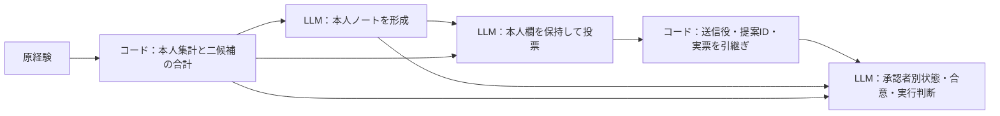
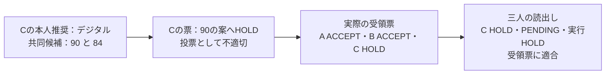

# LLM三役における本人判断・個別承認・集団合意の境界
## 実票の引継ぎと承認状態の対応比較

Kentaro Sato  
独立研究者（Independent Researcher）  
連絡先：info@metaclan.jp（[メール](mailto:info@metaclan.jp)）

2026年10月13日｜日本語草稿 v0.2｜内部検討用・未公開

## 要旨

LLMが各役に固有の判断を保ちながら協調するには、共同案のよさと、その案を誰が承認したかを区別する必要がある。本研究では、同一のQwen3.5-27Bを別コンテキストで三役として実行し、各役の経験に基づく推奨、共同案への投票、受領した票からの合意・実行判断を評価した。課題は紙とデジタルの案内設備を三人へ配分するもので、本人の経験集計と二つの共同候補の合計をコードで供給し、推奨・投票・状態の解釈をLLMに委ねた。

実記録を引き継ぐ3材料・各2反復の系列では、本人判断を正しく保ちながら高い合計の案を保留する一票が生じた。その後の三者は、その実票に沿って未合意を正しく維持した。続いて、本人ノートと共同案を固定し、一人の票だけを未返答・明示保留・承認に変えた3材料・各2反復の対応比較では、三人の読出し計54回答すべてで本人判断と合意・実行判断が適切だったが、1回答が未返答を明示保留と記録した。投票前に候補の高低を書く条件も比較し、既使用材料では従来条件52/54に対して54/54、研究内で未使用だった数値材料では両条件54/54だった。

これらの結果は、適切な案に投票すること、実際の票を忠実に扱うこと、各人の承認状態を正しく記録することが、同じ成功指標に収まらないことを示す。実票の後続利用と、同じ資料に対する承認状態の操作を組み合わせることで、本人判断を保持したまま成立する協調と、最終判断だけでは見えない状態の取り違えを追跡した。

**キーワード：** LLMエージェント、三者協調、役固有の判断、個別承認、全員合意、状態読出し、固定入力反復

## 1. 問題設定と貢献

三人の案内係が、それぞれの担当区域で紙とデジタルの案内を試してきたとする。一人で担当するなら、自分の経験でよく機能した媒体を選べばよい。ところが合同の仕事では、デジタル端末を一人にしか配れない。本人の区域にはデジタルが向いていても、他の区域へ端末を配り、本人が紙を担当する方が三人の合計を高くできる場合がある。

ここでは二つの判断がともに成立する。「自分の経験ではデジタルがよい」と「合同では紙を担当する」である。さらに、共同案がよいことと、その案への承認が揃ったことも別である。二人が承認していても、残る一人が未返答なら、全員の明示承認を必要とする仕事はまだ始められない。

本稿は、**共同案への投票の適切さと、投票後の記録への忠実性を分けて評価する。また、合意・実行判断が適切な場合にも、誰が何を表明したかの記録に不備が残ることを示す。** そのために、LLMが生成した本人ノートと実票を次の入力へ渡す経路と、同じ保存物で一人の承認状態だけを変える比較を用いた。

**表1　本稿の三つの知見と、それを支える比較**

| 知見 | 実際に観測した対応 | 主な証拠 |
|---|---|---|
| 投票の適切さと実票への忠実性は分かれる | 高合計案への誤保留を、後続の三役がそのまま保留として扱った | 本人形成・投票・読出しを接続した実経路 |
| 正しい最終判断の背後に、個別状態の誤記が残る | 未返答を明示保留と記録しながら、未合意・実行保留は正しかった | 同じ本人ノート・共同案に対する三状態比較 |
| 比較欄を添えた条件の差は材料・反復によって異なる | 既使用材料では投票成立が2回答多く、新材料では両条件全件成立した | 固定投票入力の対応比較と新材料点検 |

三つの知見は、探索結果を統合する観点である。系列全体を一つの取得前仮説で開始したものではない。各比較では、実行前に入力・割付・採点・回数・終了条件をローカル文書へ固定した。最後の三状態比較も、先行結果を踏まえて設計し、54回答の一巡を結果の方向によらず閉じる方針を採った。

研究全体の関心は、各主体の固有性を保ちながら共有状態を形成することである。本稿ではその一部を、**役固有の経験に沿った推奨と根拠を、共同担当や承認状態と混同せずに出力すること**として操作化する。人格や自律的な価値観を測るために、異なる答えを出し続けるよう求める課題ではない。

## 2. 関連研究

### 2.1 討論・投票によって共同の答えを決める研究

Kaesbergらは、全員一致を含む合意方式と複数の投票方式を比較し、決定方式と課題の関係を調べている［1］。ReConcileは、異なるLLMの回答と説明・確信度を相互に参照し、反復的な討論と集約を通じて回答を改善する［2］。Choiらは討論を行う条件と初期回答を投票で集約する条件を分け、討論と集約の寄与を評価している［3］。

これらの研究を踏まえると、三役を置くことや全員一致を用いること自体は、本稿の寄与にならない。本稿が詳しく扱うのは、数値資料から評価できる案への票と、**実際に届いた各人の票をその後でどう読み取るか**の対応である。投票では共同案の合計を参照し、読出しでは受領票を参照するため、同じHOLDでも工程によって評価上の意味が変わる。

### 2.2 個々の目的と、検証可能な協調状態

SOTOPIAは役や社会的目標を持つ相互作用を複数の次元で評価し［4］、NegotiationArenaは資源交換・分配・売買における提案、受諾、交渉結果を扱う［5］。本稿の本人推奨は、経験の累積成功率から定まる判断である。共同の仕事には合計最大化という共通目標を与えており、本人の推奨を保持することと、自己利益を優先する交渉戦略を区別する。

MASBenchは部分観測下の協調を対象とし、日程調整では候補探索と検証の不備を分け、候補・拒否候補の記憶や段階別JSON投票を用いる［6］。AlbayaydhとZhaoは、交渉メッセージのschemaとプロトコル不変条件を実行時に検査する枠組みを提示している［7］。候補探索、構造化投票、状態管理、検証を分担する設計には、こうした近接研究がある。

本稿では、共同判断時に三役の数値資料と計算済み候補表を揃え、候補探索を固定する。その上で本人ノートと提案を保ち、同じ人の票が存在しない場合、明示的に保留した場合、承認した場合を対応させる。各読出し役が出力した本人欄・承認者別の欄・合意・実行担当を同時に点検することが、この比較の焦点である。

### 2.3 工程別評価と反復信頼性

MultiAgentBenchは課題成績に加えて工程への貢献や協調過程を評価し［8］、MASTは実行履歴から設計・役間の不整合・検証にまたがる失敗を分類する［9］。また、τ-benchは同じ課題を繰り返した場合の一貫した成功を評価する［10］。本稿はこれらと問題意識を共有し、保存した同一入力の反復で、投票や承認状態の正誤がどこまで持続するかを記述する。

**表2　関連研究と本稿の比較対象**

| 研究群 | 先行研究が扱う対象 | 本稿で固定・操作するもの |
|---|---|---|
| 合意・投票による回答集約［1–3］ | 決定方式、討論、集約後の課題成績 | 二候補の評価と、生成した票の後続読出し |
| 社会的相互作用・交渉［4,5］ | 役ごとの目標、提案・受諾、共同の結果 | 経験から定まる本人推奨と共同担当 |
| 協調状態・プロトコル検証［6,7］ | 候補探索、状態管理、投票、制約の検査 | 本人ノート・案を固定した三承認状態 |
| 工程別の故障・反復［8–10］ | 途中の達成、失敗位置、成功の一貫性 | 保存物と各出力欄、同じ入力の成否変動 |

本稿の貢献は、**実票が後続判断へ渡る経路と、承認状態だけを変えた対応比較を結び付け、本人判断・投票・状態記録・実行判断の成否を同じ資料から追えるようにしたこと**にある。

## 3. 課題と評価する境界

### 3.1 本人の推奨と共同の担当

同一モデルをA・B・Cの三役として実行する。生成ごとに新しいコンテキストを用い、役名、経験資料、必要な保存記録を明示的に入力する。各役には二回分の経験行があり、各行に所有者、回、紙／デジタルそれぞれの試行数と成功数、経験IDを記録する。各媒体は一回20試行、二回で40試行である。

本人の課題では、自分の全経験における累積成功率の高い媒体を勧める。役 \(i\)、媒体 \(m\) の40人換算の予測成功人数を、次のように定める。

\[
q_i(m)=40\frac{\sum_t s_{i,t,m}}{\sum_t n_{i,t,m}}.
\]

ここで \(s\) は成功数、\(n\) は試行数である。共同の課題では、一方の媒体を一人分、他方を二人分だけ利用できる。コードが提示する実行可能な二候補 \(c\) について、割付 \(a_c(i)\) の合計

\[
Q(c)=\sum_{i\in\{A,B,C\}}q_i(a_c(i))
\]

を比較する。本稿の「高合計案」は、**提示された二候補のうち合計が高い案**を意味する。全ての可能な割付をモデルに探索させる課題ではなく、本人の推奨にも候補の合計にも同点を置かない。

本人形成には本人の経験と集計を渡す。投票と読出しには三役の経験、本人の集計、二候補それぞれの役別予測値・合計を渡す。合計計算を正しく行えるかよりも、異なる判断対象にどの資料を使うかを調べるためである。

### 3.2 個別投票から合意へ

本人ノートには、持ち主、推奨媒体、本人の経験IDを保存する。投票では、提示された提案が高合計案ならACCEPT、低合計案ならHOLDを出力する。各候補の識別子とは別に、対象提案を識別するproposal IDを用いる。

コードは生成済みの票から、送信役、proposal ID、ACCEPT／HOLDを受領票として引き継ぐ。読出し役は、各人の状態、全体の合意、本人が担当する媒体を回答する。全員の明示承認を成立規則とし、同じ提案への三人のACCEPTが揃った場合だけAGREED、それ以外はPENDINGとする。AGREEDなら提示案での本人担当を、PENDINGなら実行保留HOLDを出力する。

**表3　判断対象ごとの根拠と正解**

| 判断対象 | 出力欄 | 正解を求める資料 |
|---|---|---|
| 本人の判断 | `own`：持ち主・推奨・経験ID | 本人の原経験と呼出し対象 |
| 共同案への票 | `vote`：提案ID・ACCEPT／HOLD | 提示二候補の合計と対象提案 |
| 各人の承認状態 | `approval_state`：A/B/Cそれぞれの状態 | その読出し入力に実際に含まれる受領票 |
| 全体合意 | `agreement`：AGREED／PENDING | 同一提案への三人の明示承認 |
| 実行判断 | `joint_action`：紙／デジタル／HOLD | 合意の成立と、提示案の本人担当 |

票のHOLDは「明示的に保留した」という記録であり、MISSINGは「その人の票が入力にない」という状態である。両者は全体合意を未成立にする点で共通するが、その人が何を表明したかは異なる。読出しは再投票ではないため、高合計案にHOLDが記録されていても、その票をACCEPTへ直してはならない。



**図1　評価する情報の流れ。** 各LLM処理は新しいコンテキストで行う。コードは資料と実記録を供給し、投票や合意の正解を代入しない。実経路では、読出し時の本人ノートに、その役が既に投票していれば投票時の本人欄、未投票なら形成時の本人欄を使う。承認状態の対応比較では、本人ノートを形成時の同一記録に統一する。

### 3.3 通し例：本人に向く媒体と、全員で選ぶ媒体

ある材料では、予測成功人数が表4のようになる。本人Aはデジタルを勧める。一方、デジタル端末を一人にしか渡せない共同課題では、二候補のうちBへ端末を渡す案の合計が高い。

**表4　同じ経験から定まる本人判断と共同判断の例（材料N01）**

| 役 | 紙の予測値 | デジタルの予測値 | 本人推奨 | 高合計案での担当 |
|---|---:|---:|---|---|
| A | 24 | 29 | デジタル | 紙 |
| B | 24 | 35 | デジタル | デジタル |
| C | 32 | 16 | 紙 | 紙 |
| 二候補の合計 | Aデジタル・B紙・C紙：85 | A紙・Bデジタル・C紙：91 | — | 91の案 |

Aの適切な回答は「本人推奨はデジタル」「共同案91には承認」である。三人の承認が揃えば共同担当は紙になるが、本人推奨を紙へ変更する必要はない。

次に、91の案に対するBとCのACCEPTだけを受け取り、Aの票はまだ渡されていないとする。正しい状態は「A未返答、B承認、C承認」であり、全体は未合意、実行は保留となる。§5.2では、この同じ例でAの状態だけを取り違えた実回答を示す。

## 4. 方法

### 4.1 実記録の接続と、投票入力の固定反復

実経路の試験TB01では、3材料について各2反復を行った。各反復で本人ノートを三人分形成し、それを高合計案・低合計案の二経路へ共用した。各経路で三人が個別に投票し、二票が揃った時点と三票が揃った時点の受領記録を、三人それぞれに読ませた。本人形成18、投票36、読出し72の計126回答である。投票者には先行する他人の票を渡さず、二票時点の読出し回答も次の投票や読出しへ戻さない。

固定投票の試験TVR01では、TB01の第1反復で使用した全18投票入力を保存された本人ノートごと固定し、新しいseedで各3回、計54票を生成した。この比較は同じ入力での変動を見るもので、本人形成と読出しは再生成していない。

### 4.2 本人欄と候補比較を分ける二条件

投票の二条件比較では、本人ノート、原経験、候補表を共通にし、次の二つを比べた。

- **従来条件（DIRECT）：** 本人欄に続けて票を出力する。
- **比較欄あり（COMPARE）：** 本人欄と票の間に、対象候補ID、比較相手ID、高低関係HIGHER／LOWERを出力する。比較と票の対応も指示する。

TCV01は前項と同じ18の既使用入力を各条件3回、計108回答・54対応対で比較した。対応対では同じseedを使い、各反復の18対のうち9対ずつで先に実行する条件を入れ替えた。TCV02は、経験値・候補割付を変更した研究内で未使用の3材料で、指示・採点を固定して同じ二条件比較を行った。新たに形成した9本人ノートは、その後の108投票へ共用した。

共通の評価対象は本人三軸と投票である。COMPAREでは追加の候補対応・高低・票との整合も採点した。二条件は指示、schema、出力量をまとめて変える方式比較であり、比較欄一つの因果効果を単独で推定する設計ではない。

### 4.3 本人ノート・提案を固定した三承認状態

承認状態の比較TAR01には、新材料比較の実保存物を用いた。3材料の形成時の本人ノート9件と、COMPARE・第1反復・高合計案の実票9件を固定した。これらは全件を確認した後に選択規則を決めた後続設計であり、三反復から都合のよい票を選び出す操作は行っていない。

各材料で、高合計案の共同担当が本人推奨と異なる一人を対象役とした。対象役は材料N01でA、N02でB、N03でCである。他の二人の承認を固定し、対象役の受領票だけを表5のように変えた。

**表5　三承認状態の入力操作と期待される読出し**

| 条件 | 対象役の票をどう作るか | 対象役の状態 | 全体合意 | 実行判断 |
|---|---|---|---|---|
| 未返答（MISSING） | 実票を入力から除く | MISSING | PENDING | HOLD |
| 明示保留（HOLD） | 実票のdecisionだけをACCEPTからHOLDへ置換 | HOLD | PENDING | HOLD |
| 承認（ACCEPT） | 三人の実票をそのまま使う | ACCEPT | AGREED | 提示案の本人担当 |

未返答と承認は、実票の部分提示・全提示である。明示保留は実験者が構成した反実仮想の票で、新しくモデルが保留を選んだ票ではない。元の実票を保持し、入力変換を記録した。実際に通信遅延を起こした実験でもない。

3材料×3状態×3読出し役×2反復で54回答、状態ごとに18回答となる。同じ材料・読出し役・反復の三状態を一組とした**18対応組**で評価する。各組で同じseedを使い、三状態の実行順6通りを各3組へ割り付けた。入力は27種類で、それぞれを二回生成する。本人ノートの供給元は全状態で同じ形成時記録とし、状態の違いと本人ノートの違いを分離した。

モデル入力には条件名や正解を含めず、受領票として送信役・提案ID・decisionだけを渡した。元の投票に付随する比較欄や、入力から除いた票を別経路で提示することはない。各読出しは新規コンテキストで行い、本人欄・承認状態・合意・実行判断までを評価した。生成された読出し回答を新たな保存状態として後続工程へ再投入した場合の影響は評価していない。

### 4.4 採点、反復、終了条件

本人の持ち主・推奨・根拠IDを三軸として採点する。投票の採点は共同候補の合計と提案IDに従う。読出しでは本人三軸に加え、A/B/Cの承認状態全体、合意、実行判断を採点する。承認状態は三人の欄がすべて入力票と一致した場合に成立とする。

**正解計算と正式採点は固定規則のコードで完結する。** 成功率は原経験から分数で計算し、根拠IDと提案IDを照合する。意味的に誤った回答でも構造が有効なら、実経路ではその記録を後続へ渡す。正解への書換えは行わない。形式不備は未確定として扱う規則を固定したが、本稿で扱う完走5試験には形式不備・欠測・回答修復はなかった。

各試験の総合判定は、予定した全回答が全評価軸で成立する場合にPASSとする厳しい固定診断である。成分の誤りが一つでもあればFAILとし、方式間の差や局所的な成立を併記する。例えば二条件比較では、COMPAREが全件成立してもDIRECTに不成立があれば全体の判定はFAILとなる。

報告単位は材料、入力、回答、対応対／対応組を分ける。同じ本人ノート、候補、受領票に依存する回答を独立材料として扱わず、本稿ではp値や母集団の成功率を推定しない。二回・三回の反復は、固定入力での成否変動を点検する技術的反復である。取得後に追加した事例抽出と、合意・実行だけを抜き出した集計は、その旨を明記する。

### 4.5 実装・実行環境

全試験でQwen3.5-27Bの同じrevisionを、BF16、SDPA、non-thinking設定で使用した。temperature 0.7、top-p 0.8、top-k 20、最大生成1,024 token、最大入力8,192 tokenを固定し、ColabのRTX PRO 6000 Blackwell Server Editionで実行した。モデル呼出しに操作ツールを与えず、実行判断は回答欄への媒体／HOLDの出力に限定した。

原回答、次入力、実際のpromptとtoken列、生成設定を保存し、返送ZIPを固定ローカル集計器で再集計した。さらに同一プロジェクト内で別実装した検算器を用い、原経験・受領票・各出力の対応を照合した。モデルrevisionと依存関係は付録C、証拠への入口は付録Dにまとめる。

## 5. 結果

### 5.1 投票は誤っても、後続が実票を忠実に扱う場合がある

実経路TB01では、本人の持ち主・推奨・根拠は126回答すべてで適切だった。投票は35/36、読出しは72/72が成立した。投票だけの一件の不備により、全工程の成立は12経路中11経路だった。

**表6　実経路の成立と、不成立が現れた工程**

| 工程・集約単位 | 成立 | 観測した不備 |
|---|---:|---|
| 本人三軸（全回答、各軸） | 126/126 | なし |
| 本人ノート形成 | 18/18 | なし |
| 個別投票 | 35/36 | 高合計案へのHOLD 1件 |
| 二票時点の読出し | 36/36 | なし。全件PENDING・HOLD |
| 三票時点の読出し | 36/36 | なし。実際の三票に沿って判断 |
| 全工程（材料×反復×高／低案） | 11/12経路 | 前述の投票を含む高合計案の一経路 |

事例は、本人Cの予測値が紙26・デジタル29の材料T02である。共同候補は「A紙・Bデジタル・C紙」で合計90、もう一方は「A紙・B紙・Cデジタル」で84だった。Cは本人推奨DIGITALと本人の根拠を正しく出力しながら、90の提案にHOLDを返した。

他の二人は90の案にACCEPTしていたため、三票は「A承認、B承認、C保留」となった。その受領票を読んだA・B・Cは、いずれもCをHOLDと記録し、全体をPENDING、実行をHOLDとした。**投票の誤りは後続の正解へ置換されず、未合意として正しく引き継がれた。** 同じCの投票入力を用いた第2反復ではACCEPTとなり、合意後のCは本人推奨DIGITALを保ちつつ共同担当PAPERを出力した。



**図2　投票の不備と、後続読出しの成立が併存した実経路。** 材料T02の第1反復を示す。投票と読出しでは照合対象が異なるため、CのHOLDを記録どおり保つことが後段の正解になる。

固定投票反復TVR01でも、本人三軸は54/54、投票は52/54だった。18入力中16入力は三回すべて適切で、2入力に適切・不適切が混在した。前述のT02/C・高合計案はACCEPT、ACCEPT、HOLDとなった。別のT03/A・低合計案ではHOLD、ACCEPT、HOLDとなり、高案への誤保留だけでなく低案への誤承認も観測された。ここでは新しい票を後続へ接続していないため、その誤承認から集団合意まで進んだとは扱わない。

### 5.2 正しい保留の背後で、未返答が明示保留に変わった

三承認状態の対応比較TAR01では、本人三軸、合意、実行判断はそれぞれ54/54で適切だった。承認者別状態は53/54で、一つの未返答条件だけが不成立だった。

**表7　承認状態別の読出し成績（各条件18回答）**

| 評価対象 | 未返答 | 明示保留 | 承認 |
|---|---:|---:|---:|
| 本人の持ち主 | 18/18 | 18/18 | 18/18 |
| 本人推奨 | 18/18 | 18/18 | 18/18 |
| 本人の根拠ID | 18/18 | 18/18 | 18/18 |
| 三人の承認状態 | **17/18** | 18/18 | 18/18 |
| 全体合意 | 18/18 | 18/18 | 18/18 |
| 実行判断 | 18/18 | 18/18 | 18/18 |
| 六軸すべて | 17/18 | 18/18 | 18/18 |

不成立は、§3.3の材料N01をAが読む第1反復で起きた。入力には91の提案へのBとCのACCEPTがあり、Aの票はなかった。モデルはA自身の推奨DIGITALと二つの経験IDを正しく保ったが、Aの承認欄をMISSINGではなくHOLDと記録した。原回答のJSON値を、空白だけ整えて示す。

```json
{
  "own": {
    "holder": "A",
    "recommendation": "DIGITAL",
    "evidence_ids": ["E79c8f7f51e", "Ee4703603d4"]
  },
  "approval_state": {"A": "HOLD", "B": "ACCEPT", "C": "ACCEPT"},
  "agreement": "PENDING",
  "joint_action": "HOLD"
}
```

誤っているのは、未提示のAの票を明示的なHOLDとして扱った点である。全体を未合意とし、実行を保留したことは適切だった。同じ材料・同じ読出し役・同じ反復の明示保留条件でも、モデルはこのJSONと同じ内容を出力した。一方、承認条件では三人をACCEPTとし、AGREED・共同担当PAPERへ切り替えた。

**表8　同じ本人ノートに対するAの実回答（材料N01）**

| 反復 | 入力中のAの票 | 出力したAの状態 | 合意／実行 | 本人推奨 |
|---|---|---|---|---|
| 1 | なし | **HOLD（正解はMISSING）** | PENDING／HOLD | DIGITAL |
| 1 | HOLD | HOLD | PENDING／HOLD | DIGITAL |
| 1 | ACCEPT | ACCEPT | AGREED／PAPER | DIGITAL |
| 2 | なし | MISSING | PENDING／HOLD | DIGITAL |
| 2 | HOLD | HOLD | PENDING／HOLD | DIGITAL |
| 2 | ACCEPT | ACCEPT | AGREED／PAPER | DIGITAL |

未返答入力は第1・第2反復でpromptとtoken列が同一であり、第2反復では正しくMISSINGと答えた。27入力の二反復のうち、構造化回答の内容と成否が変わったのはこの1入力だった。

三状態をまとめた18対応組では、本人三軸はすべて適切かつ同一で18/18、未返答と明示保留の区別は17/18、六軸が三状態すべてで適切だった組は17/18となった。合意と実行の二軸だけを取得後に切り出すと18/18である。全員承認していないのに合意・実行へ進む回答も、全員承認しているのに保留する回答もなかった。

**この一件は、最終的な保留が適切でも、その理由となる各人の状態が正しく記録されているとは限らないことを示す。** 未返答と明示保留は同じ全体判断へ集約されるため、終点の正誤だけでは取り違えを検出できなかった。

### 5.3 比較欄を添えた条件の差は、新材料では現れなかった

本人欄と候補の高低比較を分けたTCV01では、従来条件の投票成立が52/54、比較欄ありは54/54だった。両条件とも本人三軸は54/54である。差2件は第1反復に集中し、残る二反復は両条件全件成立した。

新材料TCV02では、本人ノート形成9/9の後、両条件とも本人三軸と投票が54/54成立した。比較欄ありでは、両試験とも候補ID、高低関係、票との対応が全54回答で適切だった。

**表9　投票条件の対応比較と反復内訳**

| 材料 | 反復 | 従来条件 | 比較欄あり | 比較欄ありだけ成立した対応対 |
|---|---|---:|---:|---:|
| 既使用3材料（TCV01） | 1 | 16/18 | 18/18 | 2 |
| 同上 | 2 | 18/18 | 18/18 | 0 |
| 同上 | 3 | 18/18 | 18/18 | 0 |
| 同上 | 計 | **52/54** | **54/54** | **2/54** |
| 新3材料（TCV02） | 1 | 18/18 | 18/18 | 0 |
| 同上 | 2 | 18/18 | 18/18 | 0 |
| 同上 | 3 | 18/18 | 18/18 | 0 |
| 同上 | 計 | **54/54** | **54/54** | **0/54** |

両試験とも、従来条件だけ成立した対応対と両条件不成立の対は0だった。比較欄は全回答で票より先に出力された。TCV01の差は、§5.1の固定反復で変動した二入力に対応する。T02/Cの90の案では、従来条件がHOLD、比較欄ありがHIGHER・ACCEPTだった。T03/Aの76の案では、従来条件がACCEPT、比較欄ありがLOWER・HOLDだった。本人推奨はそれぞれDIGITAL、PAPERのまま正しく保たれた。

比較欄を添えた方式は、既使用入力で改善方向の差を示し、新材料でも本人・比較・投票が両立した。同時に、新材料では従来条件も全件成立したため、方式差が材料を越えて一様に続く結果にはならなかった。成績差が0だったことから方式の同等性を推定するものでもない。

**表10　同じ投票比較で記録した出力と生成時間**

| 材料 | 従来：出力token | 比較欄あり：出力token | 従来：生成秒 | 比較欄あり：生成秒 |
|---|---:|---:|---:|---:|
| 既使用3材料 | 4,799 | 7,522 | 264.159 | 408.596 |
| 新3材料 | 4,573 | 7,526 | 252.141 | 408.186 |

各欄は54回答の合計で、形成時の費用は含めない。比較欄の条件では出力量と生成時間も増えた。この表は同じ実行の費用記録であり、専用の速度ベンチマークではない。可視化された比較が得られることと、その追加費用を合わせて評価する必要がある。

## 6. 考察

### 6.1 よい案を選ぶ仕事と、実票を守る仕事

投票の適切さは、本課題で指定した「提示二候補の合計最大化」に対して判定した。現実の合意形成で保留すること一般の妥当性とは区別する。読出しは、案のよさにかかわらず実際の票を根拠とする。実経路の例では、よい案へのHOLDは投票として誤りだったが、そのHOLDを保持して未合意とする読出しは適切だった。ここから、後続の票読取りだけを正確にしても、よい案の成立が自動的に増えるわけではないことが分かる。

これは、協調が成功したかを一つの率へまとめる前に、改善すべき工程を特定するための区別である。投票の修正には候補評価と票への対応を見る必要があり、合意の修正には受領票と成立規則を見る必要がある。同じHOLDを、前段では誤り、後段では正しい記録として評価することは、この役割分担に沿っている。

### 6.2 全体の状態から個別の状態は復元できない

三状態比較の一件では、本人判断、合意、実行判断がすべて適切なまま、Aの未返答が明示保留へ変わった。未返答も明示保留もPENDING・HOLDを導くので、集約後の正解から両者を区別できないことは、規則の定義から分かる。本比較で確認したのは、**実際の生成回答がその区別を落とし、同じ入力の別反復では区別できた**という具体的な現れ方である。

運用設計では、誰に回答を待つか、誰に再検討を求めるかを決めるために、この区別が必要になり得る。本比較では、回答内の各人の状態を別々に点検することで、全体が正しく保留している場合にも、表明されていない意思を記録した不備を検出できた。

### 6.3 比較の可視化は、改善量とは別の情報を与える

COMPAREでは、対象候補と比較相手の高低、その比較から票への対応を外に出した。これにより「高低比較は正しいか」と「その比較に沿って投票したか」を別々に採点できる。今回のCOMPAREは両方とも全件適切だったため、従来条件で生じた誤りの内部機序まで特定したわけではない。

既使用材料の二回答の差は有用な局所観測であり、新材料の同点も同じく重要な結果である。可視化する欄を追加した価値を、そのまま普遍的な正答率向上へ置き換えず、得られた診断情報、材料ごとの成績、生成費用を並べることが、この結果に対応した評価になる。

### 6.4 本人判断を保つことと、共同担当を引き受けること

全員承認の条件では、本人推奨と異なる共同担当を出しながら、本人推奨と根拠を保つことができた。共同で同じ案へ従うために、各人の経験の評価を共同担当へ書き換える必要はなかった。

この両立を支えた実験条件には、本人の原経験と集計、共同候補の合計、明示的な本人欄、受領票、合意規則がある。本稿はそれらを揃えた状態で、どの欄が成立し、どこに不備が残るかを示した。三者の固有性と共有状態を調べる次の段階では、同じ分離を保ちながら、経験や票が更新された場合の対応を評価できる。

## 7. 適用範囲と限界

**材料とモデル。** 単一のモデルrevisionと生成設定、六つの合成数値材料を用いた小規模診断である。新材料も同じ課題テンプレートから作られており、自由交渉、実在の顧客対応、別モデルへの一般化は測っていない。本人判断は経験に沿った推奨と根拠として定義しており、人格や長期的な個体性の成立を意味しない。

**情報と介入。** 投票・読出しには全三役の経験と計算済み合計があり、情報を隠し合う交渉や探索の困難さを対象にしていない。比較欄の方式では指示・schema・出力長も変わる。承認状態の比較は既存の本人ノートと票を固定した後続試験であり、FORMから全経路を独立に再生成する試験ではない。

**依存と変動。** 同じ材料から作る複数の役・案・反復は依存し、読出しも同じ票束を共有する。18対応組を18独立材料とはみなさない。限られた反復で観測した票や状態の変動から、母集団頻度、方式の優越性・同等性、原因となる内部推論を確定しない。三者の結果を同時条件の二者対照と比較していないため、人数増加の因果効果も推定しない。

**未評価の状態。** 三状態比較は高合計案を対象にし、保留票は構成したものである。低合計案に全員が誤承認した条件との交差、別提案への票、遅着・撤回・版の混在、再交渉は今後の課題となる。送信役はホストが結び付けており、なりすまし耐性を測っていない。また、実行は`joint_action`欄の回答であり、現実の作業は実行していない。

## 8. 結論

LLM三役の実記録を追うことで、本人判断、共同案への投票、個別承認の記録、合意・実行判断の成否を分けて捉えた。本人判断を正しく保ちながら高い合計の案を保留する票が生じ、その票は後続で忠実に扱われた。承認状態を対応させた比較では、合意と実行判断が全件適切でも、未返答を明示保留と記録する一件が残った。

比較欄を添えた条件は、既使用材料で従来条件より二回答多く成立し、新材料では両条件が全件成立した。この範囲で、本人判断を保持しながら共同の基準に従い、承認が揃ったときに本人推奨と異なる担当を引き受けることができた。

**共同案を適切に評価することと、誰が何を承認したかを正確に引き継ぐことは、協調の別々の要件である。** 実票の接続と承認状態の対応比較は、その要件を最終回答の正誤に埋めずに点検する具体的な方法を与える。

## 9. データ可用性と研究上の開示

原入力、回答、保存ノート、受領票、固定設計、コード、設定、hash一覧、再集計をローカルに保持している。削除期限は設けていない。本稿の表を辿る入口は[証拠索引](evidence-index-v0.1-2026-10-13.md)、集計の機械可読版は[本文用データ](paper-data-v0.1-2026-10-13.json)、例示した原入力・回答は[証拠抜粋](evidence-extract-v0.1-2026-10-13.json)にある。現時点ではこの第四報の固定公開アーカイブとDOIは未設定で、相対リンクは研究用フォルダ内の資料を指す。

著者は研究設計、実装・Colab実行、結果確認、原稿の責任を担う。設計、実装、調査、分析、執筆にLLM支援を用いた。正式採点は固定コードによるもので、LLMによる読後評を第三者再採点とは扱っていない。検算は同一プロジェクト内で行った。

材料は架空の役と数値経験であり、人間参加者の募集や個人の回答収集を行っていない。外部サービスの操作や現実の設備配分も行っていない。資金提供と利益相反の最終宣言、公開ライセンスと引用情報は、公開版で著者が確認する。

## 付録A　材料・反復・回答数

**表A1　試験別の役割と計数単位**

| 略号 | 記述的名称 | 取得内容 | 材料・反復の関係 | 固定診断 |
|---|---|---:|---|---|
| TB01 | 実票を後続へ渡す実経路 | 形成18＋投票36＋読出し72＝126 | 3材料×2反復、高／低の二経路が形成を共用 | FAIL：投票1件 |
| TVR01 | 固定投票入力の反復 | 54投票 | TB01の第1反復の18入力×新3反復 | FAIL：投票2件 |
| TCV01 | 比較欄の有無・既使用材料 | 108投票 | 同じ18入力×2条件×3反復＝54対応対 | FAIL：従来条件2件 |
| TCV02 | 比較欄の有無・新材料 | 形成9＋投票108＝117 | 新3材料。形成9を18投票入力の二条件・三反復へ共用 | PASS_IN_FIXED_COMPARISON |
| TAR01 | 個別承認の三状態 | 54読出し | TCV02の3材料。27入力×2反復＝18対応組 | FAIL：承認状態1件 |

合計459回答は保存された生成物の件数であり、459独立標本の成績としては集約しない。全5試験で予定数を完遂し、回答はEOSで終了した。未確定0、形式修復0、成績改善のための再生成0である。TB01に先立つ最初の実行は、公式テンプレートによる末尾改行の処理を入力検査が誤検出し、生成0のまま停止した。原記録を保持し、入力検査を修正した完走実行を本稿のTB01とする。

**表A2　六材料の予測値と二候補**

| 材料 | A（紙, デジタル） | B（紙, デジタル） | C（紙, デジタル） | 高合計案（A/B/C）・合計 | 低合計案（A/B/C）・合計 |
|---|---|---|---|---|---|
| T01 | 34,22 | 27,23 | 18,30 | 紙／デジタル／デジタル：87 | デジタル／紙／デジタル：79 |
| T02 | 31,17 | 24,33 | 26,29 | 紙／デジタル／紙：90 | 紙／紙／デジタル：84 |
| T03 | 26,22 | 19,29 | 32,21 | デジタル／デジタル／紙：83 | 紙／デジタル／デジタル：76 |
| N01 | 24,29 | 24,35 | 32,16 | 紙／デジタル／紙：91 | デジタル／紙／紙：85 |
| N02 | 18,33 | 28,23 | 31,20 | デジタル／デジタル／紙：87 | デジタル／紙／デジタル：81 |
| N03 | 20,33 | 28,17 | 24,30 | デジタル／紙／紙：85 | 紙／紙／デジタル：78 |

値は40人換算で、各役二回の原経験を集計したもの。高合計案で本人推奨と共同担当が異なる役は、T01ではB、T02ではC、T03ではA、N01ではA、N02ではB、N03ではCである。新旧材料は同じテンプレートに属し、役名と数値材料は完全交差していない。

## 付録B　出力契約と指標の対応

### B.1 保存する欄

全schemaは未知の追加欄を拒否する。本人欄は三工程で共通し、`holder`はA/B/C、`recommendation`はPAPER/DIGITAL、`evidence_ids`は経験IDの配列である。本人根拠は本人の全経験IDと一致することを採点し、配列順は問わない。

**表B1　工程別の出力構造**

| 工程 | 必須の最上位欄 | 追加の採点内容 |
|---|---|---|
| FORM（本人形成） | `own` | 持ち主・推奨・本人根拠 |
| VOTE（従来） | `own`, `vote` | `vote.proposal_id`と`decision` |
| VOTE（比較欄あり） | `own`, `comparison`, `vote` | `candidate_id`, `other_candidate_id`, `relation`と票の対応 |
| READ（読出し） | `own`, `approval_state`, `agreement`, `joint_action` | 三役の票状態、合意、本人担当／保留 |

`approval_state`はA/B/Cを固定キーに持つobjectである。各値のschemaにはACCEPT、HOLD、MISSING、WRONG_PROPOSALがある。WRONG_PROPOSALは別の提案への票を表すが、本稿の実材料にはこの条件を含めていない。

### B.2 受領票から正解を作る規則

以下は採点の要点を示す擬似コードである。本人欄の正解は、これとは別に原経験から計算する。

```text
for role in [A, B, C]:
    receipt = that role's receipt in the current input
    if receipt is absent:
        expected_state[role] = MISSING
    elif receipt.proposal_id != current_proposal_id:
        expected_state[role] = WRONG_PROPOSAL
    else:
        expected_state[role] = receipt.decision

agreed = all(expected_state[role] == ACCEPT for role in [A, B, C])
expected_agreement = AGREED if agreed else PENDING
expected_action = current_assignment[reader] if agreed else HOLD
```

この規則は決定論的に計算できる。本実験ではその正解を読出し回答へ代入せず、モデルが出した状態・合意・行動欄の検算に用いた。

### B.3 回答、対応組、全体の成否

READ一回答の全成立は、本人三軸・承認状態・合意・実行の六軸がすべて適切な場合である。TAR01の対応組は同じ材料・読出し役・反復の三状態から成り、三回答すべての六軸成立を要求する。さらに材料×反復ごとに三読出し役をまとめた全成立は5/6だった。

TAR01の固定集計JSONにある`agreement_execution_all_states`は、名称にかかわらず**承認状態・合意・実行の三軸**を含む。値は17/18である。本稿の「合意と実行のみ18/18」は、取得後の補足集計として二軸だけを取り出した別指標であり、正式キーや採点規則を変更していない。

## 付録C　実行設定と再現の範囲

**表C1　共通設定**

| 項目 | 値 |
|---|---|
| モデル | `Qwen/Qwen3.5-27B` |
| 固定revision | `fc05daec18b0a78c049392ed2e771dde82bdf654` |
| 重み・attention | BF16、SDPA |
| thinking | `enable_thinking=false` |
| サンプリング | `do_sample=true`, temperature 0.7, top-p 0.8, top-k 20 |
| その他の生成設定 | repetition penalty 1.0、`use_cache=true` |
| 長さ上限 | 入力8,192 token、生成1,024 token |
| 依存関係 | Transformers 5.17.0、Accelerate 1.15.0 |
| GPU | RTX PRO 6000 Blackwell Server Edition |
| 実行日 | 2026年10月13日 |

seedと実行順は試験ごとに取得前に固定し、全値を設計ファイルと各回答記録へ保存した。TAR01の例示したN01/Aでは第1反復seedが230410795、第2反復が2039158309で、同じ反復の三状態に同じseedを使った。同一seedは異なる入力で同じ回答を保証するものではなく、seed固定も異なるGPU・ライブラリでのbit単位再現を保証しない。

出力は厳密なJSON構造検査を経て採点する。受け口には既知の外側囲いを扱う処理があるが、完走5試験の回答はすべて内容も外側も変更せずに採点できた。回答を得るまでの再試行を成績改善のために追加していない。

## 付録D　証拠への入口

重要な材料、採点規則、計数単位は本稿の§3–4と付録A–Cで説明した。細かな照合には次の入口を用いる。

| 確認したいこと | 入口と内容 |
|---|---|
| 表の数字と費用 | [本文用データ](paper-data-v0.1-2026-10-13.json)：固定再集計と原回答の時間・tokenを抽出 |
| §5.1・§5.2の具体例 | [証拠抜粋](evidence-extract-v0.1-2026-10-13.json)：実入力、原回答、採点、ZIP内の位置 |
| 全回答・取得前の設計 | [証拠索引](evidence-index-v0.1-2026-10-13.md)：五試験の原ZIP、固定設計、再集計器への対応 |
| 関連研究の採用範囲 | [調査メモ](related-work-review-v0.1-2026-10-13.md)：一次本文の確認箇所と、本稿で用いる主張 |

本文用データは表の抽出を再現するための資料であり、原回答・入力・実行コードを含む原ZIPの代わりではない。原ZIPからの検算と本文表への抽出は、別々の入口として保持する。

## 参考文献

［1］Lars Benedikt Kaesberg, Jonas Becker, Jan Philip Wahle, Terry Ruas, Bela Gipp. 2025. *Voting or Consensus? Decision-Making in Multi-Agent Debate.* Findings of ACL 2025, 11640–11671. [ACL Anthology / DOI:10.18653/v1/2025.findings-acl.606](https://aclanthology.org/2025.findings-acl.606/).

［2］Justin Chen, Swarnadeep Saha, Mohit Bansal. 2024. *ReConcile: Round-Table Conference Improves Reasoning via Consensus among Diverse LLMs.* ACL 2024, 7066–7085. [ACL Anthology / DOI:10.18653/v1/2024.acl-long.381](https://aclanthology.org/2024.acl-long.381/).

［3］Hyeong Kyu Choi, Xiaojin Zhu, Yixuan Li. 2025. *Debate or Vote: Which Yields Better Decisions in Multi-Agent Large Language Models?* NeurIPS 2025. [正式出版ページ](https://proceedings.neurips.cc/paper_files/paper/2025/hash/934252acd87f254d5d4672fbde283bd2-Abstract-Conference.html)；内容照合：[arXiv:2508.17536v1](https://arxiv.org/html/2508.17536v1).

［4］Xuhui Zhou et al. 2024. *SOTOPIA: Interactive Evaluation for Social Intelligence in Language Agents.* ICLR 2024. 内容照合：[arXiv:2310.11667v2](https://arxiv.org/html/2310.11667v2).

［5］Federico Bianchi, Patrick John Chia, Mert Yuksekgonul, Jacopo Tagliabue, Dan Jurafsky, James Zou. 2024. *How Well Can LLMs Negotiate? NegotiationArena Platform and Analysis.* [arXiv:2402.05863v1](https://arxiv.org/html/2402.05863v1).

［6］Qizhi Chu, Zekai Yu, Sijie Wen, Yang Liu, Chen Qian, Cheng Yang, Chuan Shi, Zhiyuan Liu. 2026. *MASBench: Benchmarking LLM-based Multi-Agent Collaboration under Partial Observability.* [arXiv:2610.04672v1](https://arxiv.org/html/2610.04672v1).

［7］Wael Albayaydh, Rui Zhao. 2026. *Do LLM Agents Negotiate Rationally? A Mechanism-Design Framework for Verifiable Multi-Agent Interaction over A2A/MCP.* [arXiv:2608.14613v1](https://arxiv.org/pdf/2608.14613v1).

［8］Kunlun Zhu et al. 2025. *MultiAgentBench: Evaluating the Collaboration and Competition of LLM agents.* ACL 2025, 8580–8622. [ACL Anthology / DOI:10.18653/v1/2025.acl-long.421](https://aclanthology.org/2025.acl-long.421/).

［9］Mert Cemri et al. 2025. *Why Do Multi-Agent LLM Systems Fail?* 内容照合：[arXiv:2503.13657v3](https://arxiv.org/html/2503.13657v3).

［10］Shunyu Yao, Noah Shinn, Pedram Razavi, Karthik Narasimhan. 2024. *τ-bench: A Benchmark for Tool-Agent-User Interaction in Real-World Domains.* [arXiv:2406.12045v1](https://arxiv.org/html/2406.12045v1).
