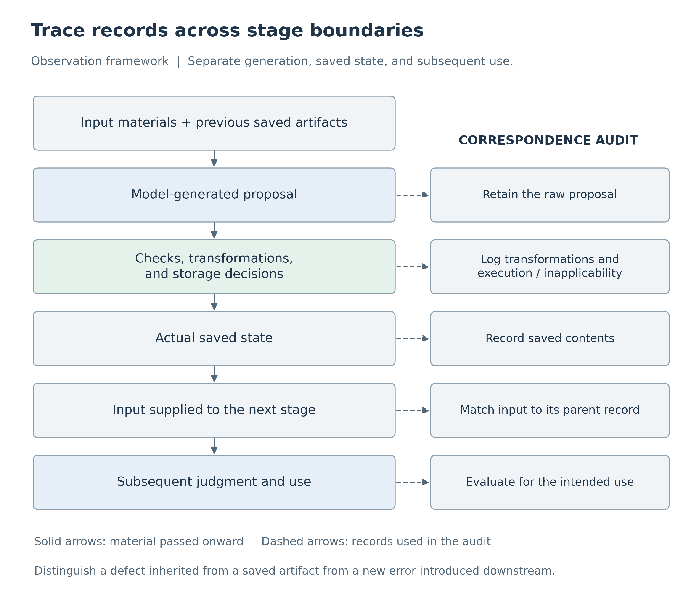
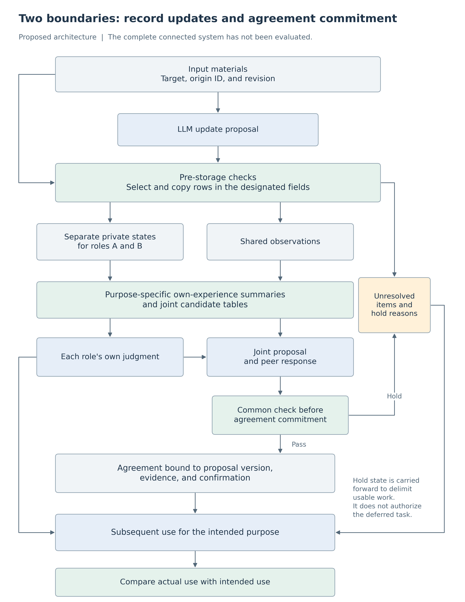

# Failure Analysis and Design Principles for Two-Role LLM Systems
## From Record Updates to Joint Agreement and Subsequent Use

**Kentaro Sato**  
Independent Researcher  
Contact: info@metaclan.jp ([email](mailto:info@metaclan.jp))

September 30, 2026 | English draft v0.2 | Internal technical report; unpublished

## Abstract

Can an LLM operating as two reception staff members maintain each role's assigned information and judgments while developing shared records and policies? This report synthesizes failure patterns and design principles from synthetic experiments in which the same model was run as two roles in separate input contexts. In one task, each role recorded its customer's dog-or-cat preference and observations of accessibility at a venue. In another, each role recommended a guidance medium from its own experience and participated in allocating limited equipment between the two roles. The experimental program saved generated records and passed those actual artifacts into subsequent model calls.

The LLM sometimes attached incorrect provenance to correct answers, adopted new information and then reverted it after an old notice, or retained a correct recommendation while accepting a suboptimal joint proposal. Subsequent calls faithfully used the defective records or agreements. Correct joint answers could also conceal defects in private records, while end-to-end outcomes could conceal successful local repairs.

These observations motivate seven principles: preserve content together with attribution and provenance; update according to the target and purpose; specify the fields covered by a control; separate role-specific judgments from joint assignments; apply consistent conditions across agreement-commitment paths; carry deferral forward as an explicit state; and evaluate components and validators separately. Each principle is developed into an implementation approach and a verification method, with tested components distinguished from proposed extensions. Supporting private and shared activity requires a structure that traces which requirements each record and decision satisfies before it is passed onward, rather than a single measure of answer correctness.

**Keywords:** LLM agents; two-role systems; failure analysis; shared memory; state updates; joint agreement; design principles

## 1. Goal: Preserve Each Role's Judgment While Working Together

Consider two reception staff members who remember their respective customers' preferences and jointly decide how to provide guidance at a venue. The customers may have different preferences. Assigning responsibilities for the joint task need not rewrite each role's past experience to match its assignment. At the same time, relevant information and judgments must remain open to revision when new experience or a legitimate customer change arrives.

This goal combines two pairs of requirements: retention with change, and private with shared activity. Simply fixing everything that should be retained prevents adaptation. Simply sharing more information leaves unclear whose information is being used and for what purpose. The required structure preserves attribution and purpose, updates the parts for which a change is justified, and establishes a policy for joint action.

The central proposition of this report is that **local correctness is specific to its object and criterion**. A correctly selected answer can carry an incorrect origin ID. A process that reads a record accurately can read a stale record accurately. Faithful execution of an agreement can faithfully implement a poor agreement. Connecting locally successful stages requires examining the records passed between them and the requirements assumed by the receiving stage.

This report makes three contributions. First, it organizes experimental cases by the location of a defect and the path along which it is carried forward. Second, it develops seven implementable design principles from these observations. Third, it presents a reference architecture and an evaluation approach that distinguish local improvements, remaining defects, and excessive deferral.

## 2. What the Two Roles Were Asked to Do

### 2.1 Two LLM Roles and the Program Running Them

The experiments invoked the same LLM separately as reception staff members A and B. Each call began in a fresh input context containing the role, the current materials, and the required saved notes. Memory therefore refers to external records explicitly passed into later calls, rather than conversation history retained internally by the model. The two staff members are model roles, not human participants.

The processing responsibilities were distinct. The **researcher** specified materials, instructions, and scoring criteria; the **LLM** generated update proposals and judgments; and the **experimental program** checked, saved, and passed those outputs onward. The term *storage component* refers to the part of that program responsible for saving records. In conditions where it copied input rows, the model proposal and the artifact produced by copying were saved separately. Fixed-rule code scored correctness, and structurally usable but substantively incorrect responses were still passed to subsequent stages. This made it possible to examine where errors arose and what was carried forward unchanged.

The report covers two tasks. Both use paper and digital guidance, but their correctness rules differ. The first selects **a medium accessible to everyone**; the second selects **an equipment allocation that maximizes the predicted total number of successful outcomes**.

### 2.2 Record Management: Customer Preferences and Venue-Wide Guidance

Roles A and B each serve a different customer and cover a different part of the venue. Each role records whether its customer wants a dog or cat design in a private note. It also receives observations indicating whether everyone in its area can use paper guidance and whether everyone can use digital guidance. All materials describe fictional situations constructed by the researcher.

**Table 1. Three information fields in the record-management task.** “Own observation” belongs to the staff role, which is distinct from the customer assigned to that role.

| Information field | Recorded information | Purpose |
|---|---|---|
| Assigned-customer information | The role's customer's dog-or-cat preference and provenance; a revision number is also included in preference-update trials | Select the design to prepare for that customer |
| Own observation | Paper/digital accessibility in the role's area, observer, revision, and provenance | Retain and update the role's observation and pass it to the other role |
| Shared observations | Saved observation rows for both A's and B's areas | Select guidance for the venue as a whole |

The private note contains separate fields for assigned-customer information and the role's own observation. The shared note contains copies of both roles' observations. A shared note is a record received and used by each role, not a single internal memory automatically kept identical across the two roles.

Under the task rule, if exactly one medium is accessible to everyone in both areas, that medium is the correct joint choice. For example, if both media are accessible to everyone in area A but only digital guidance reaches everyone in area B, the correct choice is digital. If zero or two media meet the criterion, the task requires deferral. The design prepared for each customer is determined independently by that customer's preference.

The researcher supplied new observations, observations saved by the other role, and delayed old notices. The LLM proposed note updates, and later calls answered questions about the customer design and joint guidance using the saved notes. In the field-level comparison described below, the program calculated joint guidance from four values read out by the LLM: A/B × paper/digital. Each case specifies this division of responsibilities.

### 2.3 Joint Judgment: Own Recommendations and Equipment Allocation

In the second task, each role receives several experiences stating how many people were guided using each medium and how many were successful. For its own task, the role can freely use either medium and should recommend **the medium with the higher success rate pooled over all of its experiences**. Earlier experiences remain part of the calculation; this is not a task of selecting only the latest row.

For the joint task, the available equipment is limited to one paper guidance station and one digital terminal. Even if both roles recommend digital for their own task, one must use paper in the joint assignment. Each role's success rate is used to calculate the predicted number of successes when guiding 40 people in its area. The totals for A-paper/B-digital and A-digital/B-paper are compared. The joint adoption criterion is to maximize this total while respecting the equipment constraint.

After each role recorded its own recommendation, the researcher supplied a fixed initial joint proposal. The other role responded with acceptance, a counterproposal, or deferral. **Only a counterproposal triggered one recheck by the initiating role.** The experimental program constructed a joint record from these responses and finally asked both roles to report their own recommendation and joint assignment. Execution here means reporting an allocation, not operating actual equipment or serving actual customers.

Joint confirmation and subsequent use had separate scoring criteria. At confirmation, a role should accept an optimal feasible proposal and respond to a suboptimal or resource-violating proposal with an optimal counterproposal or deferral. At subsequent use, a role should follow an approved agreement that respects the equipment constraint. Reoptimization was not required at the use stage. Thus, accepting a suboptimal proposal could be incorrect while subsequently following that agreement could satisfy the use-stage criterion.

### 2.4 How the Evidence Is Organized

The provenance, copying, and revocation trials in the record-management task used `gpt-5.6-luna`. The field-level control, update, and joint-judgment trials used Qwen3.5-27B. Within each trial, both roles used the same model. All tasks were short synthetic tasks in Japanese. The following cases identify what was held fixed and what was varied.

This technical report reorganizes the experimental records of three earlier reports by the author [1–3] around failure analysis and design. The five observations and seven principles emerged from this synthesis; they were not hypotheses fixed before the entire experimental series. Models, instructions, and scoring scopes remain specific to their respective trials, and their results are not pooled into a single failure rate. The tasks, manipulations, and results needed to understand the report are explained here. Appendix C maps them to original trial identifiers, and Supplement S1 links to the primary records.

## 3. Units of Failure Analysis: Record Fields and Stage Boundaries

### 3.1 Distinguish Private Records, Shared Records, and Joint Agreements

A *contract* in this report is an explicit requirement for a field or processing stage, not a legal contract. Whether an observation value is correct, whether its origin ID is correct, whether an old notice may be adopted, and whether a proposal may be used as an agreement are different contracts.

Four terms are used throughout. An **origin ID** identifies the source material in which a fact or observation was first recorded. A **revision** is a researcher-assigned number used to compare versions for the same target. A **current evidence reference** identifies the location of an input used directly in the present call. If an observation arrives through a shared note, its origin ID still identifies the original observation, while its current evidence reference points to the corresponding row in that note. A **record field** is a logical information field within a note, not a separate physical file.

**Table 2. Objects and requirements to specify before connecting stages.**

| Object | Relationship to preserve | Grounds for an update |
|---|---|---|
| Role-specific assigned information | Correspondence among the target person, content, provenance, and valid revision | A legitimate change concerning that target |
| Own and shared observations | Correspondence among observer, values, origin ID, and revision | Comparable new information about the same observation target |
| Own judgment | Recommendation consistent with the role's experience and its intended use | New experience or evidence that the earlier judgment was incorrect |
| Joint proposal | Correspondence among the task, candidates, constraints, and evaluation criterion | New information, changed conditions, or a counterproposal |
| Joint agreement | Correspondence between the adopted proposal version and required confirmations | A new agreement that has passed the specified checks |
| Subsequent use | Correspondence between the supplied records, valid agreement, and use outcome | An applicability judgment based on the state and purpose at use time |

Assigned information and own observations remain separate fields even within the same note. Sharing the same observations does not require the roles to make identical own judgments. Conversely, identical answers are appropriate when each role's legitimate information supports the same conclusion.

### 3.2 Separate Defect Origin, Propagation, and Evaluation

Figure 1 summarizes how the researcher traced defects. Although checking and transformation differed between trials, each distinguished the model proposal, the artifact actually saved, the next input, and the subsequent response.



**Figure 1. An observation framework for locating defects and tracing what is carried forward.** Distinguishing proposals from actual saved artifacts identifies where a defect arose and which transformations it passed through. The same correspondence also distinguishes errors newly introduced downstream.

Failure descriptions have three layers: a mismatch in information or judgment; the path carrying it through storage, exchange, and use; and the aggregation of evaluations that can obscure the mismatch. The third layer also includes cases in which an aggregate metric obscures a successful local repair.

## 4. Failure Analysis: What Was Tested and What Each Actor Got Wrong

Each case first states the question and manipulation, then follows the LLM response, storage processing, and subsequent use. It ends with the design distinction supported by the case. The cases are organized by failure and evaluation issue, not by experimental chronology.

### 4.1 Incorrect Provenance Is Carried Forward Alongside Correct Answers

**What was tested.** The researcher provided correct initial materials and examined whether both roles retained content–provenance correspondence after integrating them into private and shared notes. Two methods transferred shared observations. Under *rewriting*, the LLM rewrote the person, values, revision, and origin ID. Under *selection plus copying*, the LLM identified an input row and the storage component copied it verbatim. In both methods, the LLM still wrote the private note and declared current evidence references. The storage component saved the selected row even if the selection was wrong.

Both methods received the same 64 previously unused groups. A group comprised initial materials for both roles. Under each method, both roles saved notes and then answered subsequent questions from those notes. End-to-end success required all content, provenance, references, and judgments to satisfy their criteria across these four responses.

**What happened.** In one group, role B's customer wanted a cat design, with origin ID `RAD9D1FEC60F1FA2`. Under selection plus copying, the LLM correctly recorded role B and the cat preference in the private note, but omitted the final `2` from the origin ID, writing `RAD9D1FEC60F1FA`. Because mechanical copying covered shared observation rows, this private field was saved as written by the model. The experimental program passed that saved note into the next call.

The subsequent role B correctly chose the cat design and paper guidance. Paper was accessible to everyone in both areas, whereas digital was not, making paper the correct joint medium. However, role B again output the truncated origin ID as support for its correct answer.

> Correct input: B's customer wants a cat; origin ID ends in “…FA2.”  
> Private field written by the LLM and saved: B's customer wants a cat; origin ID ends in “…FA.”  
> Next LLM response: cat/paper is correct; the origin ID still ends in “…FA.”

This is not an inference that the later call independently dropped the same character. The saved incorrect ID was present in the actual next input, and the response retained a matching ID. Under rewriting with the same initial materials, this customer's origin ID was correct at both storage and subsequent use.

Across all 64 groups, selection plus copying met the provenance-inclusive criteria for 256/256 shared observation rows. Both methods achieved end-to-end success in 59/64 groups: rewriting had four failures and one unresolved outcome, while selection plus copying had five failures. The unresolved outcome arose from a response-format defect and remained unresolved in the formal results. Failures under selection plus copying occurred in private-information writing or subsequent readout, outside the mechanically copied fields. Defining the method difference as the selection-plus-copying rate minus the rewriting rate, the envelope of conservative 95% intervals across all completions of the unresolved outcome was −17.36 to 16.60 percentage points. End-to-end superiority was not established. Under the prespecified missingness rule, the primary p-value was not calculated.

**What this establishes.** Producing a correct answer and associating content with correct provenance are distinct tasks. Even when shared rows are copied correctly, private fields and later responses that rewrite provenance need separate checks. The design object is the correspondence among person, content, revision, and provenance through to use, rather than values or IDs protected in isolation.

### 4.2 A Role Adopts a New Preference, Then Rolls It Back After an Old Notice

**What was tested.** The researcher examined whether the targeted role could update a customer's changed preference and retain it when an old notice arrived later. Eight new cases were generated twice each, giving 16 trajectories. In each trajectory, one role received a new customer preference. Its saved note was then passed into the next input together with an old notice about the same customer. The other role was checked for retention of its unaffected customer's information.

The storage program applied per-observer latest-revision selection to paper/digital observation fields. It saved the customer-preference field as written by the LLM. Thus, although the notes were subject to a “retain the latest revision” operation, the preference field being changed lay outside that operation's scope.

**What happened.** In one case, role A's note contained a cat preference at revision 76. The researcher supplied a notice changing it to dog at revision 77. Role A correctly wrote dog, revision 77, and the new origin ID, and the storage component saved that state. Next, the researcher supplied the saved dog/revision-77 note together with the delayed cat/revision-76 notice. Role A reverted its customer field to cat, revision 76, and the old origin ID. After that proposal was saved, the final role A call selected the cat design.

The final call did not misread the supplied note: the note already said cat, and the role answered accordingly. The failure occurred earlier, when the update replaced newer information present in the input with the content of the old notice.

Initial adoption of the new preference succeeded in 16/16 trajectories. The unaffected role's customer information was also retained in 32/32 evaluations across the two update points. After the old notice, however, only 2/16 trajectories retained the new revision; in 14/16, the preference, revision, and origin ID rolled back. In all 14 cases, the correct newer state had been saved immediately beforehand and was included in the input processing the old notice.

**What this establishes.** Adopting new information, preserving unaffected information, and maintaining an adopted update are separately measurable capabilities. More accurate readout alone would not repair this path. The updating role needs a way to distinguish a notice arriving now from its content being valid now. The outputs do not establish how the internal revision comparison failed.

### 4.3 Joint Answers Can Be Correct While Own Observations Remain Stale

**What was tested.** The researcher examined what was repaired when storage processing was applied to different fields. Eighteen materials were generated twice each, yielding 36 model-proposed note updates. The own observation was already current in the initial input; the task was to preserve it while updating shared observations. Ten materials required updating the shared field from a new notice, and eight required retaining the state despite an old notice.

The experimental program **branched each identical update proposal into four conditions**. One saved observation fields without intervention. The others applied automatic processing to shared observations only, own observations only, or both. Processing first separated input candidates by observer A/B, selected that observer's highest-revision row, and copied the person, two values, origin ID, and revision together. All conditions retained the model-written customer-preference field.

Each branch's saved note was supplied to a subsequent LLM call, which read the four A/B × paper/digital values from the shared note. The program calculated joint guidance from that actual response. Own-observation correctness was assessed in the private-note field; shared-observation correctness was assessed in the shared-note rows, both against the latest input information. Generations were reused only when branches produced exactly identical subsequent inputs. Consequently, 144 branch conditions required 55 actual readout responses.

**What happened.** Table 3 reports the four branches. End-to-end success counts update proposals satisfying all requirements, including storage in the relevant fields and correct joint guidance.

**Table 3. Field-level storage controls applied to the same 36 update proposals.** These are 18 materials × two repetitions; the four branches are not 144 independent materials.

| Storage control | Correct own observation | Correct shared observations | Joint guidance matching the latest state | End-to-end success |
|---|---:|---:|---:|---:|
| None | 32/36 | 25/36 | 28/36 | 25/36 |
| Shared only | 32/36 | 36/36 | 36/36 | 32/36 |
| Own only | 36/36 | 25/36 | 28/36 | 25/36 |
| Both | 36/36 | 36/36 | 36/36 | 36/36 |

With shared-only control, the storage component correctly repaired the shared rows, and subsequent joint guidance was correct in 36/36 proposals. Yet the untouched own-observation field retained four stale records from the model proposals. Because joint guidance was calculated from the shared note, it could be correct despite these private-note defects.

Conversely, own-only control repaired all four own-observation defects, but end-to-end success remained 25/36. These four proposals also contained shared-observation defects, so fixing only the own field did not satisfy every condition. Controlling both fields yielded end-to-end success in 36/36 proposals.

**What this establishes.** Inferring that the entire record is correct from a correct joint answer misses defects in the own field. Inferring that a repair did not work because the aggregate score did not change misses successful own-field repairs. An all-conditions-required metric can obscure partial repair by definition. This comparison additionally located overlapping defects in actual model proposals and related the control scope applied to the same proposal to its downstream result.

### 4.4 A Role Preserves Its Own Recommendation but Accepts a Suboptimal Joint Proposal

**What was tested.** In the joint-judgment task, each role first formed a recommendation from its experience and then evaluated a joint proposal. One condition supplied an own-experience summary from the formation stage and provided both candidate totals at joint confirmation. The comparison examined whether roles could preserve their recommendations and accept an appropriate joint proposal when the information required for calculation was available.

**What happened.** In one previously unused numerical material, predicted successes for 40 people per role were as follows.

| Role | Predicted successes with paper | Predicted successes with digital | Appropriate own recommendation |
|---|---:|---:|---|
| A | 17 | 27 | Digital |
| B | 18 | 20 | Digital |

Both roles should recommend digital for their own task. With one unit of each medium, however, A-digital/B-paper yields 27 + 18 = 45, exceeding the 17 + 20 = 37 from A-paper/B-digital. Role B can appropriately recommend digital from its own experience while accepting paper as its joint assignment.

The researcher supplied the total-37 allocation to role B as the initial proposal. The input contained experience records for both roles, role B's own correct judgment note, B's own-experience summary, and the joint candidate table showing 45 and 37. Role B correctly reported digital as its own recommendation but accepted the total-37 proposal in its joint response. The program saved that acceptance in the joint record.

Because B did not counterpropose, the initiating role's recheck was not called. This followed the experimental rule that rechecking occurs only after a counterproposal; it was not an execution failure. At final use, A reported digital as its own recommendation but paper as its joint assignment, while B reported digital for both. The roles faithfully used the poorer total-37 agreement. Their references were also correct, and subsequent use satisfied the scoring contract described in Section 2.3.

The researcher then fixed this confirmation input and generated three new responses with fresh random seeds. In all three, B retained its digital recommendation and accepted the total-37 proposal. This was one case within a trial repeating all 48 confirmation inputs three times, rather than a rerun of a single outcome-selected case. The original own notes remained fixed; newly generated judgments were not connected to confirmation. These repetitions did not include subsequent use.

**What this establishes.** Own-judgment correctness, joint acceptance, and fidelity to an established agreement can have different outcomes on the same path. A check for counterproposals also does not inspect a proposal accepted immediately. The design question is therefore what is checked on every path to agreement. Whether a common check improves the system is a design proposal arising from this observation.

### 4.5 Identical Overall Failures Can Hide Different Defects, and Final Answers Can Hide Earlier Errors

**What was tested.** The researcher examined how own and joint judgments varied across repetitions of fixed inputs. The case considered here came from a condition that did not add an own-experience summary at confirmation. Role B received all experience records and a table of joint candidate totals, together with an earlier model-written note incorrectly recommending paper for its own task. The correct recommendation from all experience was digital. The initial proposal assigned the single digital terminal to both roles, violating the equipment constraint. The same input was generated three times.

**What happened.** In the first two responses, B corrected its old note and appropriately recommended digital, but accepted the proposal assigning the one digital terminal to both roles. In the third, B corrected the joint proposal to the appropriate A-digital/B-paper allocation, totaling 45, while retaining the incorrect paper recommendation in its own field.

| Response to the same confirmation input | Own recommendation | Joint response | Both correct |
|---|---|---|---|
| Repetition 1 | Digital: appropriate | Accepts digital for both roles: inappropriate | No |
| Repetition 2 | Digital: appropriate | Accepts digital for both roles: inappropriate | No |
| Repetition 3 | Retains paper: inappropriate | Counterproposes A-digital/B-paper: appropriate | No |

The aggregate statement “failure in all three repetitions” is correct, but the same defect did not occur three times. Joint confirmation was inappropriate in the first two; own judgment was inappropriate in the third. The third response's counterproposal was not passed to the other role for rechecking in this repetition trial, so it was not counted as a final agreement.

The researcher also compared when own-experience summaries were supplied. One condition supplied them only at final use; the other supplied them from judgment formation onward, including confirmation and recheck. Both supplied the summary at use and joint candidate totals at confirmation and recheck. Each trial branched eight materials into three initial proposals, giving 24 paths. Both roles answered at the end of each path, yielding 48 use responses. The comparison was conducted once with previously used materials and once with unused numerical materials.

In both trials, own judgments and references were appropriate throughout 15/24 paths with use-only support and 24/24 with support from formation. Nevertheless, final use was appropriate in 48/48 responses under both conditions. With use-only support, the LLM sometimes corrected an erroneous intermediate own record using the experience and summary supplied in the final input. Scoring only the endpoint would conceal this difference along the path.

**What this establishes.** End-to-end success asks whether any required component failed; final-answer correctness asks whether the last response was appropriate. Both are useful, but defect locations and correction paths require separate records. Retaining component-level own fields, joint fields, and acceptance actions helps identify where a control should act.

## 5. Seven Design Principles for Connecting Private and Shared Activity

Three principles below include short Python examples that express the required conditions as operations. Their headings distinguish a reconstruction of the core of an experimental procedure from new design examples motivated by the results.

In the code, `owner` and `role` denote A/B, `revision` denotes an information revision, `origin_id` denotes provenance, and `allocation` denotes joint assignments. `deepcopy` creates an independent copy without changing the original record. `READY` means that a candidate or prospective saved state is available; `COMMITTED` means that the controller has authorized commitment of an agreement; and `HOLD` means that the current write or commitment should not proceed. Inputs are assumed to have passed checks of types, source identity, and task scope. The functions return proposed contents or a reason for deferral without writing to disk. Complete inputs and execution instructions appear in Appendix D.

### Principle 1. Treat Content, Attribution, and Provenance as a Unit

**Requirement.** After storage or exchange, information remains correctly associated with its target, origin, and valid revision.

**Implementation.** Represent observer, values, origin ID, and revision in one row and copy the selected row intact. Keep the origin ID separate from the reference to the current input. Specify the fields passed to the other role and the private fields used only by their owning role. Record selection correctness separately from copying fidelity so that an incorrect source selection can be identified.

**Verification.** Compare saved rows with the selected sources and verify that subsequent inputs derive from the actual saved artifacts. If a later stage rewrites provenance, score that provenance separately. Selection plus copying in Section 4.1 exemplifies this division of responsibilities; defects remaining outside shared fields also delimit its coverage.

### Principle 2. Identify the Update Target and Purpose Before Selecting Information

**Requirement.** Legitimate new information reaches the relevant field, while fields without grounds for change are preserved. Distinguish when a notice arrives from when its information is valid.

**Implementation.** First filter candidates by target person and information type, then compare revisions or validity intervals within that set. A task about the current state should use current information; a task about the past should use information applicable at that time. If the same target and revision have conflicting candidates, retain them and record what is needed to resolve the conflict. Do not compare A's revision number with B's.

**Verification.** Separately assess retention, adoption, maintenance after adoption, and preservation of unaffected fields. Per-observer latest-revision selection for observation fields was compared in Section 4.3. Extending that control to the customer field, same-revision conflicts, and notices with uncertain authority are subjects for further comparison.

**Code example 1. Compare revisions within each observer and copy the selected row with its provenance. Reconstruction of an existing procedure's core.**

The storage procedure in Section 4.3 selected the observer before comparing that observer's revisions. The following function illustrates selection and copying. `rows` contains observations of the same kind for the same task. Input-source matching, structural validation, and selection-source audit records from the original implementation are omitted here; the first two are preconditions. Missing candidates and same-revision conflicts, which the original implementation reported as exceptions, are represented by `HOLD` for illustration.

```python
from copy import deepcopy

def select_observation(rows, owner):
    candidates = [r for r in rows if r["observer"] == owner]
    if not candidates:
        return {"status": "HOLD", "reason": "MISSING_OWNER"}
    by_version = {}
    for row in candidates:
        version = row["revision"]
        if version in by_version and by_version[version] != row:
            return {"status": "HOLD", "reason": "SAME_VERSION_CONFLICT"}
        by_version[version] = row
    latest = by_version[max(by_version)]
    return {"status": "READY", "row": deepcopy(latest)}
```

**Input and output.** For illustration, supply the following three rows in order. `ALL` means accessible to everyone, and `NOT_ALL` means not accessible to everyone.

| Observer | Revision | Paper | Digital | Origin ID |
|---|---:|---|---|---|
| A | 2 | ALL | NOT_ALL | OA2 |
| B | 99 | ALL | NOT_ALL | OB99 |
| A | 3 | NOT_ALL | ALL | OA3 |

`select_observation(rows, "A")` returns the **entire row** containing A, revision 3, paper `NOT_ALL`, digital `ALL`, and origin ID `OA3`. B's revision 99 is not an A candidate. A legitimate revision 4 for A would be adopted. Conflicting content or provenance within an A revision instead produces a hold. The original implementation also detects same-revision conflicts, but the original LLM comparison used consistent candidates; the conflicting inputs here test the illustrative code.

This function selects one observation row. It is not directly applicable to customer preferences or own judgments that aggregate all experience.

### Principle 3. Map a Control's Field Coverage to Subsequent Uses

**Requirement.** The scope protected by a procedure can be identified by record field and receiving stage.

**Implementation.** For assigned information, own observations, shared observations, own judgments, and joint agreements, list the generator, storage operation, and consumer. Bind feature descriptions such as “latest-revision selection” or “validation” to explicit fields. Save the model proposal, changes made by the procedure, and actual saved artifact separately.

**Verification.** Where conditions can share the same proposal, vary which fields receive the control and inspect local repairs and remaining defects. The four-way branch in Section 4.3 is an example. Measure defects in proposals separately from what would happen in a distinct continued run without the control.

### Principle 4. Retain Own Judgments and Joint Assignments as Separate Artifacts

**Requirement.** Own recommendations correspond to the role's experience, while joint assignments correspond to the joint objective, constraints, and agreement. Taking a different joint assignment does not rewrite the role's experience to match it.

**Implementation.** Associate an own judgment with its role, purpose, and experience references. Associate a joint proposal with its task, candidates, constraints, and evaluation criterion. Supply computed own-experience summaries and joint candidate totals in separate fields. Specify the formation, confirmation, and use stages at which each is needed.

**Verification.** Construct inputs changing only own experience, only joint conditions, or both, and test whether the corresponding tasks change selectively. Include valid cases with matching recommendations, different recommendations, and an own recommendation different from the joint assignment. The timing comparison in Section 4.5 illustrates support supplied earlier helping sustain intermediate own judgments.

**Code example 2. Record the agreed joint assignment without changing the own judgment. A design proposal not yet evaluated in an LLM experiment.**

Role B in Section 4.4 recommends digital for itself while taking paper in the appropriate joint allocation. This function illustrates writing those two outcomes into separate fields. `state` is the role's own state, and `agreement` is an agreement checked by the controller. Whether the retained own judgment is substantively correct must be checked separately against the role's experience.

```python
from copy import deepcopy

def record_assignment(state, agreement):
    if agreement["status"] != "COMMITTED":
        return {"status": "HOLD", "reason": "NO_COMMITTED_AGREEMENT"}
    proposal = agreement["proposal"]
    updated = deepcopy(state)
    updated["joint_assignment"] = {
        "medium": proposal["allocation"][state["role"]],
        "proposal_id": proposal["id"],
        "proposal_version": proposal["version"],
        "evidence_version": agreement["evidence_version"],
    }
    return {"status": "READY", "state": updated}
```

**Input and output.** Let B's input contain `role="B"` and `own_judgment={"choice": "DIGITAL", "refs": ["b1", "b2"]}`. If the controller commits proposal `p1`, version 1, assigning A digital and B paper on experience snapshot `exp-7`, the output's `joint_assignment` contains paper and the proposal/evidence versions. The own digital judgment and its experience references remain unchanged. If agreement is not committed, the function returns `HOLD` without producing a new state.

The experiments evaluated the separation of own recommendations and joint assignments. Writing only the joint assignment with this function is a new design illustration, distinct from the original results in which the LLM generated both fields. `COMMITTED` must be a controller-produced result from a check such as example 3, not an LLM's self-declared status.

### Principle 5. Apply Consistent Commitment Conditions Across Agreement Paths

**Requirement.** A record passed onward as an agreement satisfies the required confirmations and task requirements for the relevant proposal version.

**Implementation.** Represent a proposal, an acceptance response, and a usable agreement as different states. Route both direct acceptance and acceptance after a counterproposal through a common check before commitment. Where candidates and the objective are explicit, as in this task, code can check resource constraints, totals, and adoption criteria. Bind proposal and evidence versions to the agreement and decide whether updates require renewed confirmation.

**Verification.** Count the accuracy of the check separately from whether it was invoked on every path to agreement. Include optimal, tied, suboptimal, and resource-violating proposals, as well as legitimate counterproposals. The incorrect acceptance in Section 4.4 identifies a place where this design could be considered. The effectiveness of a system with the common check remains a hypothesis to evaluate upon implementation.

**Code example 3. Apply common conditions to a proposal and its peer acceptance before committing an agreement. A design proposal not yet evaluated in an LLM experiment.**

In Section 4.4, direct acceptance of a suboptimal proposal bypassed rechecking and was carried forward. Here, direct acceptance and acceptance after a counterproposal are both represented as “the last proposal plus the other role's acceptance of that proposal.” `proposal` and `reply` hold that pair; `scores` contains predicted outcomes for each role and medium calculated by code from the input experience. `evidence_version` identifies the experience snapshot in use. Role identity, bindings between versions and contents, and required fields are assumed to have been validated beforehand. All paths that save a committed agreement are intended to pass through this function.

```python
from copy import deepcopy

def commit_agreement(proposal, reply, scores, evidence_version):
    key = (proposal["id"], proposal["version"], evidence_version)
    target = (reply["proposal_id"], reply["proposal_version"], reply["evidence_version"])
    if proposal["evidence_version"] != evidence_version or target != key:
        return {"status": "HOLD", "reason": "STALE_OR_DIFFERENT_TARGET"}
    allocation = proposal["allocation"]
    if (reply["action"] != "ACCEPT" or reply["author"] == proposal["author"]
            or reply["allocation"] != allocation):
        return {"status": "HOLD", "reason": "NO_MATCHING_PEER_ACCEPTANCE"}
    if set(allocation) != {"A", "B"} or sorted(allocation.values()) != ["DIGITAL", "PAPER"]:
        return {"status": "HOLD", "reason": "RESOURCE_CONFLICT"}
    total = sum(scores[r][allocation[r]] for r in ("A", "B"))
    best = max(scores["A"]["PAPER"] + scores["B"]["DIGITAL"],
               scores["A"]["DIGITAL"] + scores["B"]["PAPER"])
    if total < best:
        return {"status": "HOLD", "reason": "LOWER_TOTAL"}
    return {"status": "COMMITTED", "proposal": deepcopy(proposal),
            "evidence_version": evidence_version}
```

**Input and output.** Supply the Section 4.4 values as `scores`: A-paper 17, A-digital 27, B-paper 18, and B-digital 20. Even if the peer accepts A-paper/B-digital, totaling 37, the result is `HOLD / LOWER_TOTAL`. Peer acceptance of A-digital/B-paper, totaling 45, with matching proposal and evidence versions yields `COMMITTED`, which can be passed to example 2. The function does not silently replace the total-37 proposal with the total-45 proposal; it stops in a state requiring a new proposal and peer confirmation.

It also rejects double allocation of a resource, acceptance targeting a different proposal or old evidence, and self-acceptance by the proposer. If both feasible allocations tie for the maximum, both pass. Comparisons use integers or exact fractions, not totals claimed by the LLM.

This code illustrates checking a proposal against a specified objective and constraints. Whether maximizing the total is appropriate in a real application, whether every acceptance path actually reaches this check, and how much a connected LLM system improves remain separate evaluation targets.

### Principle 6. Carry Unresolved Outcomes and Deferral Forward with Reasons and Scope

**Requirement.** Unidentified information and unapproved proposals are not used as resolved records. Other established information and valid work remain available.

**Implementation.** Separate the processing target, applicability conditions, result state, and unresolved reason. Distinguish insufficient information, an unscorable response format, a substantive requirement failure, appropriate deferral, and a stage that is inapplicable by protocol. Preserve raw responses separately from artifacts produced by syntax normalization or storage processing, recording the changes. If retries are allowed, fix their permitted changes and limits beforehand.

**Verification.** Pair inputs that can be resolved with inputs lacking the information needed for resolution. In one diagnostic using eight record-management scenarios, the researcher changed saved origin IDs to correct, old, or absent IDs and supplied each role with a notice from a source designated as trusted. The notice revoked an observation—that is, invalidated a previously recorded observation. Notices either contained only an ID or additionally specified observer, revision, and paper/digital values. The LLM was instructed to invalidate an observation when its ID matched, or, if the ID did not match, when all details uniquely matched one observation. If the target could not be identified, it should retain every row and mark the matter unresolved. When identified, all copies of the target observation were marked invalid while retaining their values, revisions, and IDs as history.

With an incorrect stored ID and an ID-only notice, the LLM did not guess a row to invalidate. It preserved customer information and observations and carried joint-decision deferral into the next response. For both the old-ID and absent-ID conditions, target-resolution completion was 0/8 and evidence-appropriate handling was 8/8. Where details uniquely identified the target, invalidation was completed. Inability to identify a target from the ID alone follows from the materials and rules; the observed behavior was whether the LLM avoided guessing and preserved unresolved state and unaffected information. Extensions with ambiguous notices or conflicting details should measure both unintended changes and excessive deferral.

### Principle 7. Retain Component-Level Evaluation and Evaluate the Validator

**Requirement.** Identical aggregate outcomes do not erase which fields or stages succeeded and what remained defective. Checks that obstruct correct inputs are also observable.

**Implementation.** Record own state, shared state, provenance, updates, acceptance, and subsequent use as components alongside end-to-end outcomes. In fixed-input repetitions, retain each component and action. Assign checks determined by explicit rules—such as structure, arithmetic, and reference existence—to code. When an LLM assists with semantic assessment, calibrate its evidence format and unresolved outputs as well as its decisions.

**Verification.** A judge-model diagnostic supplied 32 existing responses and 32 constructed controls containing known errors and valid boundary cases. The judge assessed output structure, attribution/references, own judgment, and joint action against explicit rules. All four assessments agreed with the reference assessment in 53 cases; four disagreed; and seven were unscorable because the judge's own supporting explanation violated its required format.

In all four disagreements, a response contained an unauthorized extra field, but the judge reported that no extra field existed. Fixed structural-validation code detected all four. Three were constructed controls with altered field names or placement, not evidence that the model spontaneously concealed a violation. The comparison shows that an LLM capable of assisting with content assessment has not thereby completed structural validation. Record false alarms, missed defects, unresolved judgments, and blocked legitimate updates separately.

## 6. A Reference Architecture Connecting the Principles

### 6.1 Separate Record Updates from Agreement Commitment

Figure 2 connects the seven principles into a proposed architecture. It includes partially tested components such as observation-row copying, purpose-specific information supply, and passing actual saved artifacts onward. The performance of the full architecture, including a common check before agreement commitment, has not yet been measured.



**Figure 2. Proposed reference architecture connecting private states and joint agreement.** Whether a private-state update may be saved and whether a joint proposal may be committed are assessed separately. Carrying a hold into subsequent use does not authorize the deferred task; it lets the receiving stage identify what remains usable. Audit records are attached to each stage as in Figure 1.

The architecture distinguishes four types of record: information rows pointing to source materials; judgments associated with a role and purpose; versioned joint proposals and responses; and processing records that include adoption or deferral reasons. Joint agreements are formed from the correspondence between the third and fourth types. Moving identical text to another storage location does not, by itself, grant it a different status.

Private state is implemented as a separate area for each role, with fields supplied to each call filtered by role and stage. Shared observations, proposals, and replies intended for joint processing are distinguished from assigned information used only by the relevant role. Entire private notes are not automatically forwarded into joint inputs.

Pre-storage checks use candidates actually present in the input and rules specified beforehand. The architecture is not evaluated by giving an operational procedure the research answer key to construct its saved state. Likewise, matching content hashes establishes that the same data were passed onward, not that their contents are true.

### 6.2 Three Design-Review Cases

The following are proposed checks derived from existing cases, not additional results obtained by running the reference architecture.

**An old notice arrives.** If the current state is dog/revision 77 and a notice says cat/revision 76, a task requiring current information for the same target should retain revision 77 and record the older notice as not adopted. Changes should not spill into another role's observation or assigned information. An additional test should verify that applying this check to the customer field also permits a legitimate change at revision 78.

**The own recommendation differs from the joint assignment.** Both roles may recommend digital while the joint allocation uses one of each resource. If the total-45 proposal is adopted, B's own digital recommendation should remain intact even though B takes paper. Acceptance of the total-37 proposal should be checked against the task's adoption criterion before commitment. Optimality here is specific to the agreed objective of total maximization.

**A revocation notice has an unidentified target.** If the target cannot be uniquely matched, record the unresolved notice instead of guessing a row to invalidate. Defer the joint decision that the notice may affect, while retaining well-supported private work. Explicitly delimiting the hold avoids both pretending the issue is resolved and indiscriminately stopping every task.

### 6.3 State What Each Component Has Established

**Table 4. Evidence supporting the principles and extensions to evaluate.** “Comparison” refers to comparisons of complete methods within the original fixed materials.

| Principle | Evidence and scope within existing experiments | Checks needed for extension |
|---|---|---|
| 1. Preserve correspondence | Compared copying selected rows and subsequent use; observed provenance defects arising and being carried forward | Fields outside copying, wrong source selection, rewritten provenance |
| 2. Update by target and purpose | Per-observer latest-revision selection for own/shared observations; observed customer-field rollback | Customer-field application, same-revision conflicts, notice authority, validity intervals |
| 3. Specify control coverage | Four branches from the same proposal and shared readout from their saved artifacts (Section 4.3) | Continued runs without the control, other tasks, longer histories |
| 4. Separate own and joint outcomes | Separate own-recommendation and joint-assignment evaluation; support-timing comparisons and repetitions (Sections 4.4–4.5) | Free-form experience, contribution of support at each stage |
| 5. Common agreement check | Observed incorrect acceptance alongside correct own judgment and a path that did not invoke rechecking | Implementation of the common check, passage of valid proposals, renewed confirmation after agreement updates |
| 6. Retain deferral as state | Appropriate deferral under fixed revocation/matching rules; separate treatment of format defects | Ambiguous/conflicting notices, excessive deferral, repair side effects |
| 7. Evaluate components and validators | Field-, stage-, and repetition-level diagnostics; judge calibration (Section 4 and Principle 7) | Unseen semantic boundaries, missed defects, false alarms, operational cost |

## 7. Evaluation: Allow Appropriate Progress and Stop Inappropriate Progress

### 7.1 Do Not Collapse Outcomes into One Success Rate Too Early

Evaluation pairs successful progression from valid inputs with the handling of inappropriate or insufficient inputs. Unchanged own information alone does not establish that legitimate updates remain possible. Zero incorrect agreements likewise does not establish the ability to cooperate if every proposal was deferred.

**Table 5. Paired tests for implementing the principles.** Untested entries are examples for future designs.

| Target | Inputs expected to succeed | Inputs probing the boundary | Outcomes recorded separately |
|---|---|---|---|
| Attribution and provenance | Exchange rows with matching targets and origin IDs | Correct value with wrong ID; valid ID belonging to another person | Content, attribution, provenance, propagation |
| Updates | Legitimate new revision for the same target | Old notice, same-revision conflict, notice for another target | Adoption, retention, unintended changes, deferral |
| Separation by purpose | Appropriate difference between own and joint conclusions | Change only own experience or only joint conditions | Selective effects on each use |
| Agreement | Feasible optimum or appropriate tied optimum | Suboptimal or resource-violating proposal; unaccepted counterproposal | Acceptance correctness, check invocation, final agreement |
| Subsequent use | Valid agreement and appropriate saved artifacts | Invalidated evidence, no agreement, old artifacts | Fidelity to records; conformity with current requirements |
| Validation | Valid states and legitimate changes | Known defects and semantically ambiguous cases | Valid passage, false alarms, missed defects, unresolved outcomes |

Pass actual saved artifacts onward on normal paths as well. When an earlier error is corrected at the endpoint, retain both events. Separate stages blocked by structural defects, stages inapplicable by protocol, and substantive failures. Analyses retain planned denominators and the original trials' missingness rules.

### 7.2 Align the Units Being Compared

Branching the same model proposal is useful for measuring a local storage operation. Evaluating the effect on continued operation requires carrying forward the artifacts actually produced under each condition. Counts of defects in proposals during a controlled run are not results from a reproduced uncontrolled run.

Repetition also has two forms. Fixed-input repetition measures response variability for that input. Repeating a connected path from formation through use measures the entire path, including upstream variability. The repetitions in Sections 4.4–4.5 are of the former kind; the two forms are not interchangeable reliability measures.

Comparisons adding a check should record blocked legitimate progress, defects that pass, downstream effects, and call counts and elapsed time. Specify adoption criteria for the intended task before observing outcomes. Repairing a particular failure case and satisfying the same requirements on unused materials are separate achievements.

## 8. Scope and Further Development of the Design Principles

This is an exploratory technical synthesis of three reports with different models, instructions, structures, and scoring scopes. Their results are not pooled as samples estimating one failure rate. For example, subsequent responses in Section 4.1 were scored for re-citing provenance, whereas the final design-choice response in Section 4.2 did not require it. Those outcomes are not directly comparable success rates.

The measured objects were explicit assigned facts, recommendations from supplied experience, structured shared observations, and short agreement processes. Spontaneous personality formation and long-term coexistence through free dialogue remain broader research aims. Separating own and joint outcomes provides a way to operationalize those questions through concrete records and judgments.

Per-observer latest-revision selection requires identifiable targets, candidates present in the input, and comparable revisions. Real-world truth, authority to change information, and fairness across objectives cannot be determined by the highest revision or largest total alone. Transferring the design requires specifying the criteria appropriate to the application.

Design, execution, fixed-code scoring, and checking of the three reports occurred within the same project. This synthesis adds neither independent replication nor third-party rescoring. It demonstrates failures along paths connecting two roles, but does not establish that every failure is caused by having two roles.

To develop the principles, fix their meaning and the versions of the evidence supporting them, then accumulate further validation as additional evidence. For example, implementing Principle 5's common check would leave the existing results intact while a new comparison measured valid-proposal passage and suppression of incorrect acceptance. New results should not recast original failures or unmet criteria as successes.

## 9. Conclusion

The experimental records link saved artifacts to subsequent inputs to expose provenance defects alongside correct answers, rollback after successful adoption, the separation between own judgments and joint acceptance, and faithful use of poor agreements. Final-answer correctness and end-to-end success can each hide different defects or repairs, motivating field-, stage-, and repetition-level reporting.

Translating these observations into design makes the objects to protect explicit: preserve content–attribution–provenance correspondence; update according to target and purpose; identify the fields reached by a control; support own judgments and joint assignments separately; align conditions for advancing proposals to agreement; carry deferral forward as state; and observe both progression and validation.

**A design supporting distinct roles and joint work requires more than freezing each role's information or aligning every answer. It must keep legitimate role-specific information open to justified updates, establish joint policies under separate requirements, and make the connections traceable.** The seven principles and reference architecture provide a technical basis for implementing and evaluating that structure.

## 10. Author Contributions and Data Availability

The author determined the research direction and execution scope and reviewed the results and manuscripts of the three source reports. This English version is a draft for author review. LLM assistance was used for organizing materials, drafting, translation, and checking. Preparing this synthesis involved no new model experiments, repair of original responses, or rescoring of research outcomes. All customers, venues, and experiences are fictional.

The three reports, experimental materials, and evidence index are stored privately and locally without a deletion deadline. Tasks, manipulations, and results needed to understand this report are included here. Appendix C and the references identify the evidence sources; S1 links to original results and saved-artifact checks. The author will determine the public archive, persistent identifiers, license, and formal funding and conflict-of-interest declarations during publication preparation.

## References

1. Kentaro Sato. 2026. [Maintaining Role-Specific Information and Shared Records in LLM Memory Updates: An Exploratory Evaluation of Content, Provenance, and Continued Use](../paper-01/manuscript-v0.11-2026-09-23.md). Japanese v0.11, September 23, 2026. Source report for the provenance, copying, and revocation cases. [English version](../paper-01/manuscript-en-v0.2-2026-09-23.md).
2. Kentaro Sato. 2026. [Scope of Update Control in Private and Shared LLM Records: Field-Level Comparisons and Post-Update Rollback](../paper-02/manuscript-ja-v0.4-2026-09-27.md). Japanese v0.4, September 27, 2026. Source report for the field-level comparison and customer-update cases. [English version](../paper-02/manuscript-en-v0.1-2026-09-27.md).
3. Kentaro Sato. 2026. [Separating the Stability of Role-Specific Judgments from the Quality of Joint Agreements: Timing of Computational Support and Fixed-Input Repetitions in a Two-Role LLM Task](../paper-03/manuscript-ja-v0.2-2026-09-29.md). Japanese v0.2, September 29, 2026. Source report for joint-judgment and repetition cases. [English version](../paper-03/manuscript-en-v0.1-2026-09-29.md).
4. Kentaro Sato. 2026. *LLM System Failure Studies*. Technical Report v1.8, in Meteon Collected Edition v1.1 (see the evidence index). Consulted for organizing requirements, failure paths, and classifications.
5. Kentaro Sato. 2026. *Autonomous LLM System Design: Build the Cage Before Granting Authority*. Technical Report v1.16, September 5, 2026, in the same collected edition (see the evidence index). Consulted for the distinction between evidence and proposals in Section 3, design principles in Part III, and the mapping in Appendix A.

This report organizes failure and design issues from the author's experimental records. It is neither an exhaustive literature review nor a claim that each of the seven principles is introduced here for the first time. Appendix C explains the organizational approaches drawn from References 4 and 5 within this report.

## Appendix A. From Failure Observations to Design and Verification

**Table A1. Connecting the same cases to controls and checks.** The rows are not mutually exclusive failure classes.

| Observation or evaluation issue | Main principles | What to inspect next |
|---|---|---|
| Correct values carry old IDs or IDs absent from the input | 1, 3 | Within-row correspondence, fields outside copying, later rewriting |
| An old notice reverts a new record | 2, 3 | Target-specific adoption rules and passage of legitimate updates |
| Correct joint answers coexist with stale own fields | 3, 7 | Field-level state and downstream stages using that field |
| Repairing own fields leaves aggregate performance unchanged | 3, 7 | Overlapping defects and successfully repaired components |
| Correct own judgments coexist with acceptance of a suboptimal proposal | 4, 5 | Own recommendation, joint adoption criterion, and agreement commitment |
| Incorrect acceptance proceeds without rechecking | 5, 7 | Check-trigger conditions and records of passage on every commitment path |
| Deferral, format defects, and inapplicability are collapsed together | 6, 7 | State reasons, dependencies, and the scope of valid progress |
| The defective field changes despite identical overall failure | 7 | Repetitions, components, and actions for each fixed input |

## Appendix B. A One-Page Record for Design Review

When transferring a principle to another system, complete the following for each procedure. This form is proposed to make evidence and validation scope explicit; its own effectiveness has not been evaluated.

| Field | What to record |
|---|---|
| Object to protect | Role, information field, purpose, stage |
| Success conditions | What counts as correct retention, change, agreement, and use |
| Input assumptions | Target identity, provenance, revision, candidates, authority, objective, constraints |
| Processing responsibility | Model judgment, deterministic commitment, human decision |
| Applicable paths | Normal update, direct acceptance, counterproposal, retry, and other routes |
| When not applicable | Scope of deferral, reason, retained information, next required confirmation |
| Observation record | Proposal, actual saved artifact, next input, use outcome, reasons for changes and inapplicability |
| Verification | Valid progress, inappropriate progress, excessive stopping, repetition variability |
| Evidence scope | Source versions, observations, compared procedures, untested extensions |

Evaluate the scope achieved along paths connecting actual saved artifacts, rather than treating a collection of completed forms as a guarantee that private and shared activity can coexist.

## Appendix C. Experimental Records and Organizational References

This appendix is an index for checking original records, not a prerequisite for understanding the report. Descriptive trial names in the main text map to identifiers below. [Supplement S1](evidence-index-en-v0.2-2026-09-30.md) links to original responses, inputs, and saved artifacts.

| Location in this report | Original trial | Materials and generation units | Source report |
|---|---|---|---|
| Section 4.1: transfer-method comparison | E1; worked example G49/B | 64 groups assigned to both methods; shared rows per method: 64 groups × two roles × two rows | Reference 1, Sections 3.4, 4.2, 5.2 |
| Section 4.2: preference change and rollback | CU01; worked example C06-R1/A | Eight new cases × two repetitions; one role targeted per trajectory | Reference 2, Sections 3.4, 5.4 |
| Section 4.3: field-level comparison | OR01 | 36 proposals from 18 previously used materials × two repetitions, branched four ways; 55 readout generations | Reference 2, Sections 4.2, 5.2 |
| Section 4.4: incorrect acceptance and subsequent use | ST02, EARLY, N05, LOWER | One path among eight new materials × three initial proposals | Reference 3, Sections 3.2, 5.2 |
| Sections 4.4–4.5: fixed-input confirmation repetitions | JR01 | 32 formation inputs and 48 confirmation inputs, each repeated three times; two unconnected panels | Reference 3, Sections 4.1, 5.3 |
| Section 4.5: timing of summary supply | ST01, ST02 | Each trial: eight materials × three initial proposals × two supply conditions | Reference 3, Sections 4.1–4.3, 5.1 |
| Principle 6: revocation diagnostic | E2 | Eight scenarios × three provenance conditions × two notice conditions; both roles and stages evaluated at scenario level | Reference 1, Sections 4.3, 5.3 |
| Principle 7: judge calibration | BJ01 | 32 actual responses plus 32 constructed controls | Reference 3, Appendix A, and original results |

Reference 1 records additional provenance defects. In a continued note-update trial, B saved A's new values and revision 3 while retaining the old origin ID `SM3A`. The next call correctly answered dog/digital and also retained that old ID (SM02, G03/B). In a separate comparison of transfer methods using the same pre-merge materials, B under rewriting changed the correct origin ID `SM2G3A` to `SM3G3A`, an ID absent from the input; the next response retained it (RC01, G03/B). Old-ID retention, rewriting to a nonexistent ID, and the one-character omission in Section 4.1 are distinct forms of broken content–provenance correspondence.

The organizational approach drawn from Meteon's failure studies [4] distinguishes what a procedure was required to do, what violated that requirement, and where the defect was passed. The design report [5] provided a structure that goes beyond turning failures into prohibitions: it specifies required inputs, processing responsibilities, conditions for valid progress, and verification. These ideas are developed in Sections 3 and 5–7, without requiring knowledge of Meteon terminology or principle numbers. Meteon cases are not added to the experimental counts, and this report is not presented as an independent replication of that system.

## Appendix D. Complete Code, Inputs, and Execution Instructions

The three functions, complete example inputs, and all 19 tests are combined in the single code block in D.2. This appendix can be extracted and run without another source file or the research directory. The short functions in the main text explain individual principles; this appendix follows the examples from inputs through verification.

### D.1 Inputs and Execution

Only the Python 3 standard library is required. Save the entire D.2 code block as `two_role_design_examples.py` and run the following in the directory containing it:

```sh
python3 two_role_design_examples.py
```

The program prints example results as JSON and then reports the outcomes of 19 tests. No additional package installation, model loading, GPU, or external communication is required. Pasting the entire code into one Python notebook cell executes the same procedure.

**Table D1. Function inputs.** This is the common input contract of the illustrative code, not a reproduction of the original experimental JSON.

| Input | Contents and assumptions |
|---|---|
| `rows` | Observations of one kind for the same task. `observer` is A/B; `revision` is a comparable integer; `paper` and `digital` are observed values; `origin_id` identifies the source in the input materials. Structure and source identity have been checked beforehand |
| `state` | `role` identifies the owning role. `own_judgment` contains its recommendation and own-experience references. Joint assignment is stored separately in `joint_assignment` |
| `proposal` | `id`, `version`, `author`, `evidence_version`, and `allocation`. The controller binds proposal ID/version to contents. `author` is A or B |
| `reply` | `author`, `action`, `proposal_id`, `proposal_version`, `evidence_version`, and `allocation`. The controller verifies which role produced the reply; the respondent is A or B |
| `scores` | Predicted A/B × PAPER/DIGITAL values recomputed from the same experience snapshot. Values are integers or exact fractions and allow evaluation of both feasible allocations |
| `agreement` | A result returned by the controller's common check, not an LLM string accepted directly as a committed state |

The functions assume these prechecks rather than accepting arbitrary unvalidated dictionaries. In particular, matching IDs or versions is meaningful only when the controller binds them to actual contents. Inputs that replace contents under an unchanged proposal ID/version must be stopped before these functions. The code then illustrates selection, separate storage, and agreement evaluation.

### D.2 Complete Executable Code

The block includes every function, example input, test fixture, test, and execution step. The three functions and all 19 test conditions retain their original behavior. In this English version, only comments and the module description have been translated.

```python
"""Appendix D: three design examples, complete inputs, and 19 tests.

Standard library only. Inputs satisfy the prechecks in Table D1.
Example 1 reconstructs an existing procedure's core; examples 2 and 3 are proposals.
Tests of this code are not part of the LLM experimental results.
"""
import json
import unittest
from copy import deepcopy
from fractions import Fraction
from itertools import permutations


# 1. Three functions: selection, separate storage, and agreement commitment
def select_observation(rows, owner):
    candidates = [r for r in rows if r["observer"] == owner]
    if not candidates:
        return {"status": "HOLD", "reason": "MISSING_OWNER"}
    by_version = {}
    for row in candidates:
        version = row["revision"]
        if version in by_version and by_version[version] != row:
            return {"status": "HOLD", "reason": "SAME_VERSION_CONFLICT"}
        by_version[version] = row
    latest = by_version[max(by_version)]
    return {"status": "READY", "row": deepcopy(latest)}


def record_assignment(state, agreement):
    if agreement["status"] != "COMMITTED":
        return {"status": "HOLD", "reason": "NO_COMMITTED_AGREEMENT"}
    proposal = agreement["proposal"]
    updated = deepcopy(state)
    updated["joint_assignment"] = {
        "medium": proposal["allocation"][state["role"]],
        "proposal_id": proposal["id"],
        "proposal_version": proposal["version"],
        "evidence_version": agreement["evidence_version"],
    }
    return {"status": "READY", "state": updated}


def commit_agreement(proposal, reply, scores, evidence_version):
    key = (proposal["id"], proposal["version"], evidence_version)
    target = (reply["proposal_id"], reply["proposal_version"], reply["evidence_version"])
    if proposal["evidence_version"] != evidence_version or target != key:
        return {"status": "HOLD", "reason": "STALE_OR_DIFFERENT_TARGET"}
    allocation = proposal["allocation"]
    if (reply["action"] != "ACCEPT" or reply["author"] == proposal["author"]
            or reply["allocation"] != allocation):
        return {"status": "HOLD", "reason": "NO_MATCHING_PEER_ACCEPTANCE"}
    if set(allocation) != {"A", "B"} or sorted(allocation.values()) != ["DIGITAL", "PAPER"]:
        return {"status": "HOLD", "reason": "RESOURCE_CONFLICT"}
    total = sum(scores[r][allocation[r]] for r in ("A", "B"))
    best = max(scores["A"]["PAPER"] + scores["B"]["DIGITAL"],
               scores["A"]["DIGITAL"] + scores["B"]["PAPER"])
    if total < best:
        return {"status": "HOLD", "reason": "LOWER_TOTAL"}
    return {"status": "COMMITTED", "proposal": deepcopy(proposal),
            "evidence_version": evidence_version}


# 2. Complete illustrative inputs and result display
def demonstrate():
    rows = [
        {"observer": "A", "revision": 2, "origin_id": "OA2", "paper": "ALL", "digital": "NOT_ALL"},
        {"observer": "B", "revision": 99, "origin_id": "OB99", "paper": "ALL", "digital": "NOT_ALL"},
        {"observer": "A", "revision": 3, "origin_id": "OA3", "paper": "NOT_ALL", "digital": "ALL"},
    ]
    scores = {"A": {"PAPER": 17, "DIGITAL": 27}, "B": {"PAPER": 18, "DIGITAL": 20}}
    proposal = {"id": "p1", "version": 1, "evidence_version": "exp-7", "author": "A",
                "allocation": {"A": "DIGITAL", "B": "PAPER"}}
    reply = {"author": "B", "action": "ACCEPT", "proposal_id": "p1", "proposal_version": 1,
             "evidence_version": "exp-7", "allocation": deepcopy(proposal["allocation"])}
    state = {"role": "B", "own_judgment": {"choice": "DIGITAL", "refs": ["b1", "b2"]},
             "joint_assignment": None}
    agreement = commit_agreement(proposal, reply, scores, "exp-7")
    lower_proposal, lower_reply = deepcopy(proposal), deepcopy(reply)
    lower_proposal["allocation"] = {"A": "PAPER", "B": "DIGITAL"}
    lower_reply["allocation"] = deepcopy(lower_proposal["allocation"])
    print(json.dumps({
        "note": "Synthetic code examples, not additional experimental observations.",
        "sample1_A_latest": select_observation(rows, "A"),
        "sample2_B_assignment": record_assignment(state, agreement),
        "sample3_total45": agreement,
        "sample3_total37": commit_agreement(lower_proposal, lower_reply, scores, "exp-7"),
    }, ensure_ascii=False, indent=2))


# 3. Test fixtures and 19 tests of valid and nonconforming inputs
def row(owner, version, origin, paper="ALL", digital="NOT_ALL"):
    return {"observer": owner, "revision": version, "origin_id": origin,
            "paper": paper, "digital": digital}


def fixture(author="A", version=1):
    scores = {"A": {"PAPER": 17, "DIGITAL": 27},
              "B": {"PAPER": 18, "DIGITAL": 20}}
    proposal = {"id": "p1", "version": version, "evidence_version": "exp-7",
                "author": author, "allocation": {"A": "DIGITAL", "B": "PAPER"}}
    reply = {"author": "B" if author == "A" else "A", "action": "ACCEPT",
             "proposal_id": "p1", "proposal_version": version,
             "evidence_version": "exp-7", "allocation": deepcopy(proposal["allocation"])}
    return proposal, reply, scores


class Illustrations(unittest.TestCase):
    def test_owner_and_order(self):
        rows = [row("A", 2, "OA2"), row("B", 99, "OB99"), row("A", 3, "OA3")]
        for order in permutations(rows):
            with self.subTest(order=[r["origin_id"] for r in order]):
                self.assertEqual(select_observation(order, "A")["row"], rows[2])

    def test_legitimate_newer_row(self):
        rows = [row("A", 3, "OA3"), row("A", 4, "OA4", "NOT_ALL", "ALL")]
        self.assertEqual(select_observation(rows, "A")["row"], rows[1])

    def test_missing_owner(self):
        self.assertEqual(select_observation([row("B", 99, "OB99")], "A")["reason"], "MISSING_OWNER")

    def test_conflicting_same_version(self):
        rows = [row("A", 3, "OA3"), row("A", 3, "OA3", "NOT_ALL", "ALL")]
        self.assertEqual(select_observation(rows, "A")["reason"], "SAME_VERSION_CONFLICT")

    def test_conflicting_provenance(self):
        rows = [row("A", 3, "OA3"), row("A", 3, "DIFFERENT")]
        self.assertEqual(select_observation(rows, "A")["status"], "HOLD")

    def test_older_conflict_is_not_silently_discarded(self):
        rows = [row("A", 2, "OA2"), row("A", 2, "OTHER"), row("A", 3, "OA3")]
        self.assertEqual(select_observation(rows, "A")["status"], "HOLD")

    def test_identical_duplicates_and_copy(self):
        source = row("A", 3, "OA3")
        result = select_observation([source, deepcopy(source)], "A")
        self.assertEqual(result["row"], source)
        result["row"]["origin_id"] = "CHANGED"
        self.assertEqual(source["origin_id"], "OA3")

    def test_best_proposal_commits(self):
        p, r, scores = fixture()
        self.assertEqual(commit_agreement(p, r, scores, "exp-7")["status"], "COMMITTED")

    def test_lower_total_is_held(self):
        p, r, scores = fixture()
        p["allocation"] = r["allocation"] = {"A": "PAPER", "B": "DIGITAL"}
        self.assertEqual(commit_agreement(p, r, scores, "exp-7")["reason"], "LOWER_TOTAL")

    def test_one_device_cannot_be_assigned_twice(self):
        p, r, scores = fixture()
        p["allocation"] = r["allocation"] = {"A": "DIGITAL", "B": "DIGITAL"}
        self.assertEqual(commit_agreement(p, r, scores, "exp-7")["reason"], "RESOURCE_CONFLICT")

    def test_target_and_evidence_binding(self):
        for field, value in [("proposal_id", "other"), ("proposal_version", 0), ("evidence_version", "exp-6")]:
            with self.subTest(field=field):
                p, r, scores = fixture(); r[field] = value
                self.assertEqual(commit_agreement(p, r, scores, "exp-7")["reason"], "STALE_OR_DIFFERENT_TARGET")
        p, r, scores = fixture(); p["evidence_version"] = "exp-6"
        self.assertEqual(commit_agreement(p, r, scores, "exp-7")["reason"], "STALE_OR_DIFFERENT_TARGET")

    def test_counterproposal_and_hold_are_not_acceptance(self):
        for action in ("COUNTER", "HOLD"):
            with self.subTest(action=action):
                p, r, scores = fixture(); r["action"] = action
                self.assertEqual(commit_agreement(p, r, scores, "exp-7")["status"], "HOLD")

    def test_same_author_is_not_peer_acceptance(self):
        p, r, scores = fixture(); r["author"] = p["author"]
        self.assertEqual(commit_agreement(p, r, scores, "exp-7")["status"], "HOLD")

    def test_accepted_allocation_must_match(self):
        p, r, scores = fixture(); r["allocation"] = {"A": "PAPER", "B": "DIGITAL"}
        self.assertEqual(commit_agreement(p, r, scores, "exp-7")["status"], "HOLD")

    def test_either_proposer_uses_the_same_check(self):
        # Emulates the last proposal/acceptance pair, not the original LLM routes.
        for author in ("A", "B"):
            with self.subTest(author=author):
                p, r, scores = fixture(author, version=2)
                self.assertEqual(commit_agreement(p, r, scores, "exp-7")["status"], "COMMITTED")
                p["allocation"] = r["allocation"] = {"A": "PAPER", "B": "DIGITAL"}
                self.assertEqual(commit_agreement(p, r, scores, "exp-7")["reason"], "LOWER_TOTAL")

    def test_tied_maxima_both_pass(self):
        p, r, scores = fixture()
        scores = {"A": {"PAPER": Fraction(1, 3), "DIGITAL": Fraction(2, 3)},
                  "B": {"PAPER": Fraction(1, 3), "DIGITAL": Fraction(2, 3)}}
        for allocation in ({"A": "PAPER", "B": "DIGITAL"}, {"A": "DIGITAL", "B": "PAPER"}):
            p["allocation"] = r["allocation"] = allocation
            self.assertEqual(commit_agreement(p, r, scores, "exp-7")["status"], "COMMITTED")

    def test_joint_assignment_does_not_overwrite_own_judgment(self):
        p, r, scores = fixture()
        state = {"role": "B", "own_judgment": {"choice": "DIGITAL", "refs": ["b1", "b2"]},
                 "joint_assignment": None}
        before = deepcopy(state)
        agreement = commit_agreement(p, r, scores, "exp-7")
        result = record_assignment(state, agreement)["state"]
        self.assertEqual(state, before)
        self.assertEqual(result["own_judgment"], before["own_judgment"])
        self.assertEqual(result["joint_assignment"], {"medium": "PAPER", "proposal_id": "p1",
                                                     "proposal_version": 1, "evidence_version": "exp-7"})
        result["own_judgment"]["refs"].append("changed")
        self.assertEqual(state, before)
        agreement["proposal"]["allocation"]["B"] = "DIGITAL"
        self.assertEqual(result["joint_assignment"]["medium"], "PAPER")

    def test_hold_does_not_write_an_assignment(self):
        state = {"role": "B", "own_judgment": {"choice": "DIGITAL"}, "joint_assignment": {"medium": "PAPER"}}
        before = deepcopy(state)
        result = record_assignment(state, {"status": "HOLD"})
        self.assertEqual(state, before)
        self.assertEqual(result, {"status": "HOLD", "reason": "NO_COMMITTED_AGREEMENT"})

    def test_committing_copies_the_proposal(self):
        p, r, scores = fixture(); before = deepcopy(p)
        committed = commit_agreement(p, r, scores, "exp-7")
        committed["proposal"]["allocation"]["A"] = "PAPER"
        self.assertEqual(p, before)


# 4. Run the demonstration, then all tests.
if __name__ == "__main__":
    demonstrate()
    suite = unittest.defaultTestLoader.loadTestsFromTestCase(Illustrations)
    result = unittest.TextTestRunner(verbosity=2).run(suite)
    if not result.wasSuccessful():
        raise SystemExit(1)
```

### D.3 Interpreting the Output

The printed JSON includes the following results.

| Output key | What it demonstrates |
|---|---|
| `sample1_A_latest` | `READY`. Even with B's revision 99 present, selects A's revision 3 with origin ID `OA3`, `paper=NOT_ALL`, and `digital=ALL` |
| `sample2_B_assignment` | `READY`. B's own recommendation remains `DIGITAL` with references `b1` and `b2`, while its joint assignment is `PAPER`. Proposal `p1`, version 1, and evidence version `exp-7` are retained |
| `sample3_total45` | `COMMITTED`. Commits A-digital/B-paper, totaling 45 |
| `sample3_total37` | `HOLD` with reason `LOWER_TOTAL`. Does not commit the total-37 allocation even with peer acceptance |

Each test reports `ok`, and the output ends as follows. Elapsed time varies by environment.

```text
Ran 19 tests in ...s

OK
```

A failing test reports its location and causes exit code 1. A failure of this code's tests is separate from a failure in the research LLM experiments.

### D.4 Evidential Status and Scope

Example 1 reconstructs an existing procedure that first separates candidates by observer. It omits the original input-catalog validation, selection-source logging, and exception propagation. Example 2 illustrates preserving the own field by copying it, and example 3 illustrates a common agreement check. Both are new design proposals, with no results yet from connecting them to two LLM roles.

The illustrative tests cover another role's higher revision mixed into A's candidates, legitimate updates, same-revision conflicts, differing own recommendations and joint assignments, suboptimal proposals, resource violations, mismatched acceptance targets, tied optima, and copies independent of their inputs. These are local checks of the published code, not additional cases in Section 4's experiments.

All three functions return results without mutating their inputs or writing persistent state or audit logs. The caller receiving `HOLD` should record the reason and not proceed with the current commitment or execution. Whether a previously committed state remains usable is a separate decision. Integration into a real system requires verifying persistence and coverage of all paths in Figure 2, including rechecking and consistent storage when evidence changes during validation.
