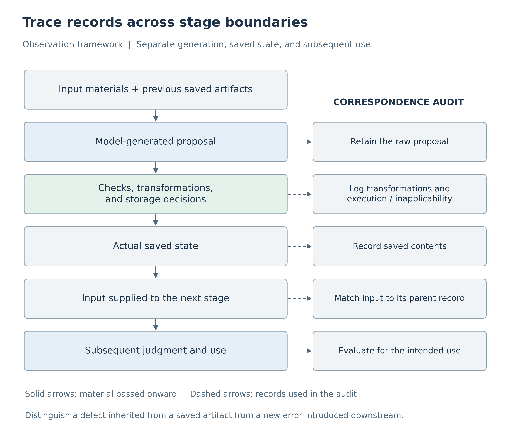
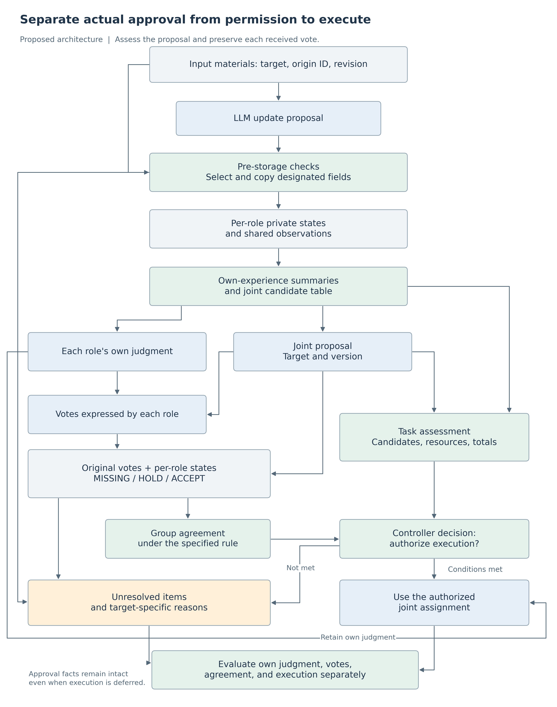

# Failure Analysis and Design Principles for Multi-Role LLM Systems
## Boundaries of Records, Approval, and Joint Use in Two- and Three-Role Tasks

**Kentaro Sato**  
Independent Researcher  
Contact: info@metaclan.jp ([email](mailto:info@metaclan.jp))

October 13, 2026 | English draft v0.3 | Internal technical report; unpublished

## Abstract

For multiple LLM roles to work together, they must connect shared records, proposal approvals, and assignments for execution while preserving each role's information and judgment. This report organizes failure observations and design principles from synthetic tasks that ran the same model as two or three roles in separate contexts. The tasks involved saving and updating customer preferences and venue observations, or deriving own recommendations and joint equipment allocations from each role's experience. We examined paths that passed generated notes or actual votes into subsequent inputs, together with matched comparisons that changed only part of the supplied material.

In two-role experiments, we observed incorrect provenance carried forward with correct answers, rollback after adoption of a newer state, and acceptance of a suboptimal proposal despite a correct own recommendation. In three-role experiments, subsequent responses faithfully used an actual vote that incorrectly deferred an appropriate proposal; in another case, a response correctly deferred group action while describing a missing vote as an explicit hold. Correct joint answers also concealed defects in private records, while end-to-end outcomes concealed successful local repairs.

We organize these findings into six observations and seven design principles. Central requirements are to preserve content, attribution, and provenance together; update according to target and purpose; identify the fields and stages covered by a control; separate own judgments from joint assignments; and record proposal assessment, actual votes, group agreement, and execution authorization separately. We present a reference architecture incorporating reasons for deferral and component-level evaluation, alongside standalone executable examples. Supporting both role-specific and joint activity can be framed as preserving, across stages, whose information or expressed position justifies which next action, rather than making all roles give the same answer.

**Keywords:** LLM agents; multi-role systems; failure analysis; shared memory; state updates; individual approval; group agreement; design principles

## 1. Goal: Preserve Each Role's Judgment While Working Together

Consider several reception staff members who remember their respective customers' preferences and jointly decide how to provide guidance at a venue. The customers may have different preferences. Assigning responsibilities for the joint task need not rewrite each role's past experience to match its assignment. At the same time, relevant information and judgments must remain open to revision when new experience or a legitimate customer change arrives.

This goal combines two pairs of requirements: retention with change, and private with shared activity. Simply fixing everything that should be retained prevents adaptation. Simply sharing more information leaves unclear whose information is being used and for what purpose. The required structure preserves attribution and purpose, updates the parts for which a change is justified, and establishes a policy for joint action.

The central proposition of this report is that **local correctness is specific to its object and criterion**. A correctly selected answer can carry an incorrect origin ID. A process that reads a record accurately can read a stale record accurately. Faithful execution of an agreement can faithfully implement a poor agreement. Group-level deferral can be correct even when the account of who expressed a hold is wrong. Connecting locally successful stages requires examining the records passed between them and the requirements assumed by the receiving stage.

For joint judgment in particular, we distinguish **whether a proposal meets the objective, whether each role actually approved it, whether the agreement rule is satisfied, and whether execution is authorized**. Here, “multi-role systems” refers to the connections between roles examined in the two- and three-role experiments.

This report makes three contributions. First, it organizes experimental cases by the location of a defect and the path along which it is carried forward. Second, it develops seven implementable design principles from these observations. Third, it presents a reference architecture and an evaluation approach that distinguish local improvements, remaining defects, and excessive deferral.

## 2. What the Roles Were Asked to Do

### 2.1 Running the Same Model as Multiple Roles

The two-role experiments invoked the same LLM separately as reception staff members A and B; the three-role experiments used A, B, and C. Each call began in a fresh input context containing the role, the current materials, and the required saved notes. Memory therefore refers to external records explicitly passed into later calls, rather than conversation history retained internally by the model. The staff members are model roles supplied with role labels and materials, not human participants.

The processing responsibilities were distinct. The **researcher** specified materials, instructions, and scoring criteria; the **LLM** generated update proposals and judgments; and the **experimental program** checked, saved, and passed those outputs onward. The term *storage component* refers to the part of that program responsible for saving records. In conditions where it copied input rows, the model proposal and the artifact produced by copying were saved separately. Fixed-rule code scored correctness, and structurally usable but substantively incorrect responses were still passed to subsequent stages. This made it possible to examine where errors arose and what was carried forward unchanged.

The report covers two tasks: record management with two roles, and joint judgment with two or three roles. Both use paper and digital guidance, but their correctness rules differ. The first selects **a medium accessible to everyone**; the second selects **an equipment allocation that maximizes the predicted total number of successful outcomes**.

### 2.2 Record Management: Customer Preferences and Venue-Wide Guidance

Roles A and B each serve a different customer and cover a different part of the venue. Each role records whether its customer wants a dog or cat design in a private note. It also receives observations indicating whether everyone in its area can use paper guidance and whether everyone can use digital guidance. All materials describe fictional situations constructed by the researcher.

**Table 1. Three information fields in the record-management task.** “Own observation” belongs to the staff role, which is distinct from the customer assigned to that role.

| Information field | Recorded information | Purpose |
|---|---|---|
| Assigned-customer information | The role's customer's dog-or-cat preference and provenance; a revision number is also included in preference-update trials | Select the design to prepare for that customer |
| Own observation | Paper/digital accessibility in the role's area, observer, revision, and provenance | Retain and update the role's observation and pass it to the other role |
| Shared observations | Saved observation rows for both A's and B's areas | Select guidance for the venue as a whole |

The private note contains separate fields for assigned-customer information and the role's own observation. The shared note contains copies of both roles' observations. A shared note is a record received and used by each role, not a single internal memory automatically kept identical across the two roles.

Under the task rule, if exactly one medium is accessible to everyone in both areas, that medium is the correct joint choice. For example, if both media are accessible to everyone in area A but only digital guidance reaches everyone in area B, the correct choice is digital. If zero or two media meet the criterion, the task requires deferral. The design prepared for each customer is determined independently by that customer's preference.

The researcher supplied new observations, observations saved by the other role, and delayed old notices. The LLM proposed note updates, and later calls answered questions about the customer design and joint guidance using the saved notes. In the field-level comparison described below, the program calculated joint guidance from four values read out by the LLM: A/B × paper/digital. Each case specifies this division of responsibilities.

### 2.3 Joint Judgment: Own Recommendations and Equipment Allocation

In the second task, each role receives several experiences stating how many people were guided using each medium and how many were successful. For its own task, the role can freely use either medium and should recommend **the medium with the higher success rate pooled over all of its experiences**. Earlier experiences remain part of the calculation; this is not a task of selecting only the latest row.

For the two-role joint task, the available equipment is limited to one paper guidance station and one digital terminal. Even if both roles recommend digital for their own task, one must use paper in the joint assignment. Each role's success rate is used to calculate the predicted number of successes when guiding 40 people in its area. The totals for A-paper/B-digital and A-digital/B-paper are compared. The joint adoption criterion is to maximize this total while respecting the equipment constraint.

In the two-role experiments, after each role recorded its own recommendation, the researcher supplied a fixed initial joint proposal. The other role responded with acceptance, a counterproposal, or deferral. **Only a counterproposal triggered one recheck by the initiating role.** The experimental program constructed a joint record from these responses and finally asked both roles to report their own recommendation and joint assignment. Execution here means reporting an allocation, not operating actual equipment or serving actual customers.

Joint confirmation and subsequent use had separate scoring criteria. At confirmation, a role should accept an optimal feasible proposal and respond to a suboptimal or resource-violating proposal with an optimal counterproposal or deferral. At subsequent use, a role should follow an approved agreement that respects the equipment constraint. Reoptimization was not required at the use stage. Thus, accepting a suboptimal proposal could be incorrect while subsequently following that agreement could satisfy the use-stage criterion.

In the three-role task, one medium is assigned to one role and the other to two roles. The experimental program supplies two feasible candidates and their totals calculated from the roles' success rates. The LLM should accept (ACCEPT) the higher-total candidate and defer (HOLD) the lower-total candidate. The task does not require searching all possible allocations. At the vote-readout stage, three ACCEPT votes for the same proposal yield agreement (AGREED); otherwise, the state is pending (PENDING). A role reports its joint assignment only when agreement has been reached.

Three-role readout distinguishes MISSING, where no vote is supplied, from HOLD, where an explicit hold vote is supplied. Both prevent unanimous agreement, but they represent different expressed facts. A favorable proposal total does not justify filling in an absent vote or changing an actual HOLD to ACCEPT.

Vote correctness in this report is evaluated against the specified numerical objective. Whether deferral is justified in a real meeting is a separate question involving the participant's circumstances and the decision-making institution.

### 2.4 How the Evidence Is Organized

The provenance, copying, and revocation trials in the record-management task used `gpt-5.6-luna`. The field-level control, update, and two- and three-role joint-judgment trials used Qwen3.5-27B. Within each trial, all roles used the same model. All tasks were short synthetic tasks in Japanese. Each case specifies what was held fixed and what was varied.

This technical report organizes the experimental records of four reports by the author [1–3,6] around failure analysis and design. The six observations and seven principles emerged from this synthesis; they were not hypotheses fixed before the entire experimental series. Each trial retains its model, instructions, scoring scope, and denominators. Tasks, manipulations, and results are explained within this report. Appendix C maps them to original trial identifiers, and Supplement S1 links to the evidence.

## 3. Units of Failure Analysis: Record Fields and Stage Boundaries

### 3.1 Distinguish Private Records, Actual Votes, Agreement, and Execution Authorization

A *contract* in this report is an explicit requirement for a field or processing stage, not a legal contract. Whether an observation value is correct, whether its origin ID is correct, whether an old notice may be adopted, and whether a proposal may be used as an agreement are different contracts.

Four terms are used throughout. An **origin ID** identifies the source material in which a fact or observation was first recorded. A **revision** is a researcher-assigned number used to compare versions for the same target. A **current evidence reference** identifies the location of an input used directly in the present call. If an observation arrives through a shared note, its origin ID still identifies the original observation, while its current evidence reference points to the corresponding row in that note. A **record field** is a logical information field within a note, not a separate physical file.

**Table 2. Objects and requirements to specify before connecting stages.**

| Object | Relationship to preserve | Grounds for an update |
|---|---|---|
| Role-specific assigned information | Correspondence among the target person, content, provenance, and valid revision | A legitimate change concerning that target |
| Own and shared observations | Correspondence among observer, values, origin ID, and revision | Comparable new information about the same observation target |
| Own judgment | Recommendation consistent with the role's experience and its intended use | New experience or evidence that the earlier judgment was incorrect |
| Joint proposal | Correspondence among the task, candidates, constraints, and evaluation criterion | New information, changed conditions, or a counterproposal |
| Individual vote | Who expressed what about which proposal | A new response from the same role whose target can be identified |
| Group agreement | Correspondence between received votes and the specified agreement rule | Receipt of the required roles' votes or an update to existing votes |
| Execution authorization | Correspondence among the target proposal, agreement, task constraints, and adoption criterion | Satisfaction of the conditions required for execution |
| Subsequent use | Correspondence between the supplied records, valid agreement, and use outcome | An applicability judgment based on the state and purpose at use time |

Assigned information and own observations remain separate fields even within the same note. Sharing the same observations does not require the roles to make identical own judgments. Conversely, identical answers are appropriate when each role's legitimate information supports the same conclusion.

The reference design records the fact of unanimous approval separately from the controller's authorization to execute a proposal. If all roles approve a suboptimal proposal, their approval remains recorded while execution is deferred on the basis of proposal assessment. This proposed additional check is distinct from the original two-role use-stage rule, which scored faithful use of an agreement as correct.

### 3.2 Separate Defect Origin, Propagation, and Evaluation

Figure 1 summarizes how the researcher traced defects. Although checking and transformation differed between trials, each distinguished the model proposal, the artifact actually saved, the next input, and the subsequent response. When votes were passed onward, generated votes were matched to the receipts actually included in the readout input.



**Figure 1. An observation framework for locating defects and tracing what is carried forward.** Distinguishing proposals from actual saved artifacts identifies where a defect arose and which transformations it passed through. The same correspondence also distinguishes errors newly introduced downstream.

Failure descriptions have three layers: a mismatch in information or judgment; the path carrying it through storage, exchange, and use; and the aggregation of evaluations that can obscure the mismatch. The third layer also includes cases in which an aggregate metric obscures a successful local repair.

## 4. Failure Analysis: What Was Tested and What Each Actor Got Wrong

Each case first states the question and manipulation, then follows the LLM response, storage processing, and subsequent use. It ends with the design distinction supported by the case. The cases are organized by failure and evaluation issue, not by experimental chronology.

### 4.1 Incorrect Provenance Is Carried Forward Alongside Correct Answers

**What was tested.** The researcher provided correct initial materials and examined whether both roles retained content–provenance correspondence after integrating them into private and shared notes. Two methods transferred shared observations. Under *rewriting*, the LLM rewrote the person, values, revision, and origin ID. Under *selection plus copying*, the LLM identified an input row and the storage component copied it verbatim. In both methods, the LLM still wrote the private note and declared current evidence references. The storage component saved the selected row even if the selection was wrong.

Both methods received the same 64 previously unused groups. A group comprised initial materials for both roles. Under each method, both roles saved notes and then answered subsequent questions from those notes. End-to-end success required all content, provenance, references, and judgments to satisfy their criteria across these four responses.

**What happened.** In one group, role B's customer wanted a cat design, with origin ID `RAD9D1FEC60F1FA2`. Under selection plus copying, the LLM correctly recorded role B and the cat preference in the private note, but omitted the final `2` from the origin ID, writing `RAD9D1FEC60F1FA`. Because mechanical copying covered shared observation rows, this private field was saved as written by the model. The experimental program passed that saved note into the next call.

The subsequent role B correctly chose the cat design and paper guidance. Paper was accessible to everyone in both areas, whereas digital was not, making paper the correct joint medium. However, role B again output the truncated origin ID as support for its correct answer.

> Correct input: B's customer wants a cat; origin ID ends in “…FA2.”  
> Private field written by the LLM and saved: B's customer wants a cat; origin ID ends in “…FA.”  
> Next LLM response: cat/paper is correct; the origin ID still ends in “…FA.”

This is not an inference that the later call independently dropped the same character. The saved incorrect ID was present in the actual next input, and the response retained a matching ID. Under rewriting with the same initial materials, this customer's origin ID was correct at both storage and subsequent use.

Across all 64 groups, selection plus copying met the provenance-inclusive criteria for 256/256 shared observation rows. Both methods achieved end-to-end success in 59/64 groups: rewriting had four failures and one unresolved outcome, while selection plus copying had five failures. The unresolved outcome arose from a response-format defect and remained unresolved in the formal results. Failures under selection plus copying occurred in private-information writing or subsequent readout, outside the mechanically copied fields. Defining the method difference as the selection-plus-copying rate minus the rewriting rate, the envelope of conservative 95% intervals across all completions of the unresolved outcome was −17.36 to 16.60 percentage points. End-to-end superiority was not established. Under the prespecified missingness rule, the primary p-value was not calculated.

**What this establishes.** Producing a correct answer and associating content with correct provenance are distinct tasks. Even when shared rows are copied correctly, private fields and later responses that rewrite provenance need separate checks. The design object is the correspondence among person, content, revision, and provenance through to use, rather than values or IDs protected in isolation.

### 4.2 A Role Adopts a New Preference, Then Rolls It Back After an Old Notice

**What was tested.** The researcher examined whether the targeted role could update a customer's changed preference and retain it when an old notice arrived later. Eight new cases were generated twice each, giving 16 trajectories. In each trajectory, one role received a new customer preference. Its saved note was then passed into the next input together with an old notice about the same customer. The other role was checked for retention of its unaffected customer's information.

The storage program applied per-observer latest-revision selection to paper/digital observation fields. It saved the customer-preference field as written by the LLM. Thus, although the notes were subject to a “retain the latest revision” operation, the preference field being changed lay outside that operation's scope.

**What happened.** In one case, role A's note contained a cat preference at revision 76. The researcher supplied a notice changing it to dog at revision 77. Role A correctly wrote dog, revision 77, and the new origin ID, and the storage component saved that state. Next, the researcher supplied the saved dog/revision-77 note together with the delayed cat/revision-76 notice. Role A reverted its customer field to cat, revision 76, and the old origin ID. After that proposal was saved, the final role A call selected the cat design.

The final call did not misread the supplied note: the note already said cat, and the role answered accordingly. The failure occurred earlier, when the update replaced newer information present in the input with the content of the old notice.

Initial adoption of the new preference succeeded in 16/16 trajectories. The unaffected role's customer information was also retained in 32/32 evaluations across the two update points. After the old notice, however, only 2/16 trajectories retained the new revision; in 14/16, the preference, revision, and origin ID rolled back. In all 14 cases, the correct newer state had been saved immediately beforehand and was included in the input processing the old notice.

**What this establishes.** Adopting new information, preserving unaffected information, and maintaining an adopted update are separately measurable capabilities. More accurate readout alone would not repair this path. The updating role needs a way to distinguish a notice arriving now from its content being valid now. The outputs do not establish how the internal revision comparison failed.

### 4.3 Joint Answers Can Be Correct While Own Observations Remain Stale

**What was tested.** The researcher examined what was repaired when storage processing was applied to different fields. Eighteen materials were generated twice each, yielding 36 model-proposed note updates. The own observation was already current in the initial input; the task was to preserve it while updating shared observations. Ten materials required updating the shared field from a new notice, and eight required retaining the state despite an old notice.

The experimental program **branched each identical update proposal into four conditions**. One saved observation fields without intervention. The others applied automatic processing to shared observations only, own observations only, or both. Processing first separated input candidates by observer A/B, selected that observer's highest-revision row, and copied the person, two values, origin ID, and revision together. All conditions retained the model-written customer-preference field.

Each branch's saved note was supplied to a subsequent LLM call, which read the four A/B × paper/digital values from the shared note. The program calculated joint guidance from that actual response. Own-observation correctness was assessed in the private-note field; shared-observation correctness was assessed in the shared-note rows, both against the latest input information. Generations were reused only when branches produced exactly identical subsequent inputs. Consequently, 144 branch conditions required 55 actual readout responses.

**What happened.** Table 3 reports the four branches. End-to-end success counts update proposals satisfying all requirements, including storage in the relevant fields and correct joint guidance.

**Table 3. Field-level storage controls applied to the same 36 update proposals.** These are 18 materials × two repetitions; the four branches are not 144 independent materials.

| Storage control | Correct own observation | Correct shared observations | Joint guidance matching the latest state | End-to-end success |
|---|---:|---:|---:|---:|
| None | 32/36 | 25/36 | 28/36 | 25/36 |
| Shared only | 32/36 | 36/36 | 36/36 | 32/36 |
| Own only | 36/36 | 25/36 | 28/36 | 25/36 |
| Both | 36/36 | 36/36 | 36/36 | 36/36 |

With shared-only control, the storage component correctly repaired the shared rows, and subsequent joint guidance was correct in 36/36 proposals. Yet the untouched own-observation field retained four stale records from the model proposals. Because joint guidance was calculated from the shared note, it could be correct despite these private-note defects.

Conversely, own-only control repaired all four own-observation defects, but end-to-end success remained 25/36. These four proposals also contained shared-observation defects, so fixing only the own field did not satisfy every condition. Controlling both fields yielded end-to-end success in 36/36 proposals.

**What this establishes.** Inferring that the entire record is correct from a correct joint answer misses defects in the own field. Inferring that a repair did not work because the aggregate score did not change misses successful own-field repairs. An all-conditions-required metric can obscure partial repair by definition. This comparison additionally located overlapping defects in actual model proposals and related the control scope applied to the same proposal to its downstream result.

### 4.4 Preserving Own Judgment Does Not Ensure a Correct Decision on a Joint Proposal

**What was tested.** In the two-role joint-judgment task, each role first formed a recommendation from its experience and then evaluated a joint proposal. One condition supplied an own-experience summary from the formation stage and provided both candidate totals at joint confirmation. The comparison examined whether roles could preserve their recommendations and accept an appropriate joint proposal when the information required for calculation was available.

**What happened.** In one previously unused numerical material, predicted successes for 40 people per role were as follows.

| Role | Predicted successes with paper | Predicted successes with digital | Appropriate own recommendation |
|---|---:|---:|---|
| A | 17 | 27 | Digital |
| B | 18 | 20 | Digital |

Both roles should recommend digital for their own task. With one unit of each medium, however, A-digital/B-paper yields 27 + 18 = 45, exceeding the 17 + 20 = 37 from A-paper/B-digital. Role B can appropriately recommend digital from its own experience while accepting paper as its joint assignment.

The researcher supplied the total-37 allocation to role B as the initial proposal. The input contained experience records for both roles, role B's own correct judgment note, B's own-experience summary, and the joint candidate table showing 45 and 37. Role B correctly reported digital as its own recommendation but accepted the total-37 proposal in its joint response. The program saved that acceptance in the joint record.

Because B did not counterpropose, the initiating role's recheck was not called. This followed the experimental rule that rechecking occurs only after a counterproposal; it was not an execution failure. At final use, A reported digital as its own recommendation but paper as its joint assignment, while B reported digital for both. The roles faithfully used the poorer total-37 agreement. Their references were also correct, and subsequent use satisfied the scoring contract described in Section 2.3.

The researcher then fixed this confirmation input and generated three new responses with fresh random seeds. In all three, B retained its digital recommendation and accepted the total-37 proposal. This was one case within a trial repeating all 48 confirmation inputs three times, rather than a rerun of a single outcome-selected case. The original own notes remained fixed; newly generated judgments were not connected to confirmation. These repetitions did not include subsequent use.

**Three roles also incorrectly deferred an appropriate proposal.** In a connected three-role trial, the researcher generated each of three materials twice, linking votes on higher- and lower-total proposals to readout of the actual votes. In one case, role C's own predictions were 26 for paper and 29 for digital. The joint candidates were A-paper/B-digital/C-paper with a total of 90, and A-paper/B-paper/C-digital with a total of 84. Role C correctly retained digital as its own recommendation but returned HOLD for the total-90 proposal.

The other two roles had returned ACCEPT for that proposal, giving A-accept/B-accept/C-hold. When A, B, and C subsequently read these actual votes, all three reported C as HOLD, group agreement as PENDING, and execution as HOLD. Across the trial, vote correctness was 35/36 and readout correctness was 72/72. In the second repetition with the same input for C's vote, C returned ACCEPT. Following agreement, C retained its own digital recommendation while reporting paper as its joint assignment.

**What this establishes.** Accepting a suboptimal proposal in the two-role task and deferring a higher-total proposal in the three-role task are different errors at the proposal-assessment stage. Faithful subsequent use of either record still counts as success under the downstream criterion. A path that rechecks only counterproposals does not inspect a directly accepted proposal through that recheck. The design needs to separate proposal assessment from recording what each role actually voted, and to apply common checks to the paths leading to execution.

### 4.5 Correct Group-Level Deferral Can Coexist with a Misrecorded Individual Position

**What was tested.** The researcher fixed the three roles' own notes and the higher-total joint proposal, varying only one role's vote. For each of three materials, the target vote was removed from the input, replaced with an explicit HOLD, or left as the original ACCEPT. The other two roles' ACCEPT votes were common to all conditions. The HOLD condition was constructed by the researcher, not newly generated by the model.

Each of A, B, and C read each state twice: three materials × three states × three reading roles × two repetitions, yielding 54 responses. These were two repetitions of 27 inputs using the same own notes and proposals. The three states were compared in 18 matched triplets sharing material, reading role, and repetition. Each response was scored for its own-judgment fields, per-role approval states, agreement, and execution judgment. The trial did not evaluate effects of saving these readout responses as new state and feeding them into further stages.

**What happened.** In one case, A's own predictions were 24 for paper and 29 for digital, so its own recommendation was digital. The joint candidates were A-digital/B-paper/C-paper with a total of 85 and A-paper/B-digital/C-paper with a total of 91. Role A read an input containing only B's and C's ACCEPT votes for the total-91 proposal. Because A's vote was absent, the correct approval states were A=MISSING and B/C=ACCEPT.

Role A correctly reported its own digital recommendation and references to its experience, but described its own approval state as HOLD. Reporting PENDING for the group and HOLD for execution was appropriate. In the second repetition with the same input, A correctly reported MISSING. Under unanimous approval, A retained its own digital recommendation while proceeding to its paper joint assignment.

**Table 4. Readout comparison with three approval states.** Each condition contains 18 responses. Approval-state success requires all three roles' states within a response to match the input.

| Evaluation target | Missing vote | Explicit hold | Unanimous approval |
|---|---:|---:|---:|
| Own-judgment holder, recommendation, and evidence (each axis) | 18/18 | 18/18 | 18/18 |
| Approval states of all three roles | 17/18 | 18/18 | 18/18 |
| Group agreement | 18/18 | 18/18 | 18/18 |
| Execution judgment | 18/18 | 18/18 | 18/18 |
| All six axes | 17/18 | 18/18 | 18/18 |

Own judgment, agreement, and execution judgment were each correct in 54/54 responses; approval states were correct in 53/54. All six axes succeeded across all three states in 17/18 matched triplets. The observed defect was one reinterpretation of an absent vote as an explicit hold. No response marked an unapproved role as having approved.

**What this establishes.** A missing vote and an explicit hold both map to the group-level decision that the group cannot yet proceed. Appropriate action alone therefore does not establish faithful recording of an individual's expressed position. Even when both lead to the same stop decision, the design should preserve vote absence and an explicitly expressed hold as separate states. This allows a later stage to identify whose response is still needed and what response has actually been expressed.

### 4.6 Identical Overall Failures Can Hide Different Defects, and Final Answers Can Hide Earlier Errors

**What was tested.** The researcher examined how own and joint judgments varied across repetitions of fixed inputs. The case considered here came from a condition that did not add an own-experience summary at confirmation. Role B received all experience records and a table of joint candidate totals, together with an earlier model-written note incorrectly recommending paper for its own task. The correct recommendation from all experience was digital. The initial proposal assigned the single digital terminal to both roles, violating the equipment constraint. The same input was generated three times.

**What happened.** In the first two responses, B corrected its old note and appropriately recommended digital, but accepted the proposal assigning the one digital terminal to both roles. In the third, B corrected the joint proposal to the appropriate A-digital/B-paper allocation, totaling 45, while retaining the incorrect paper recommendation in its own field.

| Response to the same confirmation input | Own recommendation | Joint response | Both correct |
|---|---|---|---|
| Repetition 1 | Digital: appropriate | Accepts digital for both roles: inappropriate | No |
| Repetition 2 | Digital: appropriate | Accepts digital for both roles: inappropriate | No |
| Repetition 3 | Retains paper: inappropriate | Counterproposes A-digital/B-paper: appropriate | No |

The aggregate statement “failure in all three repetitions” is correct, but the same defect did not occur three times. Joint confirmation was inappropriate in the first two; own judgment was inappropriate in the third. The third response's counterproposal was not passed to the other role for rechecking in this repetition trial, so it was not counted as a final agreement.

The researcher also compared when own-experience summaries were supplied. One condition supplied them only at final use; the other supplied them from judgment formation onward, including confirmation and recheck. Both supplied the summary at use and joint candidate totals at confirmation and recheck. Each trial branched eight materials into three initial proposals, giving 24 paths. Both roles answered at the end of each path, yielding 48 use responses. The comparison was conducted once with previously used materials and once with unused numerical materials.

In both trials, own judgments and references were appropriate throughout 15/24 paths with use-only support and 24/24 with support from formation. Nevertheless, final use was appropriate in 48/48 responses under both conditions. With use-only support, the LLM sometimes corrected an erroneous intermediate own record using the experience and summary supplied in the final input. Scoring only the endpoint would conceal this difference along the path.

**What this establishes.** End-to-end success asks whether any required component failed; final-answer correctness asks whether the last response was appropriate. Both are useful, but defect locations and correction paths require separate records. Retaining component-level own fields, joint fields, and acceptance actions helps identify where a control should act.

## 5. Seven Design Principles for Connecting Private and Shared Activity

Three principles below include short Python examples expressing requirements as operations. Observation selection reuses the core of an existing procedure; recording joint assignments and separating approval from execution illustrate the proposed reference architecture.

In the code, `owner` and `role` identify roles, `revision` is an information revision, `origin_id` identifies provenance, and `allocation` specifies joint assignments. `deepcopy` copies a record without modifying the original. Vote states are MISSING/HOLD/ACCEPT, group agreement is PENDING/AGREED, and the controller's execution decision is DEFERRED/AUTHORIZED, each in a separate field. HOLD in Code example 1 denotes deferral of observation selection, not an individual's vote.

The caller checks input types, source identity, task scope, and the binding between contents and their IDs/versions in advance. The functions return candidate saved contents and decisions without writing to disk. Appendix D contains the complete code, including helpers, all inputs, and 18 tests. Tests of the design examples are distinct from the original LLM experimental results.

### Principle 1. Treat Content, Attribution, and Provenance as a Unit

**Requirement.** After storage or exchange, information remains correctly associated with its target, origin, and valid revision.

**Implementation.** Represent observer, values, origin ID, and revision in one row and copy the selected row intact. Keep the origin ID separate from the reference to the current input. Specify the fields passed to other roles and the private fields used only by their owning role. Bind votes to their sender and target proposal, and match received original votes to the state representation derived from them. Record selection correctness separately from copying fidelity so that an incorrect source selection can be identified.

**Verification.** Compare saved rows with the selected sources and verify that subsequent inputs derive from the actual saved artifacts. If a later stage rewrites provenance, score that provenance separately. Selection plus copying in Section 4.1 exemplifies this division of responsibilities; defects remaining outside shared fields also delimit its coverage.

### Principle 2. Identify the Update Target and Purpose Before Selecting Information

**Requirement.** Legitimate new information reaches the relevant field, while fields without grounds for change are preserved. Distinguish when a notice arrives from when its information is valid.

**Implementation.** First filter candidates by target person and information type, then compare revisions or validity intervals within that set. A task about the current state should use current information; a task about the past should use information applicable at that time. If the same target and revision have conflicting candidates, retain them and record what is needed to resolve the conflict. Do not compare A's revision number with B's.

**Verification.** Separately assess retention, adoption, maintenance after adoption, and preservation of unaffected fields. Per-observer latest-revision selection for observation fields was compared in Section 4.3. Extending that control to the customer field, same-revision conflicts, and notices with uncertain authority are subjects for further comparison.

**Code example 1. Compare revisions within each observer and copy the selected row with its provenance. Reconstruction of an existing procedure's core.**

The storage procedure in Section 4.3 selected the observer before comparing that observer's revisions. The following function illustrates selection and copying. `rows` contains observations of the same kind for the same task. Input-source matching, structural validation, and selection-source audit records from the original implementation are omitted here; the first two are preconditions. Missing candidates and same-revision conflicts, which the original implementation reported as exceptions, are represented by `HOLD` for illustration.

```python
from copy import deepcopy

def select_observation(rows, owner):
    candidates = [r for r in rows if r["observer"] == owner]
    if not candidates:
        return {"status": "HOLD", "reason": "MISSING_OWNER"}
    by_version = {}
    for row in candidates:
        version = row["revision"]
        if version in by_version and by_version[version] != row:
            return {"status": "HOLD", "reason": "SAME_VERSION_CONFLICT"}
        by_version[version] = row
    latest = by_version[max(by_version)]
    return {"status": "READY", "row": deepcopy(latest)}
```

**Input and output.** For illustration, supply the following three rows in order. `ALL` means accessible to everyone, and `NOT_ALL` means not accessible to everyone.

| Observer | Revision | Paper | Digital | Origin ID |
|---|---:|---|---|---|
| A | 2 | ALL | NOT_ALL | OA2 |
| B | 99 | ALL | NOT_ALL | OB99 |
| A | 3 | NOT_ALL | ALL | OA3 |

`select_observation(rows, "A")` returns the **entire row** containing A, revision 3, paper `NOT_ALL`, digital `ALL`, and origin ID `OA3`. B's revision 99 is not an A candidate. A legitimate revision 4 for A would be adopted. Conflicting content or provenance within an A revision instead produces a hold. The original implementation also detects same-revision conflicts, but the original LLM comparison used consistent candidates; the conflicting inputs here test the illustrative code.

This function selects one observation row. It is not directly applicable to customer preferences or own judgments that aggregate all experience.

### Principle 3. Map a Control's Field Coverage to Subsequent Uses

**Requirement.** The scope protected by a procedure can be identified by record field and receiving stage.

**Implementation.** For assigned information, own observations, shared observations, own judgments, per-role approval states, and joint agreements, list the generator, storage operation, and consumer. Bind feature descriptions such as “latest-revision selection” or “validation” to explicit fields. Save the model proposal, changes made by the procedure, and actual saved artifact separately.

**Verification.** Where conditions can share the same proposal, vary which fields receive the control and inspect local repairs and remaining defects. The four-way branch in Section 4.3 is an example. Measure defects in proposals separately from what would happen in a distinct continued run without the control.

### Principle 4. Retain Own Judgments and Joint Assignments as Separate Artifacts

**Requirement.** Own recommendations correspond to the role's experience, while joint assignments correspond to the joint objective, constraints, and agreement. Taking a different joint assignment does not rewrite the role's experience to match it.

**Implementation.** Associate an own judgment with its role, purpose, and experience references. Associate a joint proposal with its task, candidates, constraints, and evaluation criterion. Supply computed own-experience summaries and joint candidate totals in separate fields. Specify the formation, confirmation, and use stages at which each is needed.

**Verification.** Construct inputs changing only own experience, only joint conditions, or both, and test whether the corresponding tasks change selectively. Include valid cases with matching recommendations, different recommendations, and an own recommendation different from the joint assignment. The timing comparison in Section 4.6 illustrates earlier support sustaining intermediate own judgments. In the three-role task, a digital own recommendation also coexisted with a paper joint assignment after agreement (Sections 4.4–4.5).

**Code example 2. Record only an authorized joint assignment without changing the own judgment. Design example.**

`state` is the role's own state, and `decision` is the controller decision from Code example 3. Whether the own judgment matches the experience is checked separately; this function adds only the joint assignment.

```python
from copy import deepcopy

def record_assignment(state, decision):
    if decision["execution"] != "AUTHORIZED":
        return {"status": "DEFERRED", "reason": "NO_EXECUTION_PERMISSION"}
    proposal = decision["proposal"]
    updated = deepcopy(state)
    updated["joint_assignment"] = {
        "medium": proposal["allocation"][state["role"]],
        "proposal_id": proposal["id"],
        "proposal_version": proposal["version"],
        "evidence_version": proposal["evidence_version"],
    }
    return {"status": "READY", "state": updated}
```

**Input and output.** A in Section 4.5 recommends digital for itself and takes paper under the total-91 proposal. Given an authorized proposal, the function records paper and the proposal/evidence versions in `joint_assignment`, preserving digital and the experience references in `own_judgment`. The same structure applies when B takes paper under the two-role total-45 proposal. If execution is deferred, the function returns DEFERRED without constructing an updated state.

### Principle 5. Separate and Connect Proposal Assessment, Actual Votes, Agreement, and Execution Authorization

**Requirement.** Proposal quality does not justify rewriting actual votes, and receipt of all votes does not by itself establish that task requirements are satisfied. Execution authorization combines proposal assessment and agreement for the same target.

**Implementation.** Separate three operations. First, assess equipment constraints and the adoption criterion within the fixed candidate set. Second, derive each role's state from received votes and apply the specified agreement rule. Third, use both results to authorize execution. Direct acceptance and acceptance following a counterproposal should reach the same execution check. Bind decisions to the proposal ID, proposal version, and experience-evidence version; another role's approval cannot fill an absent vote.

**Verification.** Test progress under unanimous approval of the higher-total proposal, and stopping under a missing vote or explicit hold while retaining their distinct individual states. Under unanimous approval of the lower-total proposal, retain the approval facts and defer execution only. Record separately whether each commitment path invokes its check and whether that check is correct.

**Code example 3. Preserve actual votes and connect proposal assessment and unanimous approval to the execution decision. Design example.**

`assess_proposal` compares candidates using predictions calculated from the supplied experience. `project_votes` records actual votes for the target proposal by role. Both helpers appear in full in Appendix D. The role keys in `scores` specify everyone whose approval is required; this illustrative rule also requires an explicit vote from the proposer. It is not a verbatim reproduction of the original two-role procedure, which constructed agreement from a proposal and the other role's response.

```python
from copy import deepcopy

def decide(proposal, receipts, scores, candidates, capacity, evidence_version):
    assessment = assess_proposal(proposal, scores, candidates, capacity, evidence_version)
    approvals = project_votes(proposal, receipts, tuple(scores))
    authorized = assessment["eligible"] and approvals["agreement"] == "AGREED"
    return {"proposal": deepcopy(proposal), "assessment": assessment,
            "approvals": approvals,
            "execution": "AUTHORIZED" if authorized else "DEFERRED"}
```

**Input and output.** If only B/C ACCEPT votes are supplied for the three-role total-91 proposal, `states` contains A=MISSING and B/C=ACCEPT, `agreement` is PENDING, and `execution` is DEFERRED. Adding A's HOLD sets A=HOLD while leaving the group-level deferral unchanged. Only adding A's ACCEPT yields both unanimous approval and execution authorization.

If all roles ACCEPT the two-role total-37 proposal, `agreement` remains AGREED, the assessment reports LOWER_TOTAL, and execution is DEFERRED. The code neither rewrites the total-37 proposal as the total-45 proposal nor replaces votes with HOLD. Adopting a new proposal requires new confirmation of that proposal.

The appendix fixes the candidate set and resource allocation. Predictions are integers or exact fractions, rather than totals reported by the LLM. Duplicate votes or votes for a mismatched target are retained in their original form pending resolution. The effectiveness of this complete reference architecture, which separates proposal quality from expressed individual positions, remains a subject for a future connected comparison; it is not retroactively assigned to the original experiments.

### Principle 6. Carry Unresolved Outcomes and Deferral Forward with Reasons and Scope

**Requirement.** Unidentified information and unapproved proposals are not used as resolved records. Other established information and valid work remain available.

**Implementation.** Separate the processing target, applicability conditions, result state, and unresolved reason. Distinguish insufficient information, an unscorable response format, a substantive requirement failure, appropriate deferral, and a stage that is inapplicable by protocol. For individual votes, distinguish nonreceipt, explicit hold, and approval in fields separate from group-level execution deferral. Do not overwrite these reasons with one aggregate state merely because the action is the same, as in Section 4.5. Preserve raw responses separately from artifacts produced by syntax normalization or storage processing, recording the changes. If retries are allowed, fix their permitted changes and limits beforehand.

**Verification.** Pair inputs that can be resolved with inputs lacking the information needed for resolution. In one diagnostic using eight record-management scenarios, the researcher changed saved origin IDs to correct, old, or absent IDs and supplied each role with a notice from a source designated as trusted. The notice revoked an observation—that is, invalidated a previously recorded observation. Notices either contained only an ID or additionally specified observer, revision, and paper/digital values. The LLM was instructed to invalidate an observation when its ID matched, or, if the ID did not match, when all details uniquely matched one observation. If the target could not be identified, it should retain every row and mark the matter unresolved. When identified, all copies of the target observation were marked invalid while retaining their values, revisions, and IDs as history.

With an incorrect stored ID and an ID-only notice, the LLM did not guess a row to invalidate. It preserved customer information and observations and carried joint-decision deferral into the next response. For both the old-ID and absent-ID conditions, target-resolution completion was 0/8 and evidence-appropriate handling was 8/8. Where details uniquely identified the target, invalidation was completed. Inability to identify a target from the ID alone follows from the materials and rules; the observed behavior was whether the LLM avoided guessing and preserved unresolved state and unaffected information. Extensions with ambiguous notices or conflicting details should measure both unintended changes and excessive deferral.

### Principle 7. Retain Component-Level Evaluation and Evaluate the Validator

**Requirement.** Identical aggregate outcomes do not erase which fields or stages succeeded and what remained defective. Checks that obstruct correct inputs are also observable.

**Implementation.** Record own state, shared state, provenance, updates, proposal judgments, per-role approval states, agreement, and subsequent use as components alongside end-to-end outcomes. In fixed-input repetitions, retain each component and action. Assign checks determined by explicit rules—such as structure, arithmetic, and reference existence—to code. When an LLM assists with semantic assessment, calibrate its evidence format and unresolved outputs as well as its decisions.

**Verification.** A judge-model diagnostic supplied 32 existing responses and 32 constructed controls containing known errors and valid boundary cases. The judge assessed output structure, attribution/references, own judgment, and joint action against explicit rules. All four assessments agreed with the reference assessment in 53 cases; four disagreed; and seven were unscorable because the judge's own supporting explanation violated its required format.

In all four disagreements, a response contained an unauthorized extra field, but the judge reported that no extra field existed. Fixed structural-validation code detected all four. Three were constructed controls with altered field names or placement, not evidence that the model spontaneously concealed a violation. The comparison shows that an LLM capable of assisting with content assessment has not thereby completed structural validation. Record false alarms, missed defects, unresolved judgments, and blocked legitimate updates separately.

**Evaluate explicit comparison fields separately from performance.** In three-role voting, a condition requiring candidate IDs and a higher/lower comparison separately from the own-judgment fields achieved 54/54 correct votes, compared with 52/54 under the earlier format, across 54 matched pairs from three previously used materials. With the same instructions applied to three numerical materials not previously used in this study, both conditions achieved 54/54. In each trial, all 54 comparison-field responses correctly aligned the candidates, their ordering, and the vote. The ability to inspect this correspondence and an increase in correct answers are separate outcomes. Because the comparison changed instructions and output schema together, it does not isolate the effect of a single field.

## 6. A Reference Architecture Connecting the Principles

### 6.1 Manage Record Updates and Joint Execution at Separate Boundaries

Figure 2 connects the seven principles. Before updating a record, check its target, provenance, and revision; before joint execution, check proposal assessment and agreement grounded in actual votes.



**Figure 2. Proposed reference architecture connecting role-specific state and joint use.** The path assessing a proposal and the path recording votes and deriving agreement meet at the controller's execution decision. Even unanimous approval leaves execution deferred if the proposal fails task requirements, while the actual approval remains unchanged. Attach the Figure 1 audit records to each stage.

Separate information rows pointing to original sources; judgments associated with roles and purposes; proposals with targets and versions; actual votes bound to senders; agreement derived from those votes; and execution authorization with unresolved reasons. Select the fields needed by each role and stage instead of automatically transferring the entire private note into joint inputs.

Pre-storage checks use candidates actually present in the input and prespecified rules. Proposal assessment uses experience, resources, and candidates available during operation, rather than an experimental answer key. The LLM continues to generate own judgments and votes, while deterministic copying and aggregation preserve the facts already generated.

### 6.2 Four Design-Review Cases

The following are proposed checks derived from existing cases, not additional results obtained by running the reference architecture.

**An old notice arrives.** If the current state is dog/revision 77 and a notice says cat/revision 76, a task requiring current information for the same target should retain revision 77 and record the older notice as not adopted. Changes should not spill into another role's observation or assigned information. An additional test should verify that applying this check to the customer field also permits a legitimate change at revision 78.

**Own recommendations and joint assignments differ.** Even when both A and B recommend digital for themselves, the joint allocation uses one unit of each resource. Under the total-45 proposal, B's own recommendation remains digital when B takes paper. If all roles approve the total-37 proposal, preserve that fact while deferring execution under the task's adoption criterion. Optimality here is specific to the agreed objective of maximizing the total in this task.

**One role's vote is missing.** Require approval from A/B/C. With only B/C ACCEPT votes, retain A=MISSING and leave the group without agreement. A's HOLD changes the individual state to an explicit hold; A's ACCEPT changes it to unanimous approval. Even when the stop decision is unchanged, retain whether a vote was not received or a hold was expressed so that downstream stages can distinguish them.

**A revocation notice has an unidentified target.** If the target cannot be uniquely matched, record the unresolved notice instead of guessing a row to invalidate. Defer the joint decision that the notice may affect, while retaining well-supported private work. Explicitly delimiting the hold avoids both pretending the issue is resolved and indiscriminately stopping every task.

### 6.3 State What Each Component Has Established

**Table 5. Evidence supporting the principles and extensions to test next.** “Comparison” refers to a comparison of complete methods on the fixed materials of the source trial.

| Principle | Existing evidence and established scope | Targets when extending the design |
|---|---|---|
| 1. Preserve correspondences | Comparison of selected-row copying and subsequent use; observation of provenance defects and their transfer | Fields outside copying, wrong source selection, rewritten provenance |
| 2. Update by target and purpose | Per-observer latest-revision selection in own/shared observations; customer-field rollback | Customer fields, same-revision conflicts, notice authority, validity intervals |
| 3. Specify control coverage | Four branches of the same proposal and joint readout from their saved artifacts (Section 4.3) | Continued runs without the control, different tasks, longer histories |
| 4. Separate own and joint outcomes | Separate evaluation of own recommendation and joint assignment; support-timing comparison and repetitions (Sections 4.4 and 4.6) | Freely described experiences and contributions of support at each stage |
| 5. Separate assessment, votes, agreement, and execution | Two-role incorrect acceptance and three-role incorrect hold, followed by faithful use of actual records | Connecting separate common checks, valid progress, agreement updates |
| 6. Preserve deferral as state | Appropriate revocation deferral; confusion between missing votes and explicit holds in three roles | State-preservation procedures, delayed/conflicting votes, subsequent use of reasons |
| 7. Evaluate components and validators | Field-, stage-, and repetition-level diagnostics; judge calibration (Section 4 and Principle 7) | Unknown semantic boundaries, missed defects, false alarms, operating cost |

## 7. Evaluation: Allow Appropriate Progress and Stop Inappropriate Progress

### 7.1 Do Not Collapse Outcomes into One Success Rate Too Early

Evaluation pairs successful progression from valid inputs with the handling of inappropriate or insufficient inputs. Unchanged own information alone does not establish that legitimate updates remain possible. Zero incorrect agreements likewise does not establish the ability to cooperate if every proposal was deferred.

**Table 6. Paired tests for implementing the principles.** Untested entries are examples for future designs.

| Target | Inputs expected to succeed | Inputs probing the boundary | Outcomes recorded separately |
|---|---|---|---|
| Attribution and provenance | Exchange rows with matching targets and origin IDs | Correct value with wrong ID; valid ID belonging to another person | Content, attribution, provenance, propagation |
| Updates | Legitimate new revision for the same target | Old notice, same-revision conflict, notice for another target | Adoption, retention, unintended changes, deferral |
| Separation by purpose | Appropriate difference between own and joint conclusions | Change only own experience or only joint conditions | Selective effects on each use |
| Proposal assessment and agreement | Unanimous approval of an appropriate candidate | Unanimous approval of a suboptimal proposal; resource violations | Proposal assessment, actual agreement, execution authorization |
| Each role's approval state | Actual votes from all required roles for the same target | One missing vote, explicit hold, different-version or duplicate votes | Per-role states, fidelity to original votes, agreement and execution |
| Subsequent use | Valid agreement and appropriate saved artifacts | Invalidated evidence, no agreement, old artifacts | Fidelity to records; conformity with current requirements |
| Validation | Valid states and legitimate changes | Known defects and semantically ambiguous cases | Valid passage, false alarms, missed defects, unresolved outcomes |

Pass actual saved artifacts onward on normal paths as well. When an earlier error is corrected at the endpoint, retain both events. Separate stages blocked by structural defects, stages inapplicable by protocol, and substantive failures. Analyses retain planned denominators and the original trials' missingness rules.

### 7.2 Align the Units Being Compared

Branching the same model proposal is useful for measuring a local storage operation. Evaluating the effect on continued operation requires carrying forward the artifacts actually produced under each condition. Counts of defects in proposals during a controlled run are not results from a reproduced uncontrolled run.

Repetition also has two forms. Fixed-input repetition measures response variability for that input. Repeating a connected path from formation through use measures the entire path, including upstream variability. The fixed-input repetitions in Sections 4.4 and 4.6 are of the former kind; the two forms are not interchangeable reliability measures.

Comparisons adding a check should record blocked legitimate progress, defects that pass, downstream effects, and call counts and elapsed time. Specify adoption criteria for the intended task before observing outcomes. Repairing a particular failure case and satisfying the same requirements on unused materials are separate achievements.

## 8. Scope and Further Development of the Design Principles

This report is an exploratory technical synthesis of four reports. Models, materials, instructions, and scoring scopes differ, so each comparison retains its denominators and evaluation targets. For example, a later response required to cite provenance and one asked only to select a customer design are evaluated on different scales. Roles, branches, and technical repetitions sharing materials are not counted as independent materials.

The observations concern explicitly assigned facts, recommendations from supplied experience, structured shared observations, and short agreement processes. They do not measure the causal effect of increasing the number of roles under matched conditions or establish performance for arbitrary group sizes. Four or more roles, delayed or withdrawn votes, votes for different versions, and judgments formed through free dialogue are candidates for extending the scope.

Per-observer latest-revision selection requires identifiable targets, candidates present in the input, and comparable revisions. Vote aggregation likewise requires an identifiable sender and target proposal. Real-world truth, authority to change information, fairness, and the appropriate agreement rule must be specified for the use case; maximum revision, maximum total, and unanimous approval do not determine them by themselves.

The four source reports' design, execution, fixed-code scoring, and verification were conducted within the same project. This report reorganizes that evidence and adds no new independent replication. The code examples and reference architecture connect previously compared components with design proposals derived from observations. Future connected evaluations should preserve the original results while jointly measuring valid progress, prevention of inappropriate execution, accuracy of role-specific state, and the cost of confirmation.

## 9. Conclusion

The two- and three-role experiments show the need to treat the connection between role-specific information and joint work as multiple kinds of correctness. Content can be correct while provenance is damaged; accurate readout can faithfully use stale saved information; and faithful use of an agreement can carry forward an inappropriate joint decision. In three roles, a response also correctly deferred group action while reinterpreting an absent vote as an individual's explicit hold.

The central design requirement is to **record separately whose information is protected, what evidence justifies changing it, and which conditions permit joint action**. Bind content to provenance, update according to target and purpose, and separate own judgments from joint assignments. Preserve proposal assessments and actual votes, then connect agreement based on those votes to the controller's execution authorization. Reasons for deferral and component-level evaluation make both local improvements and remaining defects visible.

Supporting role-specific and joint activity requires more than freezing each role's information or making every answer match. The seven principles and reference architecture provide a basis for implementing and testing systems that preserve each role's legitimate information and expressed position while allowing joint work to proceed.

## 10. Author Contributions and Data Availability

The author determined the research direction and execution scope and reviewed the results and manuscripts of the four source reports. This English version is a draft for author review. LLM assistance was used for organizing materials, drafting, translation, and checking. Preparing this synthesis involved no new model experiments, repair of original responses, or rescoring of research outcomes. All customers, venues, and experiences are fictional.

The four reports, experimental materials, and evidence index are stored privately and locally without a deletion deadline. Tasks, manipulations, and results needed to understand this report are included here. Appendix C and the references identify the evidence sources; S1 links to original results and saved-artifact checks. The author will determine the public archive, persistent identifiers, license, and formal funding and conflict-of-interest declarations during publication preparation.

## References

1. Kentaro Sato. 2026. [Maintaining Role-Specific Information and Shared Records in LLM Memory Updates: An Exploratory Evaluation of Content, Provenance, and Continued Use](../paper-01/MRSI_Paper1-ja-v1.0.md). Japanese v0.11, September 23, 2026. Source report for the provenance, copying, and revocation cases. [English version](../paper-01/MRSI_Paper1-en-v1.0.md).
2. Kentaro Sato. 2026. [Scope of Update Control in Private and Shared LLM Records: Field-Level Comparisons and Post-Update Rollback](../paper-02/MRSI_Paper2-ja-v1.0.md). Japanese v0.4, September 27, 2026. Source report for the field-level comparison and customer-update cases. [English version](../paper-02/MRSI_Paper2-en-v1.0.md).
3. Kentaro Sato. 2026. [Separating the Stability of Role-Specific Judgments from the Quality of Joint Agreements: Timing of Computational Support and Fixed-Input Repetitions in a Two-Role LLM Task](../paper-03/MRSI_Paper3-ja-v1.0.md). Japanese v0.2, September 29, 2026. Source report for joint-judgment and repetition cases. [English version](../paper-03/MRSI_Paper3-en-v1.0.md).
4. Kentaro Sato. 2026. *LLM System Failure Studies*. Technical Report v1.8, in Meteon Collected Edition v1.1 (source not bundled). Consulted for organizing requirements, failure paths, and classifications.
5. Kentaro Sato. 2026. *Autonomous LLM System Design: Build the Cage Before Granting Authority*. Technical Report v1.16, September 5, 2026, in the same collected edition (source not bundled). Consulted for the distinction between evidence and proposals in Section 3, design principles in Part III, and the mapping in Appendix A.

6. Kentaro Sato. 2026. [Boundaries Between Role-Specific Judgment, Individual Approval, and Group Agreement in Three LLM Roles: Carrying Actual Votes Forward and Comparing Matched Approval States](../paper-04/MRSI_Paper4-ja-v1.0.md). Japanese v0.2, October 13, 2026. Source report for three-role voting, state readout, and explicit comparison fields. [English version](../paper-04/MRSI_Paper4-en-v1.0.md).

This report organizes failure and design issues from the author's experimental records. It is neither an exhaustive literature review nor a claim that each of the seven principles is introduced here for the first time. Appendix C explains the organizational approaches drawn from References 4 and 5 within this report.

## Appendix A. From Failure Observations to Design and Verification

**Table A1. Connecting the same cases to controls and checks.** The rows are not mutually exclusive failure classes.

| Observation or evaluation issue | Main principles | What to inspect next |
|---|---|---|
| Correct values carry old IDs or IDs absent from the input | 1, 3 | Within-row correspondence, fields outside copying, later rewriting |
| An old notice reverts a new record | 2, 3 | Target-specific adoption rules and passage of legitimate updates |
| Correct joint answers coexist with stale own fields | 3, 7 | Field-level state and downstream stages using that field |
| Repairing own fields leaves aggregate performance unchanged | 3, 7 | Overlapping defects and successfully repaired components |
| Correct own judgments coexist with acceptance of a suboptimal proposal | 4, 5 | Own recommendation, joint adoption criterion, and agreement commitment |
| Incorrect acceptance proceeds without rechecking | 5, 7 | Check-trigger conditions and records of passage on every commitment path |
| Subsequent responses faithfully retain a hold on an appropriate proposal | 4, 5 | Vote appropriateness and fidelity to actual votes |
| Correct group-level judgment coexists with describing a missing vote as an explicit hold | 1, 5, 6, 7 | Correspondence among original votes, per-role states, agreement, and execution |
| Deferral, format defects, and inapplicability are collapsed into one outcome | 6, 7 | State reasons, dependencies, and the scope of valid progress |
| The defective field changes despite identical overall failure | 7 | Repetitions, components, and actions for each fixed input |

## Appendix B. A One-Page Record for Design Review

When transferring a principle to another system, complete the following for each procedure. This form is proposed to make evidence and validation scope explicit; its own effectiveness has not been evaluated.

| Field | What to record |
|---|---|
| Object to protect | Role, information field, purpose, stage |
| Success conditions | What counts as correct retention, change, agreement, and use |
| Input assumptions | Target identity, provenance, revision, candidates, authority, objective, constraints, required approvers, agreement rule |
| Processing responsibility | Model judgment, deterministic commitment, human decision |
| Applicable paths | Normal update, direct acceptance, counterproposal, retry, and other routes |
| When not applicable | Scope of deferral, reason, retained information, next required confirmation |
| Observation record | Proposal, actual saved artifact, next input, use outcome, reasons for changes and inapplicability |
| Verification | Valid progress, inappropriate progress, excessive stopping, repetition variability |
| Evidence scope | Source versions, observations, compared procedures, untested extensions |

Evaluate the scope achieved along paths connecting actual saved artifacts, rather than treating a collection of completed forms as a guarantee that private and shared activity can coexist.

## Appendix C. Experimental Records and Organizational References

This appendix is an index for checking original records, not a prerequisite for understanding the report. Descriptive trial names in the main text map to identifiers below. [Supplement S1](evidence-index-en-v0.3-2026-10-13.md) links to original responses, inputs, and saved artifacts.

| Location in this report | Original trial | Materials and generation units | Source report |
|---|---|---|---|
| Section 4.1: transfer-method comparison | E1; worked example G49/B | 64 groups assigned to both methods; shared rows per method: 64 groups × two roles × two rows | Reference 1, Sections 3.4, 4.2, 5.2 |
| Section 4.2: preference change and rollback | CU01; worked example C06-R1/A | Eight new cases × two repetitions; one role targeted per trajectory | Reference 2, Sections 3.4, 5.4 |
| Section 4.3: field-level comparison | OR01 | 36 proposals from 18 previously used materials × two repetitions, branched four ways; 55 readout generations | Reference 2, Sections 4.2, 5.2 |
| Section 4.4: incorrect acceptance and subsequent use | ST02, EARLY, N05, LOWER | One path among eight new materials × three initial proposals | Reference 3, Sections 3.2, 5.2 |
| Sections 4.4 and 4.6: fixed-input confirmation repetitions | JR01 | 32 formation inputs and 48 confirmation inputs, each repeated three times; two unconnected panels | Reference 3, Sections 4.1, 5.3 |
| Section 4.6: timing of summary supply | ST01, ST02 | Each trial: eight materials × three initial proposals × two supply conditions | Reference 3, Sections 4.1–4.3, 5.1 |
| Principle 6: revocation diagnostic | E2 | Eight scenarios × three provenance conditions × two notice conditions; both roles and stages evaluated at scenario level | Reference 1, Sections 4.3, 5.3 |
| Principle 7: judge calibration | BJ01 | 32 actual responses plus 32 constructed controls | Reference 3, Appendix A, and original results |
| Section 4.4: three-role incorrect hold and actual-vote use | TB01, T02/C, higher-total proposal | Three materials × two repetitions; 36 votes and 72 readouts | Reference 6, Sections 4.1 and 5.1 |
| Section 4.5: matched approval-state comparison | TAR01, including N01/A | Three materials × three states × three reading roles × two repetitions; 27 inputs and 18 matched triplets | Reference 6, Sections 4.3 and 5.2 |
| Principle 7: explicit comparison fields | TCV01, TCV02 | Each trial: three materials; two conditions with 54 votes each; 54 matched pairs | Reference 6, Sections 4.2 and 5.3 |

Reference 1 records additional provenance defects. In a continued note-update trial, B saved A's new values and revision 3 while retaining the old origin ID `SM3A`. The next call correctly answered dog/digital and also retained that old ID (SM02, G03/B). In a separate comparison of transfer methods using the same pre-merge materials, B under rewriting changed the correct origin ID `SM2G3A` to `SM3G3A`, an ID absent from the input; the next response retained it (RC01, G03/B). Old-ID retention, rewriting to a nonexistent ID, and the one-character omission in Section 4.1 are distinct forms of broken content–provenance correspondence.

The organizational approach drawn from Meteon's failure studies [4] distinguishes what a procedure was required to do, what violated that requirement, and where the defect was passed. The design report [5] provided a structure that goes beyond turning failures into prohibitions: it specifies required inputs, processing responsibilities, conditions for valid progress, and verification. These ideas are developed in Sections 3 and 5–7, without requiring knowledge of Meteon terminology or principle numbers. Meteon cases are not added to the experimental counts, and this report is not presented as an independent replication of that system.

## Appendix D. Complete Code, Inputs, and Execution Instructions

The single block below combines Code examples 1–3 with proposal assessment, actual-vote projection, synthetic inputs, and 18 tests. It uses only standard Python and needs no other research material or model.

### D.1 Inputs and Execution

Save D.2 as `multi_role_design_examples.py` and run the following command. The entire block can also be pasted into one notebook cell.

```sh
python3 multi_role_design_examples.py
```

**Table D1. Input contract for the illustrative code.** This is not a verbatim reproduction of the original experimental JSON.

| Input | Contents and assumptions |
|---|---|
| `rows` | Rows of the same observation type for the same task: observer, integer revision, observed values, and origin ID. Structure and source identity are checked in advance |
| `state` | Own role, recommendation, and experience references. Joint assignment is written separately |
| `proposal` | ID, version, proposer, experience-evidence version, and role-specific allocation. The caller verifies that identical IDs/versions refer to identical contents |
| `receipts` | Sender, target proposal ID/version, experience-evidence version, and ACCEPT/HOLD. Sender identity is checked against the source call rather than relying only on the model's self-report |
| `scores` | Per-role, per-medium predictions recalculated from the evidence by code, as integers or `Fraction` values. Role keys identify all required approvers |
| `candidates` | Fixed list of feasible allocations to compare. The maximum is taken within this list |
| `capacity` | Equipment counts by medium, all of which are used in this task: one of each for two roles; two paper and one digital for the three-role example |
| `evidence_version` | Version of the experience evidence used for the current execution |

This example requires explicit approval from everyone, including the proposer. Proposing is not treated as supplying a vote. Agreement aggregates actual votes for the proposal; execution authorization combines that agreement with assessment under the current task requirements.

The code handles a snapshot containing one vote per person. Duplicate votes, even identical ones, remain unresolved. Votes for another target, unknown senders, and unsupported actions also stop execution while preserving the original receipts. This is an entry point for later resolution, not an implementation of delayed-vote, withdrawal, or revoting rules. Matching versions to contents, authentication, persistence, and connecting every relevant path remain responsibilities of the caller.

### D.2 Complete Executable Code

```python
"""Multi-role design examples: standard library only; no LLM calls or file writes.

select_observation reuses the earlier example. The other functions illustrate
proposed architecture components; they were not connected to the original
LLM experiments. The caller checks types, source identity, and the correspondence
between IDs/versions and contents before invoking these functions.
"""
import json
import unittest
from collections import Counter
from copy import deepcopy
from fractions import Fraction
from itertools import permutations


def select_observation(rows, owner):
    candidates = [r for r in rows if r["observer"] == owner]
    if not candidates:
        return {"status": "HOLD", "reason": "MISSING_OWNER"}
    by_version = {}
    for row in candidates:
        version = row["revision"]
        if version in by_version and by_version[version] != row:
            return {"status": "HOLD", "reason": "SAME_VERSION_CONFLICT"}
        by_version[version] = row
    latest = by_version[max(by_version)]
    return {"status": "READY", "row": deepcopy(latest)}


def record_assignment(state, decision):
    if decision["execution"] != "AUTHORIZED":
        return {"status": "DEFERRED", "reason": "NO_EXECUTION_PERMISSION"}
    proposal = decision["proposal"]
    updated = deepcopy(state)
    updated["joint_assignment"] = {
        "medium": proposal["allocation"][state["role"]],
        "proposal_id": proposal["id"],
        "proposal_version": proposal["version"],
        "evidence_version": proposal["evidence_version"],
    }
    return {"status": "READY", "state": updated}


def assess_proposal(proposal, scores, candidates, capacity, evidence_version):
    """Evaluate within a fixed candidate set; do not search for new candidates."""
    def feasible(allocation):
        return (set(allocation) == set(scores)
                and Counter(allocation.values()) == Counter(capacity))

    def total(allocation):
        return sum(scores[r][allocation[r]] for r in scores)

    if proposal["evidence_version"] != evidence_version:
        return {"eligible": False, "reason": "STALE_EVIDENCE"}
    if not scores or not candidates or not all(feasible(a) for a in candidates):
        return {"eligible": False, "reason": "INVALID_CANDIDATE_CATALOG"}
    allocation = proposal["allocation"]
    if not feasible(allocation):
        return {"eligible": False, "reason": "RESOURCE_CONFLICT"}
    if allocation not in candidates:
        return {"eligible": False, "reason": "OUTSIDE_CANDIDATES"}
    value, best = total(allocation), max(map(total, candidates))
    return {"eligible": value == best, "total": value, "best": best,
            "reason": "MEETS_CRITERION" if value == best else "LOWER_TOTAL"}


def project_votes(proposal, receipts, participants):
    """Determine unanimous approval from actual votes for one proposal; absence is MISSING."""
    if not participants or len(set(participants)) != len(participants):
        raise ValueError("Participants must be nonempty and unique")
    key = (proposal["id"], proposal["version"], proposal["evidence_version"])
    states = {r: "MISSING" for r in participants}
    issues, seen = [], set()
    for vote in receipts:
        actor = vote["author"]
        target = (vote["proposal_id"], vote["proposal_version"], vote["evidence_version"])
        if actor not in states or target != key:
            issues.append("UNBOUND_RECEIPT")
            continue
        if actor in seen:
            states[actor] = "UNRESOLVED"
            issues.append("DUPLICATE_RECEIPT")
            continue
        seen.add(actor)
        if vote["action"] not in ("ACCEPT", "HOLD"):
            states[actor] = "UNRESOLVED"
            issues.append("UNSUPPORTED_ACTION")
        else:
            states[actor] = vote["action"]
    agreed = not issues and all(v == "ACCEPT" for v in states.values())
    return {"states": states, "agreement": "AGREED" if agreed else "PENDING",
            "issues": issues, "receipts": deepcopy(receipts)}


def decide(proposal, receipts, scores, candidates, capacity, evidence_version):
    assessment = assess_proposal(proposal, scores, candidates, capacity, evidence_version)
    approvals = project_votes(proposal, receipts, tuple(scores))
    authorized = assessment["eligible"] and approvals["agreement"] == "AGREED"
    return {"proposal": deepcopy(proposal), "assessment": assessment,
            "approvals": approvals,
            "execution": "AUTHORIZED" if authorized else "DEFERRED"}


def fixture(size=3, lower=False):
    """Synthetic inputs using values from existing cases, not the original experimental JSON."""
    if size == 2:
        scores = {"A": {"PAPER": 17, "DIGITAL": 27},
                  "B": {"PAPER": 18, "DIGITAL": 20}}
        candidates = [{"A": "DIGITAL", "B": "PAPER"},
                      {"A": "PAPER", "B": "DIGITAL"}]
        capacity = {"PAPER": 1, "DIGITAL": 1}
    elif size == 3:
        scores = {"A": {"PAPER": 24, "DIGITAL": 29},
                  "B": {"PAPER": 24, "DIGITAL": 35},
                  "C": {"PAPER": 32, "DIGITAL": 16}}
        candidates = [{"A": "PAPER", "B": "DIGITAL", "C": "PAPER"},
                      {"A": "DIGITAL", "B": "PAPER", "C": "PAPER"}]
        capacity = {"PAPER": 2, "DIGITAL": 1}
    else:
        raise ValueError("This illustration has fixtures for two or three roles")
    proposal = {"id": "p-low" if lower else "p-high", "version": 1,
                "evidence_version": "exp-7", "author": "A",
                "allocation": deepcopy(candidates[int(lower)])}
    receipts = [{"author": r, "action": "ACCEPT", "proposal_id": proposal["id"],
                 "proposal_version": 1, "evidence_version": "exp-7"} for r in scores]
    return proposal, receipts, scores, candidates, capacity, "exp-7"


def observation(owner, revision, origin):
    return {"observer": owner, "revision": revision, "origin_id": origin,
            "paper": "ALL", "digital": "NOT_ALL"}


class DesignTests(unittest.TestCase):
    def test_owner_then_version_and_copy(self):
        rows = [observation("A", 2, "a2"), observation("B", 99, "b99"),
                observation("A", 3, "a3")]
        for ordered in permutations(rows):
            result = select_observation(ordered, "A")
            self.assertEqual(result["row"], rows[2])
            result["row"]["origin_id"] = "changed"
            self.assertEqual(rows[2]["origin_id"], "a3")

    def test_observation_missing_conflict_and_newer(self):
        self.assertEqual(select_observation([], "A")["reason"], "MISSING_OWNER")
        rows = [observation("A", 3, "a3"), observation("A", 3, "other")]
        self.assertEqual(select_observation(rows, "A")["reason"], "SAME_VERSION_CONFLICT")
        rows = [observation("A", 3, "a3"), observation("A", 4, "a4")]
        self.assertEqual(select_observation(rows, "A")["row"]["revision"], 4)

    def test_normal_two_and_three_role_progress(self):
        for n, best in [(2, 45), (3, 91)]:
            result = decide(*fixture(n))
            self.assertEqual(result["execution"], "AUTHORIZED")
            self.assertEqual(result["assessment"]["total"], best)

    def test_missing_is_not_explicit_hold(self):
        for n in (2, 3):
            args = fixture(n)
            args[1].pop(0)
            missing = decide(*args)
            args = fixture(n)
            args[1][0]["action"] = "HOLD"
            held = decide(*args)
            self.assertEqual(missing["approvals"]["states"]["A"], "MISSING")
            self.assertEqual(held["approvals"]["states"]["A"], "HOLD")
            for r in (missing, held):
                self.assertEqual(r["approvals"]["agreement"], "PENDING")
                self.assertEqual(r["execution"], "DEFERRED")

    def test_proposing_does_not_supply_a_vote(self):
        proposal, _, scores, *_ = fixture()
        r = project_votes(proposal, [], tuple(scores))
        self.assertEqual(set(r["states"].values()), {"MISSING"})
        self.assertEqual(r["agreement"], "PENDING")

    def test_lower_total_keeps_unanimous_approval(self):
        for n, lower in [(2, 37), (3, 85)]:
            args = fixture(n, lower=True)
            r = decide(*args)
            self.assertEqual(r["assessment"]["total"], lower)
            self.assertEqual(r["assessment"]["reason"], "LOWER_TOTAL")
            self.assertEqual(r["approvals"]["agreement"], "AGREED")
            self.assertEqual(r["execution"], "DEFERRED")
            self.assertEqual(r["approvals"]["receipts"], args[1])
            self.assertEqual(r["proposal"], args[0])

    def test_resource_conflict_keeps_votes(self):
        args = fixture(2)
        args[0]["allocation"]["B"] = "DIGITAL"
        r = decide(*args)
        self.assertEqual(r["assessment"]["reason"], "RESOURCE_CONFLICT")
        self.assertEqual(r["approvals"]["agreement"], "AGREED")
        self.assertEqual(r["execution"], "DEFERRED")

    def test_different_proposal_or_version_cannot_authorize(self):
        for key, value in [("proposal_id", "other"), ("proposal_version", 0),
                           ("evidence_version", "exp-old")]:
            args = fixture()
            args[1][0][key] = value
            r = decide(*args)
            self.assertEqual(r["execution"], "DEFERRED")
            self.assertEqual(r["approvals"]["states"]["A"], "MISSING")
            self.assertTrue(r["approvals"]["issues"])

    def test_stale_snapshot_keeps_actual_agreement(self):
        args = list(fixture())
        args[-1] = "exp-8"
        r = decide(*args)
        self.assertEqual(r["approvals"]["agreement"], "AGREED")
        self.assertEqual(r["assessment"]["reason"], "STALE_EVIDENCE")
        self.assertEqual(r["execution"], "DEFERRED")

    def test_duplicate_votes_not_counted_as_another_person(self):
        for action in ("ACCEPT", "HOLD"):
            args = fixture()
            duplicate = deepcopy(args[1][0])
            duplicate["action"] = action
            args[1].append(duplicate)
            r = decide(*args)
            self.assertEqual(r["approvals"]["states"]["A"], "UNRESOLVED")
            self.assertEqual(len(r["approvals"]["receipts"]), 4)
            self.assertEqual(r["execution"], "DEFERRED")

    def test_unknown_actor_and_unsupported_action(self):
        for key, value in [("author", "OUTSIDER"), ("action", "COUNTER")]:
            args = fixture()
            args[1][0][key] = value
            r = decide(*args)
            self.assertEqual(r["execution"], "DEFERRED")
            self.assertTrue(r["approvals"]["issues"])

    def test_empty_or_duplicate_participant_set(self):
        p, receipts, *_ = fixture()
        for roles in [(), ("A", "A")]:
            with self.assertRaises(ValueError):
                project_votes(p, receipts, roles)

    def test_receipt_order_does_not_change_states(self):
        args = list(fixture())
        for ordered in permutations(args[1]):
            args[1] = list(ordered)
            r = decide(*args)
            self.assertEqual(r["execution"], "AUTHORIZED")
            self.assertEqual(set(r["approvals"]["states"].values()), {"ACCEPT"})

    def test_tie_and_exact_fraction(self):
        for lower in (False, True):
            args = fixture(2, lower)
            args[2]["A"]["PAPER"] = Fraction(20, 3)
            args[2]["A"]["DIGITAL"] = Fraction(20, 3)
            args[2]["B"]["PAPER"] = Fraction(10, 3)
            args[2]["B"]["DIGITAL"] = Fraction(10, 3)
            r = decide(*args)
            self.assertEqual(r["assessment"]["total"], 10)
            self.assertEqual(r["execution"], "AUTHORIZED")

    def test_candidate_scope_and_catalog(self):
        args = fixture()
        args[0]["allocation"] = {"A": "PAPER", "B": "PAPER", "C": "DIGITAL"}
        self.assertEqual(decide(*args)["assessment"]["reason"], "OUTSIDE_CANDIDATES")
        args[3].clear()
        self.assertEqual(decide(*args)["assessment"]["reason"], "INVALID_CANDIDATE_CATALOG")

    def test_assignment_preserves_own_judgment(self):
        for n, role in [(2, "B"), (3, "A")]:
            state = {"role": role, "own_judgment": {"choice": "DIGITAL", "refs": ["e1"]}}
            before = deepcopy(state)
            out = record_assignment(state, decide(*fixture(n)))
            self.assertEqual(out["state"]["joint_assignment"]["medium"], "PAPER")
            self.assertEqual(out["state"]["own_judgment"], before["own_judgment"])
            self.assertEqual(state, before)

    def test_no_assignment_without_permission(self):
        args = fixture()
        args[1].pop()
        self.assertEqual(record_assignment({"role": "A"}, decide(*args))["status"], "DEFERRED")

    def test_no_input_mutation_or_output_alias(self):
        args = fixture()
        before = deepcopy(args)
        out = decide(*args)
        self.assertEqual(args, before)
        out["proposal"]["allocation"]["A"] = "CHANGED"
        out["approvals"]["receipts"][0]["action"] = "CHANGED"
        self.assertEqual(args, before)


def demonstrate():
    examples = {}
    for label in ("MISSING", "HOLD", "ACCEPT"):
        args = fixture()
        if label == "MISSING":
            args[1].pop(0)
        elif label == "HOLD":
            args[1][0]["action"] = "HOLD"
        result = decide(*args)
        examples[label] = {"states": result["approvals"]["states"],
                           "agreement": result["approvals"]["agreement"],
                           "execution": result["execution"]}
    examples["LOWER_WITH_ALL_ACCEPT"] = decide(*fixture(2, lower=True))
    state = {"role": "A", "own_judgment": {"choice": "DIGITAL", "refs": ["a1", "a2"]}}
    examples["OWN_AND_ASSIGNMENT"] = record_assignment(state, decide(*fixture()))
    examples["LATEST_ROW"] = select_observation(
        [observation("A", 2, "a2"), observation("B", 99, "b99"), observation("A", 3, "a3")], "A")
    print(json.dumps(examples, ensure_ascii=False, indent=2))


if __name__ == "__main__":
    demonstrate()
    suite = unittest.defaultTestLoader.loadTestsFromTestCase(DesignTests)
    result = unittest.TextTestRunner(verbosity=2).run(suite)
    if not result.wasSuccessful():
        raise SystemExit(1)
```

### D.3 Interpreting the Output and Verification Scope

For the three-role higher-total proposal, varying A's vote gives the following results. B/C approvals and the own judgment are common to all conditions.

| A's vote | A's state | Unanimous agreement | Execution decision |
|---|---|---|---|
| Absent from input | MISSING | PENDING | DEFERRED |
| Explicit HOLD | HOLD | PENDING | DEFERRED |
| Explicit ACCEPT | ACCEPT | AGREED | AUTHORIZED |

For unanimous approval of the two-role total-37 proposal, the code returns LOWER_TOTAL and DEFERRED while preserving the original votes and AGREED. For the authorized total-91 proposal, it records PAPER as A's joint assignment while retaining DIGITAL as A's own recommendation. The observation-selection example selects A's revision 3 without admitting B's revision 99 into A's candidates.

The 18 tests cover valid two- and three-role progress, missing votes versus explicit holds, prevention of treating a proposal as a vote, unanimous approval of suboptimal and resource-violating proposals, wrong-version and duplicate votes, candidate-set scope, ties and fractions, own-field preservation, and nonmutation of inputs. A function signature that accepts arbitrary role labels is distinct from measured model performance with more roles. These are illustrative two- and three-role inputs; test counts are not added to research response counts.
