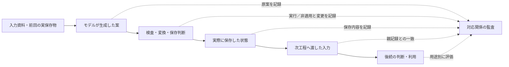
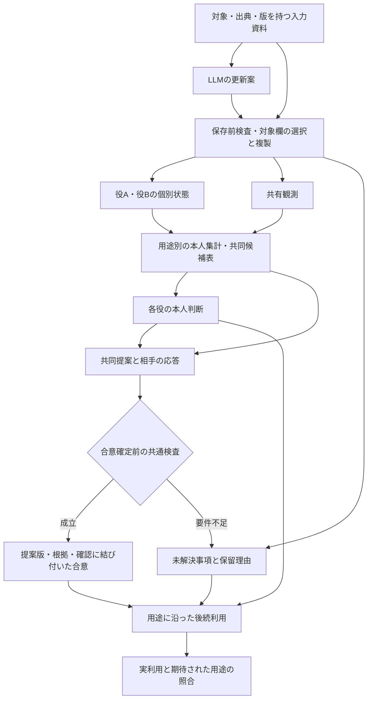

# LLM二者系の故障学と設計原則
## 記録の更新から共同合意・後続利用まで

**Kentaro Sato**  
独立研究者（Independent Researcher）  
連絡先：info@metaclan.jp（[メール](mailto:info@metaclan.jp)）

2026年9月30日｜日本語草稿 v0.5｜内部技術報告・未公開

## 要旨

LLMを二人の案内係として動かすとき、それぞれの担当情報や判断を保ちながら、共同の記録と方針を作れるだろうか。本稿は、同一モデルを別々の入力文脈で二役として実行した合成課題の実験記録をもとに、故障の現れ方と、それを踏まえた設計原則をまとめる。一つの課題では、各役が担当客の犬猫希望と会場の利用状況をノートへ保存した。もう一つでは、各役が自分の経験から案内方法を推奨し、限られた設備を二人に配分した。実験プログラムは生成された記録を保存し、その実物を次のモデル入力へ渡した。

LLMは、正しい答えに誤った出典を結び付け、新しい情報を採用した後に古い通知で記録を戻し、本人の推奨を正しく保ったまま劣る共同案を承認することがあった。後続のLLMは、誤った記録や合意を忠実に利用した。また、共同の正答だけを見ると個別記録の不備が隠れ、全工程の成否だけを見ると局所的に成功した修復が隠れた。

これらの観測から、内容・帰属・出典を一体に保つ、対象と用途に沿って更新する、制御の適用範囲を明示する、本人判断と共同担当を分ける、合意確定の条件を経路間で揃える、保留を状態として引き継ぐ、成分と検査を別々に評価する、という七原則を整理する。各原則を実装と確認方法へ展開し、比較済みの処理と未検証の設計案を対応付ける。個別と共同の両立を支えるのは、一つの正答率ではなく、各情報と判断がどの要件を満たして次へ渡ったかを追える構造である。

**キーワード：** LLMエージェント、二者系、故障分析、共有記憶、状態更新、共同合意、設計原則

## 1. 目標：それぞれの判断を保ちながら、共同で仕事を進める

二人の案内係が、それぞれの担当客の希望を覚え、会場の案内方法を共同で決めるとする。客の希望は担当ごとに異なってよい。共同作業の担当が決まっても、各自の過去の経験まで同じ内容へ書き換える必要はない。一方、新しい経験や客からの正当な変更が届けば、該当する情報と判断は更新できなければならない。

この設計目標には、保持と変更、個別と共同という二つの組合せがある。維持すべきものを固定するだけでは、変化への対応が止まる。共有するものを増やすだけでは、誰の情報を何のために使うかが曖昧になる。必要なのは、情報の帰属と用途を保ち、変更理由のある部分を更新しながら、共同で採用する方針を作る構造である。

本稿の中心命題は、**局所的な正しさは、その対象と基準に結び付いている**ということである。正しく選ばれた答えにも誤った出典が付く。保存内容を正確に読む処理は、古い記録も正確に読む。合意に忠実な実行は、質の低い合意にも忠実に従う。各工程の成功を接続するには、その間で受け渡す記録と、次工程が前提にする要件を点検する必要がある。

本稿は三つの成果を提供する。第一に、実験事例を故障の所在と引継ぎの経路から整理する。第二に、その知見から実装可能な七つの設計原則を導く。第三に、原則を接続した参照構成と、局所的な改善・残存不備・過剰な保留を見分ける評価方法を示す。

## 2. 実験で二人に何をさせたか

### 2.1 二役のLLMと、それを動かすプログラム

実験では、同じLLMを案内係Aと案内係Bとして別々に呼び出した。各呼出しは新しい入力文脈から始め、実験プログラムが役名、今回の資料、必要な保存ノートを渡した。したがって、ここでいう記憶は、モデル内部に残った会話の記憶ではなく、次の呼出しへ明示的に渡す外部の記録である。二人の案内係も、人間参加者ではなく二つの役として動くモデルを指す。

処理の主語を区別すると、**実験者**が材料・指示・採点基準を定め、**LLM**が更新案や判断を生成し、**実験プログラム**がそれを検査・保存して次へ渡す。以下の「保存器」は、そのプログラムのうち記録を保存する部分を指す。保存器が入力行を複製する条件では、LLMの原案と複製後の保存物を別々に残した。正誤の集計には固定規則のコードを使い、構造上読める誤回答も次工程へ渡した。これにより、誤りがどこで生じ、何がそのまま引き継がれたかを調べた。

本稿には二種類の課題がある。両方とも紙とデジタルを扱うが、前者は**全員に届く方法を選ぶ課題**、後者は**成功人数の予測合計が最大になる設備配分を選ぶ課題**であり、正解を決める規則が異なる。

### 2.2 記録管理課題：担当客の希望と、会場全体の案内

案内係AとBは、それぞれ別の客と会場の別区画を担当する。各役は、自分の客が犬と猫のどちらの絵柄を希望するかを個別ノートへ記録する。また、自区画で紙とデジタルを「全員が利用できる」か「全員は利用できない」かを観測したことにする。これらは実験者が作った架空の資料である。

**表1. 記録管理課題の三つの情報欄。** 「本人観測」の本人は案内係を指し、その案内係が担当する客とは区別する。

| 情報欄 | 何を記録するか | 何に使うか |
|---|---|---|
| 担当客情報 | 自分の担当客の犬猫希望と出典。希望更新の試験では版番号も付く | 客へ用意する絵柄を決める |
| 本人観測 | 自分の区画の紙・デジタルの利用状況、観測者、版、出典 | 自分の観測を保持・更新し、相手へ渡す |
| 共同観測 | AとBの両区画について保存した観測行 | 会場全体の案内方法を決める |

個別ノートには担当客情報と本人観測を別欄で置き、共同ノートにはA/B両者の観測のコピーを置く。共同ノートは各役が受け取って使う記録であり、二役が常に同じ内容を自動共有する一つの内部記憶ではない。

共同案内の正解は、A/B双方で全員が使える媒体が一つだけなら、その媒体である。例えばA区画では紙もデジタルも全員が使え、B区画ではデジタルだけが全員に届くなら、共同案内はデジタルとなる。使える媒体がゼロまたは二つなら、課題の規則上は保留する。担当客への絵柄は、この案内方法とは独立に、その客の希望で決まる。

実験者は、新しい観測、相手の保存した観測、遅れて届く古い通知などを各役へ渡した。LLMはノートの更新案を作り、後続の呼出しでは保存されたノートから絵柄や共同案内を答えた。後述の保存先比較では、LLMが読み出したA/B×紙/デジタルの四値から、プログラムが共同案内を計算した。この処理分担も各事例で明記する。

### 2.3 共同判断課題：本人の推奨と、二人の設備配分

こちらでは、案内係ごとに「紙とデジタルで何人を案内し、そのうち何人が成功したか」という複数回の経験を与える。本人の仕事では両媒体を自由に使えるので、各役は**自分の全経験を合算した成功率が高い媒体**を推奨する。昔の経験も集計対象であり、最新の一行だけを選ぶ課題ではない。

共同の仕事では、使える設備が紙の案内台一つとデジタル端末一つに限られる。二役ともデジタルを勧めていても、共同担当では一人が紙を引き受ける必要がある。各役の成功率から「その区画で40人を案内した場合の予測成功人数」を計算し、A紙・BデジタルとAデジタル・B紙の合計を比べる。共同の採用基準は、設備制約を守ったうえで、この合計を最大にすることである。

実験では、各役に本人の推奨を記録させた後、実験者が固定した共同開始案を提示した。相手役は承認、対案、保留を返し、**対案が出た場合だけ、開始役が一度再確認する**。実験プログラムはこの応答から共同記録を作り、最後に各役へ本人の推奨と共同担当を答えさせた。ここでの実行は割付を回答することであり、実際の設備や客を操作することではない。

共同確認と後続利用の採点基準は分けた。確認段階では、最適な実行可能案を承認し、劣る案や設備制約違反には最適案を出すか保留する。利用段階では、承認済みで設備制約を守る合意があれば、それに従うことを求めた。利用段階での再最適化は要求していない。このため、劣る案への承認は誤りでも、その後に合意どおり答える処理は、利用の基準を満たし得る。

### 2.4 証拠のまとめ方

記録管理の出典・転記・撤回の試験には`gpt-5.6-luna`を、保存先・更新と共同判断の試験にはQwen3.5-27Bを用いた。各試験内の二役は同じモデルである。いずれも短い日本語の合成課題であり、各事例で何を固定し、何を変えたかを以下に示す。

本稿は、著者が先にまとめた三報［1–3］の実験記録を、故障と設計の観点から整理した技術報告である。五つの観測と七原則は、この整理で得たもので、系列全体の実行前仮説ではない。実験ごとのモデル・指示・採点範囲を保ち、結果を一つの故障率へ合算しない。読者に必要な課題・操作・結果を本稿内で説明し、元の試験名と資料の対応は付録C、原記録へのリンクは補足資料S1へ置く。

## 3. 故障を追う単位：情報欄と工程の境界

### 3.1 個別記録、共同記録、共同合意を分ける

本稿でいう「契約」は、ある欄や工程が満たすべき明示要件を指す。法的な契約ではない。観測値が正しいか、出典を示す元IDが正しいか、古い通知を採用してよいか、どの提案を合意として使ってよいかは、異なる契約である。

用語を四つ定める。**元ID**は、その事実や観測が最初に記された資料の識別子である。**版**は、同じ対象についての新旧を比べるために実験者が付けた番号である。**現在参照**は、その呼出しで直接使った入力資料の場所を指す。元の観測が共同ノート経由で届いたなら、元IDは観測のID、現在参照は共同ノートの該当行となる。**保存欄**はノート内の論理的な情報欄であり、ファイル数を指さない。

**表2. 接続前に定める対象と要件。**

| 対象 | 守る関係 | 更新を認める根拠 |
|---|---|---|
| 役ごとの担当情報 | 対象人物・内容・出典・有効な版の対応 | その対象についての正当な変更 |
| 本人観測・共有観測 | 観測者・値・元ID・版の対応 | 同じ観測対象について比較可能な新情報 |
| 本人判断 | 当該役の経験と、その用途に沿った推奨 | 新経験、または旧判断の誤りを示す根拠 |
| 共同案 | 対象業務・候補・制約・評価基準の対応 | 新情報、条件変更、対案 |
| 共同合意 | 採用された提案の版と、必要な確認の対応 | 所定の確認を通った新しい合意 |
| 後続利用 | 実際に渡された記録・有効な合意と、利用結果の対応 | 利用時の状態と用途に応じた適用判断 |

同じ記録内でも、担当情報と本人観測は別の欄である。二役で同じ観測を共有していても、本人判断が同じになる必要はない。逆に、それぞれの正当な情報が同じ結論を支持すれば、二人の答えが同じであることは適切である。

### 3.2 発生、引継ぎ、評価を別々に見る

図1は、実験者が故障を追跡した方法をまとめたものである。検査・変換の内容は試験ごとに異なるが、モデル原案、実際の保存物、次入力、後続回答を分けて記録する点は共通する。



**図1. 故障の所在と引継ぎを追う観測枠組み。** 原案と実保存物を分けることで、どこで生じた不備が、どの変換を経て次へ渡ったかを確認する。後続で新たに生じた誤りも、この対応から区別する。

故障の記述は三層に分ける。第一層は情報や判断の不一致、第二層はそれが保存・交換・利用へ渡る経路、第三層は不一致を見落とす評価の集約である。第三層には、不備を隠すだけでなく、成功した局所修復を見えなくする場合も含まれる。

## 4. 故障学：どの実験で、誰が何を誤ったか

以下の各項目では、問いと実験操作を説明したうえで、LLMの回答、保存処理、後続利用を順に追う。末尾では、その事例から設計上何を区別できるかを述べる。実験の実施順ではなく、故障と評価上の論点で並べる。

### 4.1 正しい答えと一緒に、誤った出典が次へ渡る

**何を確かめたか。** 実験者は、二役に正しい初期資料を与え、個別・共同ノートへ統合した後も、内容と出典の対応を保てるかを調べた。共同観測の転記方法は二つに分けた。「再記述」ではLLMが人物・値・版・元IDを書き直す。「選択＋複製」ではLLMが入力中の行を指定し、保存器がその行をそのまま複製する。個別ノートと現在参照の申告は、どちらの方式でもLLMが書く。保存器は、誤った行が選ばれた場合にも指定された行を保存する。

同じ未使用の64組を両方式へ渡した。一組は二役分の初期資料からなり、各方式で二役がノートを保存し、二役がそのノートから後続判断を答える。全工程成立とは、この計四回答で内容・出典・参照・判断のすべてが基準を満たすことである。

**何が起きたか。** ある組では、役Bの担当客は猫の絵柄を希望し、その出典は`RAD9D1FEC60F1FA2`だった。選択＋複製条件のLLMは、個別ノートへ「担当役B、希望は猫」と正しく書いたが、元IDの末尾の`2`を落として`RAD9D1FEC60F1FA`と書いた。保存器が複製するのは共同観測行なので、この個別欄はモデルの記述のまま保存された。実験プログラムはその保存ノートを次の呼出しへ渡した。

後続の役Bは、猫の絵柄と紙の案内を正しく選んだ。この組では両区画とも紙が全員に届き、デジタルは全員には届かないため、案内の正解は紙だった。しかし役Bは、その正答の根拠として、末尾が欠けた元IDを再び出力した。

> 正しい入力：Bの客は猫、出典は末尾が「…FA2」  
> LLMが保存した個別欄：Bの客は猫、出典は「…FA」  
> 次のLLM回答：猫／紙は正答、出典は「…FA」のまま

これは、後続のLLMが新たに同じ一文字を落としたと推測する事例ではない。保存済みの誤IDが実際に次入力へ含まれ、それと一致するIDが回答に残った事例である。同じ初期資料の再記述条件では、この担当客IDは保存・後続とも正しかった。

64組全体では、選択＋複製の共同観測行は256/256行で出典込みの基準を満たした。一方、全工程成立は両方式59/64組で、再記述は4不成立・1未確定、選択＋複製は5不成立だった。未確定は回答形式の不備によるもので、正式結果ではそのまま残した。選択＋複製の不成立は、機械複製の対象外である個別情報の記述か、後続の読出しにあった。方式差を選択＋複製から再記述を引いた割合とすると、未確定1組の全補完を含む保守的95%区間の包絡は−17.36〜16.60ポイントであり、全工程の優越性は確認されなかった。欠測時の事前規則に従い、主p値は算出していない。

**何が分かったか。** 正しい答えを出すことと、内容に正しい出典を結び付けることは別の仕事である。また、共同行を正しく複製できても、個別欄や次の回答で出典を再記述するなら、その箇所は別に点検する必要がある。ここでの設計対象は、値やIDを単独で守ることではなく、人物・内容・版・出典の対応を、使われる場所まで保つことである。

### 4.2 新しい希望を採用した役が、古い通知で記録を戻す

**何を確かめたか。** 実験者は、担当客の希望が変わったとき、対象の役だけが情報を更新し、その後に古い通知が届いても新版を保てるかを調べた。新しい8ケースを各2回生成し、計16経路を実行した。各経路では、一方の役へ客の新しい希望を通知し、その役が保存したノートを次入力へ渡してから、同じ客の古い通知を届けた。もう一方の役については、変更対象でない自分の客の情報を保てるかを確認した。

保存プログラムは、紙・デジタルの観測欄には人物別の最新版選択を適用した。一方、担当客の希望欄はLLMの記述を保存した。つまり、ノートに「最新版を守る処理」があっても、今回変更する客の希望欄は、その自動処理の対象外だった。

**何が起きたか。** 一例では、役Aのノートに「客の希望は猫、版76」があり、実験者が「犬へ変更、版77」という通知を渡した。役Aは犬・版77・新しい元IDを正しく書き、保存器もその内容を保存した。次に実験者は、犬・版77の保存ノートとともに、遅れて届いた猫・版76の通知を役Aへ渡した。ここで役Aは担当客欄を猫・版76・古い元IDへ戻した。保存器がその記述を保存すると、最後の呼出しの役Aは猫の絵柄を答えた。

最後の役Aは、渡されたノートを読み違えたわけではない。ノートにはすでに猫と書かれており、役Aはその記録どおりに答えた。失敗は、その前の更新段階で、入力に存在した新版を旧通知の内容へ置き換えたことにある。

全16経路で最初の新希望の採用は16/16成立し、変更対象でない役の担当客情報も、二つの更新時点を合わせて32/32保持された。しかし古い通知の後に新版を保ったのは2/16で、14/16では希望・版・元IDが巻き戻った。14件すべてで、正しい新版が直前に保存され、旧通知を処理する入力にも含まれていた。

**何が分かったか。** 新情報を採用する能力、変更対象外を保つ能力、採用済みの新版を守る能力は、分けて測れる。読出しを正確にするだけでは、この経路は直らない。更新する役に対して、通知が今届いたことと、その内容が現在有効であることを区別する処理が必要になる。版比較が内部でどう失敗したかは、出力だけからは確定しない。

### 4.3 共同の答えが正しくても、本人の観測が古いまま残る

**何を確かめたか。** 実験者は、保存処理をどの欄へ適用すると何が修復されるかを調べた。18材料を各2回生成し、LLMから36件のノート更新案を得た。本人観測は初期入力ですでに最新版であり、これを保ちながら共同観測を更新する課題である。材料には、新通知で共同欄を更新する10材料と、古い通知が届いても状態を維持する8材料を含めた。

実験プログラムは、**同じ一件の更新案を四つに分岐**させた。一つは観測欄をそのまま保存し、残りは共同観測だけ、本人観測だけ、両方へ自動処理を適用した。自動処理は、入力内の候補をまず観測者A/Bで分け、その人の最も新しい版の行を選び、人物・二値・元ID・版をまとめて複製する。担当客の希望欄は全条件でLLMの記述を保った。

各分岐で保存したノートを次のLLMへ渡し、共同ノートからA/B×紙/デジタルの四値を読み出させた。プログラムはその実回答から共同案内を計算した。本人観測の成否は個別ノート内の欄を、共同観測の成否は共同ノートの行を、最新の入力情報と照合して判定した。四条件で完全に同じ後続入力になった場合だけ生成を共用したため、144条件分に対する実際の読出し回答は55件である。

**何が起きたか。** 四分岐の結果を表3に示す。全工程成立は、各欄の保存と共同案内を含む必要条件をすべて満たした更新案を数える。

**表3. 同じ36更新案に対する保存欄別の比較。** 18材料×2反復であり、四分岐を独立した144材料とは数えない。

| 保存処理 | 本人観測が正しい | 共同観測が正しい | 最新状態に合う共同案内 | 全工程成立 |
|---|---:|---:|---:|---:|
| なし | 32/36 | 25/36 | 28/36 | 25/36 |
| 共同のみ | 32/36 | 36/36 | 36/36 | 32/36 |
| 本人のみ | 36/36 | 25/36 | 28/36 | 25/36 |
| 両方 | 36/36 | 36/36 | 36/36 | 36/36 |

共同観測だけを処理した条件では、保存器が共同行を正しく直したため、後続の共同案内も36/36で正しくなった。しかし保存器が触れなかった本人観測には、LLMの更新案にあった4件の旧情報が残った。後続の共同案内は共同ノートから計算するので、個別ノートのその不備があっても正答できた。

反対に本人観測だけを処理した条件では、保存器がその4件を正しく修復した。それでも全工程成立は25/36のままだった。同じ4件の更新案には共同観測の不備も重なっていたため、本人欄だけ直しても「全条件が成立」という判定には届かなかった。両方の欄を処理した条件では、全工程36/36が成立した。

**何が分かったか。** 「共同の答えが正しいから、記録全体も正しい」と読むと、本人欄の不備を見落とす。「総合点が変わらないから、修復は働いていない」と読むと、本人欄の修復を見落とす。全条件の成立を要求する指標が部分修復を反映しない可能性は、定義から分かる。本比較では、実際の生成案で不備が重なっていたことを確認し、同じ案に対する処理範囲と後続結果を対応付けた。

### 4.4 本人の推奨を保った役が、劣る共同案を承認する

**何を確かめたか。** 共同判断課題では、実験者が各役に経験から本人の推奨を作らせた後、共同案を確認させた。ある条件では、本人の集計を推奨の形成段階から渡し、共同確認には二候補の予測合計も添えた。計算に必要な情報が揃ったとき、本人の推奨を保つことと、適切な共同案を承認することが両立するかを見た。

**何が起きたか。** 未使用の数値材料の一例で、各役が40人を案内する場合の予測値は次のとおりだった。

| 役 | 紙での予測成功人数 | デジタルでの予測成功人数 | 本人としての適切な推奨 |
|---|---:|---:|---|
| A | 17 | 27 | デジタル |
| B | 18 | 20 | デジタル |

A/Bとも本人の推奨はデジタルになる。しかし設備は一つずつなので、共同ではAデジタル・B紙の27＋18＝45が、A紙・Bデジタルの17＋20＝37よりよい。役Bが自分の経験からデジタルを勧めつつ、共同担当として紙を引き受けることは、この課題では適切な両立である。

実験者は、合計37になる方を開始案として役Bへ渡した。役Bの入力には、両役の経験資料、役B自身の正しい本人ノート、本人集計、45と37の共同候補表が揃っていた。役Bは、自分の推奨をデジタルと正しく答えたが、共同応答では37の案を承認した。実験プログラムはその承認を共同記録に保存した。

ここでは役Bが対案を出さなかったため、開始役による再確認は呼ばれなかった。これは処理の停止ではなく、「対案が出た場合だけ再確認する」という実験規則どおりの分岐だった。最後の呼出しで、役Aは本人推奨をデジタルと答えながら共同では紙を、役Bは本人推奨と共同担当の両方をデジタルと答えた。両役は、質の低い37の合意を忠実に使ったのである。参照IDにも不備はなく、後続利用自体は§2.3の採点基準を満たした。

さらに実験者は、役Bへ渡したこの確認入力を固定し、新しい乱数seedで三回答を得た。三回とも、役Bは本人のデジタル推奨を保ちながら37案を承認した。これは成否で選んだ一例だけの再走ではなく、確認入力48件すべてを各3回生成した試験内の一例である。反復では元の本人ノートを固定し、新しく生成した本人判断を確認へ接続していない。また、この三反復には後続利用を含めていない。

**何が分かったか。** 本人判断の正しさ、共同案を承認する判断、決まった合意への忠実性は、同じ経路でも別々の成否を持った。また、対案を点検する処理があっても、その場で承認された案はその処理へ入らない。設計上は、合意へ進むすべての経路で何を確認するかが論点になる。共通検査を追加すれば改善するかは、ここから導く設計案である。

### 4.5 同じ「不成立」でも誤る欄が変わり、最後の正答だけでは途中が見えない

**何を確かめたか。** 実験者は、本人判断と共同判断の成否が固定入力の反復でどう変わるかを調べた。ここで扱うのは、本人集計を共同確認時には追加しない条件の一入力である。役Bには、全経験と共同候補の合計表に加え、以前のLLMが誤って「本人の推奨は紙」と保存したノートを渡した。経験全体からの正解はデジタルだった。開始案は、A/Bともデジタル端末を使うという設備制約違反である。実験者はこの同じ入力を三回生成した。

**何が起きたか。** 最初の二回、役Bは古い本人ノートを訂正し、本人の推奨をデジタルと正しく答えた。しかし共同応答では、二人とも一台しかないデジタル端末を使う案を承認した。三回目、役Bは共同案をAデジタル・B紙、合計45の適切な対案へ直した一方、本人欄には紙という誤った推奨を残した。

| 同じ確認入力への回答 | 本人の推奨 | 共同応答 | 両方の成立 |
|---|---|---|---|
| 1回目 | デジタル：適切 | 二人ともデジタルを承認：不適切 | 不成立 |
| 2回目 | デジタル：適切 | 二人ともデジタルを承認：不適切 | 不成立 |
| 3回目 | 紙を維持：不適切 | Aデジタル・B紙を対案提示：適切 | 不成立 |

三回とも総合不成立という集計は正しい。しかし、同じ故障が三回続いたわけではない。最初の二回では共同確認が、三回目では本人判断が不適切だった。対案を出した三回目も、この反復では相手の再確認へ接続していないので、最終合意が成立したとは数えない。

もう一つ、実験者は本人の経験集計を渡す時期を比較した。一方の条件は最後の利用時だけ、他方は本人の推奨を形成する段階から、確認・再確認にも集計を渡した。両条件とも最後の利用時には集計があり、共同確認・再確認には共同候補の合計表があった。各試験は8材料を三つの開始案へ分岐した24経路で、各経路の最後に二役が答えるため利用回答は48件となる。同じ比較を、既知材料と未使用の数値材料で一度ずつ実施した。

二試験とも、本人判断と参照が全工程で適切だったのは、最後だけ集計を渡した条件で15/24経路、形成から渡した条件で24/24経路だった。それでも最後の利用回答は、両条件とも48/48適切だった。最後だけ供給した条件では、途中に残った誤った本人記録を、LLMが最終入力の経験と集計に沿って訂正する場合があった。終点だけを採点すれば、この途中の違いは見えない。

**何が分かったか。** 全工程の成否は「どこかに不備があるか」を、最終回答は「最後に適切に答えたか」を表す。どちらも必要だが、故障の位置や訂正の経路は別に記録する必要がある。本人欄・共同欄・承認行為を成分別に残すことで、対策が届く場所を選べる。

## 5. 設計論：個別と共同を接続する七原則


以下では、三つの原則に短いPythonコードを添える。コードは、守る条件を処理として具体化するための記述である。実験で使った処理の中核を再構成した例と、実験結果から導く新しい設計例を、各見出しで区別する。

コードに現れる`owner`・`role`は役A/B、`revision`は情報の版、`origin_id`は出典、`allocation`は共同担当を表す。`deepcopy`は元の記録を変えずに独立したコピーを作る操作である。`READY`は候補や保存案が得られた状態、`COMMITTED`は管理側が合意確定を認めた状態、`HOLD`は今回の書込み・確定を進めない状態とする。入力は型・出所・対象業務を事前に検査したものとし、関数はディスクへ書かず、次に保存する内容か保留理由を返す。完全な入力と実行方法は付録Dにまとめる。

### 原則1　情報の内容と、その帰属・根拠を一体として扱う

**守る条件。** 保存や交換の後も、誰についての何の情報か、その発生元と有効な版が対応している。

**実装。** 観測者・値・元ID・版を一行にまとめ、選択した行をそのまま複製する。元IDと今回入力への参照は別欄とする。相手へ渡す欄と、各役だけが使う個別欄も明示する。コピー元に誤りがある場合を識別できるよう、選択の適切さと複製の一致は別々に記録する。

**確認。** 保存行と選択元を照合し、次工程の入力が実保存物に由来することを確かめる。後続が出典を再記述する場合は、その出典も別に採点する。§4.1の選択＋複製はこの分担の実例であり、共同欄以外の残存不備も原則の適用範囲を示す。

### 原則2　更新対象と用途を定めてから、採る情報を決める

**守る条件。** 正当な新情報を対象欄へ反映し、変更理由のない欄を保持する。通知が届いた時刻と、情報が有効になる時点を区別する。

**実装。** まず対象人物・情報種別で候補を絞り、その中で比較可能な版や有効期間を用いる。現在状態を問う仕事では該当する現行情報を、過去時点を問う仕事ではその時点の情報を選ぶ。同一対象・同一版に矛盾がある場合は候補を保持し、解決に必要な情報を保留理由として残す。人物Aの版番号を人物Bの版番号と比較しない。

**確認。** 保持、新情報の採用、変更後の維持、非対象の保持を分ける。観測欄への人物別最新版選択は§4.3で比較した。担当客欄への同じ制御の拡張、同版矛盾、権限不明の通知への扱いは、次の比較対象となる。


**コード例1. 人ごとに版を比較し、選んだ観測行を出典ごと複製する。既存処理の中核の再構成。**

§4.3の保存処理は、先に観測者を決めてから、その人の版を比較した。以下はその選択と複製を示す。同じ業務・同じ種類の観測行を`rows`へ渡す。元実装にある入力資料との照合、構造検査、選択元の監査記録はここでは省き、前二つを入力の事前条件とする。元実装が例外として返す候補不足・同版矛盾は、説明用に`HOLD`へ置き換えた。

```python
from copy import deepcopy

def select_observation(rows, owner):
    candidates = [r for r in rows if r["observer"] == owner]
    if not candidates:
        return {"status": "HOLD", "reason": "MISSING_OWNER"}
    by_version = {}
    for row in candidates:
        version = row["revision"]
        if version in by_version and by_version[version] != row:
            return {"status": "HOLD", "reason": "SAME_VERSION_CONFLICT"}
        by_version[version] = row
    latest = by_version[max(by_version)]
    return {"status": "READY", "row": deepcopy(latest)}
```

**入出力例。** 説明用に、次の三行を順番に入力する。`ALL`は全員が利用可能、`NOT_ALL`は全員ではないという観測値である。

| 観測者 | 版 | 紙 | デジタル | 元ID |
|---|---:|---|---|---|
| A | 2 | ALL | NOT_ALL | OA2 |
| B | 99 | ALL | NOT_ALL | OB99 |
| A | 3 | NOT_ALL | ALL | OA3 |

`select_observation(rows, "A")`は、A・版3・紙NOT_ALL・デジタルALL・元ID OA3の**行全体**を返す。Bの版99はAの候補に入らない。Aの版4が正当に追加されれば版4を採用する。一方、Aの同じ版に内容または出典の異なる行があれば保留する。同版矛盾の検出は元実装にもあるが、元のLLM比較は整合した候補を使っており、ここでの矛盾入力は説明用コードの点検である。

この関数が選ぶのは観測欄の一行である。客の希望欄や、全経験を累積する本人判断へ、そのまま適用する処理ではない。

### 原則3　制御の適用欄と、その後の利用先を対応付ける

**守る条件。** ある処理が保護する範囲を、保存欄と利用工程まで特定できる。

**実装。** 個別担当情報、本人観測、共同観測、本人判断、共同合意について、生成者・保存処理・利用先を一覧化する。「最新版選択あり」「検証あり」という機能名を、対象欄の指定に結び付ける。LLM原案、処理による変更、実保存物は別々に残す。

**確認。** 同じ原案を共用できる比較では、対象欄への処理を切り替え、成分別の修復と残存不備を読む。§4.3の四分岐はこの方法に当たる。原案が何件不適切だったかと、処理を外した別の継続運転がどうなるかは、区別して測る。

### 原則4　本人判断と共同担当を別の成果物として保持する

**守る条件。** 本人の推奨は本人の経験に、共同担当は共同の目的・制約・合意に対応する。共同で別の担当を引き受けても、本人の経験をそれに合わせて書き換えない。

**実装。** 本人判断には対象役・用途・経験参照を、共同案には業務・候補・制約・評価基準を持たせる。計算で定まる本人の集計と共同候補の合計を別欄で供給する。その情報を必要とする形成・確認・利用の各段階を決める。

**確認。** 本人経験だけ、共同条件だけ、両方を変える入力を用意し、対応する仕事が選択的に変わるかを見る。同じ推奨になる正常例、異なる推奨を持つ正常例、本人推奨と共同担当が異なる正常例を含める。§4.5の供給時期比較は、早い段階への支援が途中の本人判断を支えた実例となる。


**コード例2. 本人判断を変えず、合意された共同担当だけを記録する。未実測の設計例。**

§4.4の役Bは、本人としてデジタルを勧めながら、適切な共同案では紙を担当する。この二つを別欄で保持する書込みを示す。`state`は本人の状態、`agreement`は管理側で検査済みの合意である。ここで保存する本人判断の内容が正しいかは、本人経験との照合で別に確かめる。

```python
from copy import deepcopy

def record_assignment(state, agreement):
    if agreement["status"] != "COMMITTED":
        return {"status": "HOLD", "reason": "NO_COMMITTED_AGREEMENT"}
    proposal = agreement["proposal"]
    updated = deepcopy(state)
    updated["joint_assignment"] = {
        "medium": proposal["allocation"][state["role"]],
        "proposal_id": proposal["id"],
        "proposal_version": proposal["version"],
        "evidence_version": agreement["evidence_version"],
    }
    return {"status": "READY", "state": updated}
```

**入出力例。** Bの入力状態を`role="B"`、`own_judgment={"choice": "DIGITAL", "refs": ["b1", "b2"]}`とする。管理側がAデジタル・B紙の案p1・版1を、経験資料版exp-7に基づく合意として確定していれば、出力の`joint_assignment`には紙と、その提案・資料の版が入る。`own_judgment`のデジタルと本人経験への参照は、そのまま残る。合意が未確定なら、この関数は新しい状態を作らず`HOLD`を返す。

本人推奨と共同担当の分離は実験で評価した対象である。一方、この関数で共同担当だけを書き込む処理は、今回掲載する設計例であり、元実験でLLMが両欄を答えた成績と区別する。`COMMITTED`はLLMの自己申告から採用せず、次のコード例3のような管理側の検査を通した結果だけを渡す。

### 原則5　共同案を合意として確定する条件を、経路ごとに揃える

**守る条件。** 合意として後続へ渡す記録は、該当する提案版について、必要な確認と課題上の要件を満たしている。

**実装。** 提案、承認の応答、利用可能な合意を別状態にする。初期案への直接承認も、対案後の承認も、合意確定前の共通検査へ集める。本課題のように候補と目的関数が明示されていれば、資源制約・合計・採用基準をコードで検査できる。候補と根拠の版を合意に結び付け、更新時には再確認の要否を判定する。

**確認。** 検査の判定精度と、合意へ進む各経路で検査が呼ばれたかを別々に数える。最適案・同点案・劣位案・資源違反案と、正当な対案を含める。§4.4の誤承認は、この設計を検討する箇所を示した。共通検査を追加した構成の有効性は未測定であり、実装する際に評価する設計仮説である。


**コード例3. 提案と相手の承認を、共通条件で合意へ進める。未実測の設計例。**

§4.4では、劣る案への直接承認が再確認へ入らず、そのまま後続に渡った。以下では、直接承認と対案後の承認を、どちらも「最後の提案＋その提案への相手の承認」という組にして渡す。`proposal`はその提案、`reply`は応答、`scores`は入力経験からコードで計算したA/B各媒体の予測値である。`evidence_version`は今回使う経験資料一式の版を指す。役の出所、各版と内容の対応、必須欄は事前に検査し、合意を保存する入口をこの関数へ集める構成を想定する。

```python
from copy import deepcopy

def commit_agreement(proposal, reply, scores, evidence_version):
    key = (proposal["id"], proposal["version"], evidence_version)
    target = (reply["proposal_id"], reply["proposal_version"], reply["evidence_version"])
    if proposal["evidence_version"] != evidence_version or target != key:
        return {"status": "HOLD", "reason": "STALE_OR_DIFFERENT_TARGET"}
    allocation = proposal["allocation"]
    if (reply["action"] != "ACCEPT" or reply["author"] == proposal["author"]
            or reply["allocation"] != allocation):
        return {"status": "HOLD", "reason": "NO_MATCHING_PEER_ACCEPTANCE"}
    if set(allocation) != {"A", "B"} or sorted(allocation.values()) != ["DIGITAL", "PAPER"]:
        return {"status": "HOLD", "reason": "RESOURCE_CONFLICT"}
    total = sum(scores[r][allocation[r]] for r in ("A", "B"))
    best = max(scores["A"]["PAPER"] + scores["B"]["DIGITAL"],
               scores["A"]["DIGITAL"] + scores["B"]["PAPER"])
    if total < best:
        return {"status": "HOLD", "reason": "LOWER_TOTAL"}
    return {"status": "COMMITTED", "proposal": deepcopy(proposal),
            "evidence_version": evidence_version}
```

**入出力例。** §4.4と同じA紙17・デジタル27、B紙18・デジタル20を`scores`へ与える。合計37のA紙・Bデジタル案へ相手が承認しても、出力は`HOLD / LOWER_TOTAL`となる。合計45のAデジタル・B紙案へ、正しい提案版と資料版を指す相手の承認があれば、`COMMITTED`となり、コード例2へ渡せる。コードは37案を勝手に45案へ書き換えず、新しい提案と相手の確認を必要とする状態で止める。

設備を二重に割り当てる案、別の案や古い資料への承認、提案者自身の承認も確定しない。同点の最大案が二つある場合は、どちらも通る。比較には整数または正確な分数を用い、LLMが申告した合計は使わない。

このコードは、提案が既定の目的・制約に適合しているかを検査する例である。合計最大化が現実の業務でも適切か、全承認経路が実際にここへ接続されたか、検査を追加したLLM系がどの程度改善するかは、別に確認する対象となる。

### 原則6　未確定・保留を、根拠と対象を持つ状態として引き継ぐ

**守る条件。** 対象を特定できない情報や未承認の提案を、解決済みの記録として使わない。同時に、確定している別の情報と仕事を保つ。

**実装。** 処理対象、適用条件、結果状態、未解決理由を分ける。情報不足で不明な状態、形式不備で判定できない状態、要件を満たさない回答、適切な保留、規則上実行しない工程を区別する。原回答と、構文正規化・保存処理後の成果物を別に保持し、変更箇所を記録する。再試行する場合は許す修正と上限を事前に決める。

**確認。** 正常に解決できる入力と、解決に必要な情報が欠ける入力を対にする。この原則の例として、実験者は記録管理課題の8場面で、保存ノートの出典を正しいID、古いID、存在しないIDへ変え、あらかじめ信頼する発行元とした「指定した観測を失効させる」という撤回通知を各役へ渡した。通知はIDだけの場合と、観測者・版・紙／デジタルの値も添える場合に分けた。LLMには、IDが一致すればその観測を、IDが合わなければ詳細がすべて一致する一意の観測を失効させ、対象を特定できなければ全行を保持して未解決とする規則を与えた。対象を特定した場合はその観測の全コピーを失効状態にし、元の値・版・IDは履歴として残す。

保存側のIDが誤っていて通知がIDだけの条件では、LLMは特定の行を推測で失効させず、担当客情報と観測を保持し、共同判断の保留を次の回答へ引き継いだ。古いIDと存在しないIDの各条件で、対象解決の完遂は0/8、根拠に適合した処理は8/8だった。詳細で一意に対象を特定できる条件では、失効処理を完遂した。IDだけで対象を特定できないこと自体は材料と規則の帰結であり、実際に点検した動作は、LLMが推測で対象を選ばず、未解決状態と対象外情報を保てるかである。曖昧な通知や矛盾した詳細への拡張では、対象外の変更と過剰な保留の両方を測る。

### 原則7　成分別の評価と、検査自身の評価を残す

**守る条件。** 最終成績が同じでも、どの欄・工程が成立し、何が残ったかを区別できる。検査が正しい入力を妨げた場合も観測できる。

**実装。** 本人状態、共有状態、出典、更新、承認、後続利用を成分別に記録し、全工程の成否と併記する。固定入力の反復では、各成分と行為を保存する。構造・算術・参照先の存在など、明示規則で確定する検査はコードへ置く。意味判定をLLMに補助させる場合は、判定の根拠形式と未判定も含めて較正する。

**確認。** 検査役のLLMを調べた試験では、実験者は既存の実答案32件と、誤り方や正しい境界例を用意した対照32件を渡した。検査役には、出力形式、情報の帰属・参照、本人判断、共同行為の四点を明示規則に照らして判定させた。四点すべてが参照判定と一致したのは53件、不一致は4件、検査役自身の根拠記述の形式不備による未判定は7件だった。

不一致の4件では、答案に許可していない追加欄が実在するのに、検査役は「追加欄がない」と判定した。固定した構造検査のコードは同じ4件を検出した。うち3件は欄名や配置を変えた人工対照であり、モデルが自然に違反を隠した証拠ではない。この比較が示すのは、内容の判定を補助できたLLMでも、構造検査を完了したことにはならないという点である。検査の誤警報、見逃し、未判定、正当な更新を止めた件数を分けて残す。

## 6. 原則を接続する参照構成

### 6.1 記録の更新と、合意の確定を二つの境界にする

図2は七原則を接続した設計案である。観測欄の複製・用途別の供給・実保存物の引継ぎなど、部分的に試験済みの処理を含む。合意確定の共通検査を含めた構成全体の性能は、まだ測定していない。



**図2. 個別状態と共同合意を接続する参照構成案。** 個別状態の更新可否と、共同案の合意確定可否を別に判定する。保留を後続へ渡す矢印は、保留対象の仕事を実行してよいという意味ではなく、利用可能な範囲を後続で識別するためのものである。監査記録は図1の方法で各段階に付す。

この参照構成では、四種類の記録を分けて扱う。第一は元資料を指す情報行、第二は役と用途を持つ判断、第三は版を持つ共同提案と応答、第四は採否・保留理由を含む処理記録である。共同合意は、第三と第四の対応から作る。どの成果物も、同じテキストを保存場所の変更だけで別の資格へ読み替えない。

図中の個別状態は役ごとの領域として実装し、各呼出しへ渡す欄を役と工程で絞る。共同側へ渡す共有観測・提案・応答と、各役だけが使う担当情報を区別し、個別ノート全体を共同入力へ自動転送しない。

保存前の検査が使えるのは、実際に入力へ存在する候補と事前に定めた規則である。研究上の正解表を運用処理へ渡して保存状態を作る方法は、この構成の評価には使わない。また、内容の照合用ハッシュ値による一致は、同じデータが渡ったことを確かめるためのもので、データ内容の真実性を認証するものではない。

### 6.2 三つの設計点検例

以下は既存事例から作る設計点検の例であり、参照構成を実行して得た追加結果ではない。

**古い通知が届く。** 現行状態が犬・版77、通知が猫・版76なら、同じ対象についての現行情報を使う仕事では版77を維持し、版76の通知を不採用として記録する。別の役の観測や担当情報へ変更を広げない。ここで試すべき追加点は、担当客欄にこの検査を実装したとき、正当な版78の変更も受け入れられるかである。

**本人の推奨と共同担当が異なる。** A/Bの本人推奨がともにデジタルでも、共同割付は資源を一つずつ使う。合計45の案を採用した場合、Bが紙を担当してもBの本人推奨はデジタルのまま保持する。合計37の案に承認が返った場合は、その承認だけで合意を確定せず、課題の採用基準と照合する。ここでの最適性は、この課題で合意した合計最大化という目的に限られる。

**対象不明の撤回通知が届く。** 撤回対象を一意に対応付けられなければ、特定の行を推測で失効させず、未解決通知を記録する。その通知が影響し得る共同判断を保留し、根拠のある個別仕事を維持する。解決したふりをすることと、全ての仕事を無条件に停止することの両方を避けるため、保留範囲を明示する。

### 6.3 部品ごとの到達範囲を明示する

**表4. 原則を支える証拠と、次に確かめる拡張。** 「比較」は元試験の固定材料・方式全体での比較を指す。

| 原則 | 既存実験内の根拠・到達範囲 | 拡張時の確認対象 |
|---|---|---|
| 1 対応関係の保持 | 指定行の複製と後続利用を比較。出典不備の発生・継承を観測 | 複製外の欄、誤った選択元、再記述される出典 |
| 2 対象と用途に沿った更新 | 本人・共同観測に人物別最新版選択。担当客欄の巻戻りを観測 | 担当客欄への適用、同版矛盾、通知権限、有効期間 |
| 3 制御範囲の明示 | 同じ原案の四分岐と、その保存物からの共同読出し（§4.3） | 処理を外した継続系列、別課題・長い履歴 |
| 4 本人と共同の分離 | 本人推奨と共同担当の別評価、集計供給時期の比較と反復（§4.4–4.5） | 自由な経験記述、供給する工程ごとの寄与 |
| 5 合意確定の共通検査 | 正しい本人判断を伴う誤承認と、再確認が呼ばれない経路を観測 | 共通検査の実装、正常案の通過、合意更新時の再確認 |
| 6 保留を状態として保持 | 固定した撤回・照合条件での適切な保留、形式不備の別管理 | 曖昧・矛盾通知への対応、過剰な保留、修理の副作用 |
| 7 成分と検査の評価 | 保存欄別・工程別・反復別の診断と、検査役の較正（§4・原則7） | 未知の意味境界、検査の見逃し・誤警報と運用負担 |

## 7. 評価方法：進めるべきものを進め、止めるべきものを止める

### 7.1 一つの成功率へ早くまとめない

評価では、適切な入力から適切な状態へ進めたかと、不適切・不十分な入力をどう扱ったかを対にする。本人情報が変わらなかったことだけでは、新情報の採用を妨げていないか分からない。誤合意がゼロでも、全てを保留したなら、共同作業を進める能力は別に測る必要がある。

**表5. 原則を実装する際の対になる試験。** 未測定の行は次の設計用の例である。

| 対象 | 成立を求める入力 | 境界を確かめる入力 | 別々に記録する結果 |
|---|---|---|---|
| 帰属と出典 | 対象と元IDが揃う行の交換 | 正しい値に誤ID、別人の有効ID | 内容、帰属、出典、引継ぎ |
| 更新 | 同じ対象への正当な新版 | 古い通知、同版矛盾、別対象の通知 | 採用、維持、対象外変更、保留 |
| 用途分離 | 本人と共同が異なる結論で適切 | 本人経験だけ／共同条件だけを変更 | 各用途への選択的な反映 |
| 合意 | 実行可能な最適案・適切な同点案 | 劣位案、資源違反案、未承認対案 | 承認の適切さ、検査の発動、最終合意 |
| 後続利用 | 有効な合意と適切な保存物 | 失効した根拠、未合意、旧保存物 | 記録への忠実性、現在の要件への適合 |
| 検査 | 正常な状態と正当な変更 | 既知の不備と意味の曖昧な例 | 正常通過、誤警報、見逃し、未判定 |

正常系も実保存物から次入力へ渡し、途中の誤りが最後に訂正された場合は両方を残す。構造不備で工程へ進めなかった件数、規則上対象外だった工程、意味上の不成立は分ける。解析は予定分母と元試験の欠測規則を維持する。

### 7.2 比較する単位をそろえる

保存処理の局所効果には、同じモデル原案を用いた分岐比較が有用である。継続運転全体の効果を問う場合は、それぞれの条件で実際に生じた保存物を次へ渡す必要がある。処理ありの運転中に見つかった原案の不備数は、処理なしの運転を再現した成績にはならない。

反復にも二種類ある。入力を固定した反復は、その入力に対する判断の変動を見る。形成から利用までを接続し直す反復は、上流の変動を含む経路全体を見る。§4.4–4.5で説明した固定入力反復は前者であり、二つを同じ信頼性の数値として扱わない。

検査追加の比較では、正当な進行を止めた割合、検査を通過した不備、後続への影響と、呼出し回数・時間も記録する。どの程度の成績で採用するかは、結果を見る前に対象業務とともに定める。特定の失敗例を直せたことと、未使用材料で同じ要件を満たせたことを区別する。

## 8. 成立範囲と、設計論を育てる方法

本稿は、三報を資料とする探索的な技術統合である。三報のモデル、指示、構造、採点範囲は異なり、同じ故障率を推定する標本として合算していない。例えば、§4.1の後続回答では出典の再引用も評価したが、§4.2の最後の絵柄回答ではそれを要求していない。この二つを同じ尺度の成功率として比較しない。

観測した対象は、明示的な担当事実、与えた経験からの推奨、構造化された共有観測と短い合意過程である。自発的な人格形成や自由対話による長期共存は、研究全体の展望に位置付ける。本人と共同を分けた設計は、その問いを具体的な記録と判断に分解する足場となる。

人物別最新版選択が働くには、対象が識別でき、候補が入力に存在し、版が比較可能である必要がある。現実の情報の真実性、変更権限、複数の目的間の公平性を、最大版や合計最大化だけで決めることはできない。実際の用途へ移す際には、その業務が採るべき基準を明示する。

三報の設計・実行・固定コード採点・照合は同一プロジェクト内で行われた。本稿は既存証拠の再整理であり、新しい独立再現や第三者再採点を加えたものではない。また、二役の接続を含む故障を示すが、その全てが二役であることに起因するという比較はしていない。

設計原則を育てる際は、原則の意味と根拠となる資料の版を固定し、その後の検証を追加の証拠として蓄積する。例えば原則5の共通検査を実装するなら、三報の既存結果はそのまま残し、正常案の通過と誤承認の抑制を新しい比較で測る。新しい結果に合わせて、元の失敗や未達を成功へ読み替えない。

## 9. 結論

実験記録からは、正答に併存する出典不備、新版採用後の巻戻り、本人判断と共同承認の分離、低品質な合意の忠実な利用を、実保存物と次入力の対応として捉えられる。また、最終正答と全工程の成否は、それぞれ別の不備や修復を隠すため、保存欄・工程・反復の成分を併記する意義がある。

これらの観測を設計へ展開すると、守る対象は明確になる。内容と帰属・出典の対応を保つ。対象と用途に沿って更新する。制御が届く欄を示す。本人判断と共同担当を別々に支える。提案を合意へ進める条件を揃える。保留を状態として引き継ぐ。そして、進行と検査の双方を観測する。

**個別性と共同作業を両立させる設計は、各役の情報を固定することだけでも、全員の答えを揃えることだけでも完成しない。各役に属する正当な情報を更新可能なまま保ち、共同で採る方針を別の要件で確定し、その接続を追跡できる構造として組み立てる。** 本稿の七原則と参照構成は、その実装と検証を進めるための技術的な足場である。

## 10. 著者貢献・資料の可用性

著者は研究方針と実験実行の範囲を決定し、基礎資料となる三報の結果と原稿を確認した。本稿は著者確認前の草稿であり、LLM支援を資料整理、原稿作成、照合に用いた。本稿作成に伴う新しいモデル実験、元回答の修復、研究の再採点は行っていない。題材は架空の担当客・会場・経験である。

三報、実験資料、本稿の証拠対応表はローカルに非公開で保存し、削除期限を設けていない。本文の理解に必要な課題・実験操作・結果は本稿内に記載した。付録Cと参考資料は証拠の出所を確認するための対応表であり、S1から元の結果・実保存物の照合へ進める。公開先、永続識別子、ライセンス、正式な資金・利益相反申告は、公開準備時に著者が確定する。

## 参考資料

1. Kentaro Sato. 2026. [個別情報と共有記録を両立するLLMメモリ更新：内容・出典・継続利用の探索的評価](../paper-01/manuscript-v0.11-2026-09-23.md). 日本語v0.11、2026-09-23。本稿の出典・転記・撤回事例の原報告。
2. Kentaro Sato. 2026. [LLMの個別・共有記録における更新制御の適用範囲：保存先別比較と変更後の巻戻りの追跡](../paper-02/manuscript-ja-v0.4-2026-09-27.md). 日本語v0.4、2026-09-27。本稿の保存欄別比較・担当客更新事例の原報告。
3. Kentaro Sato. 2026. [本人判断の安定性と共同合意の質を分けて評価する：LLM二役における集計支援の供給時期と固定入力反復](../paper-03/manuscript-ja-v0.2-2026-09-29.md). 日本語v0.2、2026-09-29。本稿の共同判断・反復事例の原報告。
4. Kentaro Sato. 2026. *LLM System Failure Studies*, Technical Report v1.8. Meteon Collected Edition v1.1所収 (see the evidence index)。要件・故障経路・分類方法を参照。
5. Kentaro Sato. 2026. *Autonomous LLM System Design: Build the Cage Before Granting Authority*, Technical Report v1.16, 5 September 2026. 同合冊所収 (see the evidence index)。§3の根拠と設計案の区別、Part IIIの設計原則、Appendix Aの対応表を参照。

本稿の位置づけは、自らの実験記録から故障と設計上の論点を整理した技術報告である。文献全体に対する網羅的レビューや、七原則それぞれの初提案を目的としない。資料4・5から参照した整理方法も、付録Cで本稿内に説明する。

## 付録A. 故障の観測から設計・検証へ

**表A1. 同じ事例を、対策と確認方法へつなぐ索引。** 事例を相互排他的に分類する表ではない。

| 観測・評価上の問題 | 主な設計原則 | 次に見るもの |
|---|---|---|
| 正しい値に旧ID・入力にないIDが付く | 1・3 | 行内の対応、複製対象外、後続での再記述 |
| 新しい記録が旧通知で戻る | 2・3 | 対象ごとの採用規則、正当な更新の通過 |
| 共同正答でも本人欄に旧情報が残る | 3・7 | 欄別状態と、その欄を使う後続工程 |
| 本人欄を修復しても総合成績が変わらない | 3・7 | 重複する不備と修復済み成分 |
| 本人判断が正しくても劣位案を承認する | 4・5 | 本人推奨、共同採用基準、合意確定の対応 |
| 誤承認が再確認を経ず後続へ進む | 5・7 | 検査の発動条件と、全確定経路での通過記録 |
| 保留・形式不備・非適用が一つに集約される | 6・7 | 状態理由、依存先、正常に進めた範囲 |
| 同じ総合不成立でも誤る欄が入れ替わる | 7 | 固定入力ごとの反復・成分・行為 |

## 付録B. 設計レビューに使う一枚の記録

原則を別システムへ移す場合は、各処理について次を記入する。この書式自体の有効性は未評価であり、根拠と検査範囲を明示するための提案である。

| 欄 | 記入する内容 |
|---|---|
| 守る対象 | 役、情報欄、用途、工程 |
| 成立条件 | 正しい保持・変更・合意・利用とは何か |
| 入力の前提 | 対象識別、出典、版、候補、権限、目的・制約 |
| 処理の担当 | モデルの判断、コードによる確定、人による判断 |
| 適用経路 | 通常更新、直接承認、対案、再試行等のどこを通るか |
| 適用できない場合 | 保留範囲、理由、残す情報、次に必要な確認 |
| 観測記録 | 原案、実保存物、次入力、利用結果、変更と非適用の理由 |
| 検証 | 正常な進行、不適切な進行、過剰な停止、反復での変動 |
| 根拠の範囲 | 元資料の版、実観測、比較済み処理、未検証の拡張 |

記入した処理の組合せを、そのまま「個別と共同の両立が保証されたシステム」と呼ぶのではなく、実保存物を接続した経路で成立範囲を確かめる。


## 付録C. 実験記録と構成上の参照

この付録は、本文を理解するための前提ではなく、元の記録を確認するための索引である。本文では実験を記述的な呼び名で説明し、以下で元の識別子と対応付ける。原回答・入力・保存物へのリンクは[補足資料S1](evidence-index-v0.5-2026-09-30.md)にまとめた。

| 本稿の箇所 | 元試験 | 材料・生成単位 | 元報告 |
|---|---|---|---|
| §4.1 転記方式比較 | E1。通し例はG49/B | 64組を両方式へ割付。共同行は各方式64組×二役×二行 | 資料1、§3.4・§4.2・§5.2 |
| §4.2 希望の変更と巻戻り | CU01。通し例はC06-R1/A | 新規8ケース×2反復。各経路で一役が変更対象 | 資料2、§3.4・§5.4 |
| §4.3 保存欄別比較 | OR01 | 既知18材料×2反復の36原案を四分岐。読出し55生成 | 資料2、§4.2・§5.2 |
| §4.4 誤承認と後続利用 | ST02・EARLY・N05・LOWER | 新8材料×三開始案のうち一経路 | 資料3、§3.2・§5.2 |
| §4.4–4.5 確認の固定入力反復 | JR01 | 形成32入力と確認48入力を各3回。二パネルは非接続 | 資料3、§4.1・§5.3 |
| §4.5 集計の供給時期 | ST01、ST02 | 各試験8材料×三開始案×二供給条件 | 資料3、§4.1–4.3・§5.1 |
| 原則6 撤回診断 | E2 | 8場面×出典3条件×通知2条件。両役・両工程を場面単位で評価 | 資料1、§4.3・§5.3 |
| 原則7 検査役の較正 | BJ01 | 実答案32件＋人工対照32件 | 資料3、付録Aと元結果 |

資料1には、出典の別の壊れ方も記録されている。二役のノートを継続更新する試験では、役Bが相手Aの新しい値と版3を保存しながら、元IDを古い`SM3A`のまま残した。次の呼出しは犬／デジタルと正答し、この旧IDも引き継いだ（SM02・G03/B）。同じ統合前資料から転記方式を比べた別試験では、再記述条件の役Bが、正しい元ID`SM2G3A`を入力に存在しない`SM3G3A`へ書き換え、後続回答もそのIDを引き継いだ（RC01・G03/B）。旧IDの残留、存在しないIDへの書き違い、§4.1の一文字欠落は、内容と出典の対応が異なる形で壊れた事例である。

Meteonの故障学［4］から参照したのは、①処理に何を求めていたか、②何がその要件を破ったか、③その不備がどこへ渡ったか、を分ける整理方法である。正方向の設計論［5］からは、故障の裏返しを禁止事項にするだけでなく、必要な入力、処理の担当、正常に進む条件、確認方法まで定める構成を参照した。これらの考え方は§3と§5–7に展開しており、Meteonの用語や原則番号を知らなくても読める。Meteonの別事例を本稿の実験件数へ加えず、そのシステムの独立再現とも位置づけない。


## 付録D. コード例の全文、入力、実行方法

本文の三つの関数、完全な入力例、全19テストを、D.2の一つのコードブロックにまとめた。この付録だけを取り出して実行でき、別のコードファイルや研究フォルダは必要ない。本文では各原則に対応する短い関数を読み、ここでは入力から動作確認までを通して確認できる。

### D.1 入力と実行方法

Python 3の標準ライブラリだけを使う。D.2のコード全体を`two_role_design_examples.py`という名前で保存し、そのファイルを置いたフォルダで次を実行する。

```sh
python3 two_role_design_examples.py
```

三つの説明例の結果がJSONとして表示され、その後に19テストの成否が表示される。追加ライブラリのインストール、モデルの読込み、GPU、外部通信は不要である。コードをPythonノートブックの一つのセルへまとめて貼り付けても同じ処理を実行できる。

**表D1. 関数に渡すデータ。** 以下は説明用コードの共通の入力契約であり、元実験のJSONをそのまま再掲したものではない。

| 入力 | 含める情報と前提 |
|---|---|
| `rows` | 同じ仕事・観測種別の行。`observer`はA/B、`revision`は比較可能な整数、`paper`・`digital`は観測値、`origin_id`は入力資料の出典。構造と出所を事前に照合する |
| `state` | `role`は本人の役。`own_judgment`は本人推奨と本人経験への参照。共同担当は`joint_assignment`に別保存する |
| `proposal` | `id`、`version`、`author`、`evidence_version`、`allocation`。提案ID・版と内容は管理側が対応付ける。`author`はA/Bのいずれか |
| `reply` | `author`、`action`、`proposal_id`、`proposal_version`、`evidence_version`、`allocation`。応答者はA/Bで、誰が生成した応答かを管理側が確認する |
| `scores` | 同じ経験資料版から再計算した`A/B × PAPER/DIGITAL`の予測値。整数か正確な分数で保持する。今回の二案をすべて評価できる |
| `agreement` | 管理側の共通検査が返した結果。LLMの文字列をそのまま確定状態として受け入れない |

これらの前検査を省いた未検証の辞書へ、そのまま適用することは想定していない。特に、IDや版の一致は、そのID・版と実際の内容を管理側で結び付けて初めて意味を持つ。同じ提案ID・版で内容が差し替わる入力は、前検査で止める。本文コードは、その後の選択・別保存・合意判定を示す。

### D.2 実行用コード全文

関数の定義、説明用入力、テスト用入力、全テスト、実行部分を省略せずに掲載する。三関数の処理と19テストの条件は、本文コード例を作成した版から変更していない。

```python
"""付録D：三つの設計例、説明用入力、19テストをまとめた実行用コード。

標準ライブラリのみ。入力は表D1の前検査を済ませたものを想定する。
例1は既存処理の中核の再構成、例2・3は新しい設計案。
このコードのテストは、LLM実験の成績には含めない。
"""
import json
import unittest
from copy import deepcopy
from fractions import Fraction
from itertools import permutations


# 1. 選択・別保存・合意確定の三関数
def select_observation(rows, owner):
    candidates = [r for r in rows if r["observer"] == owner]
    if not candidates:
        return {"status": "HOLD", "reason": "MISSING_OWNER"}
    by_version = {}
    for row in candidates:
        version = row["revision"]
        if version in by_version and by_version[version] != row:
            return {"status": "HOLD", "reason": "SAME_VERSION_CONFLICT"}
        by_version[version] = row
    latest = by_version[max(by_version)]
    return {"status": "READY", "row": deepcopy(latest)}


def record_assignment(state, agreement):
    if agreement["status"] != "COMMITTED":
        return {"status": "HOLD", "reason": "NO_COMMITTED_AGREEMENT"}
    proposal = agreement["proposal"]
    updated = deepcopy(state)
    updated["joint_assignment"] = {
        "medium": proposal["allocation"][state["role"]],
        "proposal_id": proposal["id"],
        "proposal_version": proposal["version"],
        "evidence_version": agreement["evidence_version"],
    }
    return {"status": "READY", "state": updated}


def commit_agreement(proposal, reply, scores, evidence_version):
    key = (proposal["id"], proposal["version"], evidence_version)
    target = (reply["proposal_id"], reply["proposal_version"], reply["evidence_version"])
    if proposal["evidence_version"] != evidence_version or target != key:
        return {"status": "HOLD", "reason": "STALE_OR_DIFFERENT_TARGET"}
    allocation = proposal["allocation"]
    if (reply["action"] != "ACCEPT" or reply["author"] == proposal["author"]
            or reply["allocation"] != allocation):
        return {"status": "HOLD", "reason": "NO_MATCHING_PEER_ACCEPTANCE"}
    if set(allocation) != {"A", "B"} or sorted(allocation.values()) != ["DIGITAL", "PAPER"]:
        return {"status": "HOLD", "reason": "RESOURCE_CONFLICT"}
    total = sum(scores[r][allocation[r]] for r in ("A", "B"))
    best = max(scores["A"]["PAPER"] + scores["B"]["DIGITAL"],
               scores["A"]["DIGITAL"] + scores["B"]["PAPER"])
    if total < best:
        return {"status": "HOLD", "reason": "LOWER_TOTAL"}
    return {"status": "COMMITTED", "proposal": deepcopy(proposal),
            "evidence_version": evidence_version}


# 2. 完全な説明用入力と結果表示
def demonstrate():
    rows = [
        {"observer": "A", "revision": 2, "origin_id": "OA2", "paper": "ALL", "digital": "NOT_ALL"},
        {"observer": "B", "revision": 99, "origin_id": "OB99", "paper": "ALL", "digital": "NOT_ALL"},
        {"observer": "A", "revision": 3, "origin_id": "OA3", "paper": "NOT_ALL", "digital": "ALL"},
    ]
    scores = {"A": {"PAPER": 17, "DIGITAL": 27}, "B": {"PAPER": 18, "DIGITAL": 20}}
    proposal = {"id": "p1", "version": 1, "evidence_version": "exp-7", "author": "A",
                "allocation": {"A": "DIGITAL", "B": "PAPER"}}
    reply = {"author": "B", "action": "ACCEPT", "proposal_id": "p1", "proposal_version": 1,
             "evidence_version": "exp-7", "allocation": deepcopy(proposal["allocation"])}
    state = {"role": "B", "own_judgment": {"choice": "DIGITAL", "refs": ["b1", "b2"]},
             "joint_assignment": None}
    agreement = commit_agreement(proposal, reply, scores, "exp-7")
    lower_proposal, lower_reply = deepcopy(proposal), deepcopy(reply)
    lower_proposal["allocation"] = {"A": "PAPER", "B": "DIGITAL"}
    lower_reply["allocation"] = deepcopy(lower_proposal["allocation"])
    print(json.dumps({
        "note": "Synthetic code examples, not additional experimental observations.",
        "sample1_A_latest": select_observation(rows, "A"),
        "sample2_B_assignment": record_assignment(state, agreement),
        "sample3_total45": agreement,
        "sample3_total37": commit_agreement(lower_proposal, lower_reply, scores, "exp-7"),
    }, ensure_ascii=False, indent=2))


# 3. テスト用入力と、正常・不適合入力の19テスト
def row(owner, version, origin, paper="ALL", digital="NOT_ALL"):
    return {"observer": owner, "revision": version, "origin_id": origin,
            "paper": paper, "digital": digital}


def fixture(author="A", version=1):
    scores = {"A": {"PAPER": 17, "DIGITAL": 27},
              "B": {"PAPER": 18, "DIGITAL": 20}}
    proposal = {"id": "p1", "version": version, "evidence_version": "exp-7",
                "author": author, "allocation": {"A": "DIGITAL", "B": "PAPER"}}
    reply = {"author": "B" if author == "A" else "A", "action": "ACCEPT",
             "proposal_id": "p1", "proposal_version": version,
             "evidence_version": "exp-7", "allocation": deepcopy(proposal["allocation"])}
    return proposal, reply, scores


class Illustrations(unittest.TestCase):
    def test_owner_and_order(self):
        rows = [row("A", 2, "OA2"), row("B", 99, "OB99"), row("A", 3, "OA3")]
        for order in permutations(rows):
            with self.subTest(order=[r["origin_id"] for r in order]):
                self.assertEqual(select_observation(order, "A")["row"], rows[2])

    def test_legitimate_newer_row(self):
        rows = [row("A", 3, "OA3"), row("A", 4, "OA4", "NOT_ALL", "ALL")]
        self.assertEqual(select_observation(rows, "A")["row"], rows[1])

    def test_missing_owner(self):
        self.assertEqual(select_observation([row("B", 99, "OB99")], "A")["reason"], "MISSING_OWNER")

    def test_conflicting_same_version(self):
        rows = [row("A", 3, "OA3"), row("A", 3, "OA3", "NOT_ALL", "ALL")]
        self.assertEqual(select_observation(rows, "A")["reason"], "SAME_VERSION_CONFLICT")

    def test_conflicting_provenance(self):
        rows = [row("A", 3, "OA3"), row("A", 3, "DIFFERENT")]
        self.assertEqual(select_observation(rows, "A")["status"], "HOLD")

    def test_older_conflict_is_not_silently_discarded(self):
        rows = [row("A", 2, "OA2"), row("A", 2, "OTHER"), row("A", 3, "OA3")]
        self.assertEqual(select_observation(rows, "A")["status"], "HOLD")

    def test_identical_duplicates_and_copy(self):
        source = row("A", 3, "OA3")
        result = select_observation([source, deepcopy(source)], "A")
        self.assertEqual(result["row"], source)
        result["row"]["origin_id"] = "CHANGED"
        self.assertEqual(source["origin_id"], "OA3")

    def test_best_proposal_commits(self):
        p, r, scores = fixture()
        self.assertEqual(commit_agreement(p, r, scores, "exp-7")["status"], "COMMITTED")

    def test_lower_total_is_held(self):
        p, r, scores = fixture()
        p["allocation"] = r["allocation"] = {"A": "PAPER", "B": "DIGITAL"}
        self.assertEqual(commit_agreement(p, r, scores, "exp-7")["reason"], "LOWER_TOTAL")

    def test_one_device_cannot_be_assigned_twice(self):
        p, r, scores = fixture()
        p["allocation"] = r["allocation"] = {"A": "DIGITAL", "B": "DIGITAL"}
        self.assertEqual(commit_agreement(p, r, scores, "exp-7")["reason"], "RESOURCE_CONFLICT")

    def test_target_and_evidence_binding(self):
        for field, value in [("proposal_id", "other"), ("proposal_version", 0), ("evidence_version", "exp-6")]:
            with self.subTest(field=field):
                p, r, scores = fixture(); r[field] = value
                self.assertEqual(commit_agreement(p, r, scores, "exp-7")["reason"], "STALE_OR_DIFFERENT_TARGET")
        p, r, scores = fixture(); p["evidence_version"] = "exp-6"
        self.assertEqual(commit_agreement(p, r, scores, "exp-7")["reason"], "STALE_OR_DIFFERENT_TARGET")

    def test_counterproposal_and_hold_are_not_acceptance(self):
        for action in ("COUNTER", "HOLD"):
            with self.subTest(action=action):
                p, r, scores = fixture(); r["action"] = action
                self.assertEqual(commit_agreement(p, r, scores, "exp-7")["status"], "HOLD")

    def test_same_author_is_not_peer_acceptance(self):
        p, r, scores = fixture(); r["author"] = p["author"]
        self.assertEqual(commit_agreement(p, r, scores, "exp-7")["status"], "HOLD")

    def test_accepted_allocation_must_match(self):
        p, r, scores = fixture(); r["allocation"] = {"A": "PAPER", "B": "DIGITAL"}
        self.assertEqual(commit_agreement(p, r, scores, "exp-7")["status"], "HOLD")

    def test_either_proposer_uses_the_same_check(self):
        # Emulates the last proposal/acceptance pair, not the original LLM routes.
        for author in ("A", "B"):
            with self.subTest(author=author):
                p, r, scores = fixture(author, version=2)
                self.assertEqual(commit_agreement(p, r, scores, "exp-7")["status"], "COMMITTED")
                p["allocation"] = r["allocation"] = {"A": "PAPER", "B": "DIGITAL"}
                self.assertEqual(commit_agreement(p, r, scores, "exp-7")["reason"], "LOWER_TOTAL")

    def test_tied_maxima_both_pass(self):
        p, r, scores = fixture()
        scores = {"A": {"PAPER": Fraction(1, 3), "DIGITAL": Fraction(2, 3)},
                  "B": {"PAPER": Fraction(1, 3), "DIGITAL": Fraction(2, 3)}}
        for allocation in ({"A": "PAPER", "B": "DIGITAL"}, {"A": "DIGITAL", "B": "PAPER"}):
            p["allocation"] = r["allocation"] = allocation
            self.assertEqual(commit_agreement(p, r, scores, "exp-7")["status"], "COMMITTED")

    def test_joint_assignment_does_not_overwrite_own_judgment(self):
        p, r, scores = fixture()
        state = {"role": "B", "own_judgment": {"choice": "DIGITAL", "refs": ["b1", "b2"]},
                 "joint_assignment": None}
        before = deepcopy(state)
        agreement = commit_agreement(p, r, scores, "exp-7")
        result = record_assignment(state, agreement)["state"]
        self.assertEqual(state, before)
        self.assertEqual(result["own_judgment"], before["own_judgment"])
        self.assertEqual(result["joint_assignment"], {"medium": "PAPER", "proposal_id": "p1",
                                                     "proposal_version": 1, "evidence_version": "exp-7"})
        result["own_judgment"]["refs"].append("changed")
        self.assertEqual(state, before)
        agreement["proposal"]["allocation"]["B"] = "DIGITAL"
        self.assertEqual(result["joint_assignment"]["medium"], "PAPER")

    def test_hold_does_not_write_an_assignment(self):
        state = {"role": "B", "own_judgment": {"choice": "DIGITAL"}, "joint_assignment": {"medium": "PAPER"}}
        before = deepcopy(state)
        result = record_assignment(state, {"status": "HOLD"})
        self.assertEqual(state, before)
        self.assertEqual(result, {"status": "HOLD", "reason": "NO_COMMITTED_AGREEMENT"})

    def test_committing_copies_the_proposal(self):
        p, r, scores = fixture(); before = deepcopy(p)
        committed = commit_agreement(p, r, scores, "exp-7")
        committed["proposal"]["allocation"]["A"] = "PAPER"
        self.assertEqual(p, before)


# 4. このファイルを実行すると、説明用出力と全テストを順に実行する。
if __name__ == "__main__":
    demonstrate()
    suite = unittest.defaultTestLoader.loadTestsFromTestCase(Illustrations)
    result = unittest.TextTestRunner(verbosity=2).run(suite)
    if not result.wasSuccessful():
        raise SystemExit(1)
```

### D.3 出力の読み方

実行すると、次の結果を含むJSONが表示される。

| 出力キー | 確認できる内容 |
|---|---|
| `sample1_A_latest` | `READY`。Bの版99を混ぜても、Aの版3を出典`OA3`とともに選ぶ。保存値は`paper=NOT_ALL`、`digital=ALL` |
| `sample2_B_assignment` | `READY`。Bの本人推奨は`DIGITAL`、参照は`b1`・`b2`のまま、共同担当に`PAPER`を記録する。提案`p1`の版1、資料版`exp-7`も残る |
| `sample3_total45` | `COMMITTED`。Aをデジタル、Bを紙に割り当てる合計45の案を確定する |
| `sample3_total37` | `HOLD`、理由は`LOWER_TOTAL`。二人が承認していても、合計37の案を確定しない |

テスト結果は各項目が`ok`となり、末尾に次の表示が出る。実行時間は環境によって変わる。

```text
Ran 19 tests in ...s

OK
```

テストに不成立があれば、その箇所を表示して終了コード1を返す。ここでのテスト不成立と、研究対象のLLM実験における不成立は別の記録である。

### D.4 証拠上の位置づけと適用範囲

コード例1は人物ごとに候補を分ける既存処理を再構成した。元実装の入力カタログ検査、選択元の記録、例外を呼出し側へ返す仕組みを省略している。コード例2は本人欄をそのまま複製する保存例、コード例3は共通の合意判定例であり、ともに新しい設計案である。二者のLLMへ接続した試験結果はまだない。

説明用の実行では、Aの候補にBの大きい版が混ざる場合、正当な新しい版、同版矛盾、本人推奨と共同担当の不一致、劣位案、設備違反、承認対象の不一致、同点案、元入力を変えない複製を点検した。これらは掲載コードの局所的な動作確認であり、§4の実験件数には加えない。

三関数はいずれも入力を変更せず結果を返し、永続化や監査ログの書込みは行わない。`HOLD`を受けた側は、理由を記録し、今回の確定・実施を進めない。過去の確定状態が利用可能かは別に判断する。実システムへ組み込む際は、図2に沿った保存と全経路への接続を確かめ、検査中に資料が更新された場合の再検査・保存の一貫性も設計する。
